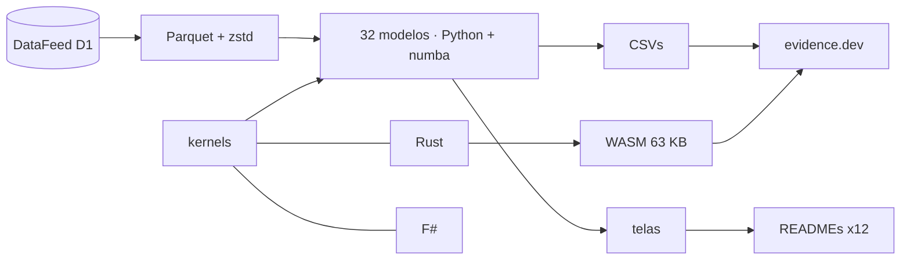

<!--
quant_models_2026
Autor: ProfBru - Bruno Penedo © 2026 - TODOS OS DIREITOS RESERVADOS
E-mail: profbruanbima@gmail.com

README GERADO — não editar à mão. Estrutura: montar_i18n.py · prosa: translation/blocos/<idioma>.json
Gerar: python3 public/foundations/pipeline/montar_i18n.py && python3 public/foundations/pipeline/gerar_readmes.py
-->

<div align="center">

# 📈 quant_models_2026 — 40 quantitative Modelle für Entscheidungen unter Unsicherheit


**ProfBru © 2026**

### Hören Sie auf, per Tabellenkalkulation zu wählen. Entscheiden Sie per Modell.

**32 Modelle auf 16 Jahren echter Daten, drei Engines (Python, Rust und F#), die Bit für Bit übereinstimmen, und ein Labor, das in Ihrem Browser läuft — jedes zeigt mit den Daten, wo die Intuition täuscht.**

[](#modelos)
[](#arquitetura)
[](#desempenho)
[](#site)

[](https://www.python.org)
[](https://numba.pydata.org)
[](https://www.rust-lang.org)
[](https://fsharp.org)
[](https://evidence.dev)
[](#licenca)

[Português](README.md) · [English](README.en.md) · [Español](README.es.md) · [Français](README.fr.md) · **Deutsch** · [中文](README.zh.md) · [한국어](README.ko.md) · [हिन्दी](README.hi.md) · [עברית](README.he.md) · [Русский](README.ru.md) · [Svenska](README.sv.md) · [Suomi](README.fi.md)

</div>

> [!WARNING]
> Verwenden Sie nur dieses Repository als Quelle. Die Ergebnisse hängen von den validierten DataFeed-Daten ab; kein Bildschirm ist eine Anlageempfehlung.

---

## 💀 Der Schmerz: Entscheiden per Tabellenkalkulation

Sie haben das schon getan. Sie haben eine Tabelle mit den Alternativen angelegt — Lieferanten, Smartphones für das Team, Elektroautos für den Fuhrpark, Anlagen für das Portfolio, Flugzeuge für eine Staffel —, jedes Kriterium bewertet, gewichtet, absteigend sortiert und den Ersten in die Besprechung gebracht. Die Tabelle stimmte. Die Entscheidung nicht.

**Die Tabellenkalkulation verrechnet sich nicht. Sie stellt die falsche Frage.**

| Was Sie getan haben | Was das Werkzeug verbarg |
|---|---|
| 🔻 **Nach dem Durchschnitt der Vergangenheit sortiert** | Der Durchschnitt von 2010–2019 wählte das beste Portfolio; 2020–2026 verlor es gegen Gleichgewichtung. Die Vergangenheit enthielt Rauschen, das die Spalte nicht zeigt. |
| 🏷️ **Nach dem Etikett gefiltert** | Sie haben zwischen Optionen derselben Kategorie „diversifiziert“, die sich gemeinsam bewegen — und zwischen verschiedenen Kategorien, die in den Daten dieselbe Gruppe bilden. |
| 🎯 **Der Trefferquote vertraut** | Ein Modell, das „zu 54 % richtig liegt“, wiederholte nur den Anteil der Aufwärtstage. Hohe Genauigkeit ohne Trennschärfe ist ein teurer Münzwurf. |

> [!IMPORTANT]
> **Der Fehler liegt nicht bei Ihnen. Er liegt am Werkzeug.**
> Tabellenkalkulationen, Bewertungsmatrizen und Rangfilter behandeln jede Zahl als sicher. Keines davon fragt, wie viel von dem, was Sie sehen, Rauschen ist, ob die Vergangenheit die Zukunft noch repräsentiert oder ob Ihre „beste Option“ einen Zeitraum überstehen würde, den sie nie gesehen hat.

Und es gibt einen Fehler, den Sie begehen, ohne es zu wissen: Je mehr Alternativen und Kombinationen Sie testen, desto besser wird das vergangene Ergebnis — aus purem Zufall. Der genetische Algorithmus dieses Projekts testete 1.826 Regeln auf einem Aktienindex; die beste glänzte im Training und verlor im folgenden Zeitraum gegen das bloße Halten der Position.

### Wo die Entscheidung zusammenbricht

In der Besprechung lautet die Frage, die die Empfehlung zu Fall bringt, nie „Wie ist die Note?“. Sie lautet anders:

> *Und wenn sich das Szenario ändert — wie viel davon hat dann noch Bestand?*

Die Tabellenkalkulation kann das nicht beantworten, weil sie nie Signal von Rauschen getrennt, nie außerhalb der Stichprobe getestet und nie ihre eigene Unsicherheit gemessen hat.

---

## 💊 Die Lösung

Jedes der 32 Modelle läuft auf 27 echten Anlagen von 2010 bis 2026, mit zeitlich getrenntem Training und Test, und endet mit einem Satz, der aus der Zahl geschrieben wird — auch wenn die Zahl der Intuition widerspricht.

> ### Drei unabhängige Engines — Python/numba, Rust und F# — berechnen dieselbe Mathematik und müssen Bit für Bit übereinstimmen. Zwei übereinstimmende Engines beweisen, dass die Rechnung stimmt, nicht nur der Code.

<div align="center">

| ❌ Tabellenkalkulation | ✅ Modell |
|---|---|
| Die Option mit der höchsten Durchschnittsnote | **Die Option, die außerhalb der Stichprobe besteht, mit ausgewiesenen Kosten und Risiken** |
| *„Diversifiziert“, weil die Kategorien verschieden sind* | **Diversifiziert, weil die Daten eine geringe Korrelation zwischen den Optionen zeigen** |

</div>

**Die Modelle sagen die Zukunft nicht mit Sicherheit voraus — und sagen das auch: Mehrere Ergebnisse hier zeigen, dass eine populäre Methode kein Signal hat. Das ist der Wert: zu wissen, wo man nicht vertrauen darf, bevor man Geld ausgibt.**

---

## 🎯 Wofür es dient — über den Markt hinaus

Die Beispiele nutzen Marktreihen, weil sie lang, öffentlich und unerbittlich sind. Die Techniken sind für jede Entscheidung unter Unsicherheit dieselben — die Wissensbasis des Projekts selbst zeigt das Marktrichtungsmodell bei der Vorhersage von Studienabbrüchen und den Anomaliedetektor beim Aufdecken von Betrug.

| Entscheidung | Modelle, die antworten | Die Frage, die die Tabellenkalkulation nicht beantwortet |
|---|---|---|
| 📊 **Anlageportfolio** | Regime (HMM), GARCH, Markowitz, Walk-forward-Backtest | Gilt die optimale Allokation der Vergangenheit auch im nächsten Regime? |
| 📱 **Unternehmenseinkauf — Geräte und Smartphones** | Benford, Ausreißer, K-Means, Drift | Ist der Preis dieses Lieferanten eine Anomalie, ein Tippfehler oder Betrug? Liefert der Lieferant von gestern noch dasselbe? |
| 🔋 **Elektroauto-Fuhrpark** | Bayes, GARCH, O-U-Monte-Carlo, nichtlineare Systeme | Mit nur wenigen Monaten Reichweiten- und Energiepreisdaten: Wie sehr kann man der prognostizierten Ersparnis trauen? |
| 🛡️ **Verteidigung — Beschaffung von Panzern und Flugzeugen** | Markow-Ketten, schwere Verteilungsenden, GA mit Nebenbedingungen, PCA | Welche Verfügbarkeit der Flotte ist zwischen Einsatz und Wartung zu erwarten, und was kostet der schlimmste Fall, nicht der Durchschnitt? |
| 🚀 **Startups und Führungsentscheidungen** | Bayes, Drift, SHAP, Walk-forward-Backtest | Gilt die im Pilotprojekt bestätigte Hypothese auch am Markt — und kann ich die Entscheidung dem Vorstand mit Zahlen erklären? |

> [!NOTE]
> Die Bildschirme und Zahlen in diesem Repository stammen aus Marktdaten. Die Anwendung auf einen anderen Bereich erfordert die Daten dieses Bereichs; Methoden, Validierungstests und die drei Engines bleiben dieselben.

---

## 🖼️ So funktioniert es

<a id="site"></a>

### 🌐 Website und Labor

Die Website wird mit evidence.dev erzeugt: SQL über die Ergebnisse, eine interaktive Seite pro Modell und ein Labor, in dem die Rust-Engine, nach WebAssembly kompiliert, in Ihrem Browser läuft — ohne Server und ohne Kosten pro Nutzer.

| | |
|---|---|
| <br/>**Schaufenster: ein Satz pro Modell**<br/>Jede Zeile ist die Lesart, die die Daten selbst erzeugt haben — auch die, die die populäre Technik widerlegen. | <br/>**Labor im Browser (WebAssembly)**<br/>216.000 Monte-Carlo-Pfade in etwa 3 Sekunden im Browser, mit derselben Engine, die die Übereinstimmungstests besteht. |
| <br/>**Modellseite: Steckbrief, Lesart und Diagramme**<br/>Die optimale Ausstiegsregel ergibt sich aus der gemessenen Dynamik des Brent − WTI-Spreads, nicht aus einem festen Prozentsatz. | <br/>**Drei Engines, ein Ergebnis**<br/>Gemessene Zeiten desselben Kernels in numba, Rust und F#, abzüglich des Prozessstarts. |

<a id="modelos"></a>

### 🧪 Die 32 Modelle, eines nach dem anderen

Jeder Bildschirm unten trägt die Entscheidungsfrage, die das Modell beantwortet, und die Lesart, die die Daten ergaben. Die übrigen 8 Modelle des Katalogs (Text, bestärkendes Lernen und Multi-Agenten-Simulation) sind in modelos_quant.md beschrieben.

### Statistik — was die Daten sind, bevor sie etwas vorhersagen

#### 01 · Robuste deskriptive Statistik

<div align="center"></div>

**Warum wählen:** Wählen Sie es, wenn Sie wissen müssen, ob der Durchschnitt den typischen Fall abbildet oder wenige Extreme die Rechnung verzerren.

> **Was die Daten zeigten:** Silber hat eine 1,6× größere Standardabweichung als sein robustes σ: Wenige extreme Tage blähen die „durchschnittliche“ Volatilität auf — Überschusskurtosis von 26,9.

#### 02 · Unterstützung und Widerstand per Modus + Clustering

<div align="center"></div>

**Warum wählen:** Wählen Sie es, wenn eine Preis- oder Budgetgrenze aus einem reproduzierbaren Kriterium stammen muss statt aus einer nach Augenmaß gezogenen Linie.

> **Was die Daten zeigten:** Gold: Der Modus der gerundeten Preise ist 3.330,00; das meistbesuchte Band (2.350,00–2.730,00) umfasst 24 % der Handelstage und wirkt heute als Unterstützung.

#### 03 · Stationarität (Augmented Dickey-Fuller)

<div align="center"></div>

**Warum wählen:** Wählen Sie es vor jeder Prognose: Es zeigt, ob die Vergangenheit noch eine gültige Stichprobe der Zukunft ist.

> **Was die Daten zeigten:** 1 von 8 Preisreihen ist auf 5-%-Niveau stationär; als Log-Rendite 8 von 8. Mit Preisen zu trainieren heißt, mit einer Verteilung zu trainieren, die nicht wiederkehrt.

#### 04 · Lineare Regression (KQ) zwischen Anlagen

<div align="center"></div>

**Warum wählen:** Wählen Sie es, um zu messen, wie viel eine Variable eine andere wirklich erklärt — und um festzustellen, dass die „offensichtliche“ Beziehung manchmal fast nichts erklärt.

> **Was die Daten zeigten:** Dow Jones ~ S&P 500: β = 0,91 bei R² = 0,91. US-Staatsanleihe ~ S&P 500 hat dagegen ein R² von 0,04: Die „offensichtliche“ Beziehung erklärt im Alltag fast nichts.

#### 13 · Ausreißer mit mehreren Methoden (IQR, robustes z, LOF)

<div align="center"></div>

**Warum wählen:** Wählen Sie es, wenn ein seltsamer Datenpunkt ein Erfassungsfehler oder das wichtigste Ereignis der Reihe sein kann: Der Konsens entscheidet.

> **Was die Daten zeigten:** Beim S&P 500 markiert der Boxplot 264 Tage als Ausreißer (6,7 % der Stichprobe); der Konsens dreier Methoden behält 101. Ein einziger abweichender Punkt ändert die Steigung der Geraden von 0,76 auf 0,53.

#### 31 · Newcomb-Benford-Gesetz — Datenintegrität

<div align="center"></div>

**Warum wählen:** Wählen Sie es, um einen Datenbestand zu prüfen, bevor Sie ihm trauen — mit dem Wissen, wann der Test greift und wann er Fehlalarm wäre.

> **Was die Daten zeigten:** Nur 21 der 29 Volumenreihen decken eine für den Test ausreichende Spannweite ab; Benford auf die übrigen anzuwenden, wäre Fehlalarm. Zusammengefasst decken die Volumina 6,4 Größenordnungen ab und ergeben eine MAD von 0,0099 (akzeptable Konformität).

#### 25 · Bedingte Volatilität (EWMA und GARCH(1,1))

<div align="center"></div>

**Warum wählen:** Wählen Sie es, um Risiko, Sicherheitsbestand oder Exposure-Limits nach dem Risiko von morgen zu bemessen, nicht nach dem Jahresdurchschnitt.

> **Was die Daten zeigten:** S&P 500: Persistenz α+β = 0,963 — ein Volatilitätsschock braucht 18 Handelstage, um die Hälfte seiner Kraft zu verlieren. 1-Tages-VaR 99 %: 1,75 %.

#### 24 · Nichtlineare Dynamik und schwere Verteilungsenden

<div align="center"></div>

**Warum wählen:** Wählen Sie es, wenn der schlimmste Fall mehr zählt als der Durchschnitt: Es misst, wie weit die echten Ränder die Normalverteilung übersteigen.

> **Was die Daten zeigten:** Bewegungen von 4 Standardabweichungen treten im Median 64× häufiger auf, als die Normalverteilung vorhersagt; die Rendite hat kaum Gedächtnis (Autokorrelation -0,02), die Größe der Bewegung schon (0,15).

#### 27 · Granger-Kausalität und Ansteckung

<div align="center"></div>

**Warum wählen:** Wählen Sie es, um „bewegen sich gemeinsam“ von „das eine geht dem anderen voraus“ zu trennen, bevor Sie einen Indikator als Auslöser nutzen.

> **Was die Daten zeigten:** Von 72 getesteten Paaren überstehen 7 die Bonferroni-Korrektur. Das stärkste, Euro/Dollar → Dollar-Index, ist ein Artefakt der Schlusszeiten unterschiedlicher Quellen: Statistische Vorzeitigkeit ist keine Ursache — und der Test zeigt genau, wo die Intuition getäuscht würde.

### Maschinelles Lernen — gemessen an der Basisrate

#### 05 · Logistische Regression der Richtung

<div align="center"></div>

**Warum wählen:** Wählen Sie es als ehrliche Basislinie jeder Ja/Nein-Klassifikation: Schlägt ein komplexes Modell sie nicht, bezahlt es seine eigenen Kosten nicht.

> **Was die Daten zeigten:** Außerhalb der Stichprobe (2016–2026) trifft die Logistik 54,2 % der Richtung des S&P 500 — praktisch den Anteil der Aufwärtstage (54,2 %): Sie sagte an 98 % der Tage einen Anstieg voraus und hat eine AUC von 0,492. Hohe Genauigkeit ohne Trennschärfe ist die Falle, die diese Basislinie entschärft.

#### 06 · SVM und Kernel-Methoden

<div align="center"></div>

**Warum wählen:** Wählen Sie es, wenn die Grenze zwischen „gut“ und „schlecht“ gekrümmt ist — und um zu prüfen, ob es überhaupt ein Signal gibt, bevor Sie für größere Modelle zahlen.

> **Was die Daten zeigten:** Mit nur RSI und Volatilität als Eingaben überschreitet keiner der vier Kernel 50,7 % balancierte Genauigkeit außerhalb der Stichprobe. Der RBF-Kernel „lernt“ im Training am meisten (53,2 %) und verliert im Test am meisten (48,4 %): Ein Kernel erzeugt kein Signal, wo keines ist.

#### 07 · Entscheidungsbäume und Random Forest

<div align="center"></div>

**Warum wählen:** Wählen Sie es, wenn die Entscheidung als Regeln erklärbar und auf tabellarischen Daten robust sein muss.

> **Was die Daten zeigten:** Ein Baum der Tiefe 20 trifft im Training 83,7 % und im Test 49,8 %: Er hat die Vergangenheit auswendig gelernt. Der flache Wald bleibt bei 53,5 % — bescheiden, aber ehrlich; das meistgenutzte Merkmal ist „ret_1“.

#### 08 · MLP-Neuronales Netz — Umkehrindikator

<div align="center"></div>

**Warum wählen:** Wählen Sie es für seltene Wendeereignisse und messen Sie die Trefferquote an der natürlichen Häufigkeit des Ereignisses, nicht an der Gesamtgenauigkeit.

> **Was die Daten zeigten:** Bei Silber gab das MLP 2023–2026 (im Training nie gesehen) 607 Signale für eine Aufwärtsumkehr mit 17,3 % Präzision ab, gegenüber einer Basisrate von 13,6 % (1,27× die natürliche Häufigkeit): Dieses Verhältnis, nicht die Gesamtgenauigkeit, zeigt, ob der Indikator Information liefert.

#### 09 · PCA — Risikofaktoren und Indizes

<div align="center"></div>

**Warum wählen:** Wählen Sie es, um herauszufinden, wie viele wirklich unabhängige Wetten in einer langen Optionsliste stecken.

> **Was die Daten zeigten:** Der 1. Faktor allein erklärt 24,5 % der täglichen Schwankung von 27 Anlagen; 12 Faktoren sind nötig, um 80 % zu erreichen. Die 27 Anlagen sind nicht 27 unabhängige Wetten.

#### 10 · Clustering von Anlagen (K-Means)

<div align="center"></div>

**Warum wählen:** Wählen Sie es, um Alternativen nach gemessenem Verhalten zu gruppieren, nicht nach dem Katalogetikett.

> **Was die Daten zeigten:** Die Silhouette wählt K = 4 Gruppen ohne manuellen Eingriff; eine Gruppe mischt 3 verschiedene Anlageklassen — das Etikett „Rohstoff“ oder „Währung“ sagt nicht, wie sich die Anlage verhält.

#### 11 · Rendite-Embeddings (FastICA) + Kosinus

<div align="center"></div>

**Warum wählen:** Wählen Sie es, um auf einer einzigen Karte zu sehen, wer sich gerade gemeinsam bewegt — in jedem Fenster aktualisiert.

> **Was die Daten zeigten:** In den letzten 60 Handelstagen ist das ähnlichste Paar Brent-Öl × WTI-Öl (Kosinus 0,96) und das gegensätzlichste Dollar-Index × Euro/Dollar (-0,89): eine Nähekarte, die sich in jedem Fenster aktualisiert.

#### 12 · Isolation Forest — anomale Renditen und Volumina

<div align="center"></div>

**Warum wählen:** Wählen Sie es, um das Anomale ohne gelabelte Beispiele zu finden: der erste Alarm, dass sich die Dynamik geändert hat.

> **Was die Daten zeigten:** Ohne ein einziges Label markiert der Isolationswald 77 Handelstage des S&P 500 als anomal — 21 davon allein 2020 — und 57 % davon sind Rückgänge: Die Anomalie ist ein Signal für veränderte Dynamik, kein Rauschen zum Aussortieren.

#### 32 · Erklärbarkeit mit Shapley-Werten (SHAP)

<div align="center"></div>

**Warum wählen:** Wählen Sie es, wenn jemand fragt „Warum hat das Modell so entschieden?“ und die Antwort Zahlen braucht, keinen Glauben.

> **Was die Daten zeigten:** In der letzten Prognose steigt die Wahrscheinlichkeit eines Anstiegs von 54,0 % (Modelldurchschnitt) auf 55,4 %; am stärksten wog das Merkmal „ret_1“ (+1,0 Pp.). Die Blackbox beginnt, das „Warum“ zu beantworten.

### Wahrscheinlichkeit und Signale — Regime, Unsicherheit und Zyklen

#### 14 · Markow-Kette der Regime (steigend, fallend, seitwärts)

<div align="center"></div>

**Warum wählen:** Wählen Sie es, um die Frage „In dieser Phase — wie wahrscheinlich ist der Wechsel in jene?“ mit einer prüfbaren Matrix zu beantworten.

> **Was die Daten zeigten:** Beim S&P 500 liegt nach einem fallenden 20-Tage-Block die Wahrscheinlichkeit für einen steigenden nächsten Block bei 59,0 % — höher als für ein Weiterfallen (30,8 %). Im Gleichgewicht verbringt der Markt 41,3 % der Zeit im Aufwärtsregime.

#### 15 · Verborgenes Markow-Modell (gaußsches HMM)

<div align="center"></div>

**Warum wählen:** Wählen Sie es, wenn Regime nicht beobachtbar sind und aus den Daten gelernt werden müssen, mit täglicher Wahrscheinlichkeit.

> **Was die Daten zeigten:** Ohne willkürliche Schwellenregel findet das HMM drei Regime im S&P 500: Das turbulente hat 43 % Volatilität pro Jahr gegenüber 7 % im ruhigen und dauert im Mittel 18 Handelstage. Heute ist das wahrscheinlichste Regime „ruhig“.

#### 16 · Bayes'sche Aktualisierung von Rendite und Volatilität

<div align="center"></div>

**Warum wählen:** Wählen Sie es, wenn es wenige Daten und viel Entscheidungsdruck gibt: Es sagt, wie sehr man dem Durchschnitt trauen kann, nicht nur, wie hoch er ist.

> **Was die Daten zeigten:** Gold seit 2019: Die durchschnittliche Jahresrendite a posteriori beträgt 15,3 %, doch das 95-%-Glaubwürdigkeitsintervall reicht von 2,3 % bis 28,4 %. Die Wahrscheinlichkeit, dass der Mittelwert positiv ist, liegt bei 98,9 % — der Stichprobenmittelwert (15,7 %) allein sagt das nicht.

#### 30 · Optimale Handelsregeln (Ornstein-Uhlenbeck)

<div align="center"></div>

**Warum wählen:** Wählen Sie es, um Ziel und Verlustgrenze aus der gemessenen Dynamik festzulegen statt aus übernommenen festen Prozentsätzen.

> **Was die Daten zeigten:** Der Brent − WTI-Spread kehrt mit einer Halbwertszeit von 22 Handelstagen zum Mittelwert zurück. Bei 4.000 simulierten Pfaden pro Zelle ist die beste Regel ein Ziel von 1,5σ mit einem Stopp bei 10,0σ (Sharpe pro Trade 0,63) — ein fester prozentualer Stopp ignoriert die Dynamik der Anlage.

#### 17 · Fourier-Transformation — dominante Zyklen

<div align="center"></div>

**Warum wählen:** Wählen Sie es, um zu beweisen, ob ein saisonaler Zyklus existiert oder Zufall ist — jedes Spektrum hat Spitzen.

> **Was die Daten zeigten:** Von den 12 größten Zyklusspitzen der vier Anlagen überschreiten nur 2 die 95-%-Rauschschwelle, die durch Mischen der eigenen Renditen gewonnen wurde. Jedes Periodogramm hat Spitzen; der Test sagt, welche Zyklen und welche Zufall sind.

#### 18 · Wavelets — Zeit-Frequenz-Zerlegung

<div align="center"></div>

**Warum wählen:** Wählen Sie es, um zeitlich zu verorten, wann die Turbulenz beginnt — was der Jahresdurchschnitt verbirgt.

> **Was die Daten zeigten:** Stufe 1 (Schwingungen über 2 Handelstage) enthält 55,0 % der Energie des S&P 500. Wenn die Hochfrequenzenergie explodiert (z > 2), ist die Streuung der Rendite der folgenden 20 Handelstage 1,3× so hoch wie normal: Das Wavelet verortet zeitlich, was Fourier nur im Durchschnitt sieht.

#### 23 · Hurst-Exponent und gleitender Hurst-Indikator

<div align="center"></div>

**Warum wählen:** Wählen Sie es, um zwischen Trend- und Umkehrstrategie zu entscheiden — im Vergleich mit der gedächtnislosen Referenz.

> **Was die Daten zeigten:** Das rohe R/S-H liegt zwischen 0,54 und 0,59 und wirkte „persistent“; gegenüber gemischten Reihen zeigt keine der 6 Anlagen echtes Gedächtnis. Der Kreuzungspunkt MH100 − MH150 schlägt den der gleitenden Durchschnitte bei 3 von 6 Anlagen nach Sharpe-Ratio.

### Optimierung und Governance — das Optimum, der Zufall und die Zeit

#### 19 · Effizienzgrenze nach Markowitz

<div align="center"></div>

**Warum wählen:** Wählen Sie es, um für jedes Risikoniveau die bestmögliche Rendite zu sehen — und wie stark dieses Optimum von fragilen Schätzungen abhängt.

> **Was die Daten zeigten:** Das Portfolio mit maximalem Sharpe hatte 2010–2019 eine Sharpe-Ratio von 1,19 und lieferte 2020–2026 0,76; die Gleichgewichtung stieg von 0,35 auf 0,94. Die Grenze ist für die Vergangenheit exakt — der Fehler liegt in der Schätzung von Mittelwerten, die die Zukunft nicht wiederholt.

#### 20 · Genetischer Algorithmus — Portfoliooptimierung

<div align="center"></div>

**Warum wählen:** Wählen Sie es, wenn das Ziel echte Nebenbedingungen hat (Kosten, Grenzen, maximale Verluste), die keine geschlossene Formel zulässt.

> **Was die Daten zeigten:** Vier parallele GA-Läufe mit verschiedenen Startwerten konvergieren zum selben Portfolio (mittlere Gewichtsabweichung 0,1 Pp.) mit einer Sharpe-Ratio von 1,19 in 2010–2019. 2020–2026 liefert es 0,86, unter der Gleichgewichtung (0,94): Konvergenz beweist, dass das Optimum stabil ist, nicht, dass die Zukunft es wiederholt.

#### 21 · Genetischer Algorithmus — Auswahl von Indikatoren und Parametern

<div align="center"></div>

**Warum wählen:** Wählen Sie es, um die beste Regelkombination zu suchen — und protokollieren Sie, wie viele getestet wurden, damit der Zufall Sie nicht täuscht.

> **Was die Daten zeigten:** Der GA testete 1826 verschiedene Regeln auf dem S&P 500, und die beste jedes Laufs hatte eine Trainings-Sharpe-Ratio von bis zu 0,78; 2019–2026 lagen sie zwischen 0,41 und 0,54, gegenüber 0,77 beim bloßen Halten. Je mehr Regeln man testet, desto höher die Trainings-Sharpe-Ratio aus purem Zufall.

#### 22 · Genetische Programmierung — symbolische Regression

<div align="center"></div>

**Warum wählen:** Wählen Sie es, um lesbare, prüfbare Formeln zu erfinden und sie einem nie gesehenen Zeitraum auszusetzen.

> **Was die Daten zeigten:** Die genetische Programmierung entdeckte lesbare Formeln wie ((sen(cos(r3)) + r1) + sen(sen(cos(r2)))) (10 Knoten), mit einer Rangkorrelation von -0,080 zur nächsten Rendite im Training und -0,028 im Test. Die Evolution findet in der Vergangenheit immer „etwas“; nur der nie gesehene Zeitraum trennt Indikator von Zufall.

#### 26 · Korrelationsnetzwerk und Zentralität

<div align="center"></div>

**Warum wählen:** Wählen Sie es, um zu sehen, wer im Zentrum und wer an der Peripherie eines Abhängigkeitssystems steht.

> **Was die Daten zeigten:** Vom Netzwerk 2010–2019 ausgewählt, blieben die 8 peripheren Anlagen 2020–2026 nahezu unabhängig (mittlere Korrelation 0,00 gegenüber 0,15 bei den zentralen) und erzielten mehr (11,0 % gegenüber 7,4 % p. a.), allerdings mit höherer Volatilität. Sieger über beide Körbe war das Portfolio mit allen 27 (Sharpe 0,95): Die Zahl unabhängiger Wetten wiegt mehr als die Position im Netzwerk.

#### 28 · Erkennung von Modell- und Konzeptdrift

<div align="center"></div>

**Warum wählen:** Wählen Sie es, um zu wissen, dass ein Modell gealtert ist, bevor der Verlust sichtbar wird.

> **Was die Daten zeigten:** Das auf 2010–2016 trainierte Modell verlangt in 8 der folgenden 10 Jahre ein Neutraining: Das Eingaberegime jenes Zeitraums kehrte nicht zurück. 2022 hatte die schlechteste Genauigkeit (43,8 %) und 2017 die größte Verschiebung (KS 0,77) — die Überwachung der Eingaben zeigt das Problem, ohne auf den Verlust zu warten.

#### 29 · Walk-forward-Backtest mit Kosten

<div align="center"></div>

**Warum wählen:** Wählen Sie es, um jede Entscheidungsregel gegen die Zeit zu testen, mit Kosten und vorab festgelegten Ablehnungsschwellen.

> **Was die Daten zeigten:** Bei Kosten von 5 Bp. pro Umschlag bestehen 2 von 4 Strategien die drei STOP-Schwellen (Gleichgewichtung, Risikoparität). Das Momentum-Fenster, jeden Monat allein aus der Vergangenheit gewählt, änderte sich 45-mal — der „optimale Parameter“ ist nicht konstant.


---

## ⚡ Installation

Voraussetzungen: Python 3.13, Rust 1.96 (mit dem Ziel wasm32-unknown-unknown), .NET 9 für die F#-Engine und Node 20+ für die Website. Die Daten stammen vom DataFeed Service Provider (Variable QUANT_MODELS_DATAFEED).

**1 · Daten und Modelle**

```bash
git clone <url-do-repositorio-privado> quant_models_2026
cd quant_models_2026/public/foundations/pipeline
pip install -r requisitos.txt
export QUANT_MODELS_DATAFEED=/mnt/d/DataFeedServiceProvider
python3 dados_feed.py consolidar --tf D1
python3 executar_modelos.py
```

**2 · Die drei Engines und die Übereinstimmung**

```bash
(cd ../rust/quant_models_2026_core && cargo build --release && cargo build --release --lib --target wasm32-unknown-unknown)
(cd ../fsharp/QuantModels2026.Core && dotnet build -c Release)
python3 testes_nucleo.py        # 38 verificações: numba × Rust × F#
```

**3 · Bildschirme und Website**

```bash
python3 gerar_telas.py && python3 gerar_site.py
cd ../evidence && npm ci && bash subir_servidor.sh     # http://localhost:3020
```

**4 · Lange Ausführung im Hintergrund (screen + 20-Minuten-Watchdog)**

```bash
./run_all.sh --background
screen -r quant_models_2026
```

---

<a id="arquitetura"></a>

## 🧠 Architektur und Entscheidungen



Architekturentscheidungen, jeweils mit ihrer Begründung:

| | |
|---|---|
| **Drei Engines mit demselben Pseudozufallsgenerator (xorshift64*)** | selbst der Monte-Carlo-Lauf stimmt Bit für Bit überein; ein mathematischer Fehler bleibt nicht in drei Sprachen gleichzeitig unbemerkt. |
| **WebAssembly ohne Abhängigkeiten (63 KB)** | die rechenintensive Arbeit läuft im Browser des Nutzers: keine Serverkosten, und keine Daten verlassen den Rechner. |
| **Training und Test immer zeitlich getrennt** | das Mischen von Zeitreihen lässt die Zukunft ins Training durchsickern und erzeugt Scheingenauigkeit. |
| **Schätzer gegen ihre eigene Nullhypothese verglichen** | Hurst und Fourier haben bekannte Verzerrungen; nur der Vergleich mit gemischten Daten trennt Signal von Artefakt. |
| **Lesart aus der Zahl geschrieben** | der Satz jedes Bildschirms wird aus dem Ergebnis erzeugt; ändert sich das Ergebnis, ändert sich der Satz mit. |
| **Parallelität mit ProcessPoolExecutor und fester Partitionierung** | das Ergebnis hängt nicht davon ab, wie viele Kerne der Rechner hat. |

---

<a id="desempenho"></a>

## 🚀 Gemessene Leistung

Zahlen gemessen mit bench_motores.py und im Projektverlauf protokolliert. Bei Rust und F# ist der Prozessstart abgezogen.

| Last | numba | Rust | F# | Reines Python |
|---|---:|---:|---:|---:|
| O-U-Monte-Carlo (20×20-Gitter, 2.000 Pfade) | 2,859 s | 2,840 s | 3,490 s | — |
| Gleitender R/S-Hurst (Fenster 250, 3.917 Handelstage) | 0,027 s | 0,016 s | 0,108 s | 7,86 s |
| Gaußsches HMM per EM (3 Zustände, 200 Iterationen) | 0,235 s | 0,308 s | 1,213 s | 64,19 s |
| Kennzahlen von 2.000 Portfolios × 10 Anlagen | 1,366 s | 1,297 s | 1,908 s | — |

Der kritische Pfad (20×20-Monte-Carlo-Gitter in numba) läuft in 3,4 s, bei einem Budget von 10 s und mit Nachweis eines Ergebnisses, das mit dem der Rust-Engine identisch ist.

---

## 📚 Vollständiger Katalog

Die 40 Modelle — Nummer, Typ, Kategorie und Beschreibung — stehen in modelos_quant.md, erzeugt aus derselben Quelle, die die Website speist. → [modelos_quant.md](modelos_quant.md)

---

## ❓ Schwierige Fragen

<details><summary><b>Ich nutze bereits eine Tabelle mit Gewichten und Filtern. Ist das nicht dasselbe?</b></summary>

Nein. Die Tabelle summiert Noten, die sie für sicher hält. Die Modelle messen, wie viel der Note Rauschen ist, testen die Wahl in einem nie gesehenen Zeitraum und zeigen, wann die beste Option der Vergangenheit aufhört, die beste zu sein.
</details>

<details><summary><b>Schlägt eines dieser Modelle „den Markt“?</b></summary>

Mehrere Ergebnisse dieses Repositorys zeigen für populäre Techniken genau das Gegenteil: Indikatoren und Kernel ohne tägliches Richtungssignal, ein langes Gedächtnis, das nur Schätzerverzerrung ist. Das zu wissen, bevor man Zeit und Geld investiert, ist das Ziel.
</details>

<details><summary><b>Warum drei Sprachen für dieselbe Rechnung?</b></summary>

Weil eine unabhängige zweite Engine, die mit der ersten übereinstimmt, die Mathematik beweist, und die dritte den Ausschlag gibt. In 38 Prüfungen stimmen alle drei Bit für Bit überein.
</details>

<details><summary><b>Brauche ich einen Server oder die Cloud?</b></summary>

Nein. Die Modelle laufen auf Ihrem Rechner und die Website ist statisch: Das Labor führt die Rust-Engine als WebAssembly im Browser aus.
</details>

<details><summary><b>Taugt es für Entscheidungen außerhalb der Finanzmärkte?</b></summary>

Die Methoden ja; die Daten müssen aus Ihrem Bereich stammen. Die Tabelle „Wofür es dient“ zeigt, welche Modelle welche Art von Entscheidung beantworten.
</details>

---

<a id="licenca"></a>

## 📜 Lizenz und Urheberschaft

Code, Modelle, Texte und Bildschirme: Nutzung dem Autor vorbehalten. Bibliotheken Dritter behalten ihre eigenen Lizenzen (NumPy, numba, scikit-learn, SciPy, pandas, networkx, matplotlib, evidence.dev).

**Autor:** ProfBru - Bruno Penedo © 2026 — TODOS OS DIREITOS RESERVADOS · profbruanbima@gmail.com

<div align="center">


**ProfBru © 2026**

</div>
