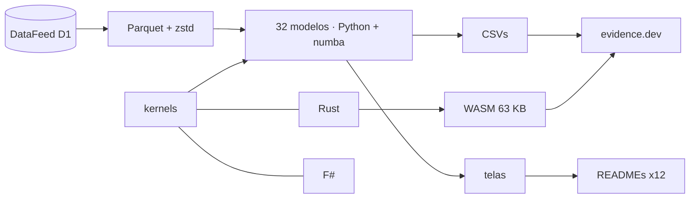

<!--
quant_models_2026
Autor: ProfBru - Bruno Penedo © 2026 - TODOS OS DIREITOS RESERVADOS
E-mail: profbruanbima@gmail.com

README GERADO — não editar à mão. Estrutura: montar_i18n.py · prosa: translation/blocos/<idioma>.json
Gerar: python3 public/foundations/pipeline/montar_i18n.py && python3 public/foundations/pipeline/gerar_readmes.py
-->

<div align="center">

# 📈 quant_models_2026 — 40 quantitative models for deciding under uncertainty


**ProfBru © 2026**

### Stop choosing by spreadsheet. Start deciding by model.

**32 models running on 16 years of real data, three engines (Python, Rust and F#) that agree bit for bit, and a lab that runs in your browser — each one showing, with the data, where intuition misleads.**

[](#modelos)
[](#arquitetura)
[](#desempenho)
[](#site)

[](https://www.python.org)
[](https://numba.pydata.org)
[](https://www.rust-lang.org)
[](https://fsharp.org)
[](https://evidence.dev)
[](#licenca)

[Português](README.md) · **English** · [Español](README.es.md) · [Français](README.fr.md) · [Deutsch](README.de.md) · [中文](README.zh.md) · [한국어](README.ko.md) · [हिन्दी](README.hi.md) · [עברית](README.he.md) · [Русский](README.ru.md) · [Svenska](README.sv.md) · [Suomi](README.fi.md)

</div>

> [!WARNING]
> Use only this repository as the source. Results depend on the validated DataFeed data; no screen is investment advice.

---

## 💀 The pain: deciding by spreadsheet

You have done this. You built a spreadsheet of alternatives — suppliers, phones for the team, electric cars for the fleet, assets for the portfolio, aircraft for a squadron —, scored each criterion, weighted them, sorted from highest to lowest and took the winner to the meeting. The spreadsheet was right. The decision was not.

**The spreadsheet does not get the arithmetic wrong. It gets the question wrong.**

| What you did | What the tool hid |
|---|---|
| 🔻 **Ranked by the past average** | The 2010–2019 average picked the best portfolio; in 2020–2026 it lost to equal weights. The past carried noise the column does not show. |
| 🏷️ **Filtered by the label** | You 'diversified' across options of the same category that move together — and across different categories that, in the data, form the same group. |
| 🎯 **Trusted the hit rate** | A model that is 'right 54% of the time' only repeated the share of up days. High accuracy without separating power is an expensive coin toss. |

> [!IMPORTANT]
> **The defect is not yours. It is the tool's.**
> Spreadsheets, scoring matrices and ranking filters treat every number as certain. None of them asks how much of what you see is noise, whether the past still represents the future, or whether your 'best option' would survive a period it has never seen.

And there is a mistake you make without knowing it: the more alternatives and combinations you test, the better the past result gets — by pure chance. This project's genetic algorithm tested 1,826 rules on a stock index; the best one shone in training and, in the following period, lost to simply holding the position.

### Where the decision collapses

In the meeting, the question that brings down the recommendation is never 'what is the score?'. It is another one:

> *And if the scenario changes — how much of this still stands?*

The spreadsheet cannot answer, because it never separated signal from noise, never tested out of sample and never measured its own uncertainty.

---

## 💊 The solution

Each of the 32 models runs on 27 real assets from 2010 to 2026, with training and testing separated in time, and ends with a sentence written from the number — including when the number contradicts intuition.

> ### Three independent engines — Python/numba, Rust and F# — compute the same mathematics and must agree bit for bit. Two engines that agree prove the math is right, not just the code.

<div align="center">

| ❌ Spreadsheet | ✅ Model |
|---|---|
| The option with the highest average score | **The option that survives out of sample, with cost and risk stated** |
| *'Diversified' because the categories differ* | **Diversified because the data shows low correlation between the choices** |

</div>

**The models do not predict the future with certainty — and they say so: several results here show that a popular method carries no signal. That is the value: knowing where not to trust before spending.**

---

## 🎯 What it is for — beyond the market

The examples use market series because they are long, public and unforgiving. The techniques are the same for any decision under uncertainty — the project's own knowledge base shows the market-direction model predicting student dropout and the anomaly detector flagging fraud.

| Decision | Models that answer | The question the spreadsheet cannot answer |
|---|---|---|
| 📊 **Investment portfolio** | regimes (HMM), GARCH, Markowitz, walk-forward backtest | Does the past optimal allocation hold in the next regime? |
| 📱 **Corporate procurement — equipment and phones** | Benford, outliers, K-means, drift | Is this supplier's price an anomaly, a typo or fraud? Does yesterday's supplier still deliver the same? |
| 🔋 **Electric car fleet** | Bayes, GARCH, O-U Monte Carlo, non-linear systems | With only a few months of range and energy-price data, how much should you trust the projected savings? |
| 🛡️ **Defense — acquiring tanks and aircraft** | Markov chains, heavy tails, constrained GA, PCA | What fleet availability should we expect between operation and maintenance, and what is the cost in the worst case, not the average one? |
| 🚀 **Startups and executive decisions** | Bayes, drift, SHAP, walk-forward backtest | Does the hypothesis validated in the pilot still hold in the market — and can I explain the decision to the board with numbers? |

> [!NOTE]
> The screens and figures in this repository come from market data. Applying them to another domain requires that domain's data; the methods, the validation tests and the three engines are the same.

---

## 🖼️ See it working

<a id="site"></a>

### 🌐 The site and the lab

The site is built with evidence.dev: SQL over the results, one interactive page per model and a lab where the Rust engine, compiled to WebAssembly, runs in your browser — no server and no per-user cost.

| | |
|---|---|
| <br/>**Showcase: one sentence per model**<br/>Each line is the reading the data itself produced — including those that refute the popular technique. | <br/>**In-browser lab (WebAssembly)**<br/>216 thousand Monte Carlo paths in about 3 seconds, in the browser, with the same engine that passes the agreement tests. |
| <br/>**Model page: profile, reading and charts**<br/>The optimal exit rule comes from the measured dynamics of the Brent − WTI spread, not from a fixed percentage. | <br/>**Three engines, one result**<br/>Measured times of the same kernel in numba, Rust and F#, with process start-up subtracted. |

<a id="modelos"></a>

### 🧪 The 32 models, one by one

Each screen below carries the decision question the model answers and the reading the data produced. The remaining 8 models of the catalog (text, reinforcement learning and multi-agent simulation) are described in modelos_quant.md.

### Statistics — what the data is, before what it predicts

#### 01 · Robust descriptive statistics

<div align="center"></div>

**Why choose it:** Choose it when you need to know whether the average represents the typical case or a few extremes distort the figure.

> **What the data showed:** Silver has a standard deviation 1.6× larger than its robust σ: a few extreme days inflate the 'average' volatility — excess kurtosis of 26.9.

#### 02 · Support and resistance by mode + clustering

<div align="center"></div>

**Why choose it:** Choose it when a price or budget limit must come from a reproducible criterion, not from a line drawn by eye.

> **What the data showed:** Gold: the mode of rounded prices is 3,330.00; the most visited band (2,350.00–2,730.00) holds 24% of the sessions and now acts as support.

#### 03 · Stationarity (Augmented Dickey-Fuller)

<div align="center"></div>

**Why choose it:** Choose it before any forecast: it tells whether the past is still a valid sample of the future.

> **What the data showed:** 1 of 8 price series is stationary at 5%; in log returns, 8 of 8. Training on prices is training on a distribution that does not come back.

#### 04 · Linear regression (OLS) between assets

<div align="center"></div>

**Why choose it:** Choose it to measure how much one variable really explains another — and to find out that the 'obvious' relationship sometimes explains almost nothing.

> **What the data showed:** Dow Jones ~ S&P 500: β = 0.91 with R² = 0.91. US Treasury ~ S&P 500, however, has an R² of 0.04: the 'obvious' relationship explains almost nothing day to day.

#### 13 · Multi-method outliers (IQR, robust z, LOF)

<div align="center"></div>

**Why choose it:** Choose it when a strange data point may be a collection error or the most important event in the series: consensus decides.

> **What the data showed:** On the S&P 500, the boxplot flags 264 days as outliers (6.7% of the sample); the three-method consensus keeps 101. A single discrepant point changes the slope of the line from 0.76 to 0.53.

#### 31 · Newcomb-Benford law — data integrity

<div align="center"></div>

**Why choose it:** Choose it to audit a set of values before trusting it, knowing when the test applies and when it would be a false alarm.

> **What the data showed:** Only 21 of the 29 volume series span enough range for the test; applying Benford to the others would be a false alarm. Aggregated, the volumes span 6.4 orders of magnitude and give a MAD of 0.0099 (acceptable conformity).

#### 25 · Conditional volatility (EWMA and GARCH(1,1))

<div align="center"></div>

**Why choose it:** Choose it to size risk, safety stock or exposure limits by tomorrow's risk, not by the year's average.

> **What the data showed:** S&P 500: persistence α+β = 0.963 — a volatility shock takes 18 sessions to lose half its strength. 1-day 99% VaR: 1.75%.

#### 24 · Non-linear dynamics and heavy tails

<div align="center"></div>

**Why choose it:** Choose it when the worst case matters more than the average case: it measures how much the real tails exceed the normal curve.

> **What the data showed:** 4-standard-deviation moves happen, in median, 64× more often than the normal curve predicts; the return has almost no memory (autocorrelation -0.02), but the size of the move does (0.15).

#### 27 · Granger causality and contagion

<div align="center"></div>

**Why choose it:** Choose it to separate 'move together' from 'one precedes the other' before using an indicator as a trigger.

> **What the data showed:** Of the 72 pairs tested, 7 survive the Bonferroni correction. The strongest, Euro/Dollar → Dollar Index, is an artifact of closing times between different sources: statistical precedence is not cause — and the test shows exactly where intuition would be fooled.

### Machine learning — measured against the base rate

#### 05 · Directional logistic regression

<div align="center"></div>

**Why choose it:** Choose it as the honest baseline for every yes/no classification: if a complex model cannot beat it, it does not pay its own cost.

> **What the data showed:** Out of sample (2016–2026) the logistic model gets 54.2% of the S&P 500 direction right — practically the share of up days (54.2%): it predicted up on 98% of days and has an AUC of 0.492. High accuracy without separating power is the trap this baseline defuses.

#### 06 · SVM and kernel methods

<div align="center"></div>

**Why choose it:** Choose it when the boundary between 'good' and 'bad' is curved — and to prove whether a signal exists before paying for bigger models.

> **What the data showed:** With only RSI and volatility as inputs, none of the four kernels exceeds 50.7% balanced accuracy out of sample. RBF is the one that 'learns' most in training (53.2%) and loses most in testing (48.4%): a kernel does not create signal where there is none.

#### 07 · Decision trees and Random Forest

<div align="center"></div>

**Why choose it:** Choose it when the decision must be explainable as rules and robust on tabular data.

> **What the data showed:** A depth-20 tree gets 83.7% right in training and 49.8% in testing: it memorized the past. The shallow forest stays at 53.5% — modest but honest; the most used attribute is 'ret_1'.

#### 08 · MLP neural network — reversal indicator

<div align="center"></div>

**Why choose it:** Choose it for rare turning events, measuring the hit rate against the event's natural frequency, not against overall accuracy.

> **What the data showed:** On silver, in 2023–2026 (never seen in training), the MLP issued 607 upward-reversal signals with 17.3% precision, against a base rate of 13.6% (1.27× the natural frequency): that ratio, not overall accuracy, says whether the indicator adds information.

#### 09 · PCA — risk factors and indices

<div align="center"></div>

**Why choose it:** Choose it to find out how many truly independent bets exist inside a long list of options.

> **What the data showed:** The 1st factor alone explains 24.5% of the daily variation of 27 assets; 12 factors are needed to reach 80%. The 27 assets are not 27 independent bets.

#### 10 · Asset clustering (K-means)

<div align="center"></div>

**Why choose it:** Choose it to group alternatives by measured behavior, not by the catalog label.

> **What the data showed:** The silhouette picks K = 4 groups without manual intervention; one group mixes 3 different asset classes — the 'commodity' or 'currency' label does not say how the asset behaves.

#### 11 · Return embeddings (FastICA) + cosine

<div align="center"></div>

**Why choose it:** Choose it to see, on a single map, who is moving together right now — updated every window.

> **What the data showed:** Over the last 60 sessions, the most similar pair is Brent crude × WTI crude (cosine 0.96) and the most opposite is the Dollar Index × Euro/Dollar (-0.89): a proximity map that updates every window.

#### 12 · Isolation Forest — abnormal returns and volumes

<div align="center"></div>

**Why choose it:** Choose it to find the abnormal without labeled examples: the first alarm that the dynamics have changed.

> **What the data showed:** Without a single label, the isolation forest flags 77 S&P 500 sessions as anomalous — 21 in 2020 alone — and 57% of them are drops: the anomaly is a signal of changing dynamics, not noise to discard.

#### 32 · Explainability with Shapley values (SHAP)

<div align="center"></div>

**Why choose it:** Choose it when someone asks 'why did the model decide this?' and the answer needs numbers, not faith.

> **What the data showed:** In the latest forecast, the probability of a rise goes from 54.0% (model average) to 55.4%; the attribute that weighed most was 'ret_1' (+1.0 p.p.). The black box starts answering 'why'.

### Probability and signals — regimes, uncertainty and cycles

#### 14 · Markov chain of regimes (up, down, sideways)

<div align="center"></div>

**Why choose it:** Choose it to answer 'being in this phase, what is the chance of moving to that one?' with an auditable matrix.

> **What the data showed:** On the S&P 500, being in a down 20-session block, the chance that the next block is up is 59.0% — higher than staying down (30.8%). In equilibrium, the market spends 41.3% of the time in an up regime.

#### 15 · Hidden Markov model (Gaussian HMM)

<div align="center"></div>

**Why choose it:** Choose it when regimes cannot be observed and must be learned from the data, with a daily probability.

> **What the data showed:** With no arbitrary cut-off rule, the HMM finds three regimes in the S&P 500: the turbulent one has 43% annual volatility against 7% in the calm one and lasts 18 sessions on average. Today the most likely regime is 'calm'.

#### 16 · Bayesian update of return and volatility

<div align="center"></div>

**Why choose it:** Choose it when there is little data and a lot of pressure to decide: it says how much to trust the average, not just what the average is.

> **What the data showed:** Gold since 2019: the posterior average annual return is 15.3%, but the 95% credible interval runs from 2.3% to 28.4%. The probability that the mean is positive is 98.9% — the sample mean (15.7%) alone does not say that.

#### 30 · Optimal trading rules (Ornstein-Uhlenbeck)

<div align="center"></div>

**Why choose it:** Choose it to set the target and the loss limit from the measured dynamics, instead of inherited fixed percentages.

> **What the data showed:** The Brent − WTI spread reverts to the mean with a half-life of 22 sessions. Simulating 4,000 paths per cell, the best rule is a 1.5σ target with a 10.0σ stop (Sharpe per trade 0.63) — a fixed percentage stop ignores the asset's dynamics.

#### 17 · Fourier transform — dominant cycles

<div align="center"></div>

**Why choose it:** Choose it to prove whether a seasonal cycle exists or is chance — every spectrum has peaks.

> **What the data showed:** Of the 12 largest cycle peaks across the four assets, only 2 exceed the 95% noise threshold obtained by shuffling the returns themselves. Every periodogram has peaks; the test says which are cycles and which are chance.

#### 18 · Wavelets — time-frequency decomposition

<div align="center"></div>

**Why choose it:** Choose it to locate in time when turbulence begins, which the annual average hides.

> **What the data showed:** Level 1 (2-session oscillations) holds 55.0% of the S&P 500's energy. When high-frequency energy explodes (z > 2), the dispersion of the next 20 sessions' return is 1.3× normal: the wavelet locates in time what Fourier only sees on average.

#### 23 · Hurst exponent and rolling Hurst indicator

<div align="center"></div>

**Why choose it:** Choose it to decide between trend and mean-reversion strategies — comparing against the memoryless reference.

> **What the data showed:** The raw R/S H lies between 0.54 and 0.59 and would look 'persistent'; against shuffled series, none of the 6 assets shows real memory. The MH100 − MH150 crossover beats the moving-average crossover in 3 of 6 assets by Sharpe ratio.

### Optimization and governance — the optimum, chance and time

#### 19 · Markowitz efficient frontier

<div align="center"></div>

**Why choose it:** Choose it to see the best possible return for each level of risk — and how much that optimum depends on fragile estimates.

> **What the data showed:** The maximum-Sharpe portfolio had a Sharpe of 1.19 in 2010–2019 and delivered 0.76 in 2020–2026; equal weights went from 0.35 to 0.94. The frontier is exact about the past — the error lies in estimating means the future does not repeat.

#### 20 · Genetic algorithm — portfolio optimization

<div align="center"></div>

**Why choose it:** Choose it when the objective has real constraints (costs, limits, maximum losses) that no closed-form formula accepts.

> **What the data showed:** Four parallel GA runs, with different seeds, converge to the same portfolio (average weight deviation of 0.1 p.p.) with a Sharpe of 1.19 in 2010–2019. In 2020–2026 it delivers 0.86, below equal weights (0.94): convergence proves the optimum is stable, not that the future will repeat it.

#### 21 · Genetic algorithm — selection of indicators and parameters

<div align="center"></div>

**Why choose it:** Choose it to search for the best combination of rules — recording how many were tested so chance does not fool you.

> **What the data showed:** The GA tested 1826 distinct rules on the S&P 500 and the best of each run had a training Sharpe of up to 0.78; in 2019–2026 they stayed between 0.41 and 0.54, against 0.77 for simply staying long. The more rules you test, the higher the training Sharpe by pure chance.

#### 22 · Genetic programming — symbolic regression

<div align="center"></div>

**Why choose it:** Choose it to invent readable, auditable formulas and submit them to a period never seen.

> **What the data showed:** Genetic programming discovered readable formulas such as ((sen(cos(r3)) + r1) + sen(sen(cos(r2)))) (10 nodes), with a rank correlation of -0.080 with the next return in training and -0.028 in testing. Evolution always finds 'something' in the past; only the unseen period separates indicator from coincidence.

#### 26 · Correlation network and centrality

<div align="center"></div>

**Why choose it:** Choose it to see who sits at the center and who is on the periphery of a system of dependencies.

> **What the data showed:** Chosen by the 2010–2019 network, the 8 peripheral assets stayed almost independent in 2020–2026 (average correlation 0.00 against 0.15 for the central ones) and returned more (11.0% against 7.4% p.a.), but with more volatility. The winner over both baskets was the portfolio with all 27 (Sharpe 0.95): the number of independent bets weighs more than position in the network.

#### 28 · Model and concept drift detection

<div align="center"></div>

**Why choose it:** Choose it to know a model has aged before the loss shows up.

> **What the data showed:** The model trained on 2010–2016 calls for retraining in 8 of the following 10 years: the input regime of that period did not return. 2022 had the worst accuracy (43.8%) and 2017 the largest shift (KS 0.77) — monitoring the input reveals the problem without waiting for the loss.

#### 29 · Walk-forward backtest with costs

<div align="center"></div>

**Why choose it:** Choose it to test any decision rule against time, with costs and rejection gates declared up front.

> **What the data showed:** With costs of 5 bps per turnover, 2 of 4 strategies pass the three STOP gates (Equal weights, Risk parity). The momentum window, chosen each month using only the past, changed 45 times — the 'optimal parameter' is not constant.


---

## ⚡ Installation

Prerequisites: Python 3.13, Rust 1.96 (with the wasm32-unknown-unknown target), .NET 9 for the F# engine and Node 20+ for the site. The data comes from the DataFeed Service Provider (variable QUANT_MODELS_DATAFEED).

**1 · Data and models**

```bash
git clone <url-do-repositorio-privado> quant_models_2026
cd quant_models_2026/public/foundations/pipeline
pip install -r requisitos.txt
export QUANT_MODELS_DATAFEED=/mnt/d/DataFeedServiceProvider
python3 dados_feed.py consolidar --tf D1
python3 executar_modelos.py
```

**2 · The three engines and the agreement test**

```bash
(cd ../rust/quant_models_2026_core && cargo build --release && cargo build --release --lib --target wasm32-unknown-unknown)
(cd ../fsharp/QuantModels2026.Core && dotnet build -c Release)
python3 testes_nucleo.py        # 38 verificações: numba × Rust × F#
```

**3 · Screens and site**

```bash
python3 gerar_telas.py && python3 gerar_site.py
cd ../evidence && npm ci && bash subir_servidor.sh     # http://localhost:3020
```

**4 · Long background run (screen + 20-minute watchdog)**

```bash
./run_all.sh --background
screen -r quant_models_2026
```

---

<a id="arquitetura"></a>

## 🧠 Architecture and decisions



Architecture decisions, each with the reason behind it:

| | |
|---|---|
| **Three engines with the same pseudo-random generator (xorshift64*)** | even the Monte Carlo matches bit for bit; a math error cannot slip through three languages at once. |
| **Dependency-free WebAssembly (63 KB)** | the heavy computation runs in the user's browser: zero server cost and no data leaves the machine. |
| **Training and testing separated in time, always** | shuffling time series leaks the future into training and fabricates accuracy. |
| **Estimators compared against their own null** | Hurst and Fourier have known biases; only the comparison with shuffled data separates signal from artifact. |
| **Reading written from the number** | each screen's sentence is generated from the result; when the result changes, the sentence changes with it. |
| **Parallelism with ProcessPoolExecutor and a fixed partition** | the result does not depend on how many cores the machine has. |

---

<a id="desempenho"></a>

## 🚀 Measured performance

Figures measured with bench_motores.py and recorded in the project history. Rust and F# have process start-up subtracted.

| Workload | numba | Rust | F# | Pure Python |
|---|---:|---:|---:|---:|
| O-U Monte Carlo (20×20 grid, 2,000 paths) | 2.859 s | 2.840 s | 3.490 s | — |
| Rolling R/S Hurst (window 250, 3,917 sessions) | 0.027 s | 0.016 s | 0.108 s | 7.86 s |
| Gaussian HMM EM (3 states, 200 iterations) | 0.235 s | 0.308 s | 1.213 s | 64.19 s |
| Metrics for 2,000 portfolios × 10 assets | 1.366 s | 1.297 s | 1.908 s | — |

The critical path (20×20 Monte Carlo grid in numba) runs in 3.4 s, with a 10 s budget and proof of a result identical to the Rust engine's.

---

## 📚 Full catalog

The 40 models — number, type, category and description — are in modelos_quant.md, generated from the same source that feeds the site. → [modelos_quant.md](modelos_quant.md)

---

## ❓ Hard questions

<details><summary><b>I already use a spreadsheet with weights and filters. Isn't that the same?</b></summary>

No. The spreadsheet adds up scores it treats as certain. The models measure how much of the score is noise, test the choice in a period it has never seen and show when the past best option stops being the best.
</details>

<details><summary><b>Does any of these models 'beat the market'?</b></summary>

Several results in this repository show exactly the opposite for popular techniques: indicators and kernels with no daily direction signal, long memory that is estimator bias. Knowing this before investing time and money is the point.
</details>

<details><summary><b>Why three languages for the same calculation?</b></summary>

Because an independent second engine that agrees with the first proves the math, and the third breaks ties. Across 38 checks, the three agree bit for bit.
</details>

<details><summary><b>Do I need a server or the cloud?</b></summary>

No. The models run on your machine and the site is static: the lab executes the Rust engine in WebAssembly inside the browser.
</details>

<details><summary><b>Does it work for decisions outside financial markets?</b></summary>

The methods do; the data must come from your domain. The 'What it is for' table shows which models answer each type of decision.
</details>

---

<a id="licenca"></a>

## 📜 License and authorship

Code, models, texts and screens: use restricted to the author. Third-party libraries keep their own licenses (NumPy, numba, scikit-learn, SciPy, pandas, networkx, matplotlib, evidence.dev).

**Author:** ProfBru - Bruno Penedo © 2026 — TODOS OS DIREITOS RESERVADOS · profbruanbima@gmail.com

<div align="center">


**ProfBru © 2026**

</div>
