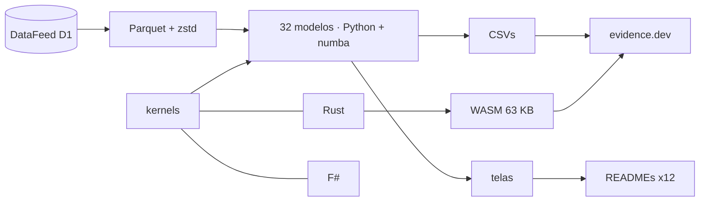

<!--
quant_models_2026
Autor: ProfBru - Bruno Penedo © 2026 - TODOS OS DIREITOS RESERVADOS
E-mail: profbruanbima@gmail.com

README GERADO — não editar à mão. Estrutura: montar_i18n.py · prosa: translation/blocos/<idioma>.json
Gerar: python3 public/foundations/pipeline/montar_i18n.py && python3 public/foundations/pipeline/gerar_readmes.py
-->

<div align="center">

# 📈 quant_models_2026 — 40 modelos cuantitativos para decidir bajo incertidumbre


**ProfBru © 2026**

### Deje de elegir con hojas de cálculo. Empiece a decidir con modelos.

**32 modelos ejecutándose sobre 16 años de datos reales, tres motores (Python, Rust y F#) que coinciden bit a bit y un laboratorio que corre en su navegador — cada uno mostrando, con el dato, dónde engaña la intuición.**

[](#modelos)
[](#arquitetura)
[](#desempenho)
[](#site)

[](https://www.python.org)
[](https://numba.pydata.org)
[](https://www.rust-lang.org)
[](https://fsharp.org)
[](https://evidence.dev)
[](#licenca)

[Português](README.md) · [English](README.en.md) · **Español** · [Français](README.fr.md) · [Deutsch](README.de.md) · [中文](README.zh.md) · [한국어](README.ko.md) · [हिन्दी](README.hi.md) · [עברית](README.he.md) · [Русский](README.ru.md) · [Svenska](README.sv.md) · [Suomi](README.fi.md)

</div>

> [!WARNING]
> Use solo este repositorio como fuente. Los resultados dependen de los datos validados del DataFeed; ninguna pantalla es una recomendación de inversión.

---

## 💀 El dolor: decidir con hojas de cálculo

Usted ya lo hizo. Armó una hoja de cálculo con las alternativas — proveedores, celulares para el equipo, autos eléctricos para la flota, activos para la cartera, aeronaves para un escuadrón —, puso nota a cada criterio, ponderó, ordenó de mayor a menor y llevó al primero a la reunión. La hoja estaba bien. La decisión, no.

**La hoja de cálculo no se equivoca en la cuenta. Se equivoca en la pregunta.**

| Lo que usted hizo | Lo que la herramienta ocultó |
|---|---|
| 🔻 **Ordenó por el promedio del pasado** | El promedio de 2010–2019 eligió la mejor cartera; en 2020–2026 perdió frente a los pesos iguales. El pasado traía ruido que la columna no muestra. |
| 🏷️ **Filtró por la etiqueta** | 'Diversificó' entre opciones de la misma categoría que se mueven juntas — y entre categorías distintas que, en el dato, forman el mismo grupo. |
| 🎯 **Confió en la tasa de acierto** | Un modelo que 'acierta el 54%' solo repetía la fracción de días al alza. Una exactitud alta sin poder de separación es un sorteo caro. |

> [!IMPORTANT]
> **El defecto no es suyo. Es de la herramienta.**
> Las hojas de cálculo, las matrices de puntuación y los filtros de clasificación tratan cada número como cierto. Ninguno pregunta cuánto de lo que usted ve es ruido, si el pasado todavía representa el futuro o si su 'mejor opción' sobreviviría a un período que nunca vio.

Y hay un error que usted comete sin saberlo: cuantas más alternativas y combinaciones prueba, mejor queda el resultado del pasado — por puro azar. El algoritmo genético de este proyecto probó 1.826 reglas sobre un índice bursátil; la mejor brilló en el entrenamiento y, en el período siguiente, perdió frente a simplemente mantener la posición.

### Dónde se derrumba la decisión

En la reunión, la pregunta que derriba la recomendación nunca es '¿cuál es la nota?'. Es otra:

> *Y si el escenario cambia, ¿cuánto de esto sigue en pie?*

La hoja de cálculo no puede responder, porque nunca separó señal de ruido, nunca probó fuera de muestra y nunca midió su propia incertidumbre.

---

## 💊 La solución

Cada uno de los 32 modelos corre sobre 27 activos reales de 2010 a 2026, con entrenamiento y prueba separados en el tiempo, y termina con una frase escrita a partir del número — incluso cuando el número desmiente la intuición.

> ### Tres motores independientes — Python/numba, Rust y F# — calculan la misma matemática y deben coincidir bit a bit. Dos motores que coinciden prueban que la cuenta está bien, no solo el código.

<div align="center">

| ❌ Hoja de cálculo | ✅ Modelo |
|---|---|
| La opción con la mayor nota promedio | **La opción que sobrevive fuera de muestra, con costo y riesgo declarados** |
| *'Diversificado' porque las categorías son distintas* | **Diversificado porque el dato muestra baja correlación entre las opciones** |

</div>

**Los modelos no predicen el futuro con certeza — y lo dicen: varios resultados aquí muestran que un método popular no tiene señal. Ese es el valor: saber dónde no confiar antes de gastar.**

---

## 🎯 Para qué sirve — más allá del mercado

Los ejemplos usan series de mercado porque son largas, públicas e implacables. Las técnicas son las mismas para cualquier decisión bajo incertidumbre — la propia base de conocimiento del proyecto muestra el modelo de dirección de mercado prediciendo deserción escolar y el detector de anomalías señalando fraude.

| Decisión | Modelos que responden | La pregunta que la hoja de cálculo no responde |
|---|---|---|
| 📊 **Cartera de inversiones** | regímenes (HMM), GARCH, Markowitz, backtest walk-forward | ¿La asignación óptima del pasado vale para el próximo régimen? |
| 📱 **Compras corporativas — equipos y celulares** | Benford, valores atípicos, K-means, deriva | ¿El precio de este proveedor es una anomalía, un error de digitación o un fraude? ¿El proveedor de ayer sigue entregando lo mismo? |
| 🔋 **Flota de autos eléctricos** | Bayes, GARCH, Monte Carlo O-U, sistemas no lineales | Con pocos meses de datos de autonomía y de precio de la energía, ¿cuánto confiar en el ahorro proyectado? |
| 🛡️ **Defensa — adquisición de tanques y aeronaves** | cadenas de Markov, colas pesadas, AG con restricciones, PCA | ¿Qué disponibilidad esperar de la flota entre operación y mantenimiento, y cuál es el costo en el peor escenario, no en el promedio? |
| 🚀 **Startups y decisiones ejecutivas** | Bayes, deriva, SHAP, backtest walk-forward | ¿La hipótesis validada en el piloto sigue siendo válida en el mercado — y puedo explicar la decisión al directorio con números? |

> [!NOTE]
> Las pantallas y cifras de este repositorio provienen de datos de mercado. Aplicarlas a otro dominio exige los datos de ese dominio; los métodos, las pruebas de validación y los tres motores son los mismos.

---

## 🖼️ Véalo funcionando

<a id="site"></a>

### 🌐 El sitio y el laboratorio

El sitio se genera con evidence.dev: SQL sobre los resultados, una página interactiva por modelo y un laboratorio en el que el motor Rust, compilado a WebAssembly, corre en su navegador — sin servidor y sin costo por usuario.

| | |
|---|---|
| <br/>**Vitrina: una frase por modelo**<br/>Cada línea es la lectura que el propio dato produjo — incluidas las que desmienten la técnica popular. | <br/>**Laboratorio en el navegador (WebAssembly)**<br/>216 mil trayectorias de Monte Carlo en unos 3 segundos, en el navegador, con el mismo motor que pasa las pruebas de concordancia. |
| <br/>**Página de modelo: ficha, lectura y gráficos**<br/>La regla óptima de salida surge de la dinámica medida del spread Brent − WTI, no de un porcentaje fijo. | <br/>**Tres motores, un resultado**<br/>Tiempos medidos del mismo kernel en numba, Rust y F#, con el arranque del proceso descontado. |

<a id="modelos"></a>

### 🧪 Los 32 modelos, uno por uno

Cada pantalla a continuación tiene la pregunta de decisión que el modelo responde y la lectura que produjo el dato. Los 8 modelos restantes del catálogo (texto, aprendizaje por refuerzo y simulación multiagente) se describen en modelos_quant.md.

### Estadística — qué es el dato, antes de qué predice

#### 01 · Estadística descriptiva robusta

<div align="center"></div>

**Por qué elegirlo:** Elíjalo cuando necesite saber si el promedio representa el caso típico o si unos pocos extremos distorsionan la cuenta.

> **Lo que mostró el dato:** La plata tiene una desviación estándar 1,6× mayor que su σ robusta: unos pocos días extremos inflan la volatilidad 'promedio' — curtosis en exceso de 26,9.

#### 02 · Soporte y resistencia por moda + agrupamiento

<div align="center"></div>

**Por qué elegirlo:** Elíjalo cuando el límite de precio o de presupuesto deba salir de un criterio reproducible y no de una línea trazada a ojo.

> **Lo que mostró el dato:** Oro: la moda de los precios redondeados es 3.330,00; la franja más visitada (2.350,00–2.730,00) concentra el 24% de las sesiones y hoy actúa como soporte.

#### 03 · Estacionariedad (Augmented Dickey-Fuller)

<div align="center"></div>

**Por qué elegirlo:** Elíjalo antes de cualquier predicción: dice si el pasado sigue siendo una muestra válida del futuro.

> **Lo que mostró el dato:** 1 de 8 series de precio es estacionaria al 5%; en log-retorno, 8 de 8. Entrenar con precios es entrenar con una distribución que no vuelve.

#### 04 · Regresión lineal (MCO) entre activos

<div align="center"></div>

**Por qué elegirlo:** Elíjalo para medir cuánto explica realmente una variable a otra — y descubrir que la relación 'obvia' a veces no explica casi nada.

> **Lo que mostró el dato:** Dow Jones ~ S&P 500: β = 0,91 con R² = 0,91. En cambio, Bono del Tesoro de EE. UU. ~ S&P 500 tiene un R² de 0,04: la relación 'obvia' casi no explica el día a día.

#### 13 · Valores atípicos multimétodo (IQR, z robusto, LOF)

<div align="center"></div>

**Por qué elegirlo:** Elíjalo cuando un dato extraño pueda ser un error de captura o el evento más importante de la serie: el consenso decide.

> **Lo que mostró el dato:** En el S&P 500, el diagrama de caja marca 264 días como atípicos (6,7% de la muestra); el consenso de tres métodos se queda con 101. Un único punto discrepante cambia la pendiente de la recta de 0,76 a 0,53.

#### 31 · Ley de Newcomb-Benford — integridad de datos

<div align="center"></div>

**Por qué elegirlo:** Elíjalo para auditar una base de valores antes de confiar en ella, sabiendo cuándo se aplica la prueba y cuándo sería una falsa alarma.

> **Lo que mostró el dato:** Solo 21 de las 29 series de volumen cubren amplitud suficiente para la prueba; aplicar Benford a las demás sería una falsa alarma. Agregados, los volúmenes cubren 6,4 órdenes de magnitud y dan un MAD de 0,0099 (conformidad aceptable).

#### 25 · Volatilidad condicional (EWMA y GARCH(1,1))

<div align="center"></div>

**Por qué elegirlo:** Elíjalo para dimensionar riesgo, stock de seguridad o límite de exposición por el riesgo de mañana, no por el promedio del año.

> **Lo que mostró el dato:** S&P 500: persistencia α+β = 0,963 — un choque de volatilidad tarda 18 sesiones en perder la mitad de su fuerza. VaR 99% a 1 día: 1,75%.

#### 24 · Dinámica no lineal y colas pesadas

<div align="center"></div>

**Por qué elegirlo:** Elíjalo cuando el peor escenario importe más que el escenario promedio: mide cuánto exceden las colas reales a la curva normal.

> **Lo que mostró el dato:** Los movimientos de 4 desviaciones ocurren, en mediana, 64× más de lo que prevé la curva normal; el retorno casi no tiene memoria (autocorrelación -0,02), pero el tamaño del movimiento sí (0,15).

#### 27 · Causalidad de Granger y contagio

<div align="center"></div>

**Por qué elegirlo:** Elíjalo para separar 'se mueven juntos' de 'uno antecede al otro' antes de tomar un indicador como disparador.

> **Lo que mostró el dato:** De los 72 pares probados, 7 sobreviven a la corrección de Bonferroni. El más fuerte, Euro/Dólar → Índice del dólar, es un artefacto del horario de cierre entre fuentes distintas: la precedencia estadística no es causa — y la prueba muestra exactamente dónde se engañaría la intuición.

### Aprendizaje automático — medido contra la tasa base

#### 05 · Regresión logística de dirección

<div align="center"></div>

**Por qué elegirlo:** Elíjalo como línea base honesta de toda clasificación sí/no: si un modelo complejo no la supera, no paga su propio costo.

> **Lo que mostró el dato:** Fuera de muestra (2016–2026) la logística acierta el 54,2% de la dirección del S&P 500 — prácticamente la fracción de días al alza (54,2%): predijo alza en el 98% de los días y tiene un AUC de 0,492. La exactitud alta sin poder de separación es la trampa que esta línea base desactiva.

#### 06 · SVM y métodos de kernel

<div align="center"></div>

**Por qué elegirlo:** Elíjalo cuando la frontera entre 'bueno' y 'malo' sea curva — y para probar si existe señal antes de gastar en modelos más grandes.

> **Lo que mostró el dato:** Con solo RSI y volatilidad como entradas, ninguno de los cuatro kernels supera el 50,7% de exactitud balanceada fuera de muestra. El RBF es el que más 'aprende' en el entrenamiento (53,2%) y el que más pierde en la prueba (48,4%): un kernel no crea señal donde no la hay.

#### 07 · Árboles de decisión y Random Forest

<div align="center"></div>

**Por qué elegirlo:** Elíjalo cuando la decisión deba ser explicable en reglas y robusta en datos tabulares.

> **Lo que mostró el dato:** Un árbol de profundidad 20 acierta el 83,7% en el entrenamiento y el 49,8% en la prueba: memorizó el pasado. El bosque poco profundo queda en el 53,5% — modesto, pero honesto; el atributo más usado es 'ret_1'.

#### 08 · Red neuronal MLP — indicador de reversión

<div align="center"></div>

**Por qué elegirlo:** Elíjalo para eventos raros de giro, midiendo el acierto contra la frecuencia natural del evento, no contra la exactitud general.

> **Lo que mostró el dato:** En la plata, en 2023–2026 (nunca vistos en el entrenamiento), la MLP emitió 607 señales de reversión al alza con una precisión del 17,3%, frente a una tasa base del 13,6% (1,27× la frecuencia natural): es esa razón, y no la exactitud general, la que dice si el indicador aporta información.

#### 09 · PCA — factores de riesgo e índices

<div align="center"></div>

**Por qué elegirlo:** Elíjalo para descubrir cuántas apuestas realmente independientes existen dentro de una lista larga de opciones.

> **Lo que mostró el dato:** El 1.er factor por sí solo explica el 24,5% de la variación diaria de 27 activos; se necesitan 12 factores para llegar al 80%. Los 27 activos no son 27 apuestas independientes.

#### 10 · Agrupamiento de activos (K-means)

<div align="center"></div>

**Por qué elegirlo:** Elíjalo para agrupar alternativas por el comportamiento medido y no por la etiqueta del catálogo.

> **Lo que mostró el dato:** La silueta elige K = 4 grupos sin intervención manual; hay un grupo que mezcla 3 clases de activo diferentes — la etiqueta 'materia prima' o 'divisa' no dice cómo se comporta el activo.

#### 11 · Embeddings de retornos (FastICA) + coseno

<div align="center"></div>

**Por qué elegirlo:** Elíjalo para ver, en un único mapa, quién se mueve junto ahora — actualizado en cada ventana.

> **Lo que mostró el dato:** En las últimas 60 sesiones, el par más parecido es Petróleo Brent × Petróleo WTI (coseno 0,96) y el más opuesto es Índice del dólar × Euro/Dólar (-0,89): un mapa de proximidad que se actualiza en cada ventana.

#### 12 · Isolation Forest — retornos y volúmenes anormales

<div align="center"></div>

**Por qué elegirlo:** Elíjalo para encontrar lo anormal sin ejemplos etiquetados: la primera alarma de que la dinámica cambió.

> **Lo que mostró el dato:** Sin ninguna etiqueta, el bosque de aislamiento marca 77 sesiones del S&P 500 como anómalas — 21 solo en 2020 — y el 57% de ellas son caídas: la anomalía es señal de cambio de dinámica, no ruido que descartar.

#### 32 · Explicabilidad con valores de Shapley (SHAP)

<div align="center"></div>

**Por qué elegirlo:** Elíjalo cuando alguien pregunte '¿por qué decidió esto el modelo?' y la respuesta necesite números, no fe.

> **Lo que mostró el dato:** En la última predicción, la probabilidad de alza pasa del 54,0% (promedio del modelo) al 55,4%; el atributo que más pesó fue 'ret_1' (+1,0 p.p.). La caja negra empieza a responder 'por qué'.

### Probabilidad y señales — regímenes, incertidumbre y ciclos

#### 14 · Cadena de Markov de regímenes (alza, baja, lateral)

<div align="center"></div>

**Por qué elegirlo:** Elíjalo para responder 'estando en esta fase, ¿qué probabilidad hay de pasar a aquella?' con una matriz auditable.

> **Lo que mostró el dato:** En el S&P 500, estando a la baja en un bloque de 20 sesiones, la probabilidad de que el bloque siguiente sea al alza es del 59,0% — mayor que la de seguir a la baja (30,8%). En equilibrio, el mercado pasa el 41,3% del tiempo en régimen alcista.

#### 15 · Modelo oculto de Markov (HMM gaussiano)

<div align="center"></div>

**Por qué elegirlo:** Elíjalo cuando los regímenes no sean observables y deban aprenderse de los datos, con probabilidad diaria.

> **Lo que mostró el dato:** Sin regla de corte arbitraria, el HMM encuentra tres regímenes en el S&P 500: el turbulento tiene una volatilidad del 43% anual frente al 7% del calmo y dura en promedio 18 sesiones. Hoy el régimen más probable es 'calmo'.

#### 16 · Actualización bayesiana de retorno y volatilidad

<div align="center"></div>

**Por qué elegirlo:** Elíjalo cuando haya pocos datos y mucha presión para decidir: dice cuánto confiar en el promedio, no solo cuál es el promedio.

> **Lo que mostró el dato:** Oro desde 2019: el retorno medio anual a posteriori es del 15,3%, pero el intervalo de credibilidad del 95% va del 2,3% al 28,4%. La probabilidad de que la media sea positiva es del 98,9% — la media muestral (15,7%) por sí sola no lo dice.

#### 30 · Reglas óptimas de trading (Ornstein-Uhlenbeck)

<div align="center"></div>

**Por qué elegirlo:** Elíjalo para fijar el objetivo y el límite de pérdida a partir de la dinámica medida, en lugar de porcentajes fijos heredados.

> **Lo que mostró el dato:** El spread Brent − WTI revierte a la media con una vida media de 22 sesiones. Simulando 4.000 trayectorias por celda, la mejor regla es un objetivo de 1,5σ con un stop de 10,0σ (Sharpe por operación 0,63) — un stop porcentual fijo ignora la dinámica del activo.

#### 17 · Transformada de Fourier — ciclos dominantes

<div align="center"></div>

**Por qué elegirlo:** Elíjalo para probar si un ciclo estacional existe o si es azar — todo espectro tiene picos.

> **Lo que mostró el dato:** De los 12 mayores picos de ciclo en los cuatro activos, solo 2 superan el umbral de ruido del 95% obtenido mezclando los propios retornos. Todo periodograma tiene picos; la prueba dice cuáles son ciclo y cuáles son azar.

#### 18 · Wavelets — descomposición tiempo-frecuencia

<div align="center"></div>

**Por qué elegirlo:** Elíjalo para localizar en el tiempo cuándo empieza la turbulencia, algo que el promedio anual oculta.

> **Lo que mostró el dato:** El nivel 1 (oscilaciones de 2 sesiones) concentra el 55,0% de la energía del S&P 500. Cuando la energía de alta frecuencia explota (z > 2), la dispersión del retorno de las 20 sesiones siguientes es 1,3× la normal: la wavelet localiza en el tiempo lo que Fourier solo ve en promedio.

#### 23 · Exponente de Hurst e indicador Hurst móvil

<div align="center"></div>

**Por qué elegirlo:** Elíjalo para decidir entre una estrategia de tendencia y una de reversión — comparando con la referencia sin memoria.

> **Lo que mostró el dato:** El H bruto de R/S queda entre 0,54 y 0,59 y parecería 'persistente'; frente a series mezcladas, ninguno de los 6 activos muestra memoria real. El cruce MH100 − MH150 supera al de medias móviles en 3 de 6 activos por ratio de Sharpe.

### Optimización y gobernanza — el óptimo, el azar y el tiempo

#### 19 · Frontera eficiente de Markowitz

<div align="center"></div>

**Por qué elegirlo:** Elíjalo para ver el mejor retorno posible para cada nivel de riesgo — y cuánto depende ese óptimo de estimaciones frágiles.

> **Lo que mostró el dato:** La cartera de máximo Sharpe tenía un Sharpe de 1,19 en 2010–2019 y entregó 0,76 en 2020–2026; los pesos iguales pasaron de 0,35 a 0,94. La frontera es exacta sobre el pasado — el error está en estimar medias que el futuro no repite.

#### 20 · Algoritmo genético — optimización de cartera

<div align="center"></div>

**Por qué elegirlo:** Elíjalo cuando el objetivo tenga restricciones reales (costos, límites, pérdidas máximas) que ninguna fórmula cerrada acepta.

> **Lo que mostró el dato:** Cuatro corridas paralelas del AG, con semillas distintas, convergen a la misma cartera (desviación media de peso de 0,1 p.p.) con un Sharpe de 1,19 en 2010–2019. En 2020–2026 entrega 0,86, por debajo de los pesos iguales (0,94): la convergencia prueba que el óptimo es estable, no que el futuro vaya a repetirlo.

#### 21 · Algoritmo genético — selección de indicadores y parámetros

<div align="center"></div>

**Por qué elegirlo:** Elíjalo para buscar la mejor combinación de reglas — registrando cuántas se probaron para no dejarse engañar por el azar.

> **Lo que mostró el dato:** El AG probó 1826 reglas distintas sobre el S&P 500 y la mejor de cada corrida tuvo un Sharpe de entrenamiento de hasta 0,78; en 2019–2026 quedaron entre 0,41 y 0,54, frente a 0,77 de simplemente mantenerse comprado. Cuantas más reglas se prueban, mayor el Sharpe de entrenamiento por puro azar.

#### 22 · Programación genética — regresión simbólica

<div align="center"></div>

**Por qué elegirlo:** Elíjalo para inventar fórmulas legibles y auditables, y someterlas a un período nunca visto.

> **Lo que mostró el dato:** La programación genética descubrió fórmulas legibles como ((sen(cos(r3)) + r1) + sen(sen(cos(r2)))) (10 nodos), con una correlación de rangos de -0,080 con el próximo retorno en el entrenamiento y -0,028 en la prueba. La evolución siempre encuentra 'algo' en el pasado; solo el período nunca visto separa indicador de coincidencia.

#### 26 · Red de correlación y centralidad

<div align="center"></div>

**Por qué elegirlo:** Elíjalo para ver quién está en el centro y quién en la periferia de un sistema de dependencias.

> **Lo que mostró el dato:** Elegidos por la red de 2010–2019, los 8 periféricos siguieron casi independientes en 2020–2026 (correlación media 0,00 frente a 0,15 de los centrales) y rindieron más (11,0% frente a 7,4% anual), aunque con más volatilidad. Quien venció a ambas canastas fue la cartera con los 27 (Sharpe 0,95): el número de apuestas independientes pesa más que la posición en la red.

#### 28 · Detección de deriva de modelo y de concepto

<div align="center"></div>

**Por qué elegirlo:** Elíjalo para saber que un modelo envejeció antes de que aparezca la pérdida.

> **Lo que mostró el dato:** El modelo entrenado en 2010–2016 pide reentrenamiento en 8 de los 10 años siguientes: el régimen de entrada de aquel período no volvió. 2022 tuvo la peor exactitud (43,8%) y 2017 el mayor desplazamiento (KS 0,77) — monitorear la entrada muestra el problema sin esperar la pérdida.

#### 29 · Backtest walk-forward con costos

<div align="center"></div>

**Por qué elegirlo:** Elíjalo para probar cualquier regla de decisión contra el tiempo, con costos y compuertas de rechazo declaradas de antemano.

> **Lo que mostró el dato:** Con costos de 5 pb por rotación, 2 de 4 estrategias pasan las tres compuertas STOP (Pesos iguales, Paridad de riesgo). La ventana del momentum, elegida cada mes solo con el pasado, cambió 45 veces — el 'parámetro óptimo' no es constante.


---

## ⚡ Instalación

Requisitos: Python 3.13, Rust 1.96 (con el objetivo wasm32-unknown-unknown), .NET 9 para el motor F# y Node 20+ para el sitio. Los datos provienen del DataFeed Service Provider (variable QUANT_MODELS_DATAFEED).

**1 · Datos y modelos**

```bash
git clone <url-do-repositorio-privado> quant_models_2026
cd quant_models_2026/public/foundations/pipeline
pip install -r requisitos.txt
export QUANT_MODELS_DATAFEED=/mnt/d/DataFeedServiceProvider
python3 dados_feed.py consolidar --tf D1
python3 executar_modelos.py
```

**2 · Los tres motores y la concordancia**

```bash
(cd ../rust/quant_models_2026_core && cargo build --release && cargo build --release --lib --target wasm32-unknown-unknown)
(cd ../fsharp/QuantModels2026.Core && dotnet build -c Release)
python3 testes_nucleo.py        # 38 verificações: numba × Rust × F#
```

**3 · Pantallas y sitio**

```bash
python3 gerar_telas.py && python3 gerar_site.py
cd ../evidence && npm ci && bash subir_servidor.sh     # http://localhost:3020
```

**4 · Ejecución larga en segundo plano (screen + watchdog de 20 minutos)**

```bash
./run_all.sh --background
screen -r quant_models_2026
```

---

<a id="arquitetura"></a>

## 🧠 Arquitectura y decisiones



Decisiones de arquitectura, cada una con la razón que la sostiene:

| | |
|---|---|
| **Tres motores con el mismo generador pseudoaleatorio (xorshift64*)** | incluso el Monte Carlo coincide bit a bit; un error matemático no pasa desapercibido en tres lenguajes a la vez. |
| **WebAssembly sin dependencias (63 KB)** | el cálculo pesado corre en el navegador del usuario: costo de servidor cero y ningún dato sale de la máquina. |
| **Entrenamiento y prueba separados en el tiempo, siempre** | mezclar series temporales filtra el futuro al entrenamiento y fabrica exactitud. |
| **Estimadores comparados con su propio nulo** | Hurst y Fourier tienen sesgos conocidos; solo la comparación con datos mezclados separa señal de artefacto. |
| **Lectura escrita a partir del número** | la frase de cada pantalla se genera del resultado; cuando el resultado cambia, la frase cambia con él. |
| **Paralelismo con ProcessPoolExecutor y partición fija** | el resultado no depende de cuántos núcleos tenga la máquina. |

---

<a id="desempenho"></a>

## 🚀 Rendimiento medido

Cifras medidas con bench_motores.py y registradas en el historial del proyecto. Rust y F# tienen descontado el arranque del proceso.

| Carga | numba | Rust | F# | Python puro |
|---|---:|---:|---:|---:|
| Monte Carlo O-U (malla 20×20, 2.000 trayectorias) | 2,859 s | 2,840 s | 3,490 s | — |
| Hurst móvil R/S (ventana 250, 3.917 sesiones) | 0,027 s | 0,016 s | 0,108 s | 7,86 s |
| HMM gaussiano EM (3 estados, 200 iteraciones) | 0,235 s | 0,308 s | 1,213 s | 64,19 s |
| Métricas de 2.000 carteras × 10 activos | 1,366 s | 1,297 s | 1,908 s | — |

El camino crítico (malla de Monte Carlo 20×20 en numba) corre en 3,4 s, con un presupuesto de 10 s y prueba de resultado idéntico al del motor Rust.

---

## 📚 Catálogo completo

Los 40 modelos — número, tipo, categoría y descripción — están en modelos_quant.md, generado desde la misma fuente que alimenta el sitio. → [modelos_quant.md](modelos_quant.md)

---

## ❓ Preguntas difíciles

<details><summary><b>Ya uso una hoja de cálculo con pesos y filtros. ¿No es lo mismo?</b></summary>

No. La hoja suma notas que considera ciertas. Los modelos miden cuánto de la nota es ruido, prueban la elección en un período que nunca vio y muestran cuándo la mejor opción del pasado deja de ser la mejor.
</details>

<details><summary><b>¿Alguno de estos modelos 'le gana al mercado'?</b></summary>

Varios resultados de este repositorio muestran justamente lo contrario para técnicas populares: indicadores y kernels sin señal de dirección diaria, memoria larga que es sesgo del estimador. Saberlo antes de invertir tiempo y dinero es el objetivo.
</details>

<details><summary><b>¿Por qué tres lenguajes para la misma cuenta?</b></summary>

Porque un segundo motor independiente que coincide con el primero prueba la matemática, y el tercero desempata. En 38 verificaciones, los tres coinciden bit a bit.
</details>

<details><summary><b>¿Necesito servidor o nube?</b></summary>

No. Los modelos corren en su máquina y el sitio es estático: el laboratorio ejecuta el motor Rust en WebAssembly dentro del navegador.
</details>

<details><summary><b>¿Sirve para decisiones fuera del mercado financiero?</b></summary>

Los métodos sí; los datos deben ser los de su dominio. La tabla 'Para qué sirve' muestra qué modelos responden a cada tipo de decisión.
</details>

---

<a id="licenca"></a>

## 📜 Licencia y autoría

Código, modelos, textos y pantallas: uso restringido al autor. Las bibliotecas de terceros mantienen sus propias licencias (NumPy, numba, scikit-learn, SciPy, pandas, networkx, matplotlib, evidence.dev).

**Autor:** ProfBru - Bruno Penedo © 2026 — TODOS OS DIREITOS RESERVADOS · profbruanbima@gmail.com

<div align="center">


**ProfBru © 2026**

</div>
