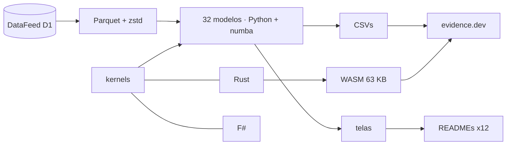

<!--
quant_models_2026
Autor: ProfBru - Bruno Penedo © 2026 - TODOS OS DIREITOS RESERVADOS
E-mail: profbruanbima@gmail.com

README GERADO — não editar à mão. Estrutura: montar_i18n.py · prosa: translation/blocos/<idioma>.json
Gerar: python3 public/foundations/pipeline/montar_i18n.py && python3 public/foundations/pipeline/gerar_readmes.py
-->

<div align="center">

# 📈 quant_models_2026 — 40 kvantitatiivista mallia päätöksiin epävarmuudessa


**ProfBru © 2026**

### Lopeta valitseminen taulukkolaskennalla. Ala päättää mallilla.

**32 mallia 16 vuoden todellisella datalla, kolme moottoria (Python, Rust ja F#), jotka täsmäävät bitilleen, ja selaimessasi toimiva laboratorio — jokainen näyttää datalla, missä intuitio johtaa harhaan.**

[](#modelos)
[](#arquitetura)
[](#desempenho)
[](#site)

[](https://www.python.org)
[](https://numba.pydata.org)
[](https://www.rust-lang.org)
[](https://fsharp.org)
[](https://evidence.dev)
[](#licenca)

[Português](README.md) · [English](README.en.md) · [Español](README.es.md) · [Français](README.fr.md) · [Deutsch](README.de.md) · [中文](README.zh.md) · [한국어](README.ko.md) · [हिन्दी](README.hi.md) · [עברית](README.he.md) · [Русский](README.ru.md) · [Svenska](README.sv.md) · **Suomi**

</div>

> [!WARNING]
> Käytä lähteenä vain tätä repositoriota. Tulokset riippuvat validoidusta DataFeed-datasta; mikään näkymä ei ole sijoitussuositus.

---

## 💀 Kipu: päätökset taulukkolaskennalla

Olet tehnyt tämän. Teit taulukon vaihtoehdoista — toimittajat, puhelimet tiimille, sähköautot kalustoon, sijoitukset salkkuun, lentokoneet laivueelle —, pisteytit jokaisen kriteerin, painotit, lajittelit suurimmasta pienimpään ja veit ykkösen kokoukseen. Taulukko oli oikeassa. Päätös ei.

**Taulukkolaskenta ei laske väärin. Se kysyy väärin.**

| Mitä teit | Mitä työkalu kätki |
|---|---|
| 🔻 **Järjestit menneen keskiarvon mukaan** | Vuosien 2010–2019 keskiarvo valitsi parhaan salkun; vuosina 2020–2026 se hävisi tasapainotukselle. Menneisyydessä oli kohinaa, jota sarake ei näytä. |
| 🏷️ **Suodatit tunnisteen mukaan** | ”Hajautit” saman luokan vaihtoehtoihin, jotka liikkuvat yhdessä — ja eri luokkiin, jotka datassa muodostavat saman ryhmän. |
| 🎯 **Luotit osumatarkkuuteen** | Malli, joka ”osuu oikeaan 54 %:ssa”, vain toisti nousupäivien osuuden. Korkea tarkkuus ilman erottelukykyä on kallis kolikonheitto. |

> [!IMPORTANT]
> **Vika ei ole sinun. Se on työkalun.**
> Taulukot, pisteytysmatriisit ja järjestyssuodattimet pitävät jokaista lukua varmana. Mikään niistä ei kysy, kuinka paljon näkemästäsi on kohinaa, edustaako menneisyys yhä tulevaa tai kestäisikö ”paras vaihtoehtosi” jakson, jota se ei ole koskaan nähnyt.

Ja on virhe, jonka teet tietämättäsi: mitä enemmän vaihtoehtoja ja yhdistelmiä testaat, sitä paremmalta menneisyyden tulos näyttää — puhtaasta sattumasta. Projektin geneettinen algoritmi testasi osakeindeksillä 1 826 sääntöä; paras loisti opetuksessa ja hävisi seuraavalla jaksolla pelkälle position pitämiselle.

### Missä päätös romahtaa

Kokouksessa suosituksen kaatava kysymys ei koskaan ole ”mikä on pistemäärä?”. Se on toinen:

> *Entä jos tilanne muuttuu — kuinka paljon tästä on enää pystyssä?*

Taulukko ei voi vastata, koska se ei koskaan erottanut signaalia kohinasta, ei koskaan testannut otoksen ulkopuolella eikä koskaan mitannut omaa epävarmuuttaan.

---

## 💊 Ratkaisu

Jokainen 32 mallista ajetaan 27 todellisella sijoituskohteella vuosina 2010–2026, opetus ja testaus ajallisesti erotettuina, ja päättyy luvusta kirjoitettuun lauseeseen — silloinkin, kun luku kumoaa intuition.

> ### Kolme riippumatonta moottoria — Python/numba, Rust ja F# — laskevat saman matematiikan, ja niiden on täsmättävä bitilleen. Kaksi täsmäävää moottoria todistaa, että laskelma on oikein, ei pelkästään koodi.

<div align="center">

| ❌ Taulukko | ✅ Malli |
|---|---|
| Vaihtoehto, jolla on korkein keskipistemäärä | **Vaihtoehto, joka kestää otoksen ulkopuolella, kustannukset ja riski ilmoitettuina** |
| *”Hajautettu”, koska luokat ovat eri* | **Hajautettu, koska data näyttää valintojen välillä matalan korrelaation** |

</div>

**Mallit eivät ennusta tulevaa varmasti — ja sanovat sen: useat tulokset tässä osoittavat, ettei suositussa menetelmässä ole signaalia. Se on arvo: tietää, mihin ei pidä luottaa ennen kuin rahaa käytetään.**

---

## 🎯 Mihin se sopii — markkinoiden ulkopuolellakin

Esimerkit käyttävät markkinasarjoja, koska ne ovat pitkiä, julkisia ja armottomia. Tekniikat ovat samat mihin tahansa epävarmuuden alaiseen päätökseen — projektin oma tietopohja näyttää markkinasuunnan mallin ennustamassa opintojen keskeyttämistä ja poikkeamien tunnistimen paljastamassa petoksen.

| Päätös | Vastaavat mallit | Kysymys, johon taulukko ei vastaa |
|---|---|---|
| 📊 **Sijoitussalkku** | markkinatilat (HMM), GARCH, Markowitz, walk-forward-jälkitestaus | Päteekö menneen optimaalinen allokaatio seuraavassa markkinatilassa? |
| 📱 **Yrityshankinnat — laitteet ja puhelimet** | Benford, poikkeavat havainnot, K-means, ajautuminen | Onko tämän toimittajan hinta poikkeama, näppäilyvirhe vai petos? Toimittaako eilinen toimittaja yhä samaa? |
| 🔋 **Sähköautokalusto** | Bayes, GARCH, O-U Monte Carlo, epälineaariset järjestelmät | Kun toimintamatkasta ja energian hinnasta on vain muutaman kuukauden data, kuinka paljon ennustettuun säästöön voi luottaa? |
| 🛡️ **Puolustus — panssarivaunujen ja lentokoneiden hankinta** | Markovin ketjut, paksut hännät, rajoitteinen GA, PCA | Mikä on kaluston odotettu käytettävyys käytön ja huollon välillä, ja mitä maksaa pahin skenaario, ei keskimääräinen? |
| 🚀 **Startupit ja johdon päätökset** | Bayes, ajautuminen, SHAP, walk-forward-jälkitestaus | Päteekö pilotissa vahvistettu hypoteesi yhä markkinoilla — ja voinko perustella päätöksen hallitukselle luvuilla? |

> [!NOTE]
> Tämän repositorion näkymät ja luvut perustuvat markkinadataan. Soveltaminen toiseen alaan vaatii sen alan datan; menetelmät, validointitestit ja kolme moottoria ovat samat.

---

## 🖼️ Katso toiminnassa

<a id="site"></a>

### 🌐 Sivusto ja laboratorio

Sivusto tehdään evidence.dev:llä: SQL tulosten päällä, interaktiivinen sivu jokaiselle mallille ja laboratorio, jossa WebAssemblyksi käännetty Rust-moottori toimii selaimessasi — ilman palvelinta ja ilman käyttäjäkohtaisia kustannuksia.

| | |
|---|---|
| <br/>**Esittely: yksi lause mallia kohden**<br/>Jokainen rivi on datan itsensä tuottama tulkinta — myös ne, jotka kumoavat suositun tekniikan. | <br/>**Laboratorio selaimessa (WebAssembly)**<br/>216 000 Monte Carlo -polkua noin 3 sekunnissa selaimessa, samalla moottorilla, joka läpäisee yhtäpitävyystestit. |
| <br/>**Mallisivu: kuvaus, tulkinta ja kaaviot**<br/>Optimaalinen poistumissääntö johdetaan Brent − WTI -erotuksen mitatusta dynamiikasta, ei kiinteästä prosentista. | <br/>**Kolme moottoria, yksi tulos**<br/>Saman ytimen mitatut ajat numbassa, Rustissa ja F#:ssa, prosessin käynnistys vähennettynä. |

<a id="modelos"></a>

### 🧪 32 mallia yksi kerrallaan

Jokaisessa alla olevassa näkymässä on päätöskysymys, johon malli vastaa, ja datan tuottama tulkinta. Luettelon loput 8 mallia (teksti, vahvistusoppiminen ja moniagenttisimulaatio) on kuvattu tiedostossa modelos_quant.md.

### Tilastotiede — mitä data on, ennen kuin mitä se ennustaa

#### 01 · Robusti kuvaileva tilastotiede

<div align="center"></div>

**Miksi valita:** Valitse se, kun sinun on tiedettävä, edustaako keskiarvo tyypillistä tapausta vai vääristävätkö muutamat ääriarvot laskelman.

> **Mitä data näytti:** Hopean keskihajonta on 1,6-kertainen robustiin σ:aan nähden: muutamat äärimmäiset päivät paisuttavat ”keskimääräistä” volatiliteettia — huipukkuuden ylite 26,9.

#### 02 · Tuki ja vastus moodilla + klusteroinnilla

<div align="center"></div>

**Miksi valita:** Valitse se, kun hinta- tai budjettirajan on tultava toistettavasta kriteeristä eikä silmämääräisesti vedetystä viivasta.

> **Mitä data näytti:** Kulta: pyöristettyjen hintojen moodi on 3 330,00; useimmin käyty vyöhyke (2 350,00–2 730,00) kattaa 24 % kaupankäyntipäivistä ja toimii nyt tukena.

#### 03 · Stationaarisuus (Augmented Dickey-Fuller)

<div align="center"></div>

**Miksi valita:** Valitse se ennen mitä tahansa ennustetta: se kertoo, onko menneisyys yhä pätevä otos tulevasta.

> **Mitä data näytti:** Vain 1 hintasarja 8:sta on stationaarinen 5 %:n tasolla; logaritmisina tuottoina 8/8. Hinnoilla opettaminen on opettamista jakaumalla, joka ei palaa.

#### 04 · Lineaarinen regressio (PNS) kohteiden välillä

<div align="center"></div>

**Miksi valita:** Valitse se mitataksesi, kuinka paljon yksi muuttuja todella selittää toista — ja huomataksesi, että ”ilmeinen” yhteys selittää joskus lähes ei mitään.

> **Mitä data näytti:** Dow Jones ~ S&P 500: β = 0,91 ja R² = 0,91. Sen sijaan Yhdysvaltain valtionlaina ~ S&P 500 antaa R²:ksi 0,04: ”ilmeinen” yhteys ei selitä päivittäistä liikettä juuri lainkaan.

#### 13 · Poikkeavat havainnot monella menetelmällä (IQR, robusti z, LOF)

<div align="center"></div>

**Miksi valita:** Valitse se, kun outo datapiste voi olla keruuvirhe tai sarjan tärkein tapahtuma: konsensus ratkaisee.

> **Mitä data näytti:** S&P 500:ssa laatikkokuvio merkitsee 264 päivää poikkeaviksi (6,7 % otoksesta); kolmen menetelmän konsensus jättää 101. Yksi poikkeava piste muuttaa suoran kulmakertoimen 0,76:sta 0,53:een.

#### 31 · Newcomb-Benfordin laki — datan eheys

<div align="center"></div>

**Miksi valita:** Valitse se tarkastaaksesi arvojoukon ennen kuin luotat siihen, tietäen milloin testi pätee ja milloin se olisi väärä hälytys.

> **Mitä data näytti:** Vain 21 volyymisarjasta 29:stä kattaa testiin riittävän vaihteluvälin; Benfordin soveltaminen muihin olisi väärä hälytys. Yhdistettyinä volyymit kattavat 6,4 suuruusluokkaa ja antavat MAD-arvon 0,0099 (hyväksyttävä yhdenmukaisuus).

#### 25 · Ehdollinen volatiliteetti (EWMA ja GARCH(1,1))

<div align="center"></div>

**Miksi valita:** Valitse se mitoittaaksesi riskin, varmuusvaraston tai altistumisrajan huomisen riskin eikä vuoden keskiarvon mukaan.

> **Mitä data näytti:** S&P 500: pysyvyys α+β = 0,963 — volatiliteettisokki tarvitsee 18 kaupankäyntipäivää menettääkseen puolet voimastaan. Yhden päivän 99 %:n VaR: 1,75 %.

#### 24 · Epälineaarinen dynamiikka ja paksut hännät

<div align="center"></div>

**Miksi valita:** Valitse se, kun pahin skenaario merkitsee enemmän kuin keskimääräinen: se mittaa, kuinka paljon todelliset hännät ylittävät normaalikäyrän.

> **Mitä data näytti:** Neljän keskihajonnan liikkeitä esiintyy mediaanina 64 kertaa useammin kuin normaalikäyrä ennustaa; tuotolla ei ole juuri muistia (autokorrelaatio -0,02), mutta liikkeen suuruudella on (0,15).

#### 27 · Grangerin kausaliteetti ja tartunta

<div align="center"></div>

**Miksi valita:** Valitse se erottaaksesi ”liikkuvat yhdessä” ja ”yksi edeltää toista” ennen kuin käytät indikaattoria laukaisimena.

> **Mitä data näytti:** Testatuista 72 parista 7 kestää Bonferronin korjauksen. Vahvin, euro/dollari → dollari-indeksi, on eri lähteiden sulkemisaikojen artefakti: tilastollinen edeltävyys ei ole syy — ja testi näyttää tarkasti, missä intuitio menisi harhaan.

### Koneoppiminen — perustason mittapuulla

#### 05 · Suunnan logistinen regressio

<div align="center"></div>

**Miksi valita:** Valitse se rehelliseksi vertailukohdaksi kaikkeen kyllä/ei-luokitteluun: jos monimutkainen malli ei voita sitä, se ei maksa itseään takaisin.

> **Mitä data näytti:** Otoksen ulkopuolella (2016–2026) logistinen malli osuu S&P 500:n suuntaan 54,2 %:ssa — käytännössä nousupäivien osuus (54,2 %): se ennusti nousua 98 %:na päivistä, ja AUC on 0,492. Korkea tarkkuus ilman erottelukykyä on ansa, jonka tämä vertailukohta purkaa.

#### 06 · SVM ja ydinmenetelmät

<div align="center"></div>

**Miksi valita:** Valitse se, kun ”hyvän” ja ”huonon” raja on kaareva — ja todistaaksesi signaalin olemassaolon ennen kuin maksat suuremmista malleista.

> **Mitä data näytti:** Kun syötteinä ovat vain RSI ja volatiliteetti, yksikään neljästä ytimestä ei ylitä 50,7 %:n tasapainotettua tarkkuutta otoksen ulkopuolella. RBF ”oppii” eniten opetuksessa (53,2 %) ja häviää eniten testissä (48,4 %): ydin ei luo signaalia sinne, missä sitä ei ole.

#### 07 · Päätöspuut ja Random Forest

<div align="center"></div>

**Miksi valita:** Valitse se, kun päätöksen on oltava selitettävissä sääntöinä ja kestävä taulukkomuotoisella datalla.

> **Mitä data näytti:** Syvyyden 20 puu osuu oikeaan 83,7 %:ssa opetuksessa ja 49,8 %:ssa testissä: se opetteli menneen ulkoa. Matala metsä jää 53,5 %:iin — vaatimatonta mutta rehellistä; eniten käytetty piirre on ”ret_1”.

#### 08 · MLP-neuroverkko — käänneindikaattori

<div align="center"></div>

**Miksi valita:** Valitse se harvinaisiin käännetapahtumiin ja mittaa osumat tapahtuman luonnolliseen yleisyyteen eikä kokonaistarkkuuteen nähden.

> **Mitä data näytti:** Hopealla vuosina 2023–2026 (joita opetus ei nähnyt) MLP antoi 607 nousukäänteen signaalia 17,3 %:n tarkkuudella, kun perustaso oli 13,6 % (1,27-kertainen luonnolliseen yleisyyteen): juuri tämä suhde, ei kokonaistarkkuus, kertoo, tuoko indikaattori tietoa.

#### 09 · PCA — riskitekijät ja indeksit

<div align="center"></div>

**Miksi valita:** Valitse se selvittääksesi, montako todella riippumatonta panosta pitkään vaihtoehtolistaan sisältyy.

> **Mitä data näytti:** Ensimmäinen tekijä yksinään selittää 24,5 % 27 kohteen päivittäisestä vaihtelusta; 80 %:iin tarvitaan 12 tekijää. 27 kohdetta eivät ole 27 riippumatonta panosta.

#### 10 · Kohteiden klusterointi (K-means)

<div align="center"></div>

**Miksi valita:** Valitse se ryhmitelläksesi vaihtoehdot mitatun käyttäytymisen eikä luettelon tunnisteen mukaan.

> **Mitä data näytti:** Siluetti valitsee K = 4 ryhmää ilman manuaalista puuttumista; yksi ryhmä sekoittaa 3 eri omaisuusluokkaa — tunniste ”raaka-aine” tai ”valuutta” ei kerro, miten kohde käyttäytyy.

#### 11 · Tuottojen upotukset (FastICA) + kosini

<div align="center"></div>

**Miksi valita:** Valitse se nähdäksesi yhdellä kartalla, kuka liikkuu juuri nyt yhdessä — päivittyy joka ikkunassa.

> **Mitä data näytti:** Viimeisten 60 kaupankäyntipäivän aikana samankaltaisin pari on Brent-öljy × WTI-öljy (kosini 0,96) ja vastakkaisin dollari-indeksi × euro/dollari (-0,89): läheisyyskartta, joka päivittyy joka ikkunassa.

#### 12 · Isolation Forest — poikkeavat tuotot ja volyymit

<div align="center"></div>

**Miksi valita:** Valitse se löytääksesi poikkeavan ilman merkittyjä esimerkkejä: ensimmäinen hälytys siitä, että dynamiikka on muuttunut.

> **Mitä data näytti:** Ilman ainuttakaan merkintää eristysmetsä merkitsee 77 S&P 500:n kaupankäyntipäivää poikkeaviksi — 21 pelkästään vuonna 2020 — ja niistä 57 % on laskuja: poikkeama on signaali muuttuneesta dynamiikasta, ei pois heitettävää kohinaa.

#### 32 · Selitettävyys Shapley-arvoilla (SHAP)

<div align="center"></div>

**Miksi valita:** Valitse se, kun joku kysyy ”miksi malli päätti näin?” ja vastaus vaatii lukuja eikä uskoa.

> **Mitä data näytti:** Viimeisimmässä ennusteessa nousun todennäköisyys kasvaa 54,0 %:sta (mallin keskiarvo) 55,4 %:iin; eniten painoi piirre ”ret_1” (+1,0 prosenttiyksikköä). Musta laatikko alkaa vastata kysymykseen ”miksi”.

### Todennäköisyys ja signaalit — markkinatilat, epävarmuus ja syklit

#### 14 · Markovin ketju markkinatiloille (nousu, lasku, sivuttais)

<div align="center"></div>

**Miksi valita:** Valitse se vastataksesi kysymykseen ”tässä vaiheessa ollessa, mikä on todennäköisyys siirtyä tuohon?” tarkastettavalla matriisilla.

> **Mitä data näytti:** S&P 500:ssa laskevan 20 kaupankäyntipäivän jakson jälkeen todennäköisyys seuraavan jakson nousulle on 59,0 % — suurempi kuin laskun jatkuminen (30,8 %). Tasapainossa markkina viettää 41,3 % ajasta noususuhdanteessa.

#### 15 · Piilo-Markov-malli (gaussinen HMM)

<div align="center"></div>

**Miksi valita:** Valitse se, kun markkinatiloja ei voi havaita ja ne on opittava datasta päivittäisellä todennäköisyydellä.

> **Mitä data näytti:** Ilman mielivaltaista katkaisusääntöä HMM löytää S&P 500:sta kolme tilaa: myrskyisän tilan vuotuinen volatiliteetti on 43 %, rauhallisen 7 %, ja myrskyisä kestää keskimäärin 18 kaupankäyntipäivää. Tänään todennäköisin tila on ”rauhallinen”.

#### 16 · Tuoton ja volatiliteetin bayesilainen päivitys

<div align="center"></div>

**Miksi valita:** Valitse se, kun dataa on vähän ja päätöspaine suuri: se kertoo, kuinka paljon keskiarvoon voi luottaa, eikä vain mikä se on.

> **Mitä data näytti:** Kulta vuodesta 2019: posteriorinen keskimääräinen vuosituotto on 15,3 %, mutta 95 %:n uskottavuusväli on 2,3 %:sta 28,4 %:iin. Todennäköisyys, että keskiarvo on positiivinen, on 98,9 % — otoskeskiarvo (15,7 %) ei yksin kerro sitä.

#### 30 · Optimaaliset kaupankäyntisäännöt (Ornstein-Uhlenbeck)

<div align="center"></div>

**Miksi valita:** Valitse se asettaaksesi tavoitteen ja tappiorajan mitatun dynamiikan perusteella perittyjen kiinteiden prosenttien sijaan.

> **Mitä data näytti:** Brent − WTI -erotus palautuu keskiarvoon 22 kaupankäyntipäivän puoliintumisajalla. Simuloimalla 4 000 polkua ruutua kohden paras sääntö on 1,5σ:n tavoite ja 10,0σ:n stop (Sharpe per kauppa 0,63) — kiinteä prosentuaalinen stop ohittaa kohteen dynamiikan.

#### 17 · Fourier-muunnos — hallitsevat syklit

<div align="center"></div>

**Miksi valita:** Valitse se todistaaksesi, onko kausisykli olemassa vai sattumaa — jokaisessa spektrissä on huippuja.

> **Mitä data näytti:** Neljän kohteen 12 suurimmasta syklihuipusta vain 2 ylittää 95 %:n kohinarajan, joka saadaan sekoittamalla itse tuotot. Jokaisessa periodogrammissa on huippuja; testi kertoo, mitkä ovat syklejä ja mitkä sattumaa.

#### 18 · Aallokkeet — aika-taajuushajotelma

<div align="center"></div>

**Miksi valita:** Valitse ne paikantaaksesi ajassa, milloin myrsky alkaa — sen, minkä vuosikeskiarvo kätkee.

> **Mitä data näytti:** Taso 1 (2 kaupankäyntipäivän värähtelyt) sisältää 55,0 % S&P 500:n energiasta. Kun korkean taajuuden energia räjähtää (z > 2), seuraavien 20 päivän tuoton hajonta on 1,3-kertainen normaaliin: aalloke paikantaa ajassa sen, minkä Fourier näkee vain keskimäärin.

#### 23 · Hurstin eksponentti ja liukuva Hurst-indikaattori

<div align="center"></div>

**Miksi valita:** Valitse se ratkaistaksesi trendi- ja keskiarvoon palautumisen strategian välillä — vertaamalla muistittomaan referenssiin.

> **Mitä data näytti:** Raaka R/S-H on välillä 0,54–0,59 ja näyttäisi ”pysyvältä”; sekoitettuihin sarjoihin verrattuna yksikään 6 kohteesta ei osoita todellista muistia. MH100 − MH150 -risteys voittaa liukuvien keskiarvojen risteyksen 3 kohteessa 6:sta Sharpen luvulla mitattuna.

### Optimointi ja hallinta — optimi, sattuma ja aika

#### 19 · Markowitzin tehokas rintama

<div align="center"></div>

**Miksi valita:** Valitse se nähdäksesi parhaan mahdollisen tuoton kullakin riskitasolla — ja sen, kuinka paljon optimi riippuu hauraista estimaateista.

> **Mitä data näytti:** Suurimman Sharpen salkun Sharpen luku oli 1,19 vuosina 2010–2019 ja 0,76 vuosina 2020–2026; tasapainotus nousi 0,35:stä 0,94:ään. Rintama on tarkka menneestä — virhe on sellaisten keskiarvojen estimoinnissa, joita tulevaisuus ei toista.

#### 20 · Geneettinen algoritmi — salkun optimointi

<div align="center"></div>

**Miksi valita:** Valitse se, kun tavoitteella on todellisia rajoitteita (kustannukset, rajat, enimmäistappiot), joita mikään suljettu kaava ei hyväksy.

> **Mitä data näytti:** Neljä rinnakkaista GA-ajoa eri siemenillä suppenee samaan salkkuun (keskimääräinen painopoikkeama 0,1 prosenttiyksikköä), Sharpen luku 1,19 vuosina 2010–2019. Vuosina 2020–2026 se tuottaa 0,86, alle tasapainotuksen (0,94): suppeneminen todistaa optimin vakauden, ei sitä, että tulevaisuus toistaa sen.

#### 21 · Geneettinen algoritmi — indikaattorien ja parametrien valinta

<div align="center"></div>

**Miksi valita:** Valitse se etsiäksesi parhaan sääntöyhdistelmän — kirjaten, montako testattiin, ettei sattuma huijaa.

> **Mitä data näytti:** GA testasi S&P 500:lla 1826 eri sääntöä, ja kunkin ajon parhaan opetusjakson Sharpen luku oli enintään 0,78; vuosina 2019–2026 ne asettuivat välille 0,41–0,54, kun pelkkä ostettuna pysyminen antoi 0,77. Mitä enemmän sääntöjä testataan, sitä korkeammaksi opetusjakson Sharpen luku nousee puhtaasta sattumasta.

#### 22 · Geneettinen ohjelmointi — symbolinen regressio

<div align="center"></div>

**Miksi valita:** Valitse se keksiäksesi luettavia, tarkastettavia kaavoja ja altistaaksesi ne jaksolle, jota ne eivät ole nähneet.

> **Mitä data näytti:** Geneettinen ohjelmointi löysi luettavia kaavoja, kuten ((sen(cos(r3)) + r1) + sen(sen(cos(r2)))) (10 solmua), joiden järjestyskorrelaatio seuraavaan tuottoon oli opetuksessa -0,080 ja testissä -0,028. Evoluutio löytää menneestä aina ”jotakin”; vain näkemätön jakso erottaa indikaattorin sattumasta.

#### 26 · Korrelaatioverkko ja keskeisyys

<div align="center"></div>

**Miksi valita:** Valitse se nähdäksesi, kuka on riippuvuusjärjestelmän keskiössä ja kuka reunalla.

> **Mitä data näytti:** Vuosien 2010–2019 verkon valitsemat 8 reunakohdetta pysyivät vuosina 2020–2026 lähes riippumattomina (keskikorrelaatio 0,00, keskeisillä 0,15) ja tuottivat enemmän (11,0 % vs. 7,4 % vuodessa), mutta suuremmalla volatiliteetilla. Molemmat korit voitti kaikkien 27:n salkku (Sharpe 0,95): riippumattomien panosten määrä painaa enemmän kuin asema verkossa.

#### 28 · Mallin ja käsitteen ajautumisen tunnistus

<div align="center"></div>

**Miksi valita:** Valitse se tietääksesi mallin vanhentuneen ennen kuin tappio näkyy.

> **Mitä data näytti:** Vuosilla 2010–2016 opetettu malli vaatii uudelleenopetusta 8:na seuraavista 10 vuodesta: sen jakson syötetila ei palannut. Vuonna 2022 tarkkuus oli heikoin (43,8 %) ja vuonna 2017 siirtymä suurin (KS 0,77) — syötteen seuranta paljastaa ongelman odottamatta tappiota.

#### 29 · Walk-forward-jälkitestaus kustannuksineen

<div align="center"></div>

**Miksi valita:** Valitse se testataksesi minkä tahansa päätössäännön ajan kuluessa, kustannukset ja hylkäysportit etukäteen ilmoitettuina.

> **Mitä data näytti:** Kun kustannus on 5 peruspistettä vaihtoa kohden, 2 strategiaa 4:stä läpäisee kolme STOP-porttia (tasapainotus, riskipariteetti). Joka kuukausi pelkän menneen perusteella valittu momentum-ikkuna vaihtui 45 kertaa — ”optimaalinen parametri” ei ole vakio.


---

## ⚡ Asennus

Edellytykset: Python 3.13, Rust 1.96 (kohteella wasm32-unknown-unknown), .NET 9 F#-moottoria varten ja Node 20+ sivustoa varten. Data tulee DataFeed Service Providerilta (muuttuja QUANT_MODELS_DATAFEED).

**1 · Data ja mallit**

```bash
git clone <url-do-repositorio-privado> quant_models_2026
cd quant_models_2026/public/foundations/pipeline
pip install -r requisitos.txt
export QUANT_MODELS_DATAFEED=/mnt/d/DataFeedServiceProvider
python3 dados_feed.py consolidar --tf D1
python3 executar_modelos.py
```

**2 · Kolme moottoria ja yhtäpitävyys**

```bash
(cd ../rust/quant_models_2026_core && cargo build --release && cargo build --release --lib --target wasm32-unknown-unknown)
(cd ../fsharp/QuantModels2026.Core && dotnet build -c Release)
python3 testes_nucleo.py        # 38 verificações: numba × Rust × F#
```

**3 · Näkymät ja sivusto**

```bash
python3 gerar_telas.py && python3 gerar_site.py
cd ../evidence && npm ci && bash subir_servidor.sh     # http://localhost:3020
```

**4 · Pitkä ajo taustalla (screen + 20 minuutin vahtikoira)**

```bash
./run_all.sh --background
screen -r quant_models_2026
```

---

<a id="arquitetura"></a>

## 🧠 Arkkitehtuuri ja päätökset



Arkkitehtuuripäätökset perusteluineen:

| | |
|---|---|
| **Kolme moottoria samalla näennäissatunnaisgeneraattorilla (xorshift64*)** | jopa Monte Carlo täsmää bitilleen; matemaattinen virhe ei voi livahtaa läpi kolmella kielellä yhtä aikaa. |
| **Riippuvuudeton WebAssembly (63 KB)** | raskas laskenta tapahtuu käyttäjän selaimessa: palvelinkustannus nolla, eikä mikään data poistu koneelta. |
| **Opetus ja testaus aina ajallisesti erillään** | aikasarjojen sekoittaminen vuotaa tulevaa opetukseen ja tuottaa näennäistä tarkkuutta. |
| **Estimaattoreita verrataan omaan nollatasoonsa** | Hurstilla ja Fourierilla on tunnetut harhat; vain vertailu sekoitettuun dataan erottaa signaalin artefaktista. |
| **Tulkinta kirjoitetaan luvusta** | jokaisen näkymän lause tuotetaan tuloksesta; kun tulos muuttuu, lause muuttuu sen mukana. |
| **Rinnakkaisuus ProcessPoolExecutorilla ja kiinteällä jaolla** | tulos ei riipu siitä, montako ydintä koneessa on. |

---

<a id="desempenho"></a>

## 🚀 Mitattu suorituskyky

Luvut mitattu bench_motores.py:llä ja tallennettu projektin historiaan. Rustista ja F#:sta on vähennetty prosessin käynnistys.

| Kuorma | numba | Rust | F# | Puhdas Python |
|---|---:|---:|---:|---:|
| O-U Monte Carlo (20×20-ruudukko, 2 000 polkua) | 2,859 s | 2,840 s | 3,490 s | — |
| Liukuva R/S-Hurst (ikkuna 250, 3 917 kaupankäyntipäivää) | 0,027 s | 0,016 s | 0,108 s | 7,86 s |
| Gaussinen HMM EM:llä (3 tilaa, 200 iteraatiota) | 0,235 s | 0,308 s | 1,213 s | 64,19 s |
| 2 000 salkun × 10 kohteen tunnusluvut | 1,366 s | 1,297 s | 1,908 s | — |

Kriittinen polku (20×20 Monte Carlo -ruudukko numbassa) suoriutuu 3,4 s:ssa 10 s:n budjetilla, ja tuloksen todistetaan olevan identtinen Rust-moottorin kanssa.

---

## 📚 Täydellinen luettelo

Kaikki 40 mallia — numero, tyyppi, luokka ja kuvaus — ovat tiedostossa modelos_quant.md, joka tuotetaan samasta lähteestä kuin sivusto. → [modelos_quant.md](modelos_quant.md)

---

## ❓ Vaikeat kysymykset

<details><summary><b>Käytän jo taulukkoa painoineen ja suodattimineen. Eikö se ole sama asia?</b></summary>

Ei. Taulukko laskee yhteen pisteitä, joita se pitää varmoina. Mallit mittaavat, kuinka paljon pisteistä on kohinaa, testaavat valintaa jaksolla, jota se ei ole nähnyt, ja näyttävät, milloin menneisyyden paras vaihtoehto lakkaa olemasta paras.
</details>

<details><summary><b>Voittaako jokin näistä malleista ”markkinat”?</b></summary>

Useat tämän repositorion tulokset näyttävät suosituista tekniikoista juuri päinvastaista: indikaattoreita ja ytimiä ilman päivittäistä suuntasignaalia, pitkää muistia, joka on vain estimaattorin harhaa. Sen tietäminen ennen ajan ja rahan sijoittamista on koko tarkoitus.
</details>

<details><summary><b>Miksi kolme kieltä samaan laskelmaan?</b></summary>

Koska ensimmäisen kanssa täsmäävä riippumaton toinen moottori todistaa matematiikan ja kolmas ratkaisee. 38 tarkistuksessa kaikki kolme täsmäävät bitilleen.
</details>

<details><summary><b>Tarvitsenko palvelimen tai pilven?</b></summary>

Et. Mallit toimivat omalla koneellasi ja sivusto on staattinen: laboratorio suorittaa Rust-moottoria WebAssemblynä selaimen sisällä.
</details>

<details><summary><b>Sopiiko se päätöksiin rahoitusmarkkinoiden ulkopuolella?</b></summary>

Menetelmät sopivat; datan on tultava omalta alaltasi. Taulukko ”Mihin se sopii” näyttää, mitkä mallit vastaavat kuhunkin päätöstyyppiin.
</details>

---

<a id="licenca"></a>

## 📜 Lisenssi ja tekijyys

Koodi, mallit, tekstit ja näkymät: käyttö vain tekijälle. Kolmansien osapuolten kirjastoilla on omat lisenssinsä (NumPy, numba, scikit-learn, SciPy, pandas, networkx, matplotlib, evidence.dev).

**Tekijä:** ProfBru - Bruno Penedo © 2026 — TODOS OS DIREITOS RESERVADOS · profbruanbima@gmail.com

<div align="center">


**ProfBru © 2026**

</div>
