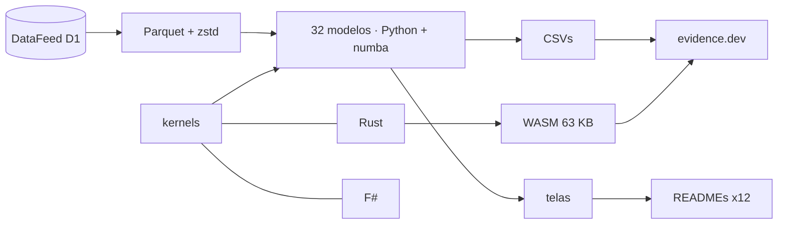

<!--
quant_models_2026
Autor: ProfBru - Bruno Penedo © 2026 - TODOS OS DIREITOS RESERVADOS
E-mail: profbruanbima@gmail.com

README GERADO — não editar à mão. Estrutura: montar_i18n.py · prosa: translation/blocos/<idioma>.json
Gerar: python3 public/foundations/pipeline/montar_i18n.py && python3 public/foundations/pipeline/gerar_readmes.py
-->

<div align="center">

# 📈 quant_models_2026 — 40 modèles quantitatifs pour décider dans l'incertitude


**ProfBru © 2026**

### Arrêtez de choisir au tableur. Commencez à décider par modèle.

**32 modèles exécutés sur 16 ans de données réelles, trois moteurs (Python, Rust et F#) qui concordent bit à bit et un laboratoire qui tourne dans votre navigateur — chacun montrant, par la donnée, où l'intuition trompe.**

[](#modelos)
[](#arquitetura)
[](#desempenho)
[](#site)

[](https://www.python.org)
[](https://numba.pydata.org)
[](https://www.rust-lang.org)
[](https://fsharp.org)
[](https://evidence.dev)
[](#licenca)

[Português](README.md) · [English](README.en.md) · [Español](README.es.md) · **Français** · [Deutsch](README.de.md) · [中文](README.zh.md) · [한국어](README.ko.md) · [हिन्दी](README.hi.md) · [עברית](README.he.md) · [Русский](README.ru.md) · [Svenska](README.sv.md) · [Suomi](README.fi.md)

</div>

> [!WARNING]
> Utilisez uniquement ce dépôt comme source. Les résultats dépendent des données validées du DataFeed ; aucun écran n'est un conseil en investissement.

---

## 💀 La douleur : décider au tableur

Vous l'avez déjà fait. Vous avez monté un tableur avec les alternatives — fournisseurs, téléphones pour l'équipe, voitures électriques pour la flotte, actifs pour le portefeuille, avions pour un escadron —, noté chaque critère, pondéré, trié du plus grand au plus petit et apporté le premier à la réunion. Le tableur avait raison. La décision, non.

**Le tableur ne se trompe pas dans le calcul. Il se trompe de question.**

| Ce que vous avez fait | Ce que l'outil a caché |
|---|---|
| 🔻 **Classé par la moyenne du passé** | La moyenne de 2010–2019 a élu le meilleur portefeuille ; en 2020–2026 il a perdu face aux poids égaux. Le passé contenait un bruit que la colonne ne montre pas. |
| 🏷️ **Filtré par l'étiquette** | Vous avez « diversifié » entre des options de même catégorie qui bougent ensemble — et entre des catégories différentes qui, dans la donnée, forment le même groupe. |
| 🎯 **Fait confiance au taux de réussite** | Un modèle qui « réussit 54 % » ne faisait que répéter la part des jours de hausse. Une précision élevée sans pouvoir de séparation est un tirage au sort coûteux. |

> [!IMPORTANT]
> **Le défaut n'est pas le vôtre. C'est celui de l'outil.**
> Tableurs, matrices de notation et filtres de classement traitent chaque nombre comme certain. Aucun ne demande quelle part de ce que vous voyez est du bruit, si le passé représente encore l'avenir ou si votre « meilleure option » survivrait à une période qu'elle n'a jamais vue.

Et il y a une erreur que vous commettez sans le savoir : plus vous testez d'alternatives et de combinaisons, meilleur devient le résultat passé — par pur hasard. L'algorithme génétique de ce projet a testé 1 826 règles sur un indice boursier ; la meilleure a brillé à l'entraînement et, sur la période suivante, a perdu face au simple maintien de la position.

### Là où la décision s'effondre

En réunion, la question qui fait tomber la recommandation n'est jamais « quelle est la note ? ». C'est une autre :

> *Et si le scénario change — qu'est-ce qui tient encore debout ?*

Le tableur ne peut pas répondre, car il n'a jamais séparé le signal du bruit, jamais testé hors échantillon et jamais mesuré sa propre incertitude.

---

## 💊 La solution

Chacun des 32 modèles tourne sur 27 actifs réels de 2010 à 2026, avec entraînement et test séparés dans le temps, et se termine par une phrase écrite à partir du nombre — y compris quand le nombre contredit l'intuition.

> ### Trois moteurs indépendants — Python/numba, Rust et F# — calculent la même mathématique et doivent concorder bit à bit. Deux moteurs qui concordent prouvent que le calcul est juste, pas seulement le code.

<div align="center">

| ❌ Tableur | ✅ Modèle |
|---|---|
| L'option avec la meilleure note moyenne | **L'option qui survit hors échantillon, avec coût et risque déclarés** |
| *« Diversifié » parce que les catégories diffèrent* | **Diversifié parce que la donnée montre une faible corrélation entre les choix** |

</div>

**Les modèles ne prédisent pas l'avenir avec certitude — et ils le disent : plusieurs résultats ici montrent qu'une méthode populaire n'a pas de signal. C'est là leur valeur : savoir où ne pas faire confiance avant de dépenser.**

---

## 🎯 À quoi ça sert — au-delà du marché

Les exemples utilisent des séries de marché parce qu'elles sont longues, publiques et implacables. Les techniques sont les mêmes pour toute décision dans l'incertitude — la base de connaissances du projet montre elle-même le modèle de direction du marché prédisant le décrochage scolaire et le détecteur d'anomalies signalant la fraude.

| Décision | Modèles qui répondent | La question à laquelle le tableur ne répond pas |
|---|---|---|
| 📊 **Portefeuille d'investissement** | régimes (HMM), GARCH, Markowitz, backtest walk-forward | L'allocation optimale du passé vaut-elle pour le prochain régime ? |
| 📱 **Achats d'entreprise — équipements et téléphones** | Benford, valeurs aberrantes, K-means, dérive | Le prix de ce fournisseur est-il une anomalie, une faute de frappe ou une fraude ? Le fournisseur d'hier livre-t-il encore la même chose ? |
| 🔋 **Flotte de voitures électriques** | Bayes, GARCH, Monte Carlo O-U, systèmes non linéaires | Avec seulement quelques mois de données d'autonomie et de prix de l'énergie, quelle confiance accorder à l'économie projetée ? |
| 🛡️ **Défense — acquisition de chars et d'avions** | chaînes de Markov, queues épaisses, AG sous contraintes, ACP | Quelle disponibilité attendre de la flotte entre opération et maintenance, et quel est le coût dans le pire scénario, pas dans le scénario moyen ? |
| 🚀 **Startups et décisions de direction** | Bayes, dérive, SHAP, backtest walk-forward | L'hypothèse validée par le pilote tient-elle encore sur le marché — et puis-je expliquer la décision au conseil avec des chiffres ? |

> [!NOTE]
> Les écrans et chiffres de ce dépôt proviennent de données de marché. Les appliquer à un autre domaine exige les données de ce domaine ; les méthodes, les tests de validation et les trois moteurs sont les mêmes.

---

## 🖼️ Voir en action

<a id="site"></a>

### 🌐 Le site et le laboratoire

Le site est généré avec evidence.dev : du SQL sur les résultats, une page interactive par modèle et un laboratoire où le moteur Rust, compilé en WebAssembly, tourne dans votre navigateur — sans serveur et sans coût par utilisateur.

| | |
|---|---|
| <br/>**Vitrine : une phrase par modèle**<br/>Chaque ligne est la lecture produite par la donnée elle-même — y compris celles qui démentent la technique populaire. | <br/>**Laboratoire dans le navigateur (WebAssembly)**<br/>216 000 trajectoires de Monte Carlo en environ 3 secondes, dans le navigateur, avec le même moteur qui passe les tests de concordance. |
| <br/>**Page de modèle : fiche, lecture et graphiques**<br/>La règle de sortie optimale découle de la dynamique mesurée du spread Brent − WTI, pas d'un pourcentage fixe. | <br/>**Trois moteurs, un résultat**<br/>Temps mesurés du même noyau en numba, Rust et F#, démarrage du processus déduit. |

<a id="modelos"></a>

### 🧪 Les 32 modèles, un par un

Chaque écran ci-dessous porte la question de décision à laquelle le modèle répond et la lecture produite par la donnée. Les 8 autres modèles du catalogue (texte, apprentissage par renforcement et simulation multi-agents) sont décrits dans modelos_quant.md.

### Statistique — ce qu'est la donnée, avant ce qu'elle prédit

#### 01 · Statistique descriptive robuste

<div align="center"></div>

**Pourquoi le choisir :** Choisissez-le quand vous devez savoir si la moyenne représente le cas typique ou si quelques extrêmes faussent le calcul.

> **Ce que la donnée a montré :** L'argent a un écart-type 1,6× supérieur à son σ robuste : quelques jours extrêmes gonflent la volatilité « moyenne » — kurtosis en excès de 26,9.

#### 02 · Support et résistance par mode + clustering

<div align="center"></div>

**Pourquoi le choisir :** Choisissez-le quand une limite de prix ou de budget doit venir d'un critère reproductible, et non d'une ligne tracée à l'œil.

> **Ce que la donnée a montré :** Or : le mode des prix arrondis est 3 330,00 ; la bande la plus visitée (2 350,00–2 730,00) concentre 24 % des séances et sert aujourd'hui de support.

#### 03 · Stationnarité (Augmented Dickey-Fuller)

<div align="center"></div>

**Pourquoi le choisir :** Choisissez-le avant toute prévision : il dit si le passé reste un échantillon valide de l'avenir.

> **Ce que la donnée a montré :** 1 série de prix sur 8 est stationnaire à 5 % ; en log-rendement, 8 sur 8. S'entraîner sur les prix, c'est s'entraîner sur une distribution qui ne revient pas.

#### 04 · Régression linéaire (MCO) entre actifs

<div align="center"></div>

**Pourquoi le choisir :** Choisissez-la pour mesurer combien une variable en explique réellement une autre — et découvrir que la relation « évidente » n'explique parfois presque rien.

> **Ce que la donnée a montré :** Dow Jones ~ S&P 500 : β = 0,91 avec R² = 0,91. En revanche, Bon du Trésor américain ~ S&P 500 a un R² de 0,04 : la relation « évidente » n'explique presque rien au quotidien.

#### 13 · Valeurs aberrantes multiméthode (IQR, z robuste, LOF)

<div align="center"></div>

**Pourquoi le choisir :** Choisissez-le quand une donnée étrange peut être une erreur de collecte ou l'événement le plus important de la série : le consensus tranche.

> **Ce que la donnée a montré :** Sur le S&P 500, la boîte à moustaches marque 264 jours comme aberrants (6,7 % de l'échantillon) ; le consensus des trois méthodes en retient 101. Un seul point discordant fait passer la pente de la droite de 0,76 à 0,53.

#### 31 · Loi de Newcomb-Benford — intégrité des données

<div align="center"></div>

**Pourquoi le choisir :** Choisissez-la pour auditer une base de valeurs avant de lui faire confiance, en sachant quand le test s'applique et quand ce serait une fausse alerte.

> **Ce que la donnée a montré :** Seules 21 des 29 séries de volume couvrent une amplitude suffisante pour le test ; appliquer Benford aux autres serait une fausse alerte. Agrégés, les volumes couvrent 6,4 ordres de grandeur et donnent un MAD de 0,0099 (conformité acceptable).

#### 25 · Volatilité conditionnelle (EWMA et GARCH(1,1))

<div align="center"></div>

**Pourquoi le choisir :** Choisissez-la pour dimensionner un risque, un stock de sécurité ou une limite d'exposition selon le risque de demain, et non selon la moyenne de l'année.

> **Ce que la donnée a montré :** S&P 500 : persistance α+β = 0,963 — un choc de volatilité met 18 séances à perdre la moitié de sa force. VaR 99 % à 1 jour : 1,75 %.

#### 24 · Dynamique non linéaire et queues épaisses

<div align="center"></div>

**Pourquoi le choisir :** Choisissez-la quand le pire scénario compte plus que le scénario moyen : elle mesure de combien les queues réelles dépassent la courbe normale.

> **Ce que la donnée a montré :** Les mouvements de 4 écarts-types se produisent, en médiane, 64× plus souvent que ne le prévoit la courbe normale ; le rendement n'a presque pas de mémoire (autocorrélation -0,02), mais l'amplitude du mouvement, si (0,15).

#### 27 · Causalité de Granger et contagion

<div align="center"></div>

**Pourquoi le choisir :** Choisissez-la pour distinguer « bougent ensemble » de « l'un précède l'autre » avant de prendre un indicateur comme déclencheur.

> **Ce que la donnée a montré :** Sur les 72 paires testées, 7 survivent à la correction de Bonferroni. La plus forte, Euro/Dollar → Indice du dollar, est un artefact d'horaire de clôture entre sources différentes : la précédence statistique n'est pas une cause — et le test montre exactement où l'intuition serait trompée.

### Apprentissage automatique — mesuré contre le taux de base

#### 05 · Régression logistique de direction

<div align="center"></div>

**Pourquoi le choisir :** Choisissez-la comme référence honnête de toute classification oui/non : si un modèle complexe ne la bat pas, il ne paie pas son propre coût.

> **Ce que la donnée a montré :** Hors échantillon (2016–2026), la logistique prédit correctement 54,2 % de la direction du S&P 500 — pratiquement la part des jours de hausse (54,2 %) : elle a prédit la hausse 98 % des jours et a un AUC de 0,492. Une précision élevée sans pouvoir de séparation est le piège que cette référence désamorce.

#### 06 · SVM et méthodes à noyau

<div align="center"></div>

**Pourquoi le choisir :** Choisissez-le quand la frontière entre « bon » et « mauvais » est courbe — et pour prouver qu'un signal existe avant de payer des modèles plus grands.

> **Ce que la donnée a montré :** Avec seulement le RSI et la volatilité en entrée, aucun des quatre noyaux ne dépasse 50,7 % de précision équilibrée hors échantillon. Le RBF est celui qui « apprend » le plus à l'entraînement (53,2 %) et perd le plus au test (48,4 %) : un noyau ne crée pas de signal là où il n'y en a pas.

#### 07 · Arbres de décision et Random Forest

<div align="center"></div>

**Pourquoi le choisir :** Choisissez-le quand la décision doit être explicable en règles et robuste sur des données tabulaires.

> **Ce que la donnée a montré :** Un arbre de profondeur 20 réussit 83,7 % à l'entraînement et 49,8 % au test : il a mémorisé le passé. La forêt peu profonde reste à 53,5 % — modeste mais honnête ; l'attribut le plus utilisé est « ret_1 ».

#### 08 · Réseau de neurones MLP — indicateur de retournement

<div align="center"></div>

**Pourquoi le choisir :** Choisissez-le pour les événements rares de retournement, en mesurant la réussite par rapport à la fréquence naturelle de l'événement, et non à la précision globale.

> **Ce que la donnée a montré :** Sur l'argent, en 2023–2026 (jamais vus à l'entraînement), le MLP a émis 607 signaux de retournement haussier avec une précision de 17,3 %, contre un taux de base de 13,6 % (1,27× la fréquence naturelle) : c'est ce rapport, et non la précision globale, qui dit si l'indicateur apporte de l'information.

#### 09 · ACP — facteurs de risque et indices

<div align="center"></div>

**Pourquoi le choisir :** Choisissez-la pour découvrir combien de paris réellement indépendants existent dans une longue liste d'options.

> **Ce que la donnée a montré :** Le 1er facteur explique à lui seul 24,5 % de la variation quotidienne de 27 actifs ; il faut 12 facteurs pour atteindre 80 %. Les 27 actifs ne sont pas 27 paris indépendants.

#### 10 · Clustering d'actifs (K-means)

<div align="center"></div>

**Pourquoi le choisir :** Choisissez-le pour regrouper les alternatives selon le comportement mesuré, et non selon l'étiquette du catalogue.

> **Ce que la donnée a montré :** La silhouette choisit K = 4 groupes sans intervention manuelle ; un groupe mélange 3 classes d'actifs différentes — l'étiquette « matière première » ou « devise » ne dit pas comment l'actif se comporte.

#### 11 · Embeddings de rendements (FastICA) + cosinus

<div align="center"></div>

**Pourquoi le choisir :** Choisissez-le pour voir, sur une seule carte, qui bouge ensemble en ce moment — mise à jour à chaque fenêtre.

> **Ce que la donnée a montré :** Sur les 60 dernières séances, la paire la plus semblable est Pétrole Brent × Pétrole WTI (cosinus 0,96) et la plus opposée Indice du dollar × Euro/Dollar (-0,89) : une carte de proximité mise à jour à chaque fenêtre.

#### 12 · Isolation Forest — rendements et volumes anormaux

<div align="center"></div>

**Pourquoi le choisir :** Choisissez-le pour trouver l'anormal sans exemples étiquetés : la première alarme que la dynamique a changé.

> **Ce que la donnée a montré :** Sans aucune étiquette, la forêt d'isolement marque 77 séances du S&P 500 comme anormales — 21 rien qu'en 2020 — et 57 % d'entre elles sont des baisses : l'anomalie est un signal de changement de dynamique, pas un bruit à écarter.

#### 32 · Explicabilité par valeurs de Shapley (SHAP)

<div align="center"></div>

**Pourquoi le choisir :** Choisissez-la quand quelqu'un demande « pourquoi le modèle a-t-il décidé cela ? » et que la réponse exige des chiffres, pas de la foi.

> **Ce que la donnée a montré :** Dans la dernière prévision, la probabilité de hausse passe de 54,0 % (moyenne du modèle) à 55,4 % ; l'attribut qui a le plus pesé est « ret_1 » (+1,0 p.p.). La boîte noire commence à répondre « pourquoi ».

### Probabilités et signaux — régimes, incertitude et cycles

#### 14 · Chaîne de Markov de régimes (hausse, baisse, latéral)

<div align="center"></div>

**Pourquoi le choisir :** Choisissez-la pour répondre à « étant dans cette phase, quelle est la chance de passer à celle-là ? » avec une matrice auditable.

> **Ce que la donnée a montré :** Sur le S&P 500, en baisse sur un bloc de 20 séances, la probabilité que le bloc suivant soit haussier est de 59,0 % — plus élevée que celle de rester en baisse (30,8 %). À l'équilibre, le marché passe 41,3 % du temps en régime haussier.

#### 15 · Modèle de Markov caché (HMM gaussien)

<div align="center"></div>

**Pourquoi le choisir :** Choisissez-le quand les régimes ne sont pas observables et doivent être appris des données, avec une probabilité quotidienne.

> **Ce que la donnée a montré :** Sans règle de coupure arbitraire, le HMM trouve trois régimes dans le S&P 500 : le turbulent a une volatilité de 43 % par an contre 7 % pour le calme et dure en moyenne 18 séances. Aujourd'hui, le régime le plus probable est « calme ».

#### 16 · Mise à jour bayésienne du rendement et de la volatilité

<div align="center"></div>

**Pourquoi le choisir :** Choisissez-la quand il y a peu de données et beaucoup de pression pour décider : elle dit quelle confiance accorder à la moyenne, pas seulement quelle est la moyenne.

> **Ce que la donnée a montré :** Or depuis 2019 : le rendement annuel moyen a posteriori est de 15,3 %, mais l'intervalle de crédibilité à 95 % va de 2,3 % à 28,4 %. La probabilité que la moyenne soit positive est de 98,9 % — la moyenne empirique (15,7 %) ne le dit pas à elle seule.

#### 30 · Règles de trading optimales (Ornstein-Uhlenbeck)

<div align="center"></div>

**Pourquoi le choisir :** Choisissez-les pour fixer l'objectif et la limite de perte à partir de la dynamique mesurée, au lieu de pourcentages fixes hérités.

> **Ce que la donnée a montré :** Le spread Brent − WTI revient à la moyenne avec une demi-vie de 22 séances. En simulant 4 000 trajectoires par cellule, la meilleure règle est un objectif de 1,5σ avec un stop de 10,0σ (Sharpe par opération 0,63) — un stop en pourcentage fixe ignore la dynamique de l'actif.

#### 17 · Transformée de Fourier — cycles dominants

<div align="center"></div>

**Pourquoi le choisir :** Choisissez-la pour prouver si un cycle saisonnier existe ou s'il s'agit du hasard — tout spectre a des pics.

> **Ce que la donnée a montré :** Sur les 12 plus grands pics de cycle des quatre actifs, seuls 2 dépassent le seuil de bruit à 95 % obtenu en mélangeant les rendements eux-mêmes. Tout périodogramme a des pics ; le test dit lesquels sont des cycles et lesquels relèvent du hasard.

#### 18 · Ondelettes — décomposition temps-fréquence

<div align="center"></div>

**Pourquoi le choisir :** Choisissez-les pour situer dans le temps le début de la turbulence, ce que la moyenne annuelle cache.

> **Ce que la donnée a montré :** Le niveau 1 (oscillations de 2 séances) concentre 55,0 % de l'énergie du S&P 500. Quand l'énergie haute fréquence explose (z > 2), la dispersion du rendement des 20 séances suivantes est 1,3× la normale : l'ondelette localise dans le temps ce que Fourier ne voit qu'en moyenne.

#### 23 · Exposant de Hurst et indicateur de Hurst glissant

<div align="center"></div>

**Pourquoi le choisir :** Choisissez-le pour trancher entre stratégie de tendance et de retour à la moyenne — en comparant à la référence sans mémoire.

> **Ce que la donnée a montré :** Le H brut de R/S se situe entre 0,54 et 0,59 et paraîtrait « persistant » ; face à des séries mélangées, aucun des 6 actifs ne montre de mémoire réelle. Le croisement MH100 − MH150 bat celui des moyennes mobiles sur 3 actifs sur 6 selon le ratio de Sharpe.

### Optimisation et gouvernance — l'optimum, le hasard et le temps

#### 19 · Frontière efficiente de Markowitz

<div align="center"></div>

**Pourquoi le choisir :** Choisissez-la pour voir le meilleur rendement possible pour chaque niveau de risque — et combien cet optimum dépend d'estimations fragiles.

> **Ce que la donnée a montré :** Le portefeuille de Sharpe maximal avait un Sharpe de 1,19 en 2010–2019 et a livré 0,76 en 2020–2026 ; les poids égaux sont passés de 0,35 à 0,94. La frontière est exacte sur le passé — l'erreur réside dans l'estimation de moyennes que l'avenir ne répète pas.

#### 20 · Algorithme génétique — optimisation de portefeuille

<div align="center"></div>

**Pourquoi le choisir :** Choisissez-le quand l'objectif comporte des contraintes réelles (coûts, limites, pertes maximales) qu'aucune formule fermée n'accepte.

> **Ce que la donnée a montré :** Quatre exécutions parallèles de l'AG, avec des graines différentes, convergent vers le même portefeuille (écart moyen de poids de 0,1 p.p.) avec un Sharpe de 1,19 en 2010–2019. En 2020–2026, il livre 0,86, en dessous des poids égaux (0,94) : la convergence prouve que l'optimum est stable, pas que l'avenir le répétera.

#### 21 · Algorithme génétique — sélection d'indicateurs et de paramètres

<div align="center"></div>

**Pourquoi le choisir :** Choisissez-le pour chercher la meilleure combinaison de règles — en enregistrant combien ont été testées pour ne pas se laisser tromper par le hasard.

> **Ce que la donnée a montré :** L'AG a testé 1826 règles distinctes sur le S&P 500 et la meilleure de chaque exécution a eu un Sharpe d'entraînement allant jusqu'à 0,78 ; en 2019–2026, elles sont restées entre 0,41 et 0,54, contre 0,77 en restant simplement acheteur. Plus on teste de règles, plus le Sharpe d'entraînement monte par pur hasard.

#### 22 · Programmation génétique — régression symbolique

<div align="center"></div>

**Pourquoi le choisir :** Choisissez-la pour inventer des formules lisibles et auditables, et les soumettre à une période jamais vue.

> **Ce que la donnée a montré :** La programmation génétique a découvert des formules lisibles comme ((sen(cos(r3)) + r1) + sen(sen(cos(r2)))) (10 nœuds), avec une corrélation de rangs de -0,080 avec le rendement suivant à l'entraînement et de -0,028 au test. L'évolution trouve toujours « quelque chose » dans le passé ; seule la période jamais vue sépare l'indicateur de la coïncidence.

#### 26 · Réseau de corrélation et centralité

<div align="center"></div>

**Pourquoi le choisir :** Choisissez-le pour voir qui est au centre et qui est en périphérie d'un système de dépendances.

> **Ce que la donnée a montré :** Choisis par le réseau de 2010–2019, les 8 actifs périphériques sont restés presque indépendants en 2020–2026 (corrélation moyenne 0,00 contre 0,15 pour les centraux) et ont rapporté davantage (11,0 % contre 7,4 % par an), mais avec plus de volatilité. Le vainqueur des deux paniers a été le portefeuille des 27 (Sharpe 0,95) : le nombre de paris indépendants pèse plus que la position dans le réseau.

#### 28 · Détection de dérive du modèle et du concept

<div align="center"></div>

**Pourquoi le choisir :** Choisissez-la pour savoir qu'un modèle a vieilli avant que la perte n'apparaisse.

> **Ce que la donnée a montré :** Le modèle entraîné sur 2010–2016 demande un réentraînement pour 8 des 10 années suivantes : le régime d'entrée de cette période n'est pas revenu. 2022 a eu la pire précision (43,8 %) et 2017 le plus grand déplacement (KS 0,77) — surveiller l'entrée révèle le problème sans attendre la perte.

#### 29 · Backtest walk-forward avec coûts

<div align="center"></div>

**Pourquoi le choisir :** Choisissez-le pour tester toute règle de décision face au temps, avec coûts et barrières de rejet déclarés à l'avance.

> **Ce que la donnée a montré :** Avec des coûts de 5 pb par rotation, 2 stratégies sur 4 franchissent les trois barrières STOP (Poids égaux, Parité de risque). La fenêtre du momentum, choisie chaque mois avec le seul passé, a changé 45 fois — le « paramètre optimal » n'est pas constant.


---

## ⚡ Installation

Prérequis : Python 3.13, Rust 1.96 (avec la cible wasm32-unknown-unknown), .NET 9 pour le moteur F# et Node 20+ pour le site. Les données proviennent du DataFeed Service Provider (variable QUANT_MODELS_DATAFEED).

**1 · Données et modèles**

```bash
git clone <url-do-repositorio-privado> quant_models_2026
cd quant_models_2026/public/foundations/pipeline
pip install -r requisitos.txt
export QUANT_MODELS_DATAFEED=/mnt/d/DataFeedServiceProvider
python3 dados_feed.py consolidar --tf D1
python3 executar_modelos.py
```

**2 · Les trois moteurs et la concordance**

```bash
(cd ../rust/quant_models_2026_core && cargo build --release && cargo build --release --lib --target wasm32-unknown-unknown)
(cd ../fsharp/QuantModels2026.Core && dotnet build -c Release)
python3 testes_nucleo.py        # 38 verificações: numba × Rust × F#
```

**3 · Écrans et site**

```bash
python3 gerar_telas.py && python3 gerar_site.py
cd ../evidence && npm ci && bash subir_servidor.sh     # http://localhost:3020
```

**4 · Exécution longue en arrière-plan (screen + watchdog de 20 minutes)**

```bash
./run_all.sh --background
screen -r quant_models_2026
```

---

<a id="arquitetura"></a>

## 🧠 Architecture et décisions



Décisions d'architecture, chacune avec la raison qui la justifie :

| | |
|---|---|
| **Trois moteurs avec le même générateur pseudo-aléatoire (xorshift64*)** | même le Monte Carlo coïncide bit à bit ; une erreur mathématique ne passe pas inaperçue dans trois langages à la fois. |
| **WebAssembly sans dépendances (63 Ko)** | le calcul lourd tourne dans le navigateur de l'utilisateur : coût serveur nul et aucune donnée ne quitte la machine. |
| **Entraînement et test séparés dans le temps, toujours** | mélanger des séries temporelles fait fuir le futur dans l'entraînement et fabrique de la précision. |
| **Estimateurs comparés à leur propre nul** | Hurst et Fourier ont des biais connus ; seule la comparaison avec des données mélangées sépare le signal de l'artefact. |
| **Lecture écrite à partir du nombre** | la phrase de chaque écran est générée à partir du résultat ; quand le résultat change, la phrase change avec lui. |
| **Parallélisme avec ProcessPoolExecutor et partition fixe** | le résultat ne dépend pas du nombre de cœurs de la machine. |

---

<a id="desempenho"></a>

## 🚀 Performance mesurée

Chiffres mesurés avec bench_motores.py et enregistrés dans l'historique du projet. Rust et F# ont le démarrage du processus déduit.

| Charge | numba | Rust | F# | Python pur |
|---|---:|---:|---:|---:|
| Monte Carlo O-U (grille 20×20, 2 000 trajectoires) | 2,859 s | 2,840 s | 3,490 s | — |
| Hurst glissant R/S (fenêtre 250, 3 917 séances) | 0,027 s | 0,016 s | 0,108 s | 7,86 s |
| HMM gaussien EM (3 états, 200 itérations) | 0,235 s | 0,308 s | 1,213 s | 64,19 s |
| Métriques de 2 000 portefeuilles × 10 actifs | 1,366 s | 1,297 s | 1,908 s | — |

Le chemin critique (grille de Monte Carlo 20×20 en numba) s'exécute en 3,4 s, avec un budget de 10 s et la preuve d'un résultat identique à celui du moteur Rust.

---

## 📚 Catalogue complet

Les 40 modèles — numéro, type, catégorie et description — figurent dans modelos_quant.md, généré à partir de la même source que le site. → [modelos_quant.md](modelos_quant.md)

---

## ❓ Questions difficiles

<details><summary><b>J'utilise déjà un tableur avec pondérations et filtres. N'est-ce pas la même chose ?</b></summary>

Non. Le tableur additionne des notes qu'il tient pour certaines. Les modèles mesurent quelle part de la note est du bruit, testent le choix sur une période qu'il n'a jamais vue et montrent quand la meilleure option du passé cesse d'être la meilleure.
</details>

<details><summary><b>L'un de ces modèles « bat-il le marché » ?</b></summary>

Plusieurs résultats de ce dépôt montrent justement le contraire pour des techniques populaires : indicateurs et noyaux sans signal de direction quotidien, mémoire longue qui n'est qu'un biais d'estimateur. Le savoir avant d'investir temps et argent, voilà l'objectif.
</details>

<details><summary><b>Pourquoi trois langages pour le même calcul ?</b></summary>

Parce qu'un second moteur indépendant qui concorde avec le premier prouve la mathématique, et le troisième départage. Sur 38 vérifications, les trois concordent bit à bit.
</details>

<details><summary><b>Ai-je besoin d'un serveur ou du cloud ?</b></summary>

Non. Les modèles tournent sur votre machine et le site est statique : le laboratoire exécute le moteur Rust en WebAssembly dans le navigateur.
</details>

<details><summary><b>Cela sert-il pour des décisions hors des marchés financiers ?</b></summary>

Les méthodes, oui ; les données doivent être celles de votre domaine. Le tableau « À quoi ça sert » montre quels modèles répondent à chaque type de décision.
</details>

---

<a id="licenca"></a>

## 📜 Licence et paternité

Code, modèles, textes et écrans : usage réservé à l'auteur. Les bibliothèques tierces conservent leurs propres licences (NumPy, numba, scikit-learn, SciPy, pandas, networkx, matplotlib, evidence.dev).

**Auteur:** ProfBru - Bruno Penedo © 2026 — TODOS OS DIREITOS RESERVADOS · profbruanbima@gmail.com

<div align="center">


**ProfBru © 2026**

</div>
