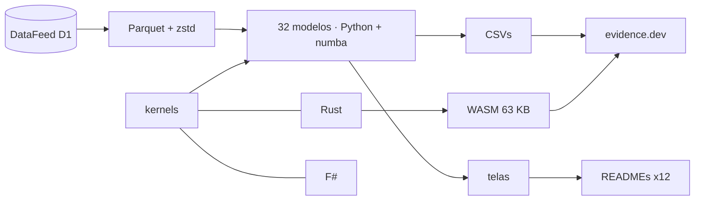

<!--
quant_models_2026
Autor: ProfBru - Bruno Penedo © 2026 - TODOS OS DIREITOS RESERVADOS
E-mail: profbruanbima@gmail.com

README GERADO — não editar à mão. Estrutura: montar_i18n.py · prosa: translation/blocos/<idioma>.json
Gerar: python3 public/foundations/pipeline/montar_i18n.py && python3 public/foundations/pipeline/gerar_readmes.py
-->

<div align="center">

# 📈 quant_models_2026 — 40 מודלים כמותיים לקבלת החלטות בתנאי אי־ודאות


**ProfBru © 2026**

### הפסיקו לבחור לפי גיליון אלקטרוני. התחילו להחליט לפי מודל.

**32 מודלים שרצים על 16 שנות נתונים אמיתיים, שלושה מנועים (Python, Rust ו־F#) שמסכימים ביט אחר ביט, ומעבדה שרצה בדפדפן שלכם — כל אחד מראה, בעזרת הנתונים, היכן האינטואיציה מטעה.**

[](#modelos)
[](#arquitetura)
[](#desempenho)
[](#site)

[](https://www.python.org)
[](https://numba.pydata.org)
[](https://www.rust-lang.org)
[](https://fsharp.org)
[](https://evidence.dev)
[](#licenca)

[Português](README.md) · [English](README.en.md) · [Español](README.es.md) · [Français](README.fr.md) · [Deutsch](README.de.md) · [中文](README.zh.md) · [한국어](README.ko.md) · [हिन्दी](README.hi.md) · **עברית** · [Русский](README.ru.md) · [Svenska](README.sv.md) · [Suomi](README.fi.md)

</div>

> [!WARNING]
> השתמשו רק במאגר הזה כמקור. התוצאות תלויות בנתוני DataFeed המאומתים; שום מסך אינו המלצת השקעה.

---

## 💀 הכאב: להחליט לפי גיליון אלקטרוני

כבר עשיתם את זה. בניתם גיליון אלקטרוני של חלופות — ספקים, טלפונים לצוות, מכוניות חשמליות לצי, נכסים לתיק, מטוסים לטייסת — נתתם ציון לכל קריטריון, שקללתם, מיינתם מהגבוה לנמוך והבאתם את המקום הראשון לישיבה. הגיליון צדק. ההחלטה לא.

**הגיליון לא טועה בחישוב. הוא טועה בשאלה.**

| מה עשיתם | מה הכלי הסתיר |
|---|---|
| 🔻 **דירגתם לפי ממוצע העבר** | הממוצע של 2010–2019 בחר את התיק הטוב ביותר; ב־2020–2026 הוא הפסיד למשקלות שווים. בעבר היה רעש שהעמודה לא מראה. |
| 🏷️ **סיננתם לפי התווית** | 'פיזרתם' בין אפשרויות מאותה קטגוריה שנעות יחד — ובין קטגוריות שונות שבנתונים יוצרות את אותה קבוצה. |
| 🎯 **סמכתם על שיעור הפגיעה** | מודל ש'צודק ב־54%' רק חזר על שיעור ימי העלייה. דיוק גבוה ללא כושר הבחנה הוא הטלת מטבע יקרה. |

> [!IMPORTANT]
> **הפגם אינו בכם. הוא בכלי.**
> גיליונות אלקטרוניים, מטריצות ניקוד ומסנני דירוג מתייחסים לכל מספר כוודאי. אף אחד מהם אינו שואל כמה ממה שאתם רואים הוא רעש, האם העבר עדיין מייצג את העתיד, או האם 'האפשרות הטובה ביותר' שלכם תשרוד תקופה שמעולם לא ראתה.

ויש טעות שאתם עושים בלי לדעת: ככל שבודקים יותר חלופות וצירופים, התוצאה של העבר משתפרת — במקרה גרידא. האלגוריתם הגנטי של הפרויקט בדק 1,826 כללים על מדד מניות; הטוב ביותר זרח באימון ובתקופה הבאה הפסיד להחזקה פשוטה של הפוזיציה.

### היכן ההחלטה קורסת

בישיבה, השאלה שמפילה את ההמלצה היא אף פעם לא 'מה הציון?'. היא אחרת:

> *ואם התרחיש ישתנה — כמה מזה עדיין יעמוד?*

הגיליון אינו יכול לענות, כי מעולם לא הפריד אות מרעש, מעולם לא נבחן מחוץ למדגם ומעולם לא מדד את אי־הוודאות של עצמו.

---

## 💊 הפתרון

כל אחד מ־32 המודלים רץ על 27 נכסים אמיתיים מ־2010 עד 2026, עם אימון ובחינה מופרדים בזמן, ומסתיים במשפט שנכתב מתוך המספר — גם כשהמספר סותר את האינטואיציה.

> ### שלושה מנועים עצמאיים — Python/numba, Rust ו־F# — מחשבים את אותה מתמטיקה וחייבים להסכים ביט אחר ביט. שני מנועים מסכימים מוכיחים שהחישוב נכון, לא רק הקוד.

<div align="center">

| ❌ גיליון אלקטרוני | ✅ מודל |
|---|---|
| האפשרות עם הציון הממוצע הגבוה ביותר | **האפשרות ששורדת מחוץ למדגם, עם עלות וסיכון מוצהרים** |
| *'מפוזר' כי הקטגוריות שונות* | **מפוזר כי הנתונים מראים מתאם נמוך בין הבחירות** |

</div>

**המודלים אינם חוזים את העתיד בוודאות — והם אומרים זאת: כמה תוצאות כאן מראות ששיטה פופולרית אינה נושאת אות. זה הערך: לדעת היכן לא לסמוך לפני שמוציאים כסף.**

---

## 🎯 למה זה משמש — מעבר לשוק

הדוגמאות משתמשות בסדרות שוק כי הן ארוכות, ציבוריות וחסרות רחמים. הטכניקות זהות לכל החלטה בתנאי אי־ודאות — בסיס הידע של הפרויקט עצמו מראה את מודל כיוון השוק חוזה נשירת סטודנטים ואת גלאי החריגות מאתר הונאה.

| החלטה | מודלים שעונים | השאלה שהגיליון לא עונה עליה |
|---|---|---|
| 📊 **תיק השקעות** | משטרים (HMM), GARCH, Markowitz, בדיקה לאחור walk-forward | האם ההקצאה האופטימלית של העבר תקפה במשטר הבא? |
| 📱 **רכש תאגידי — ציוד וטלפונים** | Benford, חריגים, K-means, סחיפה | האם המחיר של הספק הזה הוא חריגה, טעות הקלדה או הונאה? האם הספק של אתמול עדיין מספק אותו דבר? |
| 🔋 **צי מכוניות חשמליות** | בייס, GARCH, מונטה קרלו O-U, מערכות לא־ליניאריות | עם חודשים ספורים בלבד של נתוני טווח ומחיר אנרגיה, כמה לסמוך על החיסכון החזוי? |
| 🛡️ **ביטחון — רכש טנקים ומטוסים** | שרשראות מרקוב, זנבות כבדים, אלגוריתם גנטי עם אילוצים, PCA | מהי הזמינות הצפויה של הצי בין תפעול לתחזוקה, ומהי העלות בתרחיש הגרוע ביותר, לא בממוצע? |
| 🚀 **סטארט־אפים והחלטות הנהלה** | בייס, סחיפה, SHAP, בדיקה לאחור walk-forward | האם ההשערה שאומתה בפיילוט עדיין תקפה בשוק — והאם אוכל להסביר את ההחלטה לדירקטוריון במספרים? |

> [!NOTE]
> המסכים והמספרים במאגר הזה מגיעים מנתוני שוק. יישום בתחום אחר מחייב את נתוני אותו תחום; השיטות, מבחני האימות ושלושת המנועים זהים.

---

## 🖼️ ראו אותו פועל

<a id="site"></a>

### 🌐 האתר והמעבדה

האתר נבנה עם evidence.dev: SQL על התוצאות, עמוד אינטראקטיבי לכל מודל ומעבדה שבה מנוע Rust, מהודר ל־WebAssembly, רץ בדפדפן שלכם — ללא שרת וללא עלות למשתמש.

| | |
|---|---|
| <br/>**חלון ראווה: משפט אחד לכל מודל**<br/>כל שורה היא הקריאה שהנתונים עצמם הפיקו — כולל אלה שמפריכות את הטכניקה הפופולרית. | <br/>**מעבדה בדפדפן (WebAssembly)**<br/>216,000 מסלולי מונטה קרלו בכ־3 שניות, בדפדפן, עם אותו מנוע שעובר את מבחני ההסכמה. |
| <br/>**עמוד מודל: כרטיס, קריאה ותרשימים**<br/>כלל היציאה האופטימלי נגזר מהדינמיקה הנמדדת של מרווח Brent − WTI, לא מאחוז קבוע. | <br/>**שלושה מנועים, תוצאה אחת**<br/>זמנים נמדדים של אותו גרעין ב־numba, ‏Rust ו־F#, בניכוי זמן הפעלת התהליך. |

<a id="modelos"></a>

### 🧪 32 המודלים, אחד אחד

כל מסך להלן נושא את שאלת ההחלטה שהמודל עונה עליה ואת הקריאה שהנתונים הפיקו. שמונת המודלים הנותרים בקטלוג (טקסט, למידת חיזוק וסימולציה מרובת סוכנים) מתוארים ב־modelos_quant.md.

### סטטיסטיקה — מה הנתון הוא, לפני מה שהוא חוזה

#### 01 · סטטיסטיקה תיאורית חסינה

<div align="center"></div>

**למה לבחור בו:** בחרו בו כשצריך לדעת אם הממוצע מייצג את המקרה הטיפוסי או שכמה ערכי קיצון מעוותים את החישוב.

> **מה הנתונים הראו:** לכסף סטיית תקן גדולה פי 1.6 מה־σ החסינה שלו: ימים קיצוניים ספורים מנפחים את התנודתיות ה'ממוצעת' — גבנוניות עודפת של 26.9.

#### 02 · תמיכה והתנגדות לפי שכיח + אשכולות

<div align="center"></div>

**למה לבחור בו:** בחרו בו כשגבול מחיר או תקציב צריך לנבוע מקריטריון שניתן לשחזר, ולא מקו שסומן בעין.

> **מה הנתונים הראו:** זהב: השכיח של המחירים המעוגלים הוא 3,330.00; הרצועה המבוקרת ביותר (2,350.00–2,730.00) מרכזת 24% מימי המסחר ומשמשת כיום כתמיכה.

#### 03 · סטציונריות (Augmented Dickey-Fuller)

<div align="center"></div>

**למה לבחור בו:** בחרו בו לפני כל תחזית: הוא אומר אם העבר עדיין מדגם תקף של העתיד.

> **מה הנתונים הראו:** רק 1 מתוך 8 סדרות מחיר סטציונרית ברמת 5%; בתשואת לוג, 8 מתוך 8. לאמן על מחירים פירושו לאמן על התפלגות שלא חוזרת.

#### 04 · רגרסיה ליניארית (OLS) בין נכסים

<div align="center"></div>

**למה לבחור בו:** בחרו בה כדי למדוד כמה משתנה אחד באמת מסביר משתנה אחר — ולגלות שהקשר ה'מובן מאליו' לפעמים כמעט אינו מסביר דבר.

> **מה הנתונים הראו:** דאו ג'ונס ~ S&P 500: ‏β = 0.91 עם R² = 0.91. לעומת זאת, אג"ח אוצר אמריקאית ~ S&P 500 עם R² של 0.04: הקשר ה'מובן מאליו' כמעט אינו מסביר את התנועה היומית.

#### 13 · חריגים בשיטות מרובות (IQR, ‏z חסין, LOF)

<div align="center"></div>

**למה לבחור בו:** בחרו בו כשנתון מוזר יכול להיות טעות איסוף או האירוע החשוב ביותר בסדרה: הקונצנזוס מכריע.

> **מה הנתונים הראו:** ב־S&P 500, דיאגרמת הקופסה מסמנת 264 ימים כחריגים (6.7% מהמדגם); הקונצנזוס של שלוש השיטות משאיר 101. נקודה חריגה אחת משנה את שיפוע הקו מ־0.76 ל־0.53.

#### 31 · חוק ניוקומב־בנפורד — שלמות נתונים

<div align="center"></div>

**למה לבחור בו:** בחרו בו כדי לבקר מאגר ערכים לפני שסומכים עליו, תוך ידיעה מתי המבחן חל ומתי הוא יהיה אזעקת שווא.

> **מה הנתונים הראו:** רק 21 מתוך 29 סדרות המחזור מכסות טווח מספיק למבחן; החלת בנפורד על השאר תהיה אזעקת שווא. במצטבר, המחזורים מכסים 6.4 סדרי גודל ונותנים MAD של 0.0099 (התאמה סבירה).

#### 25 · תנודתיות מותנית (EWMA ו־GARCH(1,1))

<div align="center"></div>

**למה לבחור בו:** בחרו בה כדי לקבוע סיכון, מלאי ביטחון או מגבלת חשיפה לפי הסיכון של מחר, לא לפי ממוצע השנה.

> **מה הנתונים הראו:** S&P 500: התמדה α+β = 0.963 — הלם תנודתיות זקוק ל־18 ימי מסחר כדי לאבד חצי מעוצמתו. VaR של 99% ליום אחד: 1.75%.

#### 24 · דינמיקה לא־ליניארית וזנבות כבדים

<div align="center"></div>

**למה לבחור בו:** בחרו בה כשהתרחיש הגרוע חשוב יותר מהממוצע: היא מודדת בכמה הזנבות האמיתיים חורגים מהעקומה הנורמלית.

> **מה הנתונים הראו:** תנועות של 4 סטיות תקן מתרחשות, בחציון, פי 64 יותר ממה שהעקומה הנורמלית חוזה; לתשואה כמעט אין זיכרון (מתאם עצמי -0.02), אבל לגודל התנועה יש (0.15).

#### 27 · סיבתיות גריינג'ר והדבקה

<div align="center"></div>

**למה לבחור בו:** בחרו בה כדי להפריד בין 'נעים יחד' ל'אחד מקדים את השני' לפני שמשתמשים באינדיקטור כטריגר.

> **מה הנתונים הראו:** מתוך 72 הזוגות שנבדקו, 7 שורדים את תיקון בונפרוני. החזק ביותר, אירו/דולר → מדד הדולר, הוא תוצר לוואי של שעות סגירה בין מקורות שונים: קדימות סטטיסטית אינה סיבה — והמבחן מראה בדיוק היכן האינטואיציה הייתה מוטעית.

### למידת מכונה — מול שיעור הבסיס

#### 05 · רגרסיה לוגיסטית של כיוון

<div align="center"></div>

**למה לבחור בו:** בחרו בה כקו בסיס כן לכל סיווג כן/לא: אם מודל מורכב לא מנצח אותה, הוא לא מצדיק את העלות שלו.

> **מה הנתונים הראו:** מחוץ למדגם (2016–2026) הרגרסיה הלוגיסטית צודקת ב־54.2% מכיוון ה־S&P 500 — כמעט שיעור ימי העלייה (54.2%): היא חזתה עלייה ב־98% מהימים ו־AUC שלה 0.492. דיוק גבוה ללא כושר הבחנה הוא המלכודת שקו הבסיס הזה מנטרל.

#### 06 · SVM ושיטות גרעין

<div align="center"></div>

**למה לבחור בו:** בחרו בו כשהגבול בין 'טוב' ל'רע' עקום — וכדי להוכיח שקיים אות לפני שמשלמים על מודלים גדולים יותר.

> **מה הנתונים הראו:** עם RSI ותנודתיות בלבד כקלט, אף אחד מארבעת הגרעינים אינו עובר 50.7% דיוק מאוזן מחוץ למדגם. RBF הוא ש'לומד' הכי הרבה באימון (53.2%) ומפסיד הכי הרבה בבחינה (48.4%): גרעין אינו יוצר אות היכן שאין כזה.

#### 07 · עצי החלטה ו־Random Forest

<div align="center"></div>

**למה לבחור בו:** בחרו בהם כשההחלטה חייבת להיות ניתנת להסבר בכללים וחסינה בנתונים טבלאיים.

> **מה הנתונים הראו:** עץ בעומק 20 צודק ב־83.7% באימון וב־49.8% בבחינה: הוא שינן את העבר. היער הרדוד נשאר על 53.5% — צנוע אך כן; המאפיין הנפוץ ביותר הוא 'ret_1'.

#### 08 · רשת עצבית MLP — אינדיקטור היפוך

<div align="center"></div>

**למה לבחור בו:** בחרו בה לאירועי מפנה נדירים, ומדדו את הפגיעה מול השכיחות הטבעית של האירוע, לא מול הדיוק הכולל.

> **מה הנתונים הראו:** בכסף, ב־2023–2026 (מעולם לא נראו באימון), ה־MLP הפיק 607 אותות היפוך כלפי מעלה בדיוק של 17.3%, מול שיעור בסיס של 13.6% (פי 1.27 מהשכיחות הטבעית): היחס הזה, ולא הדיוק הכולל, אומר אם האינדיקטור מוסיף מידע.

#### 09 · PCA — גורמי סיכון ומדדים

<div align="center"></div>

**למה לבחור בו:** בחרו בו כדי לגלות כמה הימורים עצמאיים באמת קיימים ברשימה ארוכה של אפשרויות.

> **מה הנתונים הראו:** הגורם הראשון לבדו מסביר 24.5% מהשונות היומית של 27 נכסים; נדרשים 12 גורמים כדי להגיע ל־80%. 27 הנכסים אינם 27 הימורים עצמאיים.

#### 10 · אשכול נכסים (K-means)

<div align="center"></div>

**למה לבחור בו:** בחרו בו כדי לקבץ חלופות לפי התנהגות נמדדת ולא לפי תווית הקטלוג.

> **מה הנתונים הראו:** מדד הצללית בוחר K = 4 קבוצות ללא התערבות ידנית; יש קבוצה שמערבבת 3 סוגי נכסים שונים — התווית 'סחורה' או 'מט"ח' אינה אומרת כיצד הנכס מתנהג.

#### 11 · שיכוני תשואות (FastICA) + קוסינוס

<div align="center"></div>

**למה לבחור בו:** בחרו בו כדי לראות במפה אחת מי נע יחד עכשיו — מתעדכן בכל חלון.

> **מה הנתונים הראו:** ב־60 ימי המסחר האחרונים, הזוג הדומה ביותר הוא נפט ברנט × נפט WTI (קוסינוס 0.96) והמנוגד ביותר הוא מדד הדולר × אירו/דולר (-0.89): מפת קרבה שמתעדכנת בכל חלון.

#### 12 · Isolation Forest — תשואות ומחזורים חריגים

<div align="center"></div>

**למה לבחור בו:** בחרו בו כדי למצוא את החריג בלי דוגמאות מתויגות: האזעקה הראשונה שהדינמיקה השתנתה.

> **מה הנתונים הראו:** בלי תווית אחת, יער הבידוד מסמן 77 ימי מסחר של ה־S&P 500 כחריגים — 21 בשנת 2020 לבדה — ו־57% מהם הם ירידות: החריגה היא אות לשינוי דינמיקה, לא רעש שיש להשליך.

#### 32 · יכולת הסבר עם ערכי שפלי (SHAP)

<div align="center"></div>

**למה לבחור בו:** בחרו בה כשמישהו שואל 'למה המודל החליט כך?' והתשובה צריכה מספרים, לא אמונה.

> **מה הנתונים הראו:** בתחזית האחרונה, הסתברות העלייה עולה מ־54.0% (ממוצע המודל) ל־55.4%; המאפיין שהשפיע יותר מכול היה 'ret_1' (+1.0 נקודות אחוז). הקופסה השחורה מתחילה לענות 'למה'.

### הסתברות ואותות — משטרים, אי־ודאות ומחזורים

#### 14 · שרשרת מרקוב של משטרים (עלייה, ירידה, דשדוש)

<div align="center"></div>

**למה לבחור בו:** בחרו בה כדי לענות על 'בהיותי בשלב הזה, מה הסיכוי לעבור לשלב ההוא?' במטריצה שניתן לבקר.

> **מה הנתונים הראו:** ב־S&P 500, אחרי מקטע ירידה של 20 ימי מסחר, הסיכוי שהמקטע הבא יהיה עולה הוא 59.0% — גבוה מהסיכוי להמשיך לרדת (30.8%). בשיווי משקל, השוק שוהה 41.3% מהזמן במשטר עלייה.

#### 15 · מודל מרקוב חבוי (HMM גאוסי)

<div align="center"></div>

**למה לבחור בו:** בחרו בו כשהמשטרים אינם נצפים ויש ללמוד אותם מהנתונים, עם הסתברות יומית.

> **מה הנתונים הראו:** ללא כלל חיתוך שרירותי, ה־HMM מוצא שלושה משטרים ב־S&P 500: לסוער תנודתיות של 43% בשנה מול 7% ברגוע, והוא נמשך בממוצע 18 ימי מסחר. היום המשטר הסביר ביותר הוא 'רגוע'.

#### 16 · עדכון בייסיאני של תשואה ותנודתיות

<div align="center"></div>

**למה לבחור בו:** בחרו בו כשיש מעט נתונים ולחץ רב להחליט: הוא אומר כמה לסמוך על הממוצע, לא רק מהו הממוצע.

> **מה הנתונים הראו:** זהב מאז 2019: התשואה השנתית הממוצעת לאחר העדכון היא 15.3%, אך רווח האמינות של 95% נע בין 2.3% ל־28.4%. ההסתברות שהממוצע חיובי היא 98.9% — ממוצע המדגם (15.7%) לבדו אינו אומר זאת.

#### 30 · כללי מסחר אופטימליים (Ornstein-Uhlenbeck)

<div align="center"></div>

**למה לבחור בו:** בחרו בהם כדי לקבוע יעד ומגבלת הפסד מתוך הדינמיקה הנמדדת, במקום אחוזים קבועים שעברו בירושה.

> **מה הנתונים הראו:** מרווח Brent − WTI חוזר לממוצע עם זמן מחצית של 22 ימי מסחר. בסימולציה של 4,000 מסלולים לכל תא, הכלל הטוב ביותר הוא יעד של 1.5σ עם עצירה ב־10.0σ (שארפ לעסקה 0.63) — עצירה באחוז קבוע מתעלמת מהדינמיקה של הנכס.

#### 17 · התמרת פורייה — מחזורים דומיננטיים

<div align="center"></div>

**למה לבחור בו:** בחרו בה כדי להוכיח אם מחזור עונתי קיים או שהוא מקרי — לכל ספקטרום יש שיאים.

> **מה הנתונים הראו:** מתוך 12 שיאי המחזור הגדולים בארבעת הנכסים, רק 2 עוברים את סף הרעש של 95% שהתקבל מערבוב התשואות עצמן. לכל פריודוגרמה יש שיאים; המבחן אומר אילו הם מחזור ואילו מקרה.

#### 18 · גלונים — פירוק זמן־תדר

<div align="center"></div>

**למה לבחור בו:** בחרו בהם כדי למקם בזמן מתי הסערה מתחילה, דבר שהממוצע השנתי מסתיר.

> **מה הנתונים הראו:** רמה 1 (תנודות של 2 ימי מסחר) מרכזת 55.0% מהאנרגיה של ה־S&P 500. כשהאנרגיה בתדר הגבוה מתפרצת (z > 2), פיזור התשואה של 20 ימי המסחר הבאים גדול פי 1.3 מהרגיל: הגלון ממקם בזמן את מה שפורייה רואה רק בממוצע.

#### 23 · מעריך Hurst ואינדיקטור Hurst נע

<div align="center"></div>

**למה לבחור בו:** בחרו בו כדי להכריע בין אסטרטגיית מגמה לאסטרטגיית חזרה לממוצע — בהשוואה לייחוס חסר זיכרון.

> **מה הנתונים הראו:** ה־H הגולמי של R/S נע בין 0.54 ל־0.59 ונראה 'מתמיד'; מול סדרות מעורבבות, אף אחד מ־6 הנכסים אינו מראה זיכרון אמיתי. חציית MH100 − MH150 עדיפה על חציית הממוצעים הנעים ב־3 מתוך 6 נכסים לפי מדד שארפ.

### אופטימיזציה וממשל — האופטימום, המקרה והזמן

#### 19 · החזית היעילה של Markowitz

<div align="center"></div>

**למה לבחור בו:** בחרו בה כדי לראות את התשואה הטובה ביותר האפשרית לכל רמת סיכון — וכמה האופטימום הזה תלוי באומדנים שבירים.

> **מה הנתונים הראו:** לתיק שארפ המרבי היה מדד שארפ של 1.19 ב־2010–2019 והוא הניב 0.76 ב־2020–2026; המשקלות השווים עלו מ־0.35 ל־0.94. החזית מדויקת לגבי העבר — הטעות היא באמידת ממוצעים שהעתיד אינו חוזר עליהם.

#### 20 · אלגוריתם גנטי — אופטימיזציית תיק

<div align="center"></div>

**למה לבחור בו:** בחרו בו כשליעד יש אילוצים אמיתיים (עלויות, תקרות, הפסדים מרביים) שאף נוסחה סגורה אינה מקבלת.

> **מה הנתונים הראו:** ארבע ריצות מקבילות של האלגוריתם הגנטי, עם זרעים שונים, מתכנסות לאותו תיק (סטיית משקל ממוצעת של 0.1 נקודות אחוז) עם שארפ של 1.19 ב־2010–2019. ב־2020–2026 הוא מניב 0.86, מתחת למשקלות השווים (0.94): התכנסות מוכיחה שהאופטימום יציב, לא שהעתיד יחזור עליו.

#### 21 · אלגוריתם גנטי — בחירת אינדיקטורים ופרמטרים

<div align="center"></div>

**למה לבחור בו:** בחרו בו כדי לחפש את צירוף הכללים הטוב ביותר — תוך תיעוד כמה נבדקו, כדי שהמקרה לא יטעה אתכם.

> **מה הנתונים הראו:** האלגוריתם הגנטי בדק 1826 כללים שונים על ה־S&P 500, ולטוב ביותר בכל ריצה היה שארפ אימון של עד 0.78; ב־2019–2026 הם נעו בין 0.41 ל־0.54, מול 0.77 להחזקה פשוטה. ככל שבודקים יותר כללים, שארפ האימון עולה במקרה גרידא.

#### 22 · תכנות גנטי — רגרסיה סימבולית

<div align="center"></div>

**למה לבחור בו:** בחרו בו כדי להמציא נוסחאות קריאות שניתן לבקר, ולהעמיד אותן מול תקופה שמעולם לא נראתה.

> **מה הנתונים הראו:** התכנות הגנטי גילה נוסחאות קריאות כמו ((sen(cos(r3)) + r1) + sen(sen(cos(r2)))) (10 צמתים), עם מתאם דרגות של -0.080 לתשואה הבאה באימון ו־-0.028 בבחינה. האבולוציה תמיד מוצאת 'משהו' בעבר; רק התקופה שלא נראתה מפרידה בין אינדיקטור לצירוף מקרים.

#### 26 · רשת מתאמים ומרכזיות

<div align="center"></div>

**למה לבחור בו:** בחרו בה כדי לראות מי במרכז ומי בשוליים של מערכת תלויות.

> **מה הנתונים הראו:** שמונת הנכסים השוליים, שנבחרו לפי רשת 2010–2019, נשארו כמעט עצמאיים ב־2020–2026 (מתאם ממוצע 0.00 מול 0.15 במרכזיים) והניבו יותר (11.0% מול 7.4% בשנה), אך עם תנודתיות גבוהה יותר. המנצח על שני הסלים היה התיק עם כל ה־27 (שארפ 0.95): מספר ההימורים העצמאיים משקל יותר מהמיקום ברשת.

#### 28 · זיהוי סחיפה של מודל ושל מושג

<div align="center"></div>

**למה לבחור בו:** בחרו בו כדי לדעת שמודל התיישן לפני שההפסד מופיע.

> **מה הנתונים הראו:** המודל שאומן על 2010–2016 דורש אימון מחדש ב־8 מתוך 10 השנים שאחריו: משטר הקלט של אותה תקופה לא חזר. ל־2022 היה הדיוק הגרוע ביותר (43.8%) ול־2017 התזוזה הגדולה ביותר (KS 0.77) — ניטור הקלט חושף את הבעיה בלי לחכות להפסד.

#### 29 · בדיקה לאחור walk-forward עם עלויות

<div align="center"></div>

**למה לבחור בו:** בחרו בה כדי לבחון כל כלל החלטה מול הזמן, עם עלויות ושערי דחייה שהוצהרו מראש.

> **מה הנתונים הראו:** בעלויות של 5 נקודות בסיס לכל תחלופה, 2 מתוך 4 אסטרטגיות עוברות את שלושת שערי ה־STOP (משקלות שווים, שוויון סיכון). חלון המומנטום, שנבחר כל חודש על סמך העבר בלבד, השתנה 45 פעמים — ה'פרמטר האופטימלי' אינו קבוע.


---

## ⚡ התקנה

דרישות מקדימות: Python 3.13, ‏Rust 1.96 (עם היעד wasm32-unknown-unknown), ‏.NET 9 למנוע F# ו־Node 20+ לאתר. הנתונים מגיעים מ־DataFeed Service Provider (משתנה QUANT_MODELS_DATAFEED).

**1 · נתונים ומודלים**

```bash
git clone <url-do-repositorio-privado> quant_models_2026
cd quant_models_2026/public/foundations/pipeline
pip install -r requisitos.txt
export QUANT_MODELS_DATAFEED=/mnt/d/DataFeedServiceProvider
python3 dados_feed.py consolidar --tf D1
python3 executar_modelos.py
```

**2 · שלושת המנועים והתאמתם**

```bash
(cd ../rust/quant_models_2026_core && cargo build --release && cargo build --release --lib --target wasm32-unknown-unknown)
(cd ../fsharp/QuantModels2026.Core && dotnet build -c Release)
python3 testes_nucleo.py        # 38 verificações: numba × Rust × F#
```

**3 · מסכים ואתר**

```bash
python3 gerar_telas.py && python3 gerar_site.py
cd ../evidence && npm ci && bash subir_servidor.sh     # http://localhost:3020
```

**4 · הרצה ארוכה ברקע (screen + כלב שמירה כל 20 דקות)**

```bash
./run_all.sh --background
screen -r quant_models_2026
```

---

<a id="arquitetura"></a>

## 🧠 ארכיטקטורה והחלטות



החלטות ארכיטקטורה, כל אחת עם הנימוק שמאחוריה:

| | |
|---|---|
| **שלושה מנועים עם אותו מחולל פסאודו־אקראי (xorshift64*)** | אפילו המונטה קרלו תואם ביט אחר ביט; טעות מתמטית לא יכולה לחמוק בשלוש שפות בבת אחת. |
| **WebAssembly ללא תלויות (63 KB)** | החישוב הכבד רץ בדפדפן של המשתמש: עלות שרת אפס ושום נתון אינו יוצא מהמחשב. |
| **אימון ובחינה מופרדים בזמן, תמיד** | ערבוב סדרות עתיות מדליף את העתיד אל האימון ומייצר דיוק מזויף. |
| **אומדים מושווים לאפס שלהם עצמם** | ל־Hurst ול־Fourier יש הטיות ידועות; רק השוואה לנתונים מעורבבים מפרידה אות מתוצר לוואי. |
| **הקריאה נכתבת מתוך המספר** | המשפט של כל מסך נוצר מהתוצאה; כשהתוצאה משתנה, המשפט משתנה איתה. |
| **מקביליות עם ProcessPoolExecutor וחלוקה קבועה** | התוצאה אינה תלויה במספר הליבות של המחשב. |

---

<a id="desempenho"></a>

## 🚀 ביצועים שנמדדו

מספרים שנמדדו עם bench_motores.py ונרשמו בהיסטוריית הפרויקט. ב־Rust וב־F# נוכה זמן הפעלת התהליך.

| עומס | numba | Rust | F# | Python טהור |
|---|---:|---:|---:|---:|
| מונטה קרלו O-U (רשת 20×20, 2,000 מסלולים) | 2.859 s | 2.840 s | 3.490 s | — |
| Hurst R/S נע (חלון 250, 3,917 ימי מסחר) | 0.027 s | 0.016 s | 0.108 s | 7.86 s |
| HMM גאוסי ב־EM (3 מצבים, 200 איטרציות) | 0.235 s | 0.308 s | 1.213 s | 64.19 s |
| מדדים ל־2,000 תיקים × 10 נכסים | 1.366 s | 1.297 s | 1.908 s | — |

הנתיב הקריטי (רשת מונטה קרלו 20×20 ב־numba) רץ ב־3.4 s, בתקציב של 10 s ועם הוכחה לתוצאה זהה לזו של מנוע Rust.

---

## 📚 הקטלוג המלא

כל 40 המודלים — מספר, סוג, קטגוריה ותיאור — נמצאים ב־modelos_quant.md, שנוצר מאותו מקור שמזין את האתר. → [modelos_quant.md](modelos_quant.md)

---

## ❓ שאלות קשות

<details><summary><b>אני כבר משתמש בגיליון עם משקלות ומסננים. זה לא אותו דבר?</b></summary>

לא. הגיליון מסכם ציונים שהוא מחשיב כוודאיים. המודלים מודדים כמה מהציון הוא רעש, בוחנים את הבחירה בתקופה שלא ראתה מעולם ומראים מתי האפשרות הטובה ביותר של העבר מפסיקה להיות הטובה ביותר.
</details>

<details><summary><b>האם אחד מהמודלים האלה 'מכה את השוק'?</b></summary>

כמה תוצאות במאגר מראות בדיוק את ההפך לגבי טכניקות פופולריות: אינדיקטורים וגרעינים ללא אות כיוון יומי, זיכרון ארוך שהוא רק הטיית אומד. לדעת זאת לפני שמשקיעים זמן וכסף — זו המטרה.
</details>

<details><summary><b>למה שלוש שפות לאותו חישוב?</b></summary>

כי מנוע שני עצמאי שמסכים עם הראשון מוכיח את המתמטיקה, והשלישי מכריע. ב־38 בדיקות, השלושה מסכימים ביט אחר ביט.
</details>

<details><summary><b>האם אני צריך שרת או ענן?</b></summary>

לא. המודלים רצים במחשב שלכם והאתר סטטי: המעבדה מריצה את מנוע Rust כ־WebAssembly בתוך הדפדפן.
</details>

<details><summary><b>האם זה מתאים להחלטות מחוץ לשוק ההון?</b></summary>

השיטות כן; הנתונים חייבים להגיע מהתחום שלכם. הטבלה 'למה זה משמש' מראה אילו מודלים עונים על כל סוג החלטה.
</details>

---

<a id="licenca"></a>

## 📜 רישיון ומחבר

קוד, מודלים, טקסטים ומסכים: השימוש שמור למחבר בלבד. ספריות צד שלישי שומרות על רישיונותיהן (NumPy, numba, scikit-learn, SciPy, pandas, networkx, matplotlib, evidence.dev).

**מחבר:** ProfBru - Bruno Penedo © 2026 — TODOS OS DIREITOS RESERVADOS · profbruanbima@gmail.com

<div align="center">


**ProfBru © 2026**

</div>
