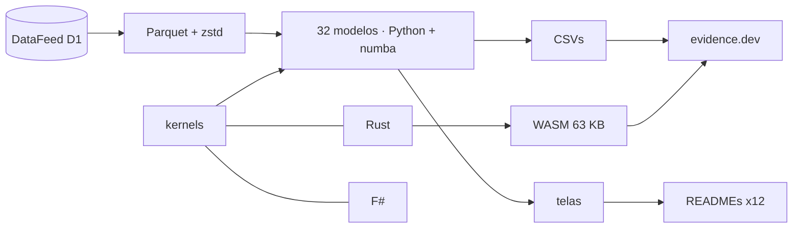

<!--
quant_models_2026
Autor: ProfBru - Bruno Penedo © 2026 - TODOS OS DIREITOS RESERVADOS
E-mail: profbruanbima@gmail.com

README GERADO — não editar à mão. Estrutura: montar_i18n.py · prosa: translation/blocos/<idioma>.json
Gerar: python3 public/foundations/pipeline/montar_i18n.py && python3 public/foundations/pipeline/gerar_readmes.py
-->

<div align="center">

# 📈 quant_models_2026 — अनिश्चितता में निर्णय लेने के लिए 40 मात्रात्मक मॉडल


**ProfBru © 2026**

### स्प्रेडशीट से चुनना बंद करें। मॉडल से निर्णय लेना शुरू करें।

**16 वर्षों के वास्तविक डेटा पर चलने वाले 32 मॉडल, बिट-दर-बिट सहमत होने वाले तीन इंजन (Python, Rust और F#) और आपके ब्राउज़र में चलने वाली एक प्रयोगशाला — हर एक डेटा से दिखाता है कि अंतर्ज्ञान कहाँ धोखा देता है।**

[](#modelos)
[](#arquitetura)
[](#desempenho)
[](#site)

[](https://www.python.org)
[](https://numba.pydata.org)
[](https://www.rust-lang.org)
[](https://fsharp.org)
[](https://evidence.dev)
[](#licenca)

[Português](README.md) · [English](README.en.md) · [Español](README.es.md) · [Français](README.fr.md) · [Deutsch](README.de.md) · [中文](README.zh.md) · [한국어](README.ko.md) · **हिन्दी** · [עברית](README.he.md) · [Русский](README.ru.md) · [Svenska](README.sv.md) · [Suomi](README.fi.md)

</div>

> [!WARNING]
> केवल इसी रिपॉज़िटरी को स्रोत मानें। परिणाम सत्यापित DataFeed डेटा पर निर्भर हैं; कोई भी स्क्रीन निवेश सलाह नहीं है।

---

## 💀 दर्द: स्प्रेडशीट से निर्णय

आप यह कर चुके हैं। आपने विकल्पों की एक स्प्रेडशीट बनाई — आपूर्तिकर्ता, टीम के लिए फ़ोन, बेड़े के लिए इलेक्ट्रिक कारें, पोर्टफोलियो के लिए परिसंपत्तियाँ, एक स्क्वाड्रन के लिए विमान — हर मानदंड को अंक दिए, भार दिया, बड़े से छोटे क्रम में लगाया और पहले स्थान वाले को बैठक में ले गए। स्प्रेडशीट सही थी। निर्णय नहीं।

**स्प्रेडशीट गणना में गलती नहीं करती। वह प्रश्न में गलती करती है।**

| आपने क्या किया | उपकरण ने क्या छिपाया |
|---|---|
| 🔻 **पिछले औसत से क्रम दिया** | 2010–2019 के औसत ने सबसे अच्छा पोर्टफोलियो चुना; 2020–2026 में वह समान भार से हार गया। अतीत में ऐसा शोर था जो कॉलम नहीं दिखाता। |
| 🏷️ **लेबल से छाँटा** | आपने एक ही श्रेणी के उन विकल्पों में 'विविधीकरण' किया जो साथ चलते हैं — और उन अलग श्रेणियों में भी जो डेटा में एक ही समूह बनाती हैं। |
| 🎯 **सफलता दर पर भरोसा किया** | '54% सही' मॉडल केवल तेज़ी वाले दिनों का अनुपात दोहरा रहा था। अलग करने की क्षमता के बिना ऊँची सटीकता एक महँगा सिक्का उछालना है। |

> [!IMPORTANT]
> **दोष आपका नहीं है। उपकरण का है।**
> स्प्रेडशीट, स्कोरिंग मैट्रिक्स और रैंकिंग फ़िल्टर हर संख्या को निश्चित मानते हैं। इनमें से कोई नहीं पूछता कि आप जो देख रहे हैं उसमें कितना शोर है, क्या अतीत अब भी भविष्य का प्रतिनिधित्व करता है, या क्या आपका 'सबसे अच्छा विकल्प' ऐसे दौर में टिक पाएगा जिसे उसने कभी नहीं देखा।

और एक गलती है जो आप अनजाने में करते हैं: आप जितने अधिक विकल्प और संयोजन परखते हैं, अतीत का परिणाम उतना ही बेहतर दिखता है — शुद्ध संयोग से। इस परियोजना के आनुवंशिक एल्गोरिदम ने एक शेयर सूचकांक पर 1,826 नियम परखे; सबसे अच्छा प्रशिक्षण में चमका और अगले दौर में केवल स्थिति बनाए रखने से हार गया।

### जहाँ निर्णय ढह जाता है

बैठक में सिफ़ारिश को गिराने वाला प्रश्न कभी 'अंक कितने हैं?' नहीं होता। वह दूसरा होता है:

> *और अगर परिदृश्य बदल जाए — तो इसमें से कितना टिकेगा?*

स्प्रेडशीट उत्तर नहीं दे सकती, क्योंकि उसने कभी संकेत को शोर से अलग नहीं किया, कभी नमूने के बाहर परीक्षण नहीं किया और कभी अपनी अनिश्चितता नहीं मापी।

---

## 💊 समाधान

32 मॉडलों में से हर एक 2010 से 2026 तक की 27 वास्तविक परिसंपत्तियों पर चलता है, प्रशिक्षण और परीक्षण समय में अलग रहते हैं, और अंत में संख्या से लिखा गया एक वाक्य होता है — तब भी जब वह संख्या अंतर्ज्ञान को झुठलाती है।

> ### तीन स्वतंत्र इंजन — Python/numba, Rust और F# — एक ही गणित की गणना करते हैं और उन्हें बिट-दर-बिट सहमत होना होता है। सहमत होने वाले दो इंजन साबित करते हैं कि गणना सही है, केवल कोड नहीं।

<div align="center">

| ❌ स्प्रेडशीट | ✅ मॉडल |
|---|---|
| सबसे ऊँचे औसत अंक वाला विकल्प | **वह विकल्प जो नमूने के बाहर टिकता है, लागत और जोखिम घोषित करके** |
| *श्रेणियाँ अलग हैं इसलिए 'विविध'* | **विविध, क्योंकि डेटा विकल्पों के बीच कम सहसंबंध दिखाता है** |

</div>

**मॉडल भविष्य की निश्चित भविष्यवाणी नहीं करते — और यह कहते भी हैं: यहाँ कई परिणाम दिखाते हैं कि एक लोकप्रिय विधि में कोई संकेत नहीं है। यही मूल्य है: खर्च करने से पहले जानना कि कहाँ भरोसा नहीं करना है।**

---

## 🎯 किस काम आता है — बाज़ार से आगे

उदाहरण बाज़ार श्रृंखलाओं का उपयोग करते हैं क्योंकि वे लंबी, सार्वजनिक और निर्मम हैं। तकनीकें अनिश्चितता में किसी भी निर्णय के लिए वही हैं — परियोजना का अपना ज्ञान आधार बाज़ार दिशा मॉडल को छात्रों के पढ़ाई छोड़ने की भविष्यवाणी करते और विसंगति पहचानने वाले को धोखाधड़ी पकड़ते दिखाता है।

| निर्णय | उत्तर देने वाले मॉडल | वह प्रश्न जिसका स्प्रेडशीट उत्तर नहीं देती |
|---|---|---|
| 📊 **निवेश पोर्टफोलियो** | बाज़ार व्यवस्थाएँ (HMM), GARCH, Markowitz, वॉक-फ़ॉरवर्ड बैकटेस्ट | क्या अतीत का इष्टतम आवंटन अगली व्यवस्था में भी लागू होगा? |
| 📱 **कॉर्पोरेट खरीद — उपकरण और फ़ोन** | Benford, असामान्य मान, K-means, ड्रिफ़्ट | क्या इस आपूर्तिकर्ता की कीमत विसंगति है, टाइपिंग की गलती है या धोखाधड़ी? क्या कल का आपूर्तिकर्ता अब भी वैसा ही माल देता है? |
| 🔋 **इलेक्ट्रिक कारों का बेड़ा** | बेयस, GARCH, O-U मोंटे कार्लो, अरैखिक प्रणालियाँ | रेंज और ऊर्जा मूल्य के केवल कुछ महीनों के डेटा के साथ, अनुमानित बचत पर कितना भरोसा करें? |
| 🛡️ **रक्षा — टैंकों और विमानों की ख़रीद** | मार्कोव श्रृंखलाएँ, भारी पूँछ, बाधाओं के साथ आनुवंशिक एल्गोरिदम, PCA | संचालन और रखरखाव के बीच बेड़े की अपेक्षित उपलब्धता क्या है, और सबसे बुरी स्थिति में — औसत नहीं — लागत क्या है? |
| 🚀 **स्टार्टअप और कार्यकारी निर्णय** | बेयस, ड्रिफ़्ट, SHAP, वॉक-फ़ॉरवर्ड बैकटेस्ट | क्या पायलट में सत्यापित परिकल्पना बाज़ार में भी टिकती है — और क्या मैं बोर्ड को संख्याओं से निर्णय समझा सकता हूँ? |

> [!NOTE]
> इस रिपॉज़िटरी की स्क्रीनें और आँकड़े बाज़ार डेटा से हैं। किसी अन्य क्षेत्र में लागू करने के लिए उस क्षेत्र का डेटा चाहिए; विधियाँ, सत्यापन परीक्षण और तीनों इंजन वही रहते हैं।

---

## 🖼️ काम करते हुए देखें

<a id="site"></a>

### 🌐 साइट और प्रयोगशाला

साइट evidence.dev से बनती है: परिणामों पर SQL, हर मॉडल का एक इंटरैक्टिव पृष्ठ और एक प्रयोगशाला जहाँ WebAssembly में संकलित Rust इंजन आपके ब्राउज़र में चलता है — बिना सर्वर और बिना प्रति-उपयोगकर्ता लागत के।

| | |
|---|---|
| <br/>**प्रदर्शनी: हर मॉडल का एक वाक्य**<br/>हर पंक्ति वह निष्कर्ष है जो डेटा ने स्वयं निकाला — उनमें वे भी जो लोकप्रिय तकनीक को झुठलाते हैं। | <br/>**ब्राउज़र में प्रयोगशाला (WebAssembly)**<br/>ब्राउज़र में लगभग 3 सेकंड में 216,000 मोंटे कार्लो पथ, उसी इंजन से जो सहमति परीक्षण पास करता है। |
| <br/>**मॉडल पृष्ठ: परिचय, निष्कर्ष और चार्ट**<br/>इष्टतम निकास नियम Brent − WTI स्प्रेड की मापी गई गतिकी से आता है, किसी निश्चित प्रतिशत से नहीं। | <br/>**तीन इंजन, एक परिणाम**<br/>numba, Rust और F# में एक ही कर्नेल के मापे गए समय, प्रक्रिया आरंभ का समय घटाकर। |

<a id="modelos"></a>

### 🧪 32 मॉडल, एक-एक करके

नीचे हर स्क्रीन पर वह निर्णय-प्रश्न है जिसका मॉडल उत्तर देता है और वह निष्कर्ष जो डेटा ने निकाला। सूची के शेष 8 मॉडल (पाठ, सुदृढीकरण शिक्षण और बहु-एजेंट सिमुलेशन) modelos_quant.md में वर्णित हैं।

### सांख्यिकी — डेटा क्या भविष्यवाणी करता है, उससे पहले डेटा क्या है

#### 01 · मज़बूत वर्णनात्मक सांख्यिकी

<div align="center"></div>

**क्यों चुनें:** इसे तब चुनें जब जानना हो कि औसत विशिष्ट स्थिति को दर्शाता है या कुछ चरम मान गणना को बिगाड़ रहे हैं।

> **डेटा ने क्या दिखाया:** चाँदी का मानक विचलन उसके मज़बूत σ से 1.6 गुना बड़ा है: कुछ चरम दिन 'औसत' अस्थिरता को फुला देते हैं — अतिरिक्त कुर्टोसिस 26.9।

#### 02 · बहुलक + क्लस्टरिंग से समर्थन और प्रतिरोध

<div align="center"></div>

**क्यों चुनें:** इसे तब चुनें जब कीमत या बजट की सीमा आँख से खींची रेखा के बजाय दोहराने योग्य मानदंड से तय करनी हो।

> **डेटा ने क्या दिखाया:** सोना: गोल की गई कीमतों का बहुलक 3,330.00 है; सबसे अधिक बार आई पट्टी (2,350.00–2,730.00) में 24% सत्र हैं और आज यह समर्थन का काम करती है।

#### 03 · स्थिरता (Augmented Dickey-Fuller)

<div align="center"></div>

**क्यों चुनें:** किसी भी पूर्वानुमान से पहले इसे चुनें: यह बताता है कि अतीत अब भी भविष्य का वैध नमूना है या नहीं।

> **डेटा ने क्या दिखाया:** 8 मूल्य श्रृंखलाओं में से 1 ही 5% स्तर पर स्थिर है; लॉग प्रतिफल में 8 में से 8। कीमतों पर प्रशिक्षण देना ऐसे वितरण पर प्रशिक्षण देना है जो लौटकर नहीं आता।

#### 04 · परिसंपत्तियों के बीच रैखिक प्रतिगमन (OLS)

<div align="center"></div>

**क्यों चुनें:** इसे यह मापने के लिए चुनें कि एक चर दूसरे को वास्तव में कितना समझाता है — और यह जानने के लिए कि 'स्पष्ट' संबंध कभी-कभी लगभग कुछ नहीं समझाता।

> **डेटा ने क्या दिखाया:** डॉव जोन्स ~ S&P 500: β = 0.91, R² = 0.91। वहीं अमेरिकी ट्रेज़री ~ S&P 500 का R² 0.04 है: 'स्पष्ट' संबंध रोज़मर्रा की गति को लगभग नहीं समझाता।

#### 13 · बहु-विधि असामान्य मान (IQR, मज़बूत z, LOF)

<div align="center"></div>

**क्यों चुनें:** इसे तब चुनें जब कोई अजीब डेटा बिंदु संग्रह की गलती भी हो सकता है और श्रृंखला की सबसे महत्वपूर्ण घटना भी: सहमति तय करती है।

> **डेटा ने क्या दिखाया:** S&P 500 पर बॉक्सप्लॉट 264 दिनों को असामान्य बताता है (नमूने का 6.7%); तीन विधियों की सहमति 101 रखती है। एक अकेला विचलित बिंदु रेखा की ढलान को 0.76 से 0.53 कर देता है।

#### 31 · Newcomb-Benford नियम — डेटा अखंडता

<div align="center"></div>

**क्यों चुनें:** इसे किसी डेटा संग्रह पर भरोसा करने से पहले उसका लेखा-परीक्षण करने के लिए चुनें, यह जानते हुए कि परीक्षण कब लागू होता है और कब झूठा अलार्म होगा।

> **डेटा ने क्या दिखाया:** 29 मात्रा श्रृंखलाओं में से केवल 21 में परीक्षण के लिए पर्याप्त विस्तार है; बाकी पर Benford लागू करना झूठा अलार्म होगा। एकत्रित करने पर मात्राएँ 6.4 परिमाण-क्रम फैलती हैं और MAD 0.0099 देती हैं (स्वीकार्य अनुरूपता)।

#### 25 · सशर्त अस्थिरता (EWMA और GARCH(1,1))

<div align="center"></div>

**क्यों चुनें:** इसे जोखिम, सुरक्षा भंडार या एक्सपोज़र सीमा को साल के औसत के बजाय कल के जोखिम से तय करने के लिए चुनें।

> **डेटा ने क्या दिखाया:** S&P 500: स्थायित्व α+β = 0.963 — एक अस्थिरता झटके को अपनी आधी शक्ति खोने में 18 सत्र लगते हैं। 1 दिन का 99% VaR: 1.75%।

#### 24 · अरैखिक गतिकी और भारी पूँछ

<div align="center"></div>

**क्यों चुनें:** इसे तब चुनें जब सबसे बुरा परिदृश्य औसत से अधिक मायने रखता हो: यह मापता है कि वास्तविक पूँछ सामान्य वक्र से कितनी अधिक है।

> **डेटा ने क्या दिखाया:** 4 मानक विचलनों की गतियाँ, माध्यिका में, सामान्य वक्र की भविष्यवाणी से 64 गुना अधिक बार होती हैं; प्रतिफल में लगभग कोई स्मृति नहीं (स्वसहसंबंध -0.02), पर गति के आकार में है (0.15)।

#### 27 · Granger कार्यकारणता और संक्रमण

<div align="center"></div>

**क्यों चुनें:** किसी संकेतक को ट्रिगर बनाने से पहले 'साथ चलते हैं' और 'एक दूसरे से पहले आता है' को अलग करने के लिए चुनें।

> **डेटा ने क्या दिखाया:** परखी गई 72 जोड़ियों में से 7 Bonferroni सुधार के बाद टिकती हैं। सबसे मज़बूत, यूरो/डॉलर → डॉलर सूचकांक, अलग-अलग स्रोतों के बंद होने के समय का कृत्रिम प्रभाव है: सांख्यिकीय पूर्ववर्तिता कारण नहीं है — और परीक्षण ठीक दिखाता है कि अंतर्ज्ञान कहाँ धोखा खाता।

### मशीन लर्निंग — आधार दर की कसौटी पर

#### 05 · दिशा का लॉजिस्टिक प्रतिगमन

<div align="center"></div>

**क्यों चुनें:** हर हाँ/ना वर्गीकरण की ईमानदार आधार-रेखा के रूप में चुनें: अगर कोई जटिल मॉडल इसे नहीं हराता, तो वह अपनी लागत नहीं चुकाता।

> **डेटा ने क्या दिखाया:** नमूने के बाहर (2016–2026) लॉजिस्टिक मॉडल S&P 500 की दिशा का 54.2% सही बताता है — लगभग तेज़ी वाले दिनों का अनुपात (54.2%): उसने 98% दिनों में तेज़ी की भविष्यवाणी की और AUC 0.492 है। अलग करने की क्षमता के बिना ऊँची सटीकता वही जाल है जिसे यह आधार-रेखा निष्क्रिय करती है।

#### 06 · SVM और कर्नेल विधियाँ

<div align="center"></div>

**क्यों चुनें:** इसे तब चुनें जब 'अच्छे' और 'बुरे' की सीमा वक्र हो — और बड़े मॉडलों पर खर्च करने से पहले यह साबित करने के लिए कि संकेत मौजूद है।

> **डेटा ने क्या दिखाया:** केवल RSI और अस्थिरता को इनपुट बनाने पर चारों कर्नेल में से कोई भी नमूने के बाहर 50.7% संतुलित सटीकता से आगे नहीं जाता। RBF प्रशिक्षण में सबसे अधिक 'सीखता' है (53.2%) और परीक्षण में सबसे अधिक खोता है (48.4%): कर्नेल वहाँ संकेत नहीं बनाता जहाँ वह है ही नहीं।

#### 07 · निर्णय वृक्ष और रैंडम फ़ॉरेस्ट

<div align="center"></div>

**क्यों चुनें:** इसे तब चुनें जब निर्णय नियमों में समझाने योग्य और सारणीबद्ध डेटा पर मज़बूत होना चाहिए।

> **डेटा ने क्या दिखाया:** गहराई 20 का वृक्ष प्रशिक्षण में 83.7% और परीक्षण में 49.8% सही है: उसने अतीत रट लिया। उथला वन 53.5% पर रहता है — मामूली, पर ईमानदार; सबसे अधिक उपयोग हुई विशेषता 'ret_1' है।

#### 08 · MLP न्यूरल नेटवर्क — उलटाव संकेतक

<div align="center"></div>

**क्यों चुनें:** दुर्लभ मोड़ की घटनाओं के लिए चुनें, और सफलता को समग्र सटीकता के बजाय घटना की स्वाभाविक आवृत्ति से मापें।

> **डेटा ने क्या दिखाया:** चाँदी पर, 2023–2026 में (प्रशिक्षण में कभी न देखे गए), MLP ने ऊपर की ओर उलटाव के 607 संकेत 17.3% परिशुद्धता के साथ दिए, जबकि आधार दर 13.6% थी (स्वाभाविक आवृत्ति का 1.27 गुना): यही अनुपात, न कि समग्र सटीकता, बताता है कि संकेतक जानकारी जोड़ता है या नहीं।

#### 09 · PCA — जोखिम कारक और सूचकांक

<div align="center"></div>

**क्यों चुनें:** इसे यह जानने के लिए चुनें कि विकल्पों की लंबी सूची में वास्तव में कितने स्वतंत्र दाँव हैं।

> **डेटा ने क्या दिखाया:** अकेला पहला कारक 27 परिसंपत्तियों की दैनिक भिन्नता का 24.5% समझाता है; 80% तक पहुँचने के लिए 12 कारक चाहिए। 27 परिसंपत्तियाँ 27 स्वतंत्र दाँव नहीं हैं।

#### 10 · परिसंपत्तियों का क्लस्टरिंग (K-means)

<div align="center"></div>

**क्यों चुनें:** इसे विकल्पों को सूची के लेबल के बजाय मापे गए व्यवहार से समूहित करने के लिए चुनें।

> **डेटा ने क्या दिखाया:** सिल्हूट बिना मैनुअल हस्तक्षेप के K = 4 समूह चुनता है; एक समूह में 3 अलग परिसंपत्ति वर्ग मिले हैं — 'कमोडिटी' या 'मुद्रा' का लेबल नहीं बताता कि परिसंपत्ति कैसा व्यवहार करती है।

#### 11 · प्रतिफल एम्बेडिंग (FastICA) + कोसाइन

<div align="center"></div>

**क्यों चुनें:** इसे एक ही नक़्शे पर यह देखने के लिए चुनें कि अभी कौन साथ चल रहा है — हर विंडो में अद्यतन।

> **डेटा ने क्या दिखाया:** पिछले 60 सत्रों में सबसे मिलती-जुलती जोड़ी ब्रेंट तेल × WTI तेल है (कोसाइन 0.96) और सबसे विपरीत डॉलर सूचकांक × यूरो/डॉलर (-0.89): निकटता का नक़्शा जो हर विंडो में अद्यतन होता है।

#### 12 · आइसोलेशन फ़ॉरेस्ट — असामान्य प्रतिफल और मात्रा

<div align="center"></div>

**क्यों चुनें:** इसे बिना लेबल वाले उदाहरणों के असामान्य को खोजने के लिए चुनें: गतिकी बदलने का पहला अलार्म।

> **डेटा ने क्या दिखाया:** एक भी लेबल के बिना, आइसोलेशन फ़ॉरेस्ट S&P 500 के 77 सत्रों को असामान्य बताता है — अकेले 2020 में 21 — और उनमें से 57% गिरावट हैं: विसंगति गतिकी बदलने का संकेत है, फेंकने लायक शोर नहीं।

#### 32 · Shapley मानों से व्याख्येयता (SHAP)

<div align="center"></div>

**क्यों चुनें:** इसे तब चुनें जब कोई पूछे 'मॉडल ने यह निर्णय क्यों लिया?' और उत्तर में आस्था नहीं, संख्याएँ चाहिए।

> **डेटा ने क्या दिखाया:** पिछली भविष्यवाणी में तेज़ी की प्रायिकता 54.0% (मॉडल औसत) से बढ़कर 55.4% हो जाती है; सबसे अधिक भार वाली विशेषता 'ret_1' रही (+1.0 प्रतिशत अंक)। ब्लैक बॉक्स 'क्यों' का उत्तर देने लगता है।

### प्रायिकता और संकेत — बाज़ार व्यवस्थाएँ, अनिश्चितता और चक्र

#### 14 · व्यवस्थाओं की मार्कोव श्रृंखला (तेज़ी, मंदी, बग़ल)

<div align="center"></div>

**क्यों चुनें:** इसे 'इस चरण में रहते हुए, उस चरण में जाने की संभावना क्या है?' का उत्तर एक लेखा-परीक्षा योग्य मैट्रिक्स से देने के लिए चुनें।

> **डेटा ने क्या दिखाया:** S&P 500 पर, 20 सत्रों के मंदी वाले खंड के बाद अगला खंड तेज़ी का होने की संभावना 59.0% है — मंदी में बने रहने (30.8%) से अधिक। संतुलन में बाज़ार 41.3% समय तेज़ी की व्यवस्था में रहता है।

#### 15 · छिपा मार्कोव मॉडल (गाउसियन HMM)

<div align="center"></div>

**क्यों चुनें:** इसे तब चुनें जब व्यवस्थाएँ दिखाई न दें और उन्हें डेटा से दैनिक प्रायिकता के साथ सीखना पड़े।

> **डेटा ने क्या दिखाया:** किसी मनमाने कट-ऑफ़ नियम के बिना HMM S&P 500 में तीन व्यवस्थाएँ पाता है: अशांत व्यवस्था की वार्षिक अस्थिरता 43% है जबकि शांत की 7%, और अशांत औसतन 18 सत्र चलती है। आज सबसे संभावित व्यवस्था 'शांत' है।

#### 16 · प्रतिफल और अस्थिरता का बेयसीय अद्यतन

<div align="center"></div>

**क्यों चुनें:** इसे तब चुनें जब डेटा कम हो और निर्णय का दबाव अधिक: यह बताता है कि औसत पर कितना भरोसा करें, केवल यह नहीं कि औसत क्या है।

> **डेटा ने क्या दिखाया:** 2019 से सोना: उत्तरवर्ती औसत वार्षिक प्रतिफल 15.3% है, पर 95% विश्वसनीयता अंतराल 2.3% से 28.4% तक है। औसत के धनात्मक होने की प्रायिकता 98.9% है — अकेला नमूना औसत (15.7%) यह नहीं बताता।

#### 30 · इष्टतम ट्रेडिंग नियम (Ornstein-Uhlenbeck)

<div align="center"></div>

**क्यों चुनें:** इसे विरासत में मिले निश्चित प्रतिशतों के बजाय मापी गई गतिकी से लक्ष्य और हानि सीमा तय करने के लिए चुनें।

> **डेटा ने क्या दिखाया:** Brent − WTI स्प्रेड 22 सत्रों के अर्ध-जीवन के साथ माध्य की ओर लौटता है। हर सेल में 4,000 पथ सिमुलेट करने पर सबसे अच्छा नियम 1.5σ लक्ष्य और 10.0σ स्टॉप है (प्रति सौदा शार्प 0.63) — निश्चित प्रतिशत स्टॉप परिसंपत्ति की गतिकी को अनदेखा करता है।

#### 17 · फ़ूरिए रूपांतरण — प्रमुख चक्र

<div align="center"></div>

**क्यों चुनें:** इसे यह सिद्ध करने के लिए चुनें कि मौसमी चक्र सचमुच है या संयोग — हर स्पेक्ट्रम में शिखर होते हैं।

> **डेटा ने क्या दिखाया:** चारों परिसंपत्तियों के 12 सबसे बड़े चक्र-शिखरों में से केवल 2 ही प्रतिफलों को मिलाकर प्राप्त 95% शोर सीमा को पार करते हैं। हर पीरियडोग्राम में शिखर होते हैं; परीक्षण बताता है कि कौन चक्र है और कौन संयोग।

#### 18 · वेवलेट — समय-आवृत्ति विघटन

<div align="center"></div>

**क्यों चुनें:** इसे यह समय में पहचानने के लिए चुनें कि अशांति कब शुरू होती है, जिसे वार्षिक औसत छिपा लेता है।

> **डेटा ने क्या दिखाया:** स्तर 1 (2 सत्रों के दोलन) में S&P 500 की 55.0% ऊर्जा है। जब उच्च आवृत्ति ऊर्जा फूटती है (z > 2), तो अगले 20 सत्रों के प्रतिफल का फैलाव सामान्य से 1.3 गुना होता है: वेवलेट समय में वह पहचानता है जो फ़ूरिए केवल औसत में देखता है।

#### 23 · Hurst घातांक और चलित Hurst संकेतक

<div align="center"></div>

**क्यों चुनें:** इसे प्रवृत्ति और माध्य-प्रत्यावर्तन रणनीति के बीच चुनने के लिए चुनें — स्मृतिहीन संदर्भ से तुलना करते हुए।

> **डेटा ने क्या दिखाया:** कच्चा R/S H 0.54 और 0.59 के बीच है और 'स्थायी' लगेगा; मिलाई गई श्रृंखलाओं की तुलना में 6 में से कोई भी परिसंपत्ति वास्तविक स्मृति नहीं दिखाती। शार्प अनुपात के आधार पर MH100 − MH150 क्रॉसओवर 6 में से 3 परिसंपत्तियों में चलित औसत क्रॉसओवर से बेहतर है।

### अनुकूलन और शासन — इष्टतम, संयोग और समय

#### 19 · Markowitz कुशल सीमा

<div align="center"></div>

**क्यों चुनें:** इसे हर जोखिम स्तर पर सर्वोत्तम संभव प्रतिफल देखने के लिए चुनें — और यह कि वह इष्टतम कितना नाज़ुक अनुमानों पर निर्भर है।

> **डेटा ने क्या दिखाया:** अधिकतम शार्प पोर्टफोलियो का 2010–2019 में शार्प अनुपात 1.19 था और 2020–2026 में 0.76 रहा; समान भार 0.35 से बढ़कर 0.94 हो गया। सीमा अतीत के बारे में सटीक है — गलती उन औसतों के अनुमान में है जिन्हें भविष्य दोहराता नहीं।

#### 20 · आनुवंशिक एल्गोरिदम — पोर्टफोलियो अनुकूलन

<div align="center"></div>

**क्यों चुनें:** इसे तब चुनें जब लक्ष्य में वास्तविक बाधाएँ हों (लागत, सीमाएँ, अधिकतम हानि) जिन्हें कोई बंद सूत्र स्वीकार नहीं करता।

> **डेटा ने क्या दिखाया:** अलग-अलग बीजों के साथ आनुवंशिक एल्गोरिदम के चार समानांतर रन एक ही पोर्टफोलियो पर अभिसरित होते हैं (औसत भार विचलन 0.1 प्रतिशत अंक), 2010–2019 में शार्प 1.19 के साथ। 2020–2026 में यह 0.86 देता है, समान भार (0.94) से कम: अभिसरण सिद्ध करता है कि इष्टतम स्थिर है, यह नहीं कि भविष्य उसे दोहराएगा।

#### 21 · आनुवंशिक एल्गोरिदम — संकेतकों और मापदंडों का चयन

<div align="center"></div>

**क्यों चुनें:** इसे नियमों का सबसे अच्छा संयोजन खोजने के लिए चुनें — यह दर्ज करते हुए कि कितने परखे गए, ताकि संयोग आपको धोखा न दे।

> **डेटा ने क्या दिखाया:** आनुवंशिक एल्गोरिदम ने S&P 500 पर 1826 अलग नियम परखे और हर रन के सबसे अच्छे नियम का प्रशिक्षण शार्प 0.78 तक रहा; 2019–2026 में वे 0.41 और 0.54 के बीच रहे, जबकि केवल ख़रीदकर रखने का 0.77 था। जितने अधिक नियम परखे जाते हैं, प्रशिक्षण शार्प उतना ही शुद्ध संयोग से बढ़ता है।

#### 22 · आनुवंशिक प्रोग्रामिंग — प्रतीकात्मक प्रतिगमन

<div align="center"></div>

**क्यों चुनें:** इसे पढ़ने योग्य, जाँचने योग्य सूत्र बनाने और उन्हें कभी न देखे गए दौर में परखने के लिए चुनें।

> **डेटा ने क्या दिखाया:** आनुवंशिक प्रोग्रामिंग ने ((sen(cos(r3)) + r1) + sen(sen(cos(r2)))) (10 नोड) जैसे पढ़ने योग्य सूत्र खोजे, जिनका अगले प्रतिफल से क्रम सहसंबंध प्रशिक्षण में -0.080 और परीक्षण में -0.028 रहा। विकास अतीत में हमेशा 'कुछ' खोज लेता है; केवल कभी न देखा गया दौर ही संकेतक को संयोग से अलग करता है।

#### 26 · सहसंबंध नेटवर्क और केंद्रीयता

<div align="center"></div>

**क्यों चुनें:** इसे यह देखने के लिए चुनें कि निर्भरताओं की प्रणाली में कौन केंद्र में है और कौन परिधि पर।

> **डेटा ने क्या दिखाया:** 2010–2019 के नेटवर्क से चुनी गई 8 परिधीय परिसंपत्तियाँ 2020–2026 में लगभग स्वतंत्र रहीं (औसत सहसंबंध 0.00, केंद्रीय वालों का 0.15) और अधिक प्रतिफल दिया (वार्षिक 11.0% बनाम 7.4%), पर अधिक अस्थिरता के साथ। दोनों टोकरियों को हराने वाला सभी 27 का पोर्टफोलियो था (शार्प 0.95): स्वतंत्र दाँवों की संख्या नेटवर्क में स्थिति से अधिक मायने रखती है।

#### 28 · मॉडल और अवधारणा ड्रिफ़्ट की पहचान

<div align="center"></div>

**क्यों चुनें:** इसे यह जानने के लिए चुनें कि मॉडल पुराना हो गया है, नुकसान दिखने से पहले।

> **डेटा ने क्या दिखाया:** 2010–2016 पर प्रशिक्षित मॉडल अगले 10 में से 8 वर्षों में पुनः प्रशिक्षण माँगता है: उस दौर की इनपुट व्यवस्था लौटकर नहीं आई। 2022 में सटीकता सबसे खराब रही (43.8%) और 2017 में बदलाव सबसे बड़ा (KS 0.77) — इनपुट की निगरानी नुकसान की प्रतीक्षा किए बिना समस्या दिखा देती है।

#### 29 · लागत सहित वॉक-फ़ॉरवर्ड बैकटेस्ट

<div align="center"></div>

**क्यों चुनें:** इसे किसी भी निर्णय नियम को समय के विरुद्ध परखने के लिए चुनें, लागत और पहले से घोषित अस्वीकृति द्वारों के साथ।

> **डेटा ने क्या दिखाया:** प्रति टर्नओवर 5 bps की लागत पर 4 में से 2 रणनीतियाँ तीनों STOP द्वार पार करती हैं (समान भार, जोखिम समता)। हर महीने केवल अतीत से चुनी गई मोमेंटम विंडो 45 बार बदली — 'इष्टतम मापदंड' स्थिर नहीं है।


---

## ⚡ इंस्टॉलेशन

पूर्वापेक्षाएँ: Python 3.13, Rust 1.96 (wasm32-unknown-unknown लक्ष्य सहित), F# इंजन के लिए .NET 9 और साइट के लिए Node 20+। डेटा DataFeed Service Provider से आता है (चर QUANT_MODELS_DATAFEED)।

**1 · डेटा और मॉडल**

```bash
git clone <url-do-repositorio-privado> quant_models_2026
cd quant_models_2026/public/foundations/pipeline
pip install -r requisitos.txt
export QUANT_MODELS_DATAFEED=/mnt/d/DataFeedServiceProvider
python3 dados_feed.py consolidar --tf D1
python3 executar_modelos.py
```

**2 · तीनों इंजन और सहमति**

```bash
(cd ../rust/quant_models_2026_core && cargo build --release && cargo build --release --lib --target wasm32-unknown-unknown)
(cd ../fsharp/QuantModels2026.Core && dotnet build -c Release)
python3 testes_nucleo.py        # 38 verificações: numba × Rust × F#
```

**3 · स्क्रीनें और साइट**

```bash
python3 gerar_telas.py && python3 gerar_site.py
cd ../evidence && npm ci && bash subir_servidor.sh     # http://localhost:3020
```

**4 · पृष्ठभूमि में लंबा निष्पादन (screen + हर 20 मिनट पर वॉचडॉग)**

```bash
./run_all.sh --background
screen -r quant_models_2026
```

---

<a id="arquitetura"></a>

## 🧠 आर्किटेक्चर और निर्णय



आर्किटेक्चर निर्णय, हर एक अपने कारण के साथ:

| | |
|---|---|
| **तीनों इंजनों में एक ही छद्म-यादृच्छिक जनरेटर (xorshift64*)** | मोंटे कार्लो तक बिट-दर-बिट मेल खाता है; गणित की गलती एक साथ तीन भाषाओं में छिप नहीं सकती। |
| **बिना निर्भरता का WebAssembly (63 KB)** | भारी गणना उपयोगकर्ता के ब्राउज़र में चलती है: सर्वर लागत शून्य और कोई डेटा मशीन से बाहर नहीं जाता। |
| **प्रशिक्षण और परीक्षण हमेशा समय में अलग** | समय-श्रृंखला को मिलाने से भविष्य प्रशिक्षण में रिस जाता है और सटीकता गढ़ दी जाती है। |
| **आकलकों की तुलना उनके अपने शून्य से** | Hurst और Fourier में ज्ञात पूर्वाग्रह हैं; केवल मिलाए गए डेटा से तुलना ही संकेत को कृत्रिम प्रभाव से अलग करती है। |
| **निष्कर्ष संख्या से लिखा जाता है** | हर स्क्रीन का वाक्य परिणाम से बनता है; परिणाम बदले तो वाक्य भी बदलता है। |
| **ProcessPoolExecutor के साथ समानांतरता और स्थिर विभाजन** | परिणाम इस पर निर्भर नहीं करता कि मशीन में कितने कोर हैं। |

---

<a id="desempenho"></a>

## 🚀 मापा गया प्रदर्शन

bench_motores.py से मापे गए और परियोजना इतिहास में दर्ज आँकड़े। Rust और F# में प्रक्रिया आरंभ का समय घटाया गया है।

| कार्यभार | numba | Rust | F# | शुद्ध Python |
|---|---:|---:|---:|---:|
| O-U मोंटे कार्लो (20×20 ग्रिड, 2,000 पथ) | 2.859 s | 2.840 s | 3.490 s | — |
| चलित R/S Hurst (विंडो 250, 3,917 सत्र) | 0.027 s | 0.016 s | 0.108 s | 7.86 s |
| गाउसियन HMM EM (3 अवस्थाएँ, 200 पुनरावृत्तियाँ) | 0.235 s | 0.308 s | 1.213 s | 64.19 s |
| 2,000 पोर्टफोलियो × 10 परिसंपत्तियों के मापदंड | 1.366 s | 1.297 s | 1.908 s | — |

महत्वपूर्ण पथ (numba में 20×20 मोंटे कार्लो ग्रिड) 3.4 s में चलता है, 10 s के बजट के साथ और Rust इंजन के परिणाम से समान होने के प्रमाण के साथ।

---

## 📚 पूरी सूची

सभी 40 मॉडल — संख्या, प्रकार, श्रेणी और विवरण — modelos_quant.md में हैं, जो उसी स्रोत से बनता है जिससे साइट बनती है। → [modelos_quant.md](modelos_quant.md)

---

## ❓ कठिन प्रश्न

<details><summary><b>मैं पहले से भार और फ़िल्टर वाली स्प्रेडशीट इस्तेमाल करता हूँ। क्या यह वही नहीं है?</b></summary>

नहीं। स्प्रेडशीट उन अंकों को जोड़ती है जिन्हें वह निश्चित मानती है। मॉडल मापते हैं कि अंक में कितना शोर है, चुनाव को ऐसे दौर में परखते हैं जिसे उसने कभी नहीं देखा, और दिखाते हैं कि अतीत का सबसे अच्छा विकल्प कब सबसे अच्छा नहीं रहता।
</details>

<details><summary><b>क्या इनमें से कोई मॉडल 'बाज़ार को हराता' है?</b></summary>

इस रिपॉज़िटरी के कई परिणाम लोकप्रिय तकनीकों के बारे में ठीक उल्टा दिखाते हैं: दैनिक दिशा के संकेत के बिना संकेतक और कर्नेल, लंबी स्मृति जो केवल आकलक का पूर्वाग्रह है। समय और पैसा लगाने से पहले यह जानना ही उद्देश्य है।
</details>

<details><summary><b>एक ही गणना के लिए तीन भाषाएँ क्यों?</b></summary>

क्योंकि पहले से सहमत एक स्वतंत्र दूसरा इंजन गणित को सिद्ध करता है, और तीसरा निर्णायक होता है। 38 जाँचों में तीनों बिट-दर-बिट सहमत हैं।
</details>

<details><summary><b>क्या मुझे सर्वर या क्लाउड चाहिए?</b></summary>

नहीं। मॉडल आपकी मशीन पर चलते हैं और साइट स्थिर है: प्रयोगशाला ब्राउज़र के भीतर Rust इंजन को WebAssembly में चलाती है।
</details>

<details><summary><b>क्या यह वित्तीय बाज़ार के बाहर के निर्णयों के लिए काम करता है?</b></summary>

विधियाँ हाँ; डेटा आपके क्षेत्र का होना चाहिए। 'किस काम आता है' तालिका दिखाती है कि कौन-से मॉडल किस प्रकार के निर्णय का उत्तर देते हैं।
</details>

---

<a id="licenca"></a>

## 📜 लाइसेंस और लेखकत्व

कोड, मॉडल, पाठ और स्क्रीनें: उपयोग केवल लेखक तक सीमित। तृतीय-पक्ष लाइब्रेरी अपने-अपने लाइसेंस रखती हैं (NumPy, numba, scikit-learn, SciPy, pandas, networkx, matplotlib, evidence.dev)।

**लेखक:** ProfBru - Bruno Penedo © 2026 — TODOS OS DIREITOS RESERVADOS · profbruanbima@gmail.com

<div align="center">


**ProfBru © 2026**

</div>
