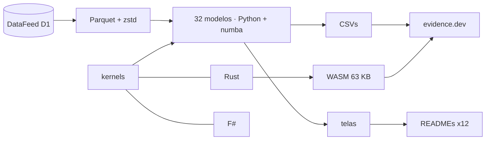

<!--
quant_models_2026
Autor: ProfBru - Bruno Penedo © 2026 - TODOS OS DIREITOS RESERVADOS
E-mail: profbruanbima@gmail.com

README GERADO — não editar à mão. Estrutura: montar_i18n.py · prosa: translation/blocos/<idioma>.json
Gerar: python3 public/foundations/pipeline/montar_i18n.py && python3 public/foundations/pipeline/gerar_readmes.py
-->

<div align="center">

# 📈 quant_models_2026 — 불확실성 속 의사결정을 위한 40개의 정량 모델


**ProfBru © 2026**

### 스프레드시트로 고르는 일을 멈추세요. 모델로 결정하세요.

**16년간의 실제 데이터 위에서 돌아가는 32개 모델, 비트 단위까지 일치하는 세 개의 엔진(Python, Rust, F#), 그리고 브라우저에서 실행되는 실험실 — 각각이 데이터로 직관이 어디서 틀리는지 보여줍니다.**

[](#modelos)
[](#arquitetura)
[](#desempenho)
[](#site)

[](https://www.python.org)
[](https://numba.pydata.org)
[](https://www.rust-lang.org)
[](https://fsharp.org)
[](https://evidence.dev)
[](#licenca)

[Português](README.md) · [English](README.en.md) · [Español](README.es.md) · [Français](README.fr.md) · [Deutsch](README.de.md) · [中文](README.zh.md) · **한국어** · [हिन्दी](README.hi.md) · [עברית](README.he.md) · [Русский](README.ru.md) · [Svenska](README.sv.md) · [Suomi](README.fi.md)

</div>

> [!WARNING]
> 이 저장소만 출처로 사용하십시오. 결과는 검증된 DataFeed 데이터에 의존하며, 어떤 화면도 투자 권유가 아닙니다.

---

## 💀 고통: 스프레드시트로 결정하기

이미 해 보셨을 겁니다. 대안들 — 공급업체, 팀에 지급할 휴대폰, 차량용 전기차, 포트폴리오 자산, 비행대대의 항공기 — 을 스프레드시트에 정리하고, 기준마다 점수를 매기고, 가중치를 주고, 높은 순서로 정렬해 1위를 회의에 가져갔습니다. 스프레드시트는 맞았습니다. 결정은 틀렸습니다.

**스프레드시트는 계산을 틀리지 않습니다. 질문을 틀립니다.**

| 당신이 한 일 | 도구가 숨긴 것 |
|---|---|
| 🔻 **과거 평균으로 순위를 매김** | 2010–2019년 평균이 최고의 포트폴리오를 골랐지만, 2020–2026년에는 동일 가중에 졌습니다. 과거에는 그 열이 보여주지 않는 잡음이 있었습니다. |
| 🏷️ **라벨로 걸러냄** | 함께 움직이는 같은 범주의 선택지끼리, 그리고 데이터상 같은 그룹을 이루는 서로 다른 범주끼리 '분산'했습니다. |
| 🎯 **적중률을 믿음** | '54%를 맞히는' 모델은 상승일의 비율을 반복했을 뿐입니다. 판별력 없는 높은 정확도는 값비싼 동전 던지기입니다. |

> [!IMPORTANT]
> **결함은 당신이 아니라 도구에 있습니다.**
> 스프레드시트, 점수 매트릭스, 순위 필터는 모든 숫자를 확실한 것으로 취급합니다. 그중 어느 것도 보이는 것 중 얼마가 잡음인지, 과거가 여전히 미래를 대표하는지, 당신의 '최선의 선택'이 한 번도 본 적 없는 기간을 견딜 수 있는지 묻지 않습니다.

그리고 모르는 사이에 저지르는 실수가 있습니다. 대안과 조합을 많이 시험할수록 과거의 결과는 순전히 우연으로 더 좋아집니다. 이 프로젝트의 유전 알고리즘은 한 주가지수에서 1,826개의 규칙을 시험했고, 최고의 규칙은 학습에서 빛났지만 다음 기간에는 그냥 포지션을 유지하는 것에 졌습니다.

### 결정이 무너지는 곳

회의에서 추천을 무너뜨리는 질문은 결코 '점수가 몇 점인가?'가 아닙니다. 다른 질문입니다:

> *시나리오가 바뀌면 — 이 중 얼마나 버틸 수 있습니까?*

스프레드시트는 답할 수 없습니다. 신호와 잡음을 분리한 적도, 표본 외 검증을 한 적도, 스스로의 불확실성을 측정한 적도 없기 때문입니다.

---

## 💊 해결책

32개 모델은 각각 2010년부터 2026년까지 27개 실제 자산에서 학습과 검증을 시간 순으로 분리해 실행되며, 숫자로부터 쓰인 한 문장으로 끝납니다 — 그 숫자가 직관과 어긋날 때조차도.

> ### 세 개의 독립 엔진 — Python/numba, Rust, F# — 이 같은 수학을 계산하고 비트 단위까지 일치해야 합니다. 일치하는 두 엔진은 코드뿐 아니라 계산 자체가 옳다는 것을 증명합니다.

<div align="center">

| ❌ 스프레드시트 | ✅ 모델 |
|---|---|
| 평균 점수가 가장 높은 선택지 | **비용과 위험이 명시된, 표본 외에서도 살아남는 선택지** |
| *범주가 다르니 '분산됨'* | **데이터상 선택지 간 상관이 낮아서 분산됨** |

</div>

**모델은 미래를 확실하게 예측하지 않으며, 그렇다고 말합니다. 여기 여러 결과는 인기 있는 방법에 신호가 없음을 보여줍니다. 그것이 가치입니다: 돈을 쓰기 전에 어디를 믿지 말아야 하는지 아는 것.**

---

## 🎯 활용 분야 — 시장을 넘어

예시는 길고, 공개되어 있으며, 냉정한 시장 시계열을 사용합니다. 기법은 불확실성 속의 어떤 결정에도 똑같이 적용됩니다 — 프로젝트의 지식 베이스 자체가 시장 방향 모델로 학생 중도 탈락을 예측하고 이상 탐지기로 부정을 찾아내는 사례를 보여줍니다.

| 결정 | 답하는 모델 | 스프레드시트가 답하지 못하는 질문 |
|---|---|---|
| 📊 **투자 포트폴리오** | 국면(HMM), GARCH, Markowitz, 워크포워드 백테스트 | 과거의 최적 배분이 다음 국면에서도 유효한가? |
| 📱 **기업 구매 — 장비와 휴대폰** | Benford, 이상치, K-means, 드리프트 | 이 공급업체의 가격은 이상치인가, 입력 오류인가, 부정인가? 어제의 공급업체가 여전히 같은 것을 납품하는가? |
| 🔋 **전기차 차량단** | 베이즈, GARCH, O-U 몬테카를로, 비선형 시스템 | 주행거리와 에너지 가격 데이터가 몇 달치뿐일 때, 예상 절감액을 얼마나 믿어야 하는가? |
| 🛡️ **국방 — 전차와 항공기 획득** | 마르코프 연쇄, 두꺼운 꼬리, 제약 조건 GA, PCA | 운용과 정비 사이에서 기대되는 가동률은 얼마이며, 평균이 아닌 최악의 경우 비용은 얼마인가? |
| 🚀 **스타트업과 경영 의사결정** | 베이즈, 드리프트, SHAP, 워크포워드 백테스트 | 파일럿에서 검증한 가설이 시장에서도 유효한가 — 그리고 이사회에 숫자로 결정을 설명할 수 있는가? |

> [!NOTE]
> 이 저장소의 화면과 수치는 시장 데이터에서 나옵니다. 다른 분야에 적용하려면 그 분야의 데이터가 필요하며, 방법과 검증 테스트, 세 엔진은 동일합니다.

---

## 🖼️ 작동 모습

<a id="site"></a>

### 🌐 사이트와 실험실

사이트는 evidence.dev로 생성됩니다: 결과에 대한 SQL, 모델별 인터랙티브 페이지, 그리고 WebAssembly로 컴파일된 Rust 엔진이 브라우저에서 실행되는 실험실 — 서버도, 사용자당 비용도 없습니다.

| | |
|---|---|
| <br/>**쇼케이스: 모델당 한 문장**<br/>각 줄은 데이터 자체가 만들어 낸 해석입니다 — 인기 있는 기법을 반박하는 것까지 포함해서. | <br/>**브라우저 실험실 (WebAssembly)**<br/>브라우저에서 약 3초 만에 216,000개의 몬테카를로 경로를, 일치 테스트를 통과한 바로 그 엔진으로 계산합니다. |
| <br/>**모델 페이지: 개요, 해석, 차트**<br/>최적 청산 규칙은 고정 비율이 아니라 측정된 Brent − WTI 스프레드의 동역학에서 나옵니다. | <br/>**세 엔진, 하나의 결과**<br/>numba, Rust, F#에서 같은 커널의 측정 시간 — 프로세스 시작 시간은 제외. |

<a id="modelos"></a>

### 🧪 32개 모델, 하나씩

아래 각 화면에는 모델이 답하는 결정 질문과 데이터가 만들어 낸 해석이 있습니다. 카탈로그의 나머지 8개 모델(텍스트, 강화학습, 다중 에이전트 시뮬레이션)은 modelos_quant.md에 설명되어 있습니다.

### 통계 — 무엇을 예측하는지보다 데이터가 무엇인지 먼저

#### 01 · 강건 기술통계

<div align="center"></div>

**선택하는 이유:** 평균이 전형적인 경우를 나타내는지, 아니면 소수의 극단값이 계산을 왜곡하는지 알아야 할 때 선택하세요.

> **데이터가 보여준 것:** 은의 표준편차는 강건 σ보다 1.6배 큽니다: 소수의 극단적인 날이 '평균' 변동성을 부풀립니다 — 초과 첨도 26.9.

#### 02 · 최빈값 + 군집화 기반 지지와 저항

<div align="center"></div>

**선택하는 이유:** 가격이나 예산 한도를 눈대중으로 그은 선이 아니라 재현 가능한 기준에서 정해야 할 때 선택하세요.

> **데이터가 보여준 것:** 금: 반올림한 가격의 최빈값은 3,330.00이며, 가장 자주 찾은 구간(2,350.00–2,730.00)에 거래일의 24%가 모여 있고 현재 지지선 역할을 합니다.

#### 03 · 정상성 (Augmented Dickey-Fuller)

<div align="center"></div>

**선택하는 이유:** 어떤 예측보다 먼저 선택하세요: 과거가 여전히 미래의 유효한 표본인지 알려 줍니다.

> **데이터가 보여준 것:** 가격 시계열 8개 중 1개만 5% 수준에서 정상이며, 로그 수익률로는 8개 중 8개입니다. 가격으로 학습하는 것은 다시 돌아오지 않는 분포로 학습하는 것입니다.

#### 04 · 자산 간 선형회귀 (OLS)

<div align="center"></div>

**선택하는 이유:** 한 변수가 다른 변수를 실제로 얼마나 설명하는지 측정하고, '당연한' 관계가 때로는 거의 아무것도 설명하지 못한다는 것을 발견할 때 선택하세요.

> **데이터가 보여준 것:** 다우존스 ~ S&P 500: β = 0.91, R² = 0.91. 반면 미국 국채 ~ S&P 500의 R²는 0.04입니다: '당연한' 관계가 일상의 움직임을 거의 설명하지 못합니다.

#### 13 · 다중 방법 이상치 (IQR, 강건 z, LOF)

<div align="center"></div>

**선택하는 이유:** 이상한 데이터가 수집 오류일 수도, 시계열에서 가장 중요한 사건일 수도 있을 때 선택하세요: 합의가 결정합니다.

> **데이터가 보여준 것:** S&P 500에서 박스플롯은 264일을 이상치로 표시합니다(표본의 6.7%). 세 방법의 합의는 101일을 남깁니다. 단 하나의 이탈점이 회귀선의 기울기를 0.76에서 0.53으로 바꿉니다.

#### 31 · Newcomb-Benford 법칙 — 데이터 무결성

<div align="center"></div>

**선택하는 이유:** 데이터를 믿기 전에 감사하되, 검정이 언제 적용되고 언제 오경보가 되는지 알 때 선택하세요.

> **데이터가 보여준 것:** 거래량 시계열 29개 중 21개만 검정에 충분한 범위를 가집니다. 나머지에 Benford를 적용하면 오경보가 됩니다. 합산하면 거래량은 6.4 자릿수에 걸치며 MAD는 0.0099입니다(허용 가능한 적합).

#### 25 · 조건부 변동성 (EWMA와 GARCH(1,1))

<div align="center"></div>

**선택하는 이유:** 연평균이 아니라 내일의 위험으로 위험, 안전 재고, 노출 한도를 정할 때 선택하세요.

> **데이터가 보여준 것:** S&P 500: 지속성 α+β = 0.963 — 변동성 충격이 힘의 절반을 잃는 데 18 거래일이 걸립니다. 1일 99% VaR: 1.75%.

#### 24 · 비선형 동역학과 두꺼운 꼬리

<div align="center"></div>

**선택하는 이유:** 평균 시나리오보다 최악의 시나리오가 더 중요할 때 선택하세요: 실제 꼬리가 정규 곡선을 얼마나 넘어서는지 측정합니다.

> **데이터가 보여준 것:** 4 표준편차 움직임은 중앙값 기준으로 정규 곡선의 예측보다 64배 더 자주 일어납니다. 수익률에는 기억이 거의 없지만(자기상관 -0.02) 움직임의 크기에는 있습니다(0.15).

#### 27 · Granger 인과성과 전염

<div align="center"></div>

**선택하는 이유:** 지표를 트리거로 쓰기 전에 '함께 움직인다'와 '하나가 다른 것에 앞선다'를 구분할 때 선택하세요.

> **데이터가 보여준 것:** 검정한 72개 쌍 중 7개가 Bonferroni 보정을 통과합니다. 가장 강한 유로/달러 → 달러 인덱스는 서로 다른 출처의 종가 시각 차이가 만든 인공물입니다: 통계적 선행은 원인이 아니며, 검정은 직관이 어디서 속는지 정확히 보여줍니다.

### 머신러닝 — 기저율이라는 잣대로

#### 05 · 방향 로지스틱 회귀

<div align="center"></div>

**선택하는 이유:** 모든 예/아니오 분류의 정직한 기준선으로 선택하세요: 복잡한 모델이 이를 이기지 못하면 자신의 비용을 감당하지 못합니다.

> **데이터가 보여준 것:** 표본 외(2016–2026)에서 로지스틱 회귀는 S&P 500 방향의 54.2%를 맞힙니다 — 사실상 상승일 비율(54.2%)입니다: 98%의 날에 상승을 예측했고 AUC는 0.492입니다. 판별력 없는 높은 정확도가 바로 이 기준선이 해체하는 함정입니다.

#### 06 · SVM과 커널 방법

<div align="center"></div>

**선택하는 이유:** '좋음'과 '나쁨'의 경계가 곡선일 때, 그리고 더 큰 모델에 돈을 쓰기 전에 신호가 존재하는지 증명할 때 선택하세요.

> **데이터가 보여준 것:** RSI와 변동성만 입력으로 쓰면 네 커널 모두 표본 외 균형 정확도 50.7%를 넘지 못합니다. RBF는 학습에서 가장 많이 '배우고'(53.2%) 검증에서 가장 많이 잃습니다(48.4%): 커널은 신호가 없는 곳에 신호를 만들지 못합니다.

#### 07 · 의사결정나무와 랜덤 포레스트

<div align="center"></div>

**선택하는 이유:** 결정을 규칙으로 설명할 수 있어야 하고 표 형식 데이터에서 강건해야 할 때 선택하세요.

> **데이터가 보여준 것:** 깊이 20의 나무는 학습에서 83.7%, 검증에서 49.8%를 맞힙니다: 과거를 외웠습니다. 얕은 숲은 53.5%에 머뭅니다 — 수수하지만 정직합니다. 가장 많이 쓰인 특성은 'ret_1'입니다.

#### 08 · MLP 신경망 — 반전 지표

<div align="center"></div>

**선택하는 이유:** 드문 전환 이벤트에 대해, 전체 정확도가 아니라 이벤트의 자연 빈도에 대비한 적중률로 평가할 때 선택하세요.

> **데이터가 보여준 것:** 은에서 2023–2026년(학습에서 본 적 없음)에 MLP는 상승 반전 신호 607개를 정밀도 17.3%로 냈고, 기저율은 13.6%였습니다(자연 빈도의 1.27배). 지표가 정보를 더하는지 말해 주는 것은 전체 정확도가 아니라 이 비율입니다.

#### 09 · PCA — 위험 요인과 지수

<div align="center"></div>

**선택하는 이유:** 긴 선택지 목록 안에 실제로 독립적인 베팅이 몇 개나 있는지 알아낼 때 선택하세요.

> **데이터가 보여준 것:** 첫 번째 요인 하나가 27개 자산 일간 변동의 24.5%를 설명하며, 80%에 이르려면 12개 요인이 필요합니다. 27개 자산은 27개의 독립적인 베팅이 아닙니다.

#### 10 · 자산 군집화 (K-means)

<div align="center"></div>

**선택하는 이유:** 카탈로그 라벨이 아니라 측정된 행동으로 대안을 묶을 때 선택하세요.

> **데이터가 보여준 것:** 실루엣이 사람의 개입 없이 K = 4개 그룹을 고릅니다. 한 그룹은 서로 다른 자산군 3개가 섞여 있습니다 — '원자재'나 '외환'이라는 라벨은 자산이 어떻게 움직이는지 말해 주지 않습니다.

#### 11 · 수익률 임베딩 (FastICA) + 코사인

<div align="center"></div>

**선택하는 이유:** 지금 누가 함께 움직이는지 하나의 지도에서 보고 싶을 때 선택하세요 — 윈도마다 갱신됩니다.

> **데이터가 보여준 것:** 최근 60 거래일 동안 가장 비슷한 쌍은 브렌트유 × WTI유(코사인 0.96), 가장 반대인 쌍은 달러 인덱스 × 유로/달러(-0.89)입니다: 윈도마다 갱신되는 근접성 지도입니다.

#### 12 · 아이솔레이션 포레스트 — 이상 수익률과 거래량

<div align="center"></div>

**선택하는 이유:** 라벨이 붙은 예시 없이 이상을 찾을 때 선택하세요: 동역학이 바뀌었다는 첫 경보입니다.

> **데이터가 보여준 것:** 라벨 하나 없이 아이솔레이션 포레스트는 S&P 500의 77 거래일을 이상으로 표시합니다 — 2020년에만 21일 — 그중 57%가 하락입니다: 이상은 버릴 잡음이 아니라 동역학 변화의 신호입니다.

#### 32 · Shapley 값을 이용한 설명 가능성 (SHAP)

<div align="center"></div>

**선택하는 이유:** 누군가 '모델이 왜 이렇게 결정했나?'라고 묻고 답에 믿음이 아닌 숫자가 필요할 때 선택하세요.

> **데이터가 보여준 것:** 최근 예측에서 상승 확률은 54.0%(모델 평균)에서 55.4%로 올라갑니다. 가장 큰 영향을 준 특성은 'ret_1'(+1.0%p)입니다. 블랙박스가 '왜'에 답하기 시작합니다.

### 확률과 신호 — 국면, 불확실성, 주기

#### 14 · 국면 마르코프 연쇄 (상승, 하락, 횡보)

<div align="center"></div>

**선택하는 이유:** '이 국면에 있을 때 저 국면으로 넘어갈 확률은?'에 감사 가능한 행렬로 답할 때 선택하세요.

> **데이터가 보여준 것:** S&P 500에서 20 거래일 블록이 하락일 때 다음 블록이 상승일 확률은 59.0%로, 계속 하락할 확률(30.8%)보다 높습니다. 균형 상태에서 시장은 41.3%의 시간을 상승 국면에 머뭅니다.

#### 15 · 은닉 마르코프 모델 (가우시안 HMM)

<div align="center"></div>

**선택하는 이유:** 국면을 관측할 수 없어 데이터로부터 일간 확률과 함께 학습해야 할 때 선택하세요.

> **데이터가 보여준 것:** 임의의 기준선 없이 HMM은 S&P 500에서 세 가지 국면을 찾습니다: 격동 국면의 연간 변동성은 43%, 평온 국면은 7%이며 격동은 평균 18 거래일 지속됩니다. 오늘 가장 가능성 높은 국면은 '평온'입니다.

#### 16 · 수익률과 변동성의 베이즈 갱신

<div align="center"></div>

**선택하는 이유:** 데이터는 적고 결정 압박은 클 때 선택하세요: 평균이 얼마인지뿐 아니라 그 평균을 얼마나 믿을지 알려 줍니다.

> **데이터가 보여준 것:** 2019년 이후 금: 사후 연평균 수익률은 15.3%이지만 95% 신용구간은 2.3%에서 28.4%까지입니다. 평균이 양수일 확률은 98.9%이며, 표본 평균(15.7%)만으로는 이를 알 수 없습니다.

#### 30 · 최적 매매 규칙 (Ornstein-Uhlenbeck)

<div align="center"></div>

**선택하는 이유:** 물려받은 고정 비율 대신 측정된 동역학으로 목표와 손실 한도를 정할 때 선택하세요.

> **데이터가 보여준 것:** Brent − WTI 스프레드는 반감기 22 거래일로 평균 회귀합니다. 셀마다 4,000개 경로를 시뮬레이션한 결과, 최선의 규칙은 1.5σ 목표에 10.0σ 손절입니다(거래당 샤프 0.63) — 고정 비율 손절은 자산의 동역학을 무시합니다.

#### 17 · 푸리에 변환 — 지배적 주기

<div align="center"></div>

**선택하는 이유:** 계절 주기가 실제로 존재하는지 우연인지 증명할 때 선택하세요 — 모든 스펙트럼에는 봉우리가 있습니다.

> **데이터가 보여준 것:** 네 자산의 가장 큰 주기 봉우리 12개 중 수익률 자체를 섞어 얻은 95% 잡음 임계값을 넘는 것은 2개뿐입니다. 모든 주기도에는 봉우리가 있으며, 검정이 어느 것이 주기이고 어느 것이 우연인지 말해 줍니다.

#### 18 · 웨이블릿 — 시간-주파수 분해

<div align="center"></div>

**선택하는 이유:** 연평균이 감추는 것, 즉 격동이 언제 시작되는지를 시간 위에 위치시킬 때 선택하세요.

> **데이터가 보여준 것:** 1단계(2 거래일 진동)가 S&P 500 에너지의 55.0%를 차지합니다. 고주파 에너지가 폭발하면(z > 2) 이후 20 거래일 수익률의 분산이 평소의 1.3배가 됩니다: 웨이블릿은 푸리에가 평균으로만 보는 것을 시간 위에 짚어 냅니다.

#### 23 · Hurst 지수와 이동 Hurst 지표

<div align="center"></div>

**선택하는 이유:** 추세 전략과 평균 회귀 전략 중에서 고를 때, 기억 없는 기준과 비교하며 선택하세요.

> **데이터가 보여준 것:** 원시 R/S의 H는 0.54에서 0.59 사이로 '지속적'으로 보이지만, 섞은 시계열과 비교하면 6개 자산 중 어느 것도 실제 기억을 보이지 않습니다. 샤프 지수 기준으로 MH100 − MH150 교차는 6개 자산 중 3개에서 이동평균 교차를 앞섭니다.

### 최적화와 거버넌스 — 최적해, 우연, 그리고 시간

#### 19 · Markowitz 효율적 투자선

<div align="center"></div>

**선택하는 이유:** 각 위험 수준에서 가능한 최선의 수익률과, 그 최적해가 취약한 추정에 얼마나 의존하는지 볼 때 선택하세요.

> **데이터가 보여준 것:** 최대 샤프 포트폴리오는 2010–2019년 샤프 지수 1.19였으나 2020–2026년에는 0.76을 냈고, 동일 가중은 0.35에서 0.94로 올랐습니다. 투자선은 과거에 대해서는 정확합니다 — 오류는 미래가 반복하지 않는 평균을 추정하는 데 있습니다.

#### 20 · 유전 알고리즘 — 포트폴리오 최적화

<div align="center"></div>

**선택하는 이유:** 어떤 닫힌 공식도 받아들이지 못하는 현실적 제약(비용, 한도, 최대 손실)이 목표에 있을 때 선택하세요.

> **데이터가 보여준 것:** 서로 다른 시드로 병렬 실행한 네 번의 GA가 같은 포트폴리오로 수렴하며(평균 가중치 편차 0.1%p), 2010–2019년 샤프 지수는 1.19입니다. 2020–2026년에는 0.86으로 동일 가중(0.94)보다 낮습니다: 수렴은 최적해가 안정적이라는 것을 증명할 뿐, 미래가 이를 반복한다는 것을 증명하지는 않습니다.

#### 21 · 유전 알고리즘 — 지표와 파라미터 선택

<div align="center"></div>

**선택하는 이유:** 최적의 규칙 조합을 찾되, 우연에 속지 않도록 몇 개를 시험했는지 기록할 때 선택하세요.

> **데이터가 보여준 것:** GA는 S&P 500에서 서로 다른 규칙 1826개를 시험했고, 각 실행의 최고 규칙은 학습 샤프 지수가 최대 0.78이었습니다. 2019–2026년에는 0.41에서 0.54 사이였고, 단순 보유는 0.77이었습니다. 시험한 규칙이 많을수록 학습 샤프 지수는 순전히 우연으로 높아집니다.

#### 22 · 유전 프로그래밍 — 기호 회귀

<div align="center"></div>

**선택하는 이유:** 읽고 감사할 수 있는 공식을 만들어 한 번도 본 적 없는 기간에 시험할 때 선택하세요.

> **데이터가 보여준 것:** 유전 프로그래밍은 ((sen(cos(r3)) + r1) + sen(sen(cos(r2))))(노드 10개) 같은 읽을 수 있는 공식을 찾아냈고, 다음 수익률과의 순위 상관은 학습에서 -0.080, 검증에서 -0.028이었습니다. 진화는 과거에서 언제나 '무언가'를 찾아냅니다. 지표와 우연을 가르는 것은 한 번도 보지 못한 기간뿐입니다.

#### 26 · 상관 네트워크와 중심성

<div align="center"></div>

**선택하는 이유:** 의존 관계 시스템에서 누가 중심에 있고 누가 주변에 있는지 볼 때 선택하세요.

> **데이터가 보여준 것:** 2010–2019년 네트워크로 고른 주변부 자산 8개는 2020–2026년에 거의 독립적이었고(평균 상관 0.00, 중심부는 0.15) 수익도 더 높았지만(연 11.0% 대 7.4%) 변동성도 더 컸습니다. 두 바구니를 모두 이긴 것은 27개 전체 포트폴리오(샤프 0.95)였습니다: 독립적인 베팅의 수가 네트워크 내 위치보다 중요합니다.

#### 28 · 모델 드리프트와 개념 드리프트 탐지

<div align="center"></div>

**선택하는 이유:** 손실이 드러나기 전에 모델이 낡았다는 것을 알 때 선택하세요.

> **데이터가 보여준 것:** 2010–2016년 데이터로 학습한 모델은 이후 10년 중 8년에 재학습을 요구합니다: 그 시기의 입력 국면은 돌아오지 않았습니다. 2022년은 정확도가 가장 낮았고(43.8%), 2017년은 이동이 가장 컸습니다(KS 0.77) — 입력을 모니터링하면 손실을 기다리지 않고도 문제를 볼 수 있습니다.

#### 29 · 비용을 포함한 워크포워드 백테스트

<div align="center"></div>

**선택하는 이유:** 비용과 사전에 선언한 거부 관문을 두고 어떤 결정 규칙이든 시간에 대해 시험할 때 선택하세요.

> **데이터가 보여준 것:** 회전당 5bp의 비용에서 4개 전략 중 2개가 세 개의 STOP 관문을 통과합니다(동일 가중, 리스크 패리티). 매달 과거만으로 고른 모멘텀 윈도는 45번 바뀌었습니다 — '최적 파라미터'는 일정하지 않습니다.


---

## ⚡ 설치

사전 요구 사항: Python 3.13, Rust 1.96(wasm32-unknown-unknown 타깃 포함), F# 엔진용 .NET 9, 사이트용 Node 20+. 데이터는 DataFeed Service Provider(변수 QUANT_MODELS_DATAFEED)에서 가져옵니다.

**1 · 데이터와 모델**

```bash
git clone <url-do-repositorio-privado> quant_models_2026
cd quant_models_2026/public/foundations/pipeline
pip install -r requisitos.txt
export QUANT_MODELS_DATAFEED=/mnt/d/DataFeedServiceProvider
python3 dados_feed.py consolidar --tf D1
python3 executar_modelos.py
```

**2 · 세 엔진과 일치 검증**

```bash
(cd ../rust/quant_models_2026_core && cargo build --release && cargo build --release --lib --target wasm32-unknown-unknown)
(cd ../fsharp/QuantModels2026.Core && dotnet build -c Release)
python3 testes_nucleo.py        # 38 verificações: numba × Rust × F#
```

**3 · 화면과 사이트**

```bash
python3 gerar_telas.py && python3 gerar_site.py
cd ../evidence && npm ci && bash subir_servidor.sh     # http://localhost:3020
```

**4 · 백그라운드 장시간 실행 (screen + 20분 간격 워치독)**

```bash
./run_all.sh --background
screen -r quant_models_2026
```

---

<a id="arquitetura"></a>

## 🧠 아키텍처와 결정



아키텍처 결정과 그 근거:

| | |
|---|---|
| **세 엔진이 같은 의사난수 생성기(xorshift64*)를 사용** | 몬테카를로까지 비트 단위로 일치합니다. 수학 오류가 세 언어에서 동시에 통과할 수는 없습니다. |
| **의존성 없는 WebAssembly (63 KB)** | 무거운 계산이 사용자 브라우저에서 실행됩니다: 서버 비용 0, 데이터는 기기를 떠나지 않습니다. |
| **학습과 검증은 언제나 시간 순으로 분리** | 시계열을 섞으면 미래가 학습에 새어 들어가 정확도를 조작합니다. |
| **추정량을 자신의 귀무 기준과 비교** | Hurst와 Fourier에는 알려진 편향이 있습니다. 섞은 데이터와의 비교만이 신호와 인공물을 구분합니다. |
| **해석은 숫자로부터 작성** | 각 화면의 문장은 결과로부터 생성되며, 결과가 바뀌면 문장도 함께 바뀝니다. |
| **ProcessPoolExecutor 병렬화와 고정 분할** | 결과가 기기의 코어 수에 따라 달라지지 않습니다. |

---

<a id="desempenho"></a>

## 🚀 측정된 성능

bench_motores.py로 측정하고 프로젝트 이력에 기록한 수치입니다. Rust와 F#은 프로세스 시작 시간을 뺐습니다.

| 작업 | numba | Rust | F# | 순수 Python |
|---|---:|---:|---:|---:|
| O-U 몬테카를로 (20×20 격자, 2,000개 경로) | 2.859 s | 2.840 s | 3.490 s | — |
| 이동 R/S Hurst (윈도 250, 3,917 거래일) | 0.027 s | 0.016 s | 0.108 s | 7.86 s |
| 가우시안 HMM EM (상태 3개, 200회 반복) | 0.235 s | 0.308 s | 1.213 s | 64.19 s |
| 2,000개 포트폴리오 × 10개 자산의 지표 | 1.366 s | 1.297 s | 1.908 s | — |

핵심 경로(numba의 20×20 몬테카를로 격자)는 10 s 예산 안에서 3.4 s에 실행되며, Rust 엔진과 결과가 동일함을 증명합니다.

---

## 📚 전체 카탈로그

40개 모델 전체 — 번호, 유형, 범주, 설명 — 는 사이트와 같은 원천에서 생성된 modelos_quant.md에 있습니다. → [modelos_quant.md](modelos_quant.md)

---

## ❓ 어려운 질문

<details><summary><b>이미 가중치와 필터가 있는 스프레드시트를 씁니다. 같은 것 아닌가요?</b></summary>

아닙니다. 스프레드시트는 확실하다고 여기는 점수를 더합니다. 모델은 점수 중 얼마가 잡음인지 측정하고, 선택을 한 번도 본 적 없는 기간에서 시험하며, 과거의 최선이 언제 더 이상 최선이 아니게 되는지 보여줍니다.
</details>

<details><summary><b>이 모델 중 '시장을 이기는' 것이 있나요?</b></summary>

이 저장소의 여러 결과는 인기 있는 기법에 대해 정반대를 보여줍니다: 일간 방향 신호가 없는 지표와 커널, 추정량 편향에 불과한 장기 기억. 시간과 돈을 투자하기 전에 이것을 아는 것이 목적입니다.
</details>

<details><summary><b>같은 계산에 왜 세 가지 언어를 쓰나요?</b></summary>

첫 번째와 일치하는 독립된 두 번째 엔진이 수학을 증명하고, 세 번째가 판정을 내리기 때문입니다. 38번의 검사에서 세 엔진은 비트 단위로 일치합니다.
</details>

<details><summary><b>서버나 클라우드가 필요한가요?</b></summary>

아니요. 모델은 당신의 기기에서 실행되고 사이트는 정적입니다. 실험실은 브라우저 안에서 Rust 엔진을 WebAssembly로 실행합니다.
</details>

<details><summary><b>금융시장 밖의 결정에도 쓸 수 있나요?</b></summary>

방법은 그렇습니다. 데이터는 해당 분야의 것이어야 합니다. '활용 분야' 표는 어떤 모델이 어떤 유형의 결정에 답하는지 보여줍니다.
</details>

---

<a id="licenca"></a>

## 📜 라이선스와 저작권

코드, 모델, 텍스트, 화면: 저자만 사용할 수 있습니다. 서드파티 라이브러리는 각자의 라이선스를 따릅니다(NumPy, numba, scikit-learn, SciPy, pandas, networkx, matplotlib, evidence.dev).

**저자:** ProfBru - Bruno Penedo © 2026 — TODOS OS DIREITOS RESERVADOS · profbruanbima@gmail.com

<div align="center">


**ProfBru © 2026**

</div>
