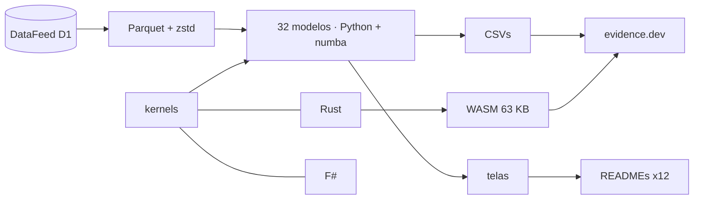

<!--
quant_models_2026
Autor: ProfBru - Bruno Penedo © 2026 - TODOS OS DIREITOS RESERVADOS
E-mail: profbruanbima@gmail.com

README GERADO — não editar à mão. Estrutura: montar_i18n.py · prosa: translation/blocos/<idioma>.json
Gerar: python3 public/foundations/pipeline/montar_i18n.py && python3 public/foundations/pipeline/gerar_readmes.py
-->

<div align="center">

# 📈 quant_models_2026 — 40 modelos quantitativos para decidir sob incerteza


**ProfBru © 2026**

### Pare de escolher por planilha. Comece a decidir por modelo.

**32 modelos rodando sobre 16 anos de dados reais, três motores (Python, Rust e F#) que concordam bit a bit e um laboratório que roda no seu navegador — cada um mostrando, com o dado, onde a intuição engana.**

[](#modelos)
[](#arquitetura)
[](#desempenho)
[](#site)

[](https://www.python.org)
[](https://numba.pydata.org)
[](https://www.rust-lang.org)
[](https://fsharp.org)
[](https://evidence.dev)
[](#licenca)

🌐 **Português** · [English](README.en.md) · [Español](README.es.md) · [Français](README.fr.md) · [Deutsch](README.de.md) · [中文](README.zh.md) · [한국어](README.ko.md) · [हिन्दी](README.hi.md) · [עברית](README.he.md) · [Русский](README.ru.md) · [Svenska](README.sv.md) · [Suomi](README.fi.md)

</div>

> [!WARNING]
> Use apenas este repositório como fonte. Os resultados dependem dos dados validados do DataFeed; nenhuma tela é recomendação de investimento.

---

## 💀 A dor: decidir por planilha

Você já fez isto. Montou uma planilha com as alternativas — fornecedores, celulares para a equipe, carros elétricos para a frota, ativos para a carteira, aeronaves para um esquadrão —, deu nota a cada critério, ponderou, ordenou do maior para o menor e levou o primeiro colocado para a reunião. A planilha estava certa. A decisão, não.

**A planilha não erra a conta. Ela erra a pergunta.**

| O que você fez | O que a ferramenta escondeu |
|---|---|
| 🔻 **Ordenou pela média do passado** | A média de 2010–2019 elegeu a melhor carteira; em 2020–2026 ela perdeu para os pesos iguais. O passado tinha ruído que a coluna não mostra. |
| 🏷️ **Filtrou pelo rótulo** | 'Diversificou' entre opções da mesma categoria que se movem juntas — e entre categorias diferentes que, no dado, formam o mesmo grupo. |
| 🎯 **Confiou na taxa de acerto** | Um modelo que 'acerta 54%' só repetia a fração de dias de alta. Acurácia alta sem poder de separação é um sorteio caro. |

> [!IMPORTANT]
> **O defeito não é seu. É da ferramenta.**
> Planilhas, matrizes de pontuação e filtros de classificação tratam cada número como certo. Nenhum deles pergunta quanto do que você vê é ruído, se o passado ainda representa o futuro ou se a sua 'melhor opção' sobreviveria a um período que ela nunca viu.

E há um erro que você comete sem saber: quanto mais alternativas e combinações você testa, melhor fica o resultado do passado — por puro acaso. O algoritmo genético deste projeto testou 1.826 regras para um índice de ações; a melhor brilhou no treino e perdeu, no período seguinte, para simplesmente manter a posição.

### Onde a decisão desaba

Na reunião, a pergunta que derruba a recomendação nunca é 'qual a nota?'. É outra:

> *E se o cenário mudar — quanto disso continua de pé?*

A planilha não tem como responder, porque nunca separou sinal de ruído, nunca testou fora da amostra e nunca mediu a própria incerteza.

---

## 💊 A solução

Cada um dos 32 modelos roda sobre 27 ativos reais de 2010 a 2026, com treino e teste separados no tempo, e termina com uma frase escrita a partir do número — inclusive quando o número desmente a intuição.

> ### Três motores independentes — Python/numba, Rust e F# — calculam a mesma matemática e precisam concordar bit a bit. Dois motores que concordam provam que a conta está certa, não só o código.

<div align="center">

| ❌ Planilha | ✅ Modelo |
|---|---|
| A opção com a maior nota média | **A opção que sobrevive fora da amostra, com custo e risco declarados** |
| *'Diversificado' porque são categorias diferentes* | **Diversificado porque o dado mostra correlação baixa entre as escolhas** |

</div>

**Os modelos não preveem o futuro com certeza — e dizem isso: vários resultados aqui mostram que um método popular não tem sinal. Esse é o valor: saber onde não confiar antes de gastar.**

---

## 🎯 Para que serve — além do mercado

Os exemplos usam séries de mercado porque elas são longas, públicas e implacáveis. As técnicas são as mesmas para qualquer decisão sob incerteza — a própria base de conhecimento do projeto mostra o modelo de direção de mercado prevendo evasão escolar e o detector de anomalia apontando fraude.

| Decisão | Modelos que respondem | A pergunta que a planilha não responde |
|---|---|---|
| 📊 **Carteira de investimentos** | regimes (HMM), GARCH, Markowitz, backtest walk-forward | A alocação ótima do passado vale para o próximo regime? |
| 📱 **Compras corporativas — equipamentos e celulares** | Benford, outliers, K-means, drift | O preço deste fornecedor é anomalia, erro de digitação ou fraude? O fornecedor de ontem ainda entrega o mesmo? |
| 🔋 **Frota de carros elétricos** | Bayes, GARCH, Monte Carlo O-U, sistemas não lineares | Com poucos meses de dados de autonomia e de preço de energia, quanto confiar na economia projetada? |
| 🛡️ **Defesa — aquisição de tanques e aeronaves** | cadeias de Markov, caudas pesadas, AG com restrições, PCA | Qual a disponibilidade esperada da frota entre operação e manutenção, e qual o custo no pior cenário, não no médio? |
| 🚀 **Startups e decisões executivas** | Bayes, drift, SHAP, backtest walk-forward | A hipótese validada no piloto continua válida no mercado — e consigo explicar a decisão ao conselho com números? |

> [!NOTE]
> As telas e números deste repositório vêm de dados de mercado. Aplicar a outro domínio exige os dados daquele domínio; os métodos, os testes de validação e os três motores são os mesmos.

---

## 🖼️ Veja funcionando

<a id="site"></a>

### 🌐 O site e o laboratório

O site é gerado com evidence.dev: SQL sobre os resultados, uma página interativa por modelo e um laboratório em que o motor Rust, compilado para WebAssembly, roda no seu navegador — sem servidor e sem custo por usuário.

| | |
|---|---|
| <br/>**Vitrine: uma frase por modelo**<br/>Cada linha é a leitura que o próprio dado produziu — inclusive as que desmentem a técnica popular. | <br/>**Laboratório no navegador (WebAssembly)**<br/>216 mil trajetórias de Monte Carlo em cerca de 3 segundos, no navegador, com o mesmo motor que passa nos testes de concordância. |
| <br/>**Página de modelo: ficha, leitura e gráficos**<br/>A regra ótima de saída sai da dinâmica medida do spread Brent − WTI, não de um percentual fixo. | <br/>**Três motores, um resultado**<br/>Tempos medidos do mesmo kernel em numba, Rust e F#, com a partida de processo descontada. |

<a id="modelos"></a>

### 🧪 Os 32 modelos, um por um

Cada tela abaixo tem a pergunta de decisão que o modelo responde e a leitura que o dado produziu. Os 8 modelos restantes do catálogo (texto, aprendizado por reforço e simulação multiagente) estão descritos em modelos_quant.md.

### Estatística — o que o dado é, antes do que ele prevê

#### 01 · Estatística descritiva robusta

<div align="center"></div>

**Por que escolher:** Escolha quando precisar saber se a média representa o caso típico ou se poucos extremos distorcem a conta.

> **O que o dado mostrou:** Prata tem desvio-padrão 1,6× maior que a σ robusta: poucos dias extremos inflam a volatilidade 'média' — curtose em excesso de 26,9.

#### 02 · Suporte e resistência por moda + clusterização

<div align="center"></div>

**Por que escolher:** Escolha quando o limite de preço ou de orçamento precisar sair de um critério reprodutível, e não de uma linha traçada a olho.

> **O que o dado mostrou:** Ouro: a moda dos preços arredondados é 3.330,00; a faixa mais visitada (2.350,00–2.730,00) concentra 24% dos pregões e hoje atua como suporte.

#### 03 · Estacionariedade (Augmented Dickey-Fuller)

<div align="center"></div>

**Por que escolher:** Escolha antes de qualquer previsão: ele diz se o passado ainda é uma amostra válida do futuro.

> **O que o dado mostrou:** 1 de 8 séries de preço são estacionárias a 5%; em log-retorno, 8 de 8. Treinar com preço é treinar com uma distribuição que não volta.

#### 04 · Regressão linear (MQO) entre ativos

<div align="center"></div>

**Por que escolher:** Escolha para medir quanto uma variável realmente explica outra — e descobrir que a relação 'óbvia' às vezes explica quase nada.

> **O que o dado mostrou:** Dow Jones ~ S&P 500: β = 0,91 com R² = 0,91. Já Treasury americano ~ S&P 500 tem R² de 0,04: a relação 'óbvia' explica quase nada do dia a dia.

#### 13 · Outliers multimétodo (IQR, z-robusto, LOF)

<div align="center"></div>

**Por que escolher:** Escolha quando um dado estranho puder ser erro de coleta ou o evento mais importante da série: o consenso decide.

> **O que o dado mostrou:** No S&P 500, o boxplot marca 264 dias como outlier (6,7% da amostra); o consenso de três métodos fica com 101. Um único ponto discrepante muda a inclinação da reta de 0,76 para 0,53.

#### 31 · Lei de Newcomb-Benford — integridade de dados

<div align="center"></div>

**Por que escolher:** Escolha para auditar uma base de valores antes de confiar nela, sabendo quando o teste se aplica e quando seria falso alarme.

> **O que o dado mostrou:** Só 21 das 29 séries de volume cobrem amplitude suficiente para o teste; aplicar Benford às demais seria falso alarme. Agregados, os volumes cobrem 6,4 ordens de grandeza e dão MAD de 0,0099 (conformidade aceitável).

#### 25 · Volatilidade condicional (EWMA e GARCH(1,1))

<div align="center"></div>

**Por que escolher:** Escolha para dimensionar risco, estoque de segurança ou limite de exposição pelo risco de amanhã, não pela média do ano.

> **O que o dado mostrou:** S&P 500: persistência α+β = 0,963 — um choque de volatilidade leva 18 pregões para perder metade da força. VaR 99% de 1 dia: 1,75%.

#### 24 · Dinâmica não linear e caudas pesadas

<div align="center"></div>

**Por que escolher:** Escolha quando o pior cenário importar mais que o cenário médio: ele mede quanto as caudas reais excedem a curva normal.

> **O que o dado mostrou:** Movimentos de 4 desvios acontecem, em mediana, 64× mais do que a curva normal prevê; o retorno quase não tem memória (autocorrelação -0,02), mas o tamanho do movimento tem (0,15).

#### 27 · Causalidade de Granger e contágio

<div align="center"></div>

**Por que escolher:** Escolha para separar 'andam juntos' de 'um antecede o outro' antes de tomar um indicador como gatilho.

> **O que o dado mostrou:** Dos 72 pares testados, 7 sobrevivem à correção de Bonferroni. O mais forte, Euro/Dólar → Índice do dólar, é artefato de horário de fechamento entre fontes diferentes: precedência estatística não é causa — e o teste mostra exatamente onde a intuição seria enganada.

### Aprendizado de máquina — com a régua da taxa-base

#### 05 · Regressão logística de direção

<div align="center"></div>

**Por que escolher:** Escolha como linha de base honesta de toda classificação sim/não: se um modelo complexo não a vence, ele não paga o próprio custo.

> **O que o dado mostrou:** Fora da amostra (2016–2026) a logística acerta 54,2% da direção do S&P 500 — praticamente a fração de dias de alta (54,2%): previu alta em 98% dos dias e tem AUC 0,492. Acurácia alta sem poder de separação é a armadilha que esta linha de base desarma.

#### 06 · SVM e métodos de kernel

<div align="center"></div>

**Por que escolher:** Escolha quando a fronteira entre 'bom' e 'ruim' for curva — e para provar se existe sinal antes de gastar com modelos maiores.

> **O que o dado mostrou:** Com só RSI e volatilidade como entradas, nenhum dos quatro kernels passa de 50,7% de acurácia balanceada fora da amostra. O RBF é o que mais 'aprende' no treino (53,2%) e o que mais perde no teste (48,4%): kernel não cria sinal onde ele não existe.

#### 07 · Árvores de decisão e Random Forest

<div align="center"></div>

**Por que escolher:** Escolha quando a decisão precisar ser explicável em regras e robusta em dados tabulares.

> **O que o dado mostrou:** Árvore com profundidade 20 acerta 83,7% no treino e 49,8% no teste: decorou o passado. A floresta rasa fica em 53,5% — modesta, mas honesta; o atributo mais usado é 'ret_1'.

#### 08 · Rede neural MLP — indicador de reversão

<div align="center"></div>

**Por que escolher:** Escolha para eventos raros de virada, medindo o acerto contra a frequência natural do evento, não contra a acurácia geral.

> **O que o dado mostrou:** Na prata, em 2023–2026 (nunca vistos no treino), a MLP emitiu 607 sinais de reversão de alta com precisão de 17,3%, contra taxa base de 13,6% (1,27× a frequência natural): é essa razão, e não a acurácia geral, que diz se o indicador agrega informação.

#### 09 · PCA — fatores de risco e índices

<div align="center"></div>

**Por que escolher:** Escolha para descobrir quantas apostas independentes existem de fato dentro de uma lista longa de opções.

> **O que o dado mostrou:** O 1º fator sozinho explica 24,5% da variação diária de 27 ativos; são precisos 12 fatores para chegar a 80%. Os 27 ativos não são 27 apostas independentes.

#### 10 · Clusterização de ativos (K-means)

<div align="center"></div>

**Por que escolher:** Escolha para agrupar alternativas pelo comportamento medido, e não pelo rótulo de catálogo.

> **O que o dado mostrou:** A silhueta escolhe K = 4 grupos sem intervenção manual; há grupo que mistura 3 classes de ativo diferentes — o rótulo 'commodity' ou 'câmbio' não diz como o ativo se comporta.

#### 11 · Embeddings de retornos (FastICA) + cosseno

<div align="center"></div>

**Por que escolher:** Escolha para ver, num mapa único, quem se move junto agora — atualizado a cada janela.

> **O que o dado mostrou:** Nos últimos 60 pregões, o par mais parecido é Petróleo Brent × Petróleo WTI (cosseno 0,96) e o mais oposto é Índice do dólar × Euro/Dólar (-0,89): um mapa de proximidade que se atualiza a cada janela.

#### 12 · Isolation Forest — retornos e volumes anormais

<div align="center"></div>

**Por que escolher:** Escolha para achar o anormal sem exemplos rotulados: o primeiro alarme de que a dinâmica mudou.

> **O que o dado mostrou:** Sem nenhum rótulo, a floresta de isolamento marca 77 pregões do S&P 500 como anômalos — 21 só em 2020 — e 57% deles são quedas: a anomalia é sinal de mudança de dinâmica, não ruído a descartar.

#### 32 · Explicabilidade com valores de Shapley (SHAP)

<div align="center"></div>

**Por que escolher:** Escolha quando alguém perguntar 'por que o modelo decidiu isso?' e a resposta precisar de números, não de fé.

> **O que o dado mostrou:** Na última previsão, a probabilidade de alta sai de 54,0% (média do modelo) para 55,4%; o atributo que mais pesou foi 'ret_1' (+1,0 p.p.). A caixa-preta passa a responder 'por quê'.

### Probabilidade e sinais — regimes, incerteza e ciclos

#### 14 · Cadeia de Markov de regimes (alta, baixa, lateral)

<div align="center"></div>

**Por que escolher:** Escolha para responder 'estando nesta fase, qual a chance de passar para aquela?' com uma matriz auditável.

> **O que o dado mostrou:** No S&P 500, estando em baixa em um bloco de 20 pregões, a chance de o próximo bloco ser de alta é 59,0% — maior que a de continuar em baixa (30,8%). Em equilíbrio, o mercado passa 41,3% do tempo em regime de alta.

#### 15 · Modelo oculto de Markov (HMM gaussiano)

<div align="center"></div>

**Por que escolher:** Escolha quando os regimes não forem observáveis e precisarem ser aprendidos dos dados, com probabilidade diária.

> **O que o dado mostrou:** Sem regra de corte arbitrária, o HMM encontra três regimes no S&P 500: o turbulento tem volatilidade de 43% ao ano contra 7% no calmo e dura em média 18 pregões. Hoje o regime mais provável é 'calmo'.

#### 16 · Atualização bayesiana de retorno e volatilidade

<div align="center"></div>

**Por que escolher:** Escolha quando houver poucos dados e muita pressão para decidir: ele diz quanto confiar na média, não só qual é a média.

> **O que o dado mostrou:** Ouro desde 2019: o retorno médio anual a posteriori é 15,3%, mas o intervalo de credibilidade de 95% vai de 2,3% a 28,4%. A probabilidade de a média ser positiva é 98,9% — a média amostral (15,7%) sozinha não diz isso.

#### 30 · Regras ótimas de trading (Ornstein-Uhlenbeck)

<div align="center"></div>

**Por que escolher:** Escolha para definir alvo e limite de perda a partir da dinâmica medida, em vez de percentuais fixos herdados.

> **O que o dado mostrou:** O spread Brent − WTI reverte à média com meia-vida de 22 pregões. Simulando 4.000 trajetórias por célula, a melhor regra é alvo de 1,5σ com stop de 10,0σ (Sharpe por operação 0,63) — um stop percentual fixo ignora a dinâmica do ativo.

#### 17 · Transformada de Fourier — ciclos dominantes

<div align="center"></div>

**Por que escolher:** Escolha para provar se um ciclo sazonal existe ou se é acaso — todo espectro tem picos.

> **O que o dado mostrou:** Dos 12 maiores picos de ciclo nos quatro ativos, só 2 superam o limiar de ruído de 95% obtido embaralhando os próprios retornos. Todo periodograma tem picos; o teste diz quais são ciclo e quais são acaso.

#### 18 · Wavelets — decomposição tempo-frequência

<div align="center"></div>

**Por que escolher:** Escolha para localizar no tempo quando a turbulência começa, o que a média anual esconde.

> **O que o dado mostrou:** O nível 1 (oscilações de 2 pregões) concentra 55,0% da energia do S&P 500. Quando a energia de alta frequência explode (z > 2), a dispersão do retorno dos 20 pregões seguintes é 1,3× a normal: a wavelet localiza no tempo o que Fourier só vê na média.

#### 23 · Expoente de Hurst e indicador Hurst móvel

<div align="center"></div>

**Por que escolher:** Escolha para decidir entre estratégia de tendência e de reversão — comparando com a referência sem memória.

> **O que o dado mostrou:** O H bruto de R/S fica entre 0,54 e 0,59 e pareceria 'persistente'; contra séries embaralhadas, nenhum dos 6 ativos mostra memória real. O cruzamento MH100 − MH150 supera o de médias móveis em 3 de 6 ativos pelo índice de Sharpe.

### Otimização e governança — o ótimo, o acaso e o tempo

#### 19 · Fronteira eficiente de Markowitz

<div align="center"></div>

**Por que escolher:** Escolha para ver o melhor retorno possível para cada nível de risco — e o quanto esse ótimo depende de estimativas frágeis.

> **O que o dado mostrou:** A carteira de máximo Sharpe tinha Sharpe 1,19 em 2010–2019 e entregou 0,76 em 2020–2026; os pesos iguais foram de 0,35 para 0,94. A fronteira é exata sobre o passado — o erro está na estimativa de médias que o futuro não repete.

#### 20 · Algoritmo genético — otimização de carteira

<div align="center"></div>

**Por que escolher:** Escolha quando o objetivo tiver restrições reais (custos, limites, perdas máximas) que nenhuma fórmula fechada aceita.

> **O que o dado mostrou:** Quatro rodadas paralelas do AG, com sementes diferentes, convergem para a mesma carteira (desvio médio de peso de 0,1 p.p.) com Sharpe de 1,19 em 2010–2019. Em 2020–2026 ela entrega 0,86, abaixo dos pesos iguais (0,94): convergência prova que o ótimo é estável, não que o futuro vai repeti-lo.

#### 21 · Algoritmo genético — seleção de indicadores e parâmetros

<div align="center"></div>

**Por que escolher:** Escolha para buscar a melhor combinação de regras — registrando quantas foram testadas para não se enganar com o acaso.

> **O que o dado mostrou:** O AG testou 1826 regras distintas no S&P 500 e a melhor de cada rodada teve Sharpe de treino até 0,78; em 2019–2026 elas ficaram entre 0,41 e 0,54, contra 0,77 de simplesmente ficar comprado. Quanto mais regras se testa, maior o Sharpe de treino por puro acaso.

#### 22 · Programação genética — regressão simbólica

<div align="center"></div>

**Por que escolher:** Escolha para inventar fórmulas legíveis e auditáveis, e submetê-las a um período nunca visto.

> **O que o dado mostrou:** A programação genética descobriu fórmulas legíveis como ((sen(cos(r3)) + r1) + sen(sen(cos(r2)))) (10 nós), com correlação de postos de -0,080 com o próximo retorno no treino e -0,028 no teste. A evolução sempre encontra 'algo' no passado; só o período nunca visto separa indicador de coincidência.

#### 26 · Rede de correlação e centralidade

<div align="center"></div>

**Por que escolher:** Escolha para enxergar quem está no centro e quem está na periferia de um sistema de dependências.

> **O que o dado mostrou:** Escolhidos pela rede de 2010–2019, os 8 periféricos seguiram quase independentes em 2020–2026 (correlação média 0,00 contra 0,15 dos centrais) e renderam mais (11,0% contra 7,4% a.a.), porém com mais volatilidade. Quem venceu as duas cestas foi a carteira com os 27 (Sharpe 0,95): número de apostas independentes pesa mais que a posição na rede.

#### 28 · Detecção de drift de modelo e de conceito

<div align="center"></div>

**Por que escolher:** Escolha para saber que um modelo envelheceu antes que o prejuízo apareça.

> **O que o dado mostrou:** O modelo treinado em 2010–2016 pede retreino em 8 dos 10 anos seguintes: o regime de entrada daquele período não voltou. 2022 teve a pior acurácia (43,8%) e 2017 o maior deslocamento (KS 0,77) — monitorar a entrada mostra o problema sem esperar a perda.

#### 29 · Backtest walk-forward com custos

<div align="center"></div>

**Por que escolher:** Escolha para testar qualquer regra de decisão contra o tempo, com custos e portões de reprovação declarados antes.

> **O que o dado mostrou:** Com custos de 5 bps por giro, 2 de 4 estratégias passam pelos três portões STOP (Pesos iguais, Paridade de risco). A janela do momentum, escolhida a cada mês só com o passado, mudou 45 vezes — o 'parâmetro ótimo' não é constante.


---

## ⚡ Instalação

Pré-requisitos: Python 3.13, Rust 1.96 (com o alvo wasm32-unknown-unknown), .NET 9 para o motor F# e Node 20+ para o site. Os dados vêm do DataFeed Service Provider (variável QUANT_MODELS_DATAFEED).

**1 · Dados e modelos**

```bash
git clone <url-do-repositorio-privado> quant_models_2026
cd quant_models_2026/public/foundations/pipeline
pip install -r requisitos.txt
export QUANT_MODELS_DATAFEED=/mnt/d/DataFeedServiceProvider
python3 dados_feed.py consolidar --tf D1
python3 executar_modelos.py
```

**2 · Os três motores e a concordância**

```bash
(cd ../rust/quant_models_2026_core && cargo build --release && cargo build --release --lib --target wasm32-unknown-unknown)
(cd ../fsharp/QuantModels2026.Core && dotnet build -c Release)
python3 testes_nucleo.py        # 38 verificações: numba × Rust × F#
```

**3 · Telas e site**

```bash
python3 gerar_telas.py && python3 gerar_site.py
cd ../evidence && npm ci && bash subir_servidor.sh     # http://localhost:3020
```

**4 · Execução longa em segundo plano (screen + watchdog de 20 minutos)**

```bash
./run_all.sh --background
screen -r quant_models_2026
```

---

<a id="arquitetura"></a>

## 🧠 Arquitetura e decisões



Decisões de arquitetura, cada uma com a razão que a sustenta:

| | |
|---|---|
| **Três motores com o mesmo gerador pseudoaleatório (xorshift64*)** | até o Monte Carlo coincide bit a bit; um erro de matemática não passa despercebido em três linguagens ao mesmo tempo. |
| **WebAssembly sem dependências (63 KB)** | o cálculo pesado roda no navegador do usuário: custo de servidor zero e nenhum dado sai da máquina. |
| **Treino e teste separados no tempo, sempre** | embaralhar séries temporais vaza o futuro para o treino e fabrica acurácia. |
| **Estimadores comparados com o próprio nulo** | Hurst e Fourier têm vieses conhecidos; só a comparação com dados embaralhados separa sinal de artefato. |
| **Leitura escrita a partir do número** | a frase de cada tela é gerada do resultado; quando o resultado muda, a frase muda junto. |
| **Paralelismo com ProcessPoolExecutor e partição fixa** | o resultado não depende de quantos núcleos a máquina tem. |

---

<a id="desempenho"></a>

## 🚀 Desempenho medido

Números medidos com bench_motores.py e registrados no histórico do projeto. Rust e F# têm a partida de processo descontada.

| Carga | numba | Rust | F# | Python puro |
|---|---:|---:|---:|---:|
| Monte Carlo O-U (malha 20×20, 2.000 trajetórias) | 2,859 s | 2,840 s | 3,490 s | — |
| Hurst móvel R/S (janela 250, 3.917 pregões) | 0,027 s | 0,016 s | 0,108 s | 7,86 s |
| HMM gaussiano EM (3 estados, 200 iterações) | 0,235 s | 0,308 s | 1,213 s | 64,19 s |
| Métricas de 2.000 carteiras × 10 ativos | 1,366 s | 1,297 s | 1,908 s | — |

O caminho crítico (malha de Monte Carlo 20×20 em numba) roda em 3,4 s, com orçamento de 10 s e prova de resultado idêntico ao do motor Rust.

---

## 📚 Catálogo completo

Os 40 modelos — número, tipo, categoria e descrição — estão em modelos_quant.md, gerado a partir da mesma fonte que alimenta o site. → [modelos_quant.md](modelos_quant.md)

---

## ❓ Perguntas difíceis

<details><summary><b>Já uso planilha com pesos e filtros. Não é a mesma coisa?</b></summary>

Não. A planilha soma notas que considera certas. Os modelos medem quanto da nota é ruído, testam a escolha num período que ela nunca viu e mostram quando a melhor opção do passado deixa de ser a melhor.
</details>

<details><summary><b>Algum desses modelos 'acerta o mercado'?</b></summary>

Vários resultados deste repositório mostram justamente o contrário para técnicas populares: indicadores e kernels sem sinal de direção diária, memória longa que é viés de estimador. Saber disso antes de investir tempo e dinheiro é o objetivo.
</details>

<details><summary><b>Por que três linguagens para a mesma conta?</b></summary>

Porque um segundo motor independente que concorda com o primeiro prova a matemática, e o terceiro desempata. Em 38 verificações, os três concordam bit a bit.
</details>

<details><summary><b>Preciso de servidor ou nuvem?</b></summary>

Não. Os modelos rodam na sua máquina e o site é estático: o laboratório executa o motor Rust em WebAssembly dentro do navegador.
</details>

<details><summary><b>Serve para decisões fora do mercado financeiro?</b></summary>

Os métodos sim; os dados precisam ser os do seu domínio. A tabela 'Para que serve' mostra quais modelos respondem a cada tipo de decisão.
</details>

---

<a id="licenca"></a>

## 📜 Licença e autoria

Código, modelos, textos e telas: uso restrito ao autor. Bibliotecas de terceiros mantêm suas próprias licenças (NumPy, numba, scikit-learn, SciPy, pandas, networkx, matplotlib, evidence.dev).

**Autor:** ProfBru - Bruno Penedo © 2026 — TODOS OS DIREITOS RESERVADOS · profbruanbima@gmail.com

<div align="center">


**ProfBru © 2026**

</div>
