<!--
quant_models_2026
Autor: ProfBru - Bruno Penedo © 2026 - TODOS OS DIREITOS RESERVADOS
E-mail: profbruanbima@gmail.com

README GERADO — não editar à mão. Estrutura: montar_i18n.py · prosa: translation/blocos/<idioma>.json
Gerar: python3 public/foundations/pipeline/montar_i18n.py && python3 public/foundations/pipeline/gerar_readmes.py
-->

<div align="center">

# 📈 quant_models_2026 — 40 количественных моделей для решений в условиях неопределённости


**ProfBru © 2026**

### Хватит выбирать по электронной таблице. Начните решать по модели.

**32 модели на 16 годах реальных данных, три движка (Python, Rust и F#), совпадающие бит в бит, и лаборатория, работающая в вашем браузере, — каждая на данных показывает, где интуиция обманывает.**

[](#modelos)
[](#arquitetura)
[](#desempenho)
[](#site)

[](https://www.python.org)
[](https://numba.pydata.org)
[](https://www.rust-lang.org)
[](https://fsharp.org)
[](https://evidence.dev)
[](#licenca)

[Português](README.md) · [English](README.en.md) · [Español](README.es.md) · [Français](README.fr.md) · [Deutsch](README.de.md) · [中文](README.zh.md) · [한국어](README.ko.md) · [हिन्दी](README.hi.md) · [עברית](README.he.md) · **Русский** · [Svenska](README.sv.md) · [Suomi](README.fi.md)

</div>

> [!WARNING]
> Используйте только этот репозиторий как источник. Результаты зависят от проверенных данных DataFeed; ни один экран не является инвестиционной рекомендацией.

---

## 💀 Боль: решения по электронной таблице

Вы это уже делали. Составили таблицу альтернатив — поставщики, телефоны для команды, электромобили для автопарка, активы для портфеля, самолёты для эскадрильи, — оценили каждый критерий, взвесили, отсортировали по убыванию и понесли первое место на совещание. Таблица была верна. Решение — нет.

**Электронная таблица не ошибается в подсчёте. Она ошибается в вопросе.**

| Что вы сделали | Что скрыл инструмент |
|---|---|
| 🔻 **Ранжировали по среднему прошлого** | Среднее за 2010–2019 выбрало лучший портфель; в 2020–2026 он проиграл равным весам. В прошлом был шум, которого столбец не показывает. |
| 🏷️ **Отфильтровали по ярлыку** | Вы «диверсифицировались» между вариантами одной категории, которые движутся вместе, — и между разными категориями, которые в данных образуют одну группу. |
| 🎯 **Поверили доле попаданий** | Модель, которая «угадывает в 54 % случаев», лишь повторяла долю дней роста. Высокая точность без разделяющей способности — дорогое подбрасывание монеты. |

> [!IMPORTANT]
> **Дефект не в вас. Он в инструменте.**
> Электронные таблицы, матрицы оценок и фильтры ранжирования считают каждое число достоверным. Ни один из них не спрашивает, сколько из видимого вами — шум, представляет ли прошлое по-прежнему будущее и выдержит ли ваш «лучший вариант» период, которого он никогда не видел.

И есть ошибка, которую вы совершаете, не зная об этом: чем больше альтернатив и комбинаций вы проверяете, тем лучше становится результат прошлого — по чистой случайности. Генетический алгоритм этого проекта проверил 1 826 правил на фондовом индексе; лучшее блистало на обучении, а в следующем периоде проиграло простому удержанию позиции.

### Где решение рушится

На совещании вопрос, который рушит рекомендацию, — никогда не «какой балл?». Он другой:

> *А если сценарий изменится — сколько из этого устоит?*

Таблица не может ответить, потому что никогда не отделяла сигнал от шума, никогда не проверялась вне выборки и никогда не измеряла собственную неопределённость.

---

## 💊 Решение

Каждая из 32 моделей работает на 27 реальных активах с 2010 по 2026 год, обучение и проверка разделены во времени, а итог — фраза, написанная по числу, даже когда число опровергает интуицию.

> ### Три независимых движка — Python/numba, Rust и F# — вычисляют одну и ту же математику и обязаны совпадать бит в бит. Два совпадающих движка доказывают, что верен расчёт, а не только код.

<div align="center">

| ❌ Электронная таблица | ✅ Модель |
|---|---|
| Вариант с наивысшим средним баллом | **Вариант, который выдерживает проверку вне выборки, с заявленными затратами и риском** |
| *«Диверсифицировано», потому что категории разные* | **Диверсифицировано, потому что данные показывают низкую корреляцию между вариантами** |

</div>

**Модели не предсказывают будущее наверняка — и говорят об этом: несколько результатов здесь показывают, что у популярного метода нет сигнала. В этом и ценность: знать, где не доверять, прежде чем тратить.**

---

## 🎯 Для чего это — за пределами рынка

В примерах используются рыночные ряды, потому что они длинные, публичные и беспощадные. Методы одинаковы для любого решения в условиях неопределённости — сама база знаний проекта показывает модель направления рынка, предсказывающую отчисление студентов, и детектор аномалий, выявляющий мошенничество.

| Решение | Модели, которые отвечают | Вопрос, на который таблица не отвечает |
|---|---|---|
| 📊 **Инвестиционный портфель** | режимы (HMM), GARCH, Марковиц, бэктест walk-forward | Сохранится ли оптимальное распределение прошлого в следующем режиме? |
| 📱 **Корпоративные закупки — оборудование и телефоны** | Бенфорд, выбросы, K-means, дрейф | Цена этого поставщика — аномалия, опечатка или мошенничество? Поставляет ли вчерашний поставщик то же самое? |
| 🔋 **Автопарк электромобилей** | Байес, GARCH, Монте-Карло O-U, нелинейные системы | Имея лишь несколько месяцев данных о запасе хода и цене энергии, насколько можно доверять прогнозируемой экономии? |
| 🛡️ **Оборона — закупка танков и самолётов** | марковские цепи, тяжёлые хвосты, ГА с ограничениями, PCA | Какую готовность парка ожидать между эксплуатацией и обслуживанием и какова стоимость в худшем сценарии, а не в среднем? |
| 🚀 **Стартапы и управленческие решения** | Байес, дрейф, SHAP, бэктест walk-forward | Остаётся ли гипотеза, подтверждённая в пилоте, верной на рынке — и могу ли я объяснить решение совету директоров цифрами? |

> [!NOTE]
> Экраны и числа в этом репозитории получены на рыночных данных. Применение в другой области требует данных этой области; методы, проверочные тесты и три движка те же.

---

## 🖼️ Как это работает

<a id="site"></a>

### 🌐 Сайт и лаборатория

Сайт собирается на evidence.dev: SQL по результатам, интерактивная страница для каждой модели и лаборатория, где движок Rust, скомпилированный в WebAssembly, работает в вашем браузере — без сервера и без затрат на пользователя.

| | |
|---|---|
| 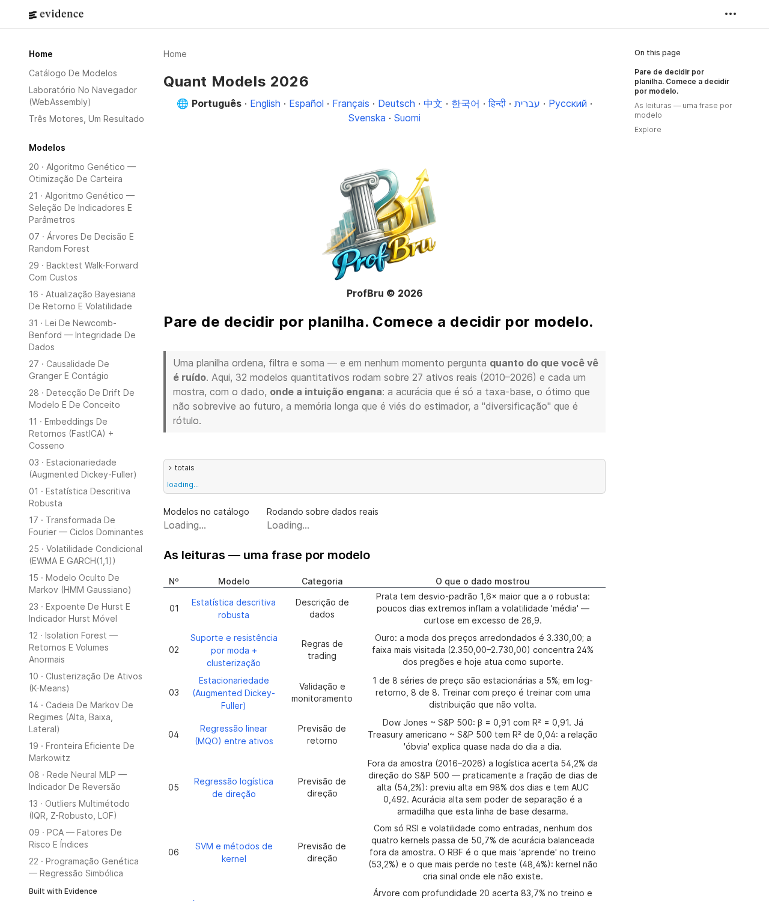<br/>**Витрина: одна фраза на модель**<br/>Каждая строка — вывод, сделанный самими данными, включая те, что опровергают популярную технику. | 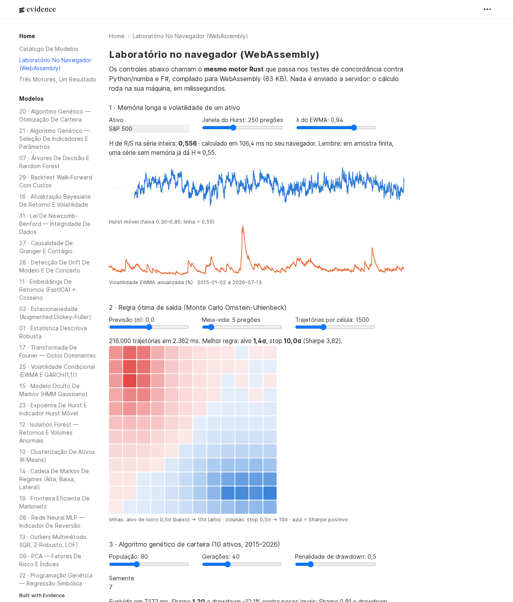<br/>**Лаборатория в браузере (WebAssembly)**<br/>216 тысяч траекторий Монте-Карло примерно за 3 секунды в браузере — тем же движком, который проходит тесты согласия. |
| 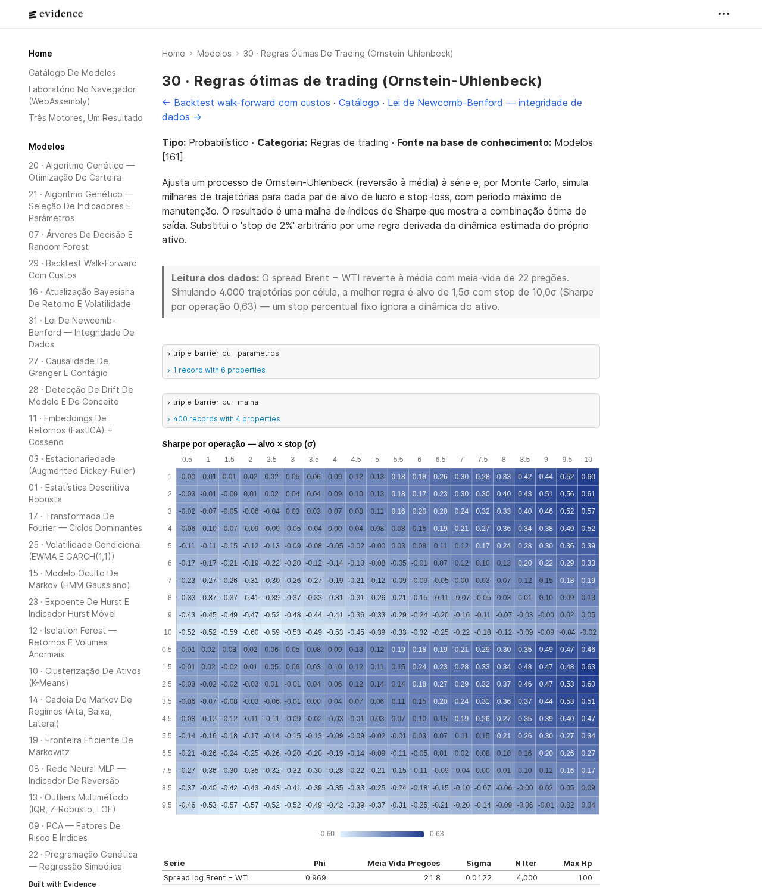<br/>**Страница модели: карточка, вывод и графики**<br/>Оптимальное правило выхода выводится из измеренной динамики спреда Brent − WTI, а не из фиксированного процента. | 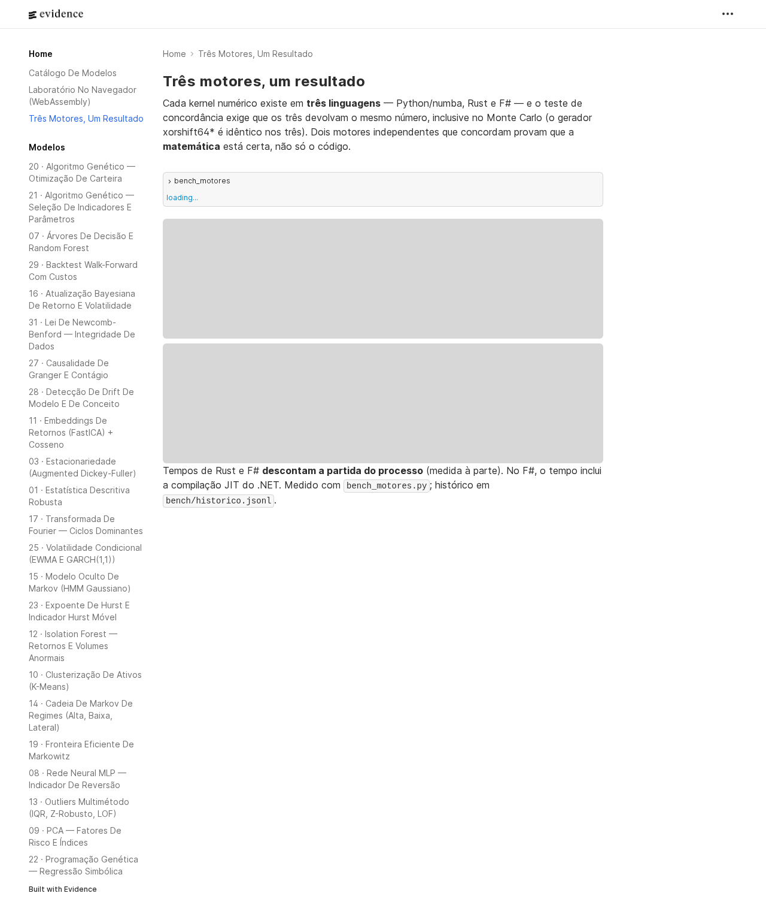<br/>**Три движка, один результат**<br/>Измеренное время одного и того же ядра в numba, Rust и F# с вычетом запуска процесса. |

<a id="modelos"></a>

### 🧪 32 модели, одна за другой

На каждом экране ниже — вопрос решения, на который отвечает модель, и вывод, полученный из данных. Остальные 8 моделей каталога (текст, обучение с подкреплением и многоагентное моделирование) описаны в modelos_quant.md.

### Статистика — что такое данные, прежде чем что они предсказывают

#### 01 · Робастная описательная статистика

<div align="center">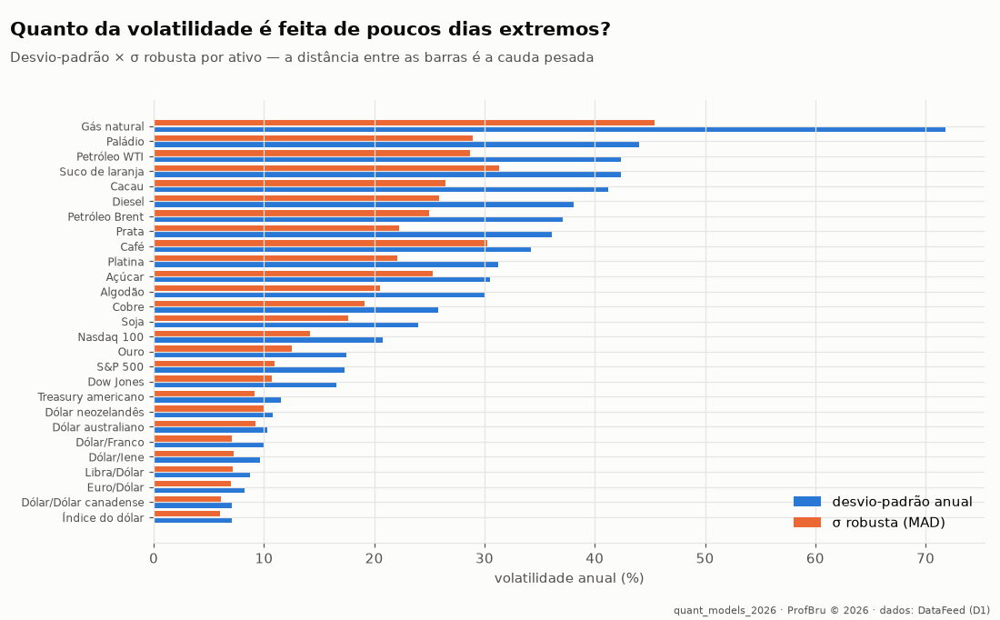</div>

**Почему выбрать:** Выбирайте, когда нужно знать, представляет ли среднее типичный случай или его искажают несколько экстремумов.

> **Что показали данные:** У серебра стандартное отклонение в 1,6 раза больше робастной σ: несколько экстремальных дней раздувают «среднюю» волатильность — избыточный эксцесс 26,9.

#### 02 · Поддержка и сопротивление по моде + кластеризация

<div align="center">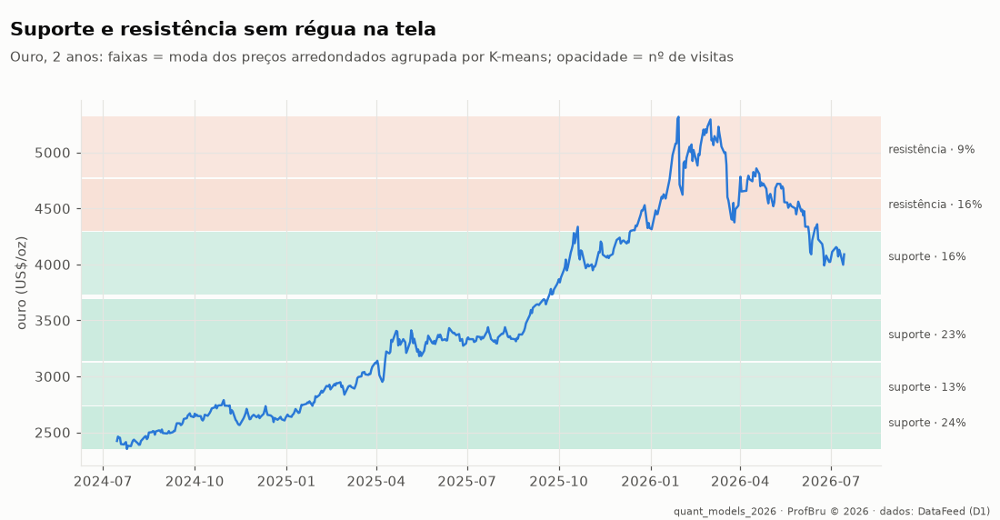</div>

**Почему выбрать:** Выбирайте, когда ценовой или бюджетный предел должен следовать из воспроизводимого критерия, а не из линии, проведённой на глаз.

> **Что показали данные:** Золото: мода округлённых цен — 3 330,00; самая посещаемая полоса (2 350,00–2 730,00) собирает 24 % торговых дней и сейчас служит поддержкой.

#### 03 · Стационарность (Augmented Dickey-Fuller)

<div align="center">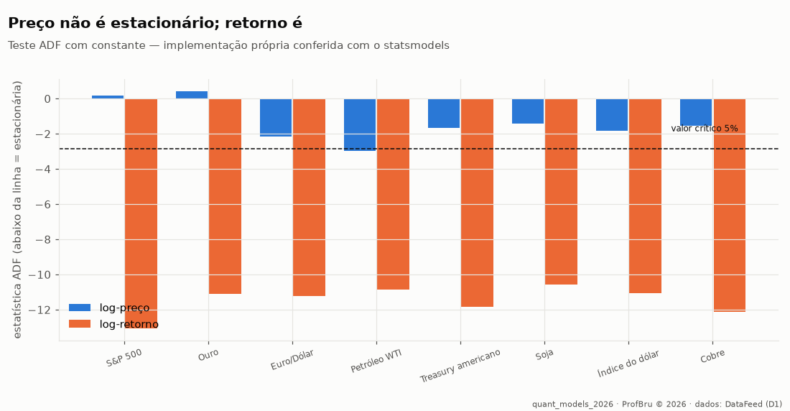</div>

**Почему выбрать:** Выбирайте перед любым прогнозом: тест показывает, остаётся ли прошлое пригодной выборкой будущего.

> **Что показали данные:** Только 1 из 8 ценовых рядов стационарен на уровне 5 %; в лог-доходностях — 8 из 8. Обучать на ценах — значит обучать на распределении, которое не вернётся.

#### 04 · Линейная регрессия (МНК) между активами

<div align="center">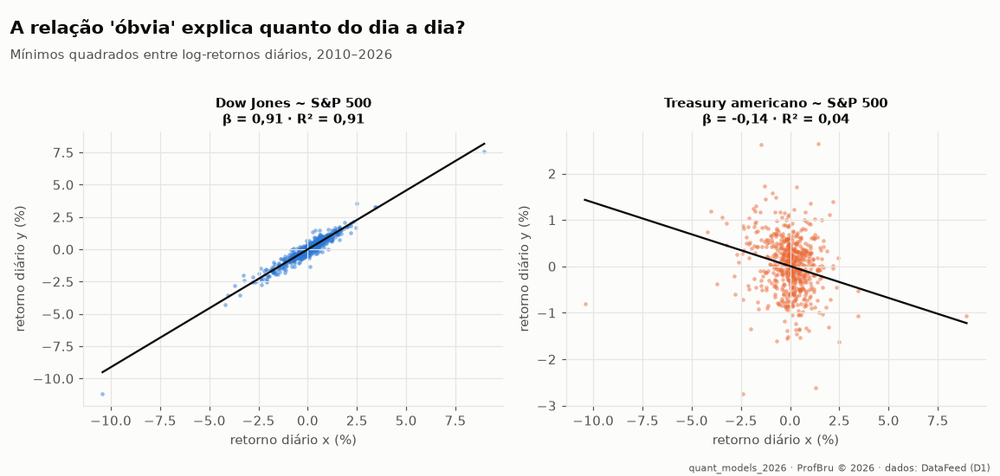</div>

**Почему выбрать:** Выбирайте, чтобы измерить, насколько одна переменная действительно объясняет другую, — и обнаружить, что «очевидная» связь порой почти ничего не объясняет.

> **Что показали данные:** Dow Jones ~ S&P 500: β = 0,91 при R² = 0,91. А казначейские облигации США ~ S&P 500 дают R² 0,04: «очевидная» связь почти не объясняет повседневные движения.

#### 13 · Выбросы несколькими методами (IQR, робастный z, LOF)

<div align="center">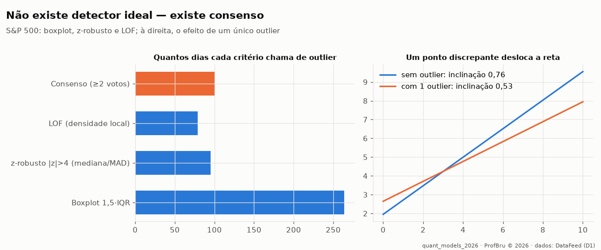</div>

**Почему выбрать:** Выбирайте, когда странное значение может быть ошибкой сбора или самым важным событием ряда: решает консенсус.

> **Что показали данные:** На S&P 500 ящик с усами отмечает 264 дня как выбросы (6,7 % выборки); консенсус трёх методов оставляет 101. Одна выпадающая точка меняет наклон прямой с 0,76 до 0,53.

#### 31 · Закон Ньюкомба — Бенфорда — целостность данных

<div align="center">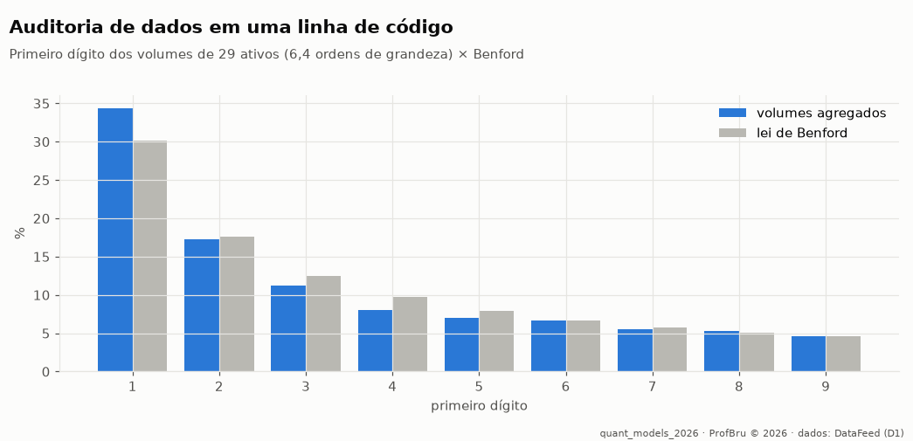</div>

**Почему выбрать:** Выбирайте, чтобы проверить набор значений, прежде чем ему доверять, понимая, когда тест применим, а когда дал бы ложную тревогу.

> **Что показали данные:** Лишь 21 из 29 рядов объёма охватывает достаточный для теста диапазон; применять Бенфорда к остальным — ложная тревога. В совокупности объёмы охватывают 6,4 порядка величины и дают MAD 0,0099 (приемлемое соответствие).

#### 25 · Условная волатильность (EWMA и GARCH(1,1))

<div align="center">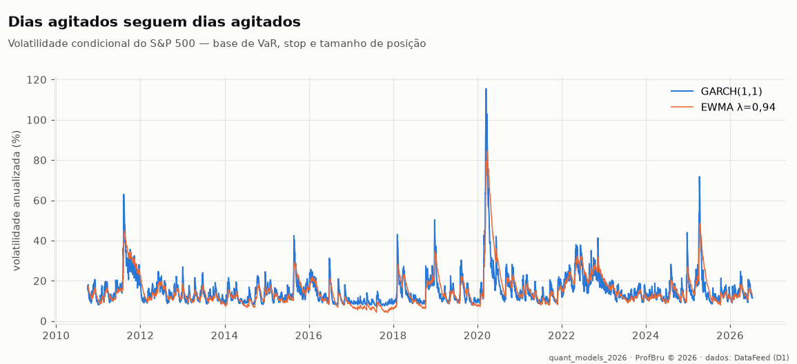</div>

**Почему выбрать:** Выбирайте, чтобы определять риск, страховой запас или лимит позиции по риску завтрашнего дня, а не по среднему за год.

> **Что показали данные:** S&P 500: устойчивость α+β = 0,963 — шоку волатильности нужно 18 торговых дней, чтобы потерять половину силы. Однодневный VaR 99 %: 1,75 %.

#### 24 · Нелинейная динамика и тяжёлые хвосты

<div align="center">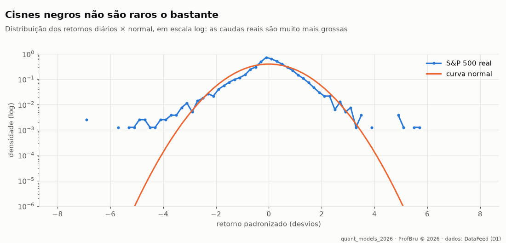</div>

**Почему выбрать:** Выбирайте, когда худший сценарий важнее среднего: модель измеряет, насколько реальные хвосты превышают нормальную кривую.

> **Что показали данные:** Движения в 4 стандартных отклонения происходят, по медиане, в 64 раза чаще, чем предсказывает нормальная кривая; у доходности почти нет памяти (автокорреляция -0,02), а у размера движения есть (0,15).

#### 27 · Причинность по Грейнджеру и заражение

<div align="center">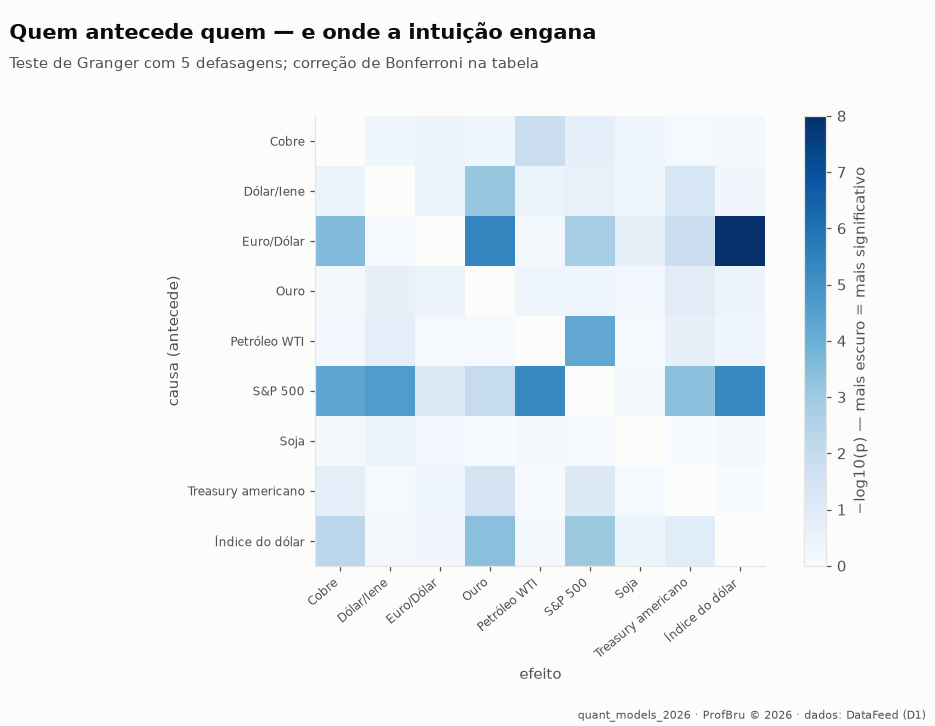</div>

**Почему выбрать:** Выбирайте, чтобы отделить «движутся вместе» от «одно опережает другое», прежде чем брать индикатор в качестве триггера.

> **Что показали данные:** Из 72 проверенных пар 7 выдерживают поправку Бонферрони. Сильнейшая — евро/доллар → индекс доллара — артефакт разного времени закрытия источников: статистическое опережение не есть причина, и тест точно показывает, где интуиция обманулась бы.

### Машинное обучение — по мерке базовой частоты

#### 05 · Логистическая регрессия направления

<div align="center">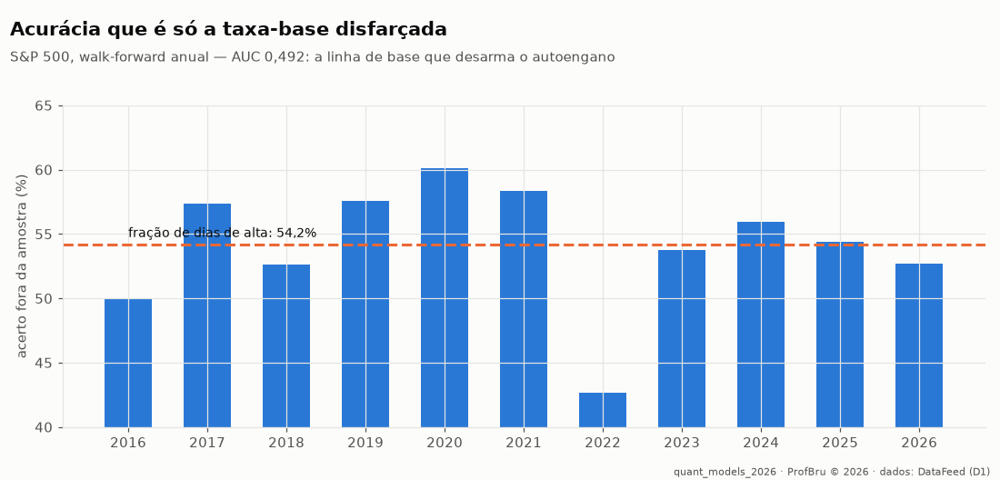</div>

**Почему выбрать:** Выбирайте как честную базовую линию любой бинарной классификации: если сложная модель её не превосходит, она не окупает себя.

> **Что показали данные:** Вне выборки (2016–2026) логистическая регрессия угадывает 54,2 % направлений S&P 500 — практически долю дней роста (54,2 %): она предсказала рост в 98 % дней, AUC — 0,492. Высокая точность без разделяющей способности — ловушка, которую обезвреживает эта базовая линия.

#### 06 · SVM и ядерные методы

<div align="center">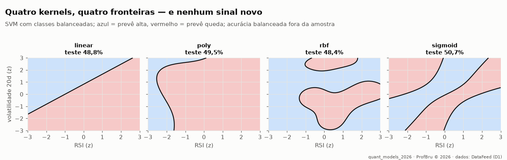</div>

**Почему выбрать:** Выбирайте, когда граница между «хорошим» и «плохим» криволинейна, — и чтобы доказать наличие сигнала, прежде чем платить за модели крупнее.

> **Что показали данные:** При входах только RSI и волатильность ни одно из четырёх ядер не превышает 50,7 % сбалансированной точности вне выборки. RBF больше всех «учится» на обучении (53,2 %) и больше всех теряет на проверке (48,4 %): ядро не создаёт сигнал там, где его нет.

#### 07 · Деревья решений и Random Forest

<div align="center">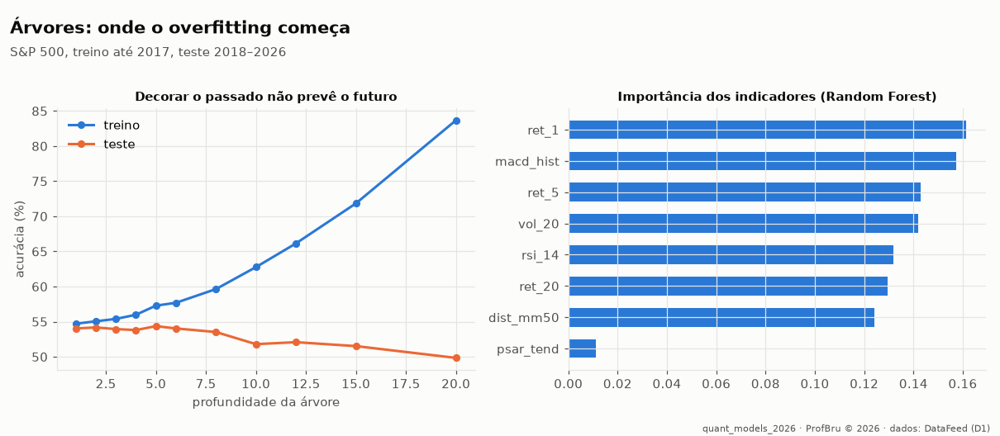</div>

**Почему выбрать:** Выбирайте, когда решение должно объясняться правилами и быть устойчивым на табличных данных.

> **Что показали данные:** Дерево глубины 20 даёт 83,7 % на обучении и 49,8 % на проверке: оно заучило прошлое. Неглубокий лес держится на 53,5 % — скромно, но честно; самый используемый признак — «ret_1».

#### 08 · Нейросеть MLP — индикатор разворота

<div align="center">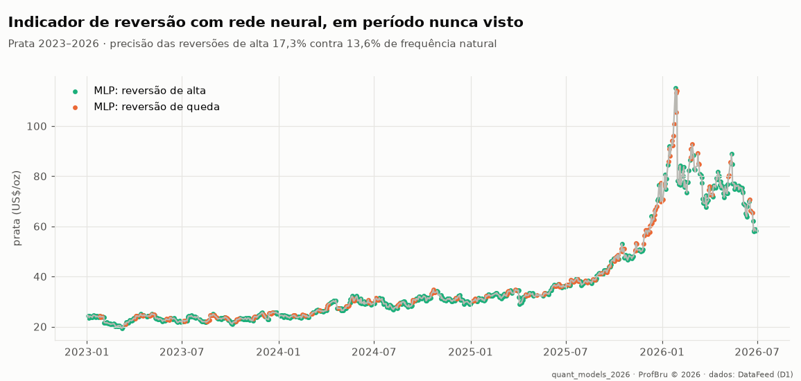</div>

**Почему выбрать:** Выбирайте для редких событий разворота, измеряя попадания относительно естественной частоты события, а не общей точности.

> **Что показали данные:** На серебре в 2023–2026 годах (не виденных при обучении) MLP выдала 607 сигналов разворота вверх с точностью 17,3 % при базовой частоте 13,6 % (в 1,27 раза выше естественной частоты): именно это отношение, а не общая точность, показывает, добавляет ли индикатор информацию.

#### 09 · PCA — факторы риска и индексы

<div align="center">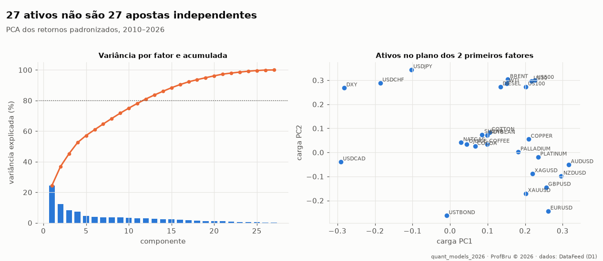</div>

**Почему выбрать:** Выбирайте, чтобы выяснить, сколько действительно независимых ставок скрыто в длинном списке вариантов.

> **Что показали данные:** Один 1-й фактор объясняет 24,5 % дневной изменчивости 27 активов; чтобы достичь 80 %, нужно 12 факторов. 27 активов — это не 27 независимых ставок.

#### 10 · Кластеризация активов (K-means)

<div align="center">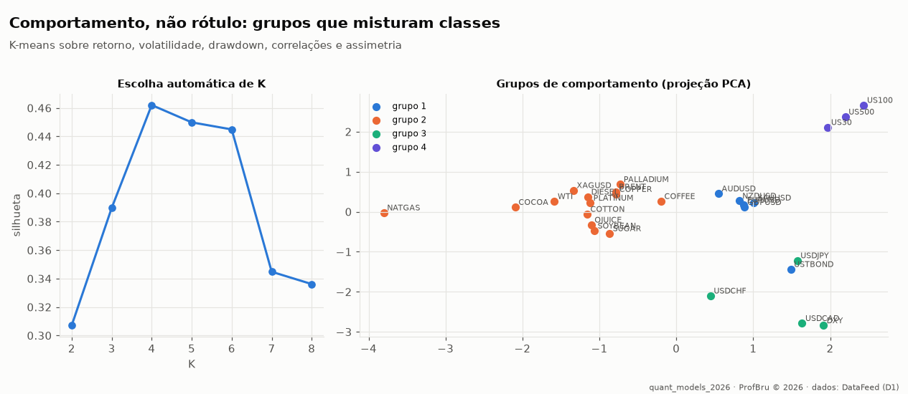</div>

**Почему выбрать:** Выбирайте, чтобы группировать альтернативы по измеренному поведению, а не по ярлыку из каталога.

> **Что показали данные:** Силуэт выбирает K = 4 группы без ручного вмешательства; одна группа смешивает 3 разных класса активов — ярлык «сырьё» или «валюта» не говорит, как ведёт себя актив.

#### 11 · Эмбеддинги доходностей (FastICA) + косинус

<div align="center">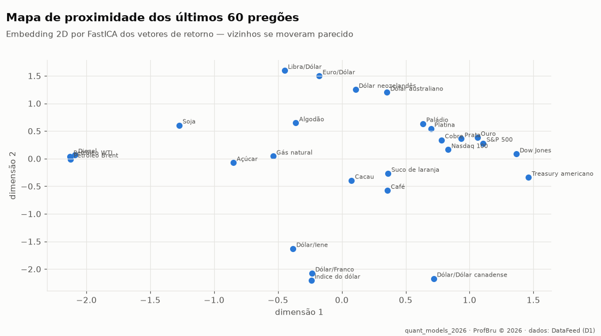</div>

**Почему выбрать:** Выбирайте, чтобы на одной карте увидеть, кто сейчас движется вместе, — с обновлением в каждом окне.

> **Что показали данные:** За последние 60 торговых дней самая похожая пара — нефть Brent × нефть WTI (косинус 0,96), а самая противоположная — индекс доллара × евро/доллар (-0,89): карта близости, обновляемая в каждом окне.

#### 12 · Isolation Forest — аномальные доходности и объёмы

<div align="center">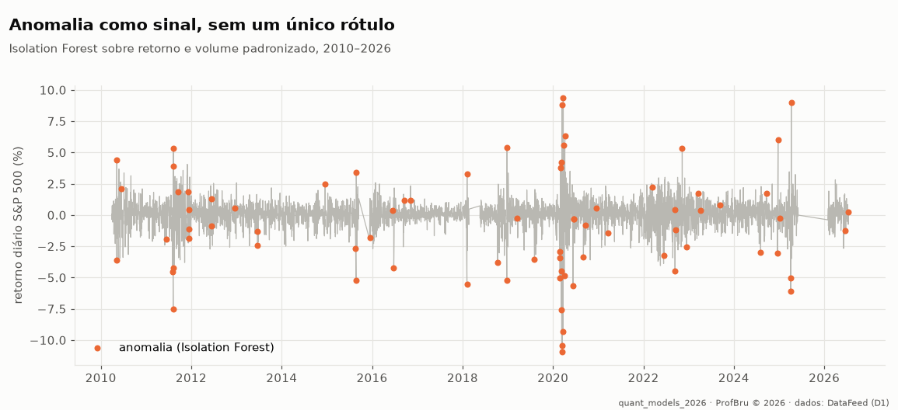</div>

**Почему выбрать:** Выбирайте, чтобы находить аномалии без размеченных примеров: первая тревога о том, что динамика изменилась.

> **Что показали данные:** Без единой метки изолирующий лес отмечает 77 торговых дней S&P 500 как аномальные — 21 только в 2020 году, — и 57 % из них падения: аномалия — сигнал смены динамики, а не шум, который нужно выбросить.

#### 32 · Объяснимость через значения Шепли (SHAP)

<div align="center">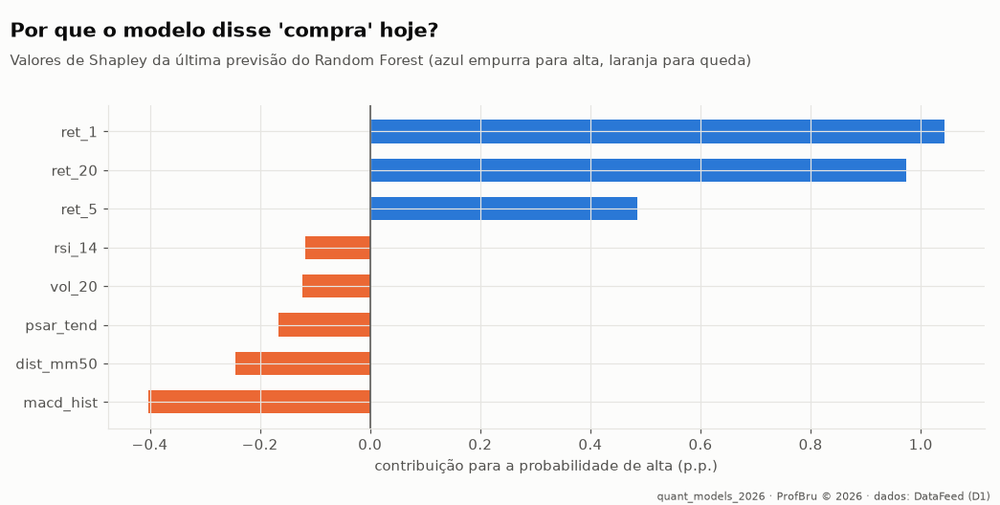</div>

**Почему выбрать:** Выбирайте, когда кто-то спрашивает «почему модель так решила?», а ответ требует чисел, а не веры.

> **Что показали данные:** В последнем прогнозе вероятность роста поднимается с 54,0 % (среднее модели) до 55,4 %; сильнее всего повлиял признак «ret_1» (+1,0 п. п.). Чёрный ящик начинает отвечать на вопрос «почему».

### Вероятность и сигналы — режимы, неопределённость и циклы

#### 14 · Марковская цепь режимов (рост, падение, боковик)

<div align="center">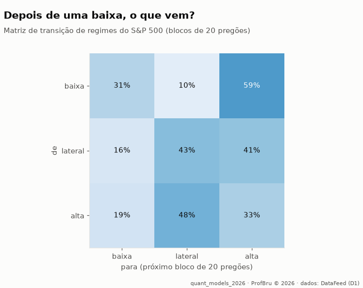</div>

**Почему выбрать:** Выбирайте, чтобы ответить на вопрос «находясь в этой фазе, каков шанс перейти в ту?» с помощью проверяемой матрицы.

> **Что показали данные:** На S&P 500 после падающего блока из 20 торговых дней вероятность того, что следующий блок будет растущим, — 59,0 %, выше, чем остаться в падении (30,8 %). В равновесии рынок проводит 41,3 % времени в режиме роста.

#### 15 · Скрытая марковская модель (гауссова HMM)

<div align="center">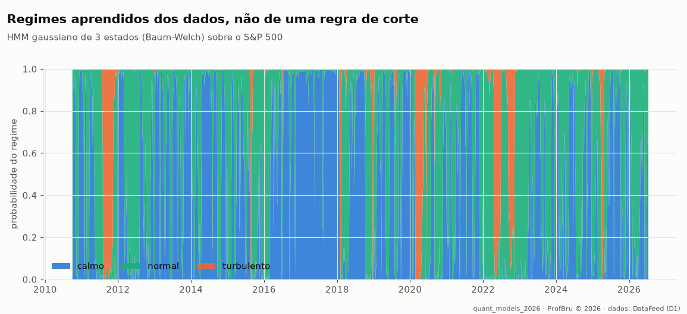</div>

**Почему выбрать:** Выбирайте, когда режимы ненаблюдаемы и их нужно выучить из данных с ежедневной вероятностью.

> **Что показали данные:** Без произвольного правила отсечения HMM находит в S&P 500 три режима: у турбулентного волатильность 43 % годовых против 7 % у спокойного, и он длится в среднем 18 торговых дней. Сегодня наиболее вероятный режим — «спокойный».

#### 16 · Байесовское обновление доходности и волатильности

<div align="center">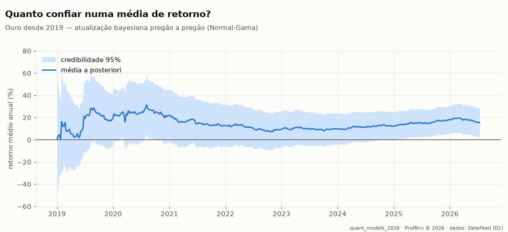</div>

**Почему выбрать:** Выбирайте, когда данных мало, а давление на решение велико: модель говорит, насколько доверять среднему, а не только каково оно.

> **Что показали данные:** Золото с 2019 года: апостериорная средняя годовая доходность — 15,3 %, но 95-процентный интервал достоверности — от 2,3 % до 28,4 %. Вероятность того, что среднее положительно, — 98,9 %; одно выборочное среднее (15,7 %) этого не говорит.

#### 30 · Оптимальные торговые правила (Орнштейн — Уленбек)

<div align="center">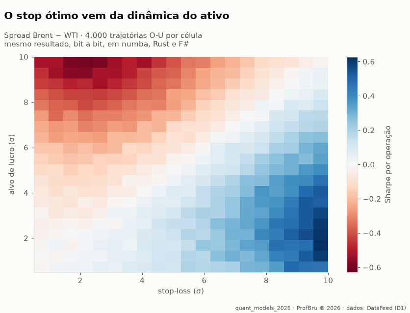</div>

**Почему выбрать:** Выбирайте, чтобы задавать цель и предел убытка по измеренной динамике, а не по унаследованным фиксированным процентам.

> **Что показали данные:** Спред Brent − WTI возвращается к среднему с периодом полураспада 22 торговых дня. При 4 000 смоделированных траекторий на ячейку лучшее правило — цель 1,5σ со стопом 10,0σ (Шарп на сделку 0,63): фиксированный процентный стоп игнорирует динамику актива.

#### 17 · Преобразование Фурье — доминирующие циклы

<div align="center">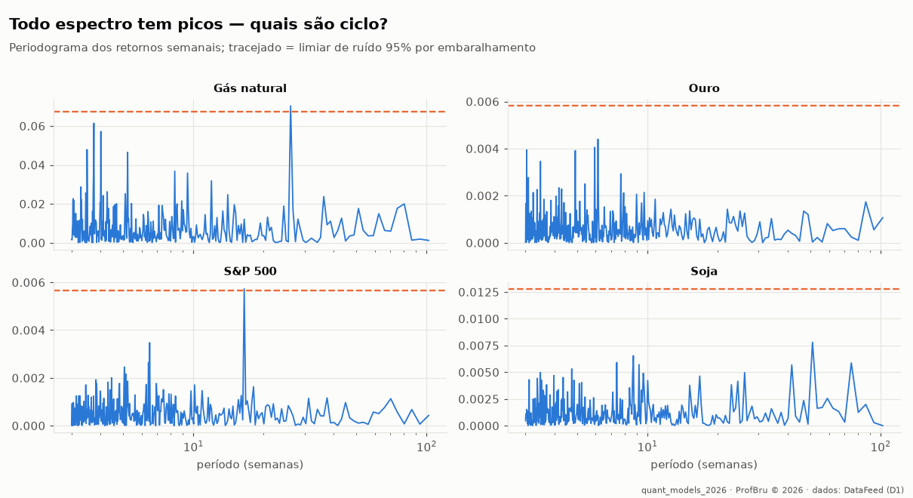</div>

**Почему выбрать:** Выбирайте, чтобы доказать, существует ли сезонный цикл или это случайность, — пики есть у любого спектра.

> **Что показали данные:** Из 12 крупнейших пиков циклов по четырём активам лишь 2 превышают порог шума 95 %, полученный перемешиванием самих доходностей. У любой периодограммы есть пики; тест говорит, какие из них — циклы, а какие — случайность.

#### 18 · Вейвлеты — частотно-временное разложение

<div align="center">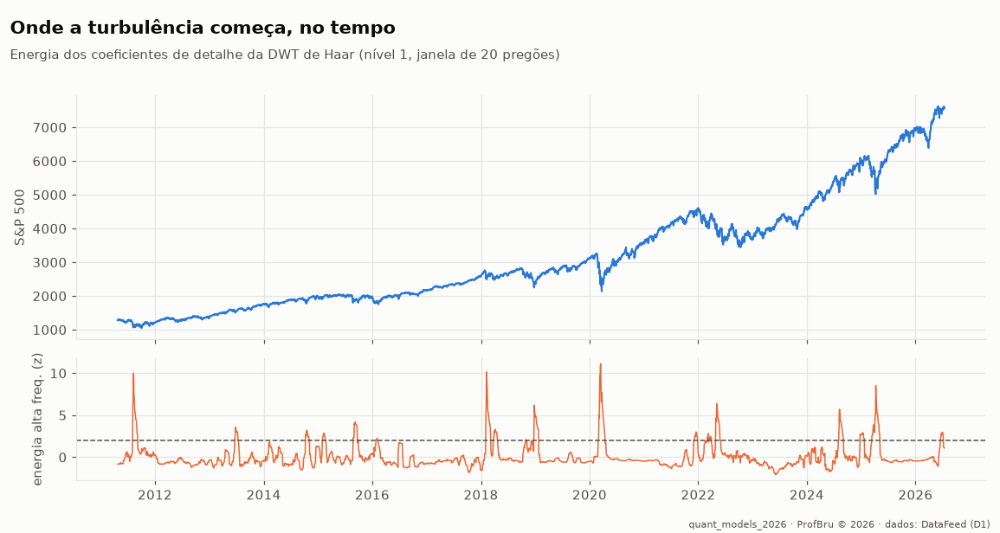</div>

**Почему выбрать:** Выбирайте, чтобы локализовать во времени начало турбулентности, которое скрывает среднегодовое значение.

> **Что показали данные:** Уровень 1 (колебания за 2 торговых дня) содержит 55,0 % энергии S&P 500. Когда энергия высоких частот взрывается (z > 2), разброс доходности следующих 20 дней в 1,3 раза выше обычного: вейвлет локализует во времени то, что Фурье видит лишь в среднем.

#### 23 · Показатель Хёрста и скользящий индикатор Хёрста

<div align="center">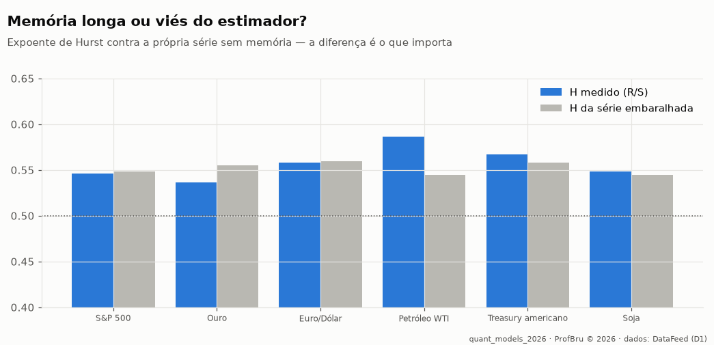</div>

**Почему выбрать:** Выбирайте, чтобы сделать выбор между трендовой стратегией и стратегией возврата к среднему, сравнивая с эталоном без памяти.

> **Что показали данные:** Сырой H по R/S лежит между 0,54 и 0,59 и выглядел бы «персистентным»; при сравнении с перемешанными рядами ни один из 6 активов не показывает реальной памяти. Пересечение MH100 − MH150 обходит пересечение скользящих средних в 3 из 6 активов по коэффициенту Шарпа.

### Оптимизация и управление — оптимум, случай и время

#### 19 · Эффективная граница Марковица

<div align="center">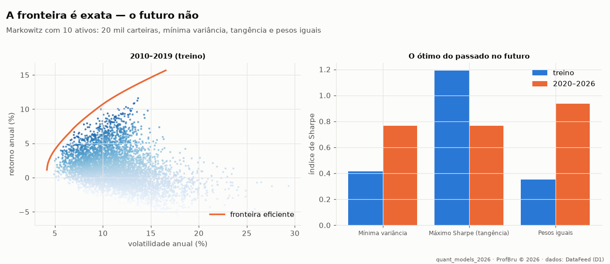</div>

**Почему выбрать:** Выбирайте, чтобы увидеть наилучшую доходность для каждого уровня риска — и насколько этот оптимум зависит от хрупких оценок.

> **Что показали данные:** Портфель максимального Шарпа имел коэффициент 1,19 в 2010–2019 годах и дал 0,76 в 2020–2026; равные веса выросли с 0,35 до 0,94. Граница точна для прошлого — ошибка в оценке средних, которые будущее не повторяет.

#### 20 · Генетический алгоритм — оптимизация портфеля

<div align="center">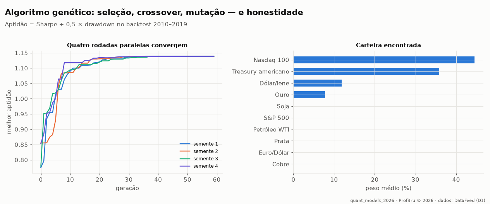</div>

**Почему выбрать:** Выбирайте, когда у цели есть реальные ограничения (издержки, лимиты, максимальные потери), которые не допускает ни одна закрытая формула.

> **Что показали данные:** Четыре параллельных запуска ГА с разными зёрнами сходятся к одному портфелю (среднее отклонение весов 0,1 п. п.) с коэффициентом Шарпа 1,19 в 2010–2019 годах. В 2020–2026 он даёт 0,86 — ниже равных весов (0,94): сходимость доказывает устойчивость оптимума, а не то, что будущее его повторит.

#### 21 · Генетический алгоритм — выбор индикаторов и параметров

<div align="center">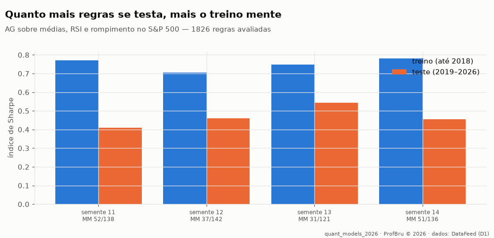</div>

**Почему выбрать:** Выбирайте для поиска лучшей комбинации правил, фиксируя, сколько их проверено, чтобы не обмануться случайностью.

> **Что показали данные:** ГА проверил 1826 различных правил на S&P 500, и лучшее в каждом запуске имело обучающий Шарп до 0,78; в 2019–2026 они держались между 0,41 и 0,54 против 0,77 у простого удержания длинной позиции. Чем больше правил проверяешь, тем выше обучающий Шарп — по чистой случайности.

#### 22 · Генетическое программирование — символьная регрессия

<div align="center">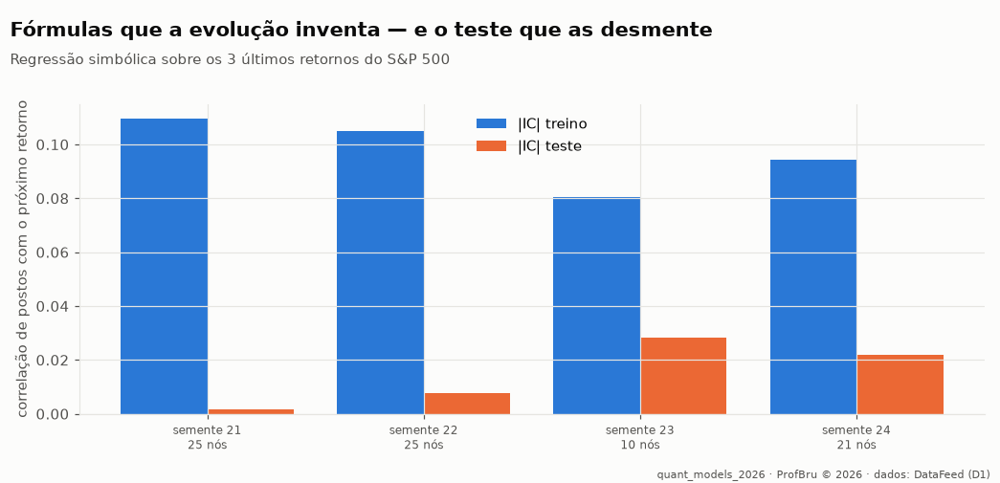</div>

**Почему выбрать:** Выбирайте, чтобы изобретать читаемые, проверяемые формулы и подвергать их периоду, которого они не видели.

> **Что показали данные:** Генетическое программирование нашло читаемые формулы вроде ((sen(cos(r3)) + r1) + sen(sen(cos(r2)))) (10 узлов) с ранговой корреляцией со следующей доходностью -0,080 на обучении и -0,028 на проверке. Эволюция всегда находит «что-то» в прошлом; только невиданный период отделяет индикатор от совпадения.

#### 26 · Сеть корреляций и центральность

<div align="center">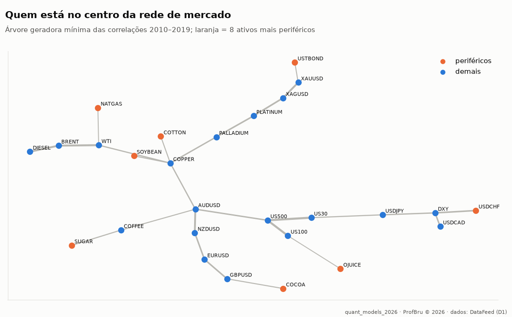</div>

**Почему выбрать:** Выбирайте, чтобы увидеть, кто находится в центре, а кто на периферии системы зависимостей.

> **Что показали данные:** Выбранные по сети 2010–2019 годов 8 периферийных активов в 2020–2026 оставались почти независимыми (средняя корреляция 0,00 против 0,15 у центральных) и принесли больше (11,0 % против 7,4 % годовых), но с большей волатильностью. Обе корзины обошёл портфель из всех 27 (Шарп 0,95): число независимых ставок важнее положения в сети.

#### 28 · Обнаружение дрейфа модели и концепции

<div align="center">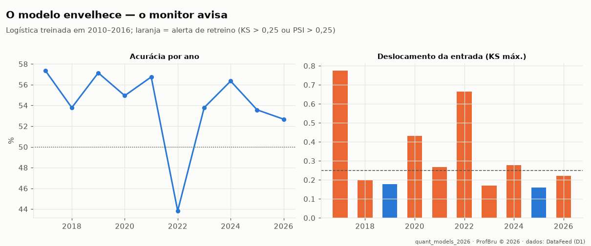</div>

**Почему выбрать:** Выбирайте, чтобы узнать об устаревании модели до того, как появятся потери.

> **Что показали данные:** Модель, обученная на 2010–2016 годах, требует переобучения в 8 из 10 последующих лет: режим входных данных того периода не вернулся. В 2022 году была худшая точность (43,8 %), а в 2017 — наибольший сдвиг (KS 0,77): мониторинг входа показывает проблему, не дожидаясь убытков.

#### 29 · Бэктест walk-forward с издержками

<div align="center">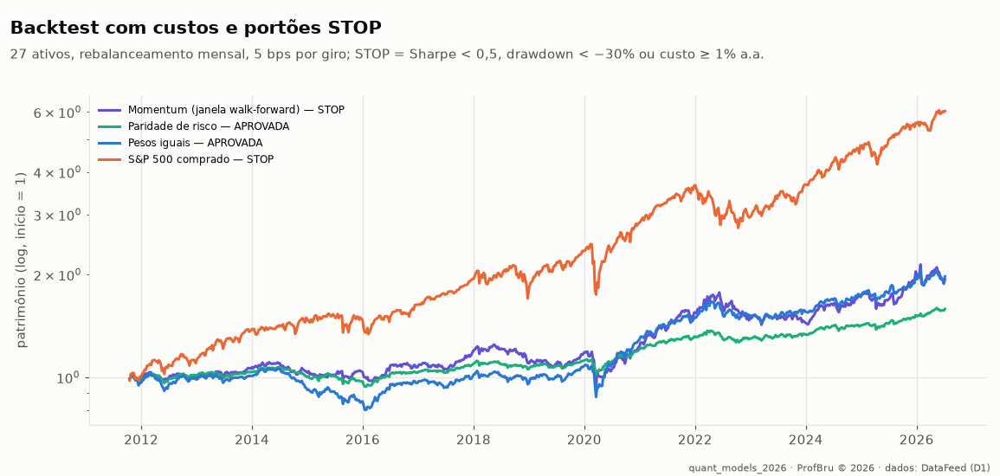</div>

**Почему выбрать:** Выбирайте, чтобы проверить любое правило решения во времени, с издержками и заранее объявленными барьерами отклонения.

> **Что показали данные:** При издержках 5 б. п. за оборот 2 из 4 стратегий проходят три барьера STOP (равные веса, паритет риска). Окно моментума, выбираемое каждый месяц только по прошлому, менялось 45 раз — «оптимальный параметр» не постоянен.


---

## ⚡ Установка

Требования: Python 3.13, Rust 1.96 (с целью wasm32-unknown-unknown), .NET 9 для движка F# и Node 20+ для сайта. Данные поступают из DataFeed Service Provider (переменная QUANT_MODELS_DATAFEED).

**1 · Данные и модели**

```bash
git clone <url-do-repositorio-privado> quant_models_2026
cd quant_models_2026/public/foundations/pipeline
pip install -r requisitos.txt
export QUANT_MODELS_DATAFEED=/mnt/d/DataFeedServiceProvider
python3 dados_feed.py consolidar --tf D1
python3 executar_modelos.py
```

**2 · Три движка и проверка согласия**

```bash
(cd ../rust/quant_models_2026_core && cargo build --release && cargo build --release --lib --target wasm32-unknown-unknown)
(cd ../fsharp/QuantModels2026.Core && dotnet build -c Release)
python3 testes_nucleo.py        # 38 verificações: numba × Rust × F#
```

**3 · Экраны и сайт**

```bash
python3 gerar_telas.py && python3 gerar_site.py
cd ../evidence && npm ci && bash subir_servidor.sh     # http://localhost:3020
```

**4 · Длительный фоновый запуск (screen + сторожевой процесс каждые 20 минут)**

```bash
./run_all.sh --background
screen -r quant_models_2026
```

---

<a id="arquitetura"></a>

## 🧠 Архитектура и решения

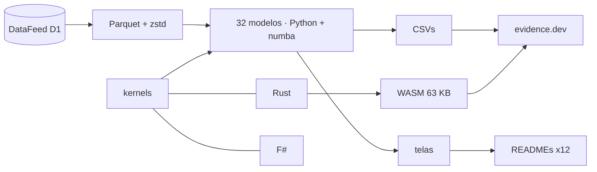

Архитектурные решения, каждое с обоснованием:

| | |
|---|---|
| **Три движка с одним генератором псевдослучайных чисел (xorshift64*)** | даже Монте-Карло совпадает бит в бит; математическая ошибка не может проскочить сразу в трёх языках. |
| **WebAssembly без зависимостей (63 КБ)** | тяжёлые вычисления идут в браузере пользователя: нулевые затраты на сервер, и никакие данные не покидают компьютер. |
| **Обучение и проверка всегда разделены во времени** | перемешивание временных рядов переносит будущее в обучение и фабрикует точность. |
| **Оценки сравниваются с собственной нулевой гипотезой** | у Хёрста и Фурье известные смещения; только сравнение с перемешанными данными отделяет сигнал от артефакта. |
| **Вывод пишется по числу** | фраза каждого экрана генерируется из результата; меняется результат — меняется и фраза. |
| **Параллелизм через ProcessPoolExecutor и фиксированное разбиение** | результат не зависит от числа ядер машины. |

---

<a id="desempenho"></a>

## 🚀 Измеренная производительность

Числа измерены с помощью bench_motores.py и записаны в историю проекта. Для Rust и F# вычтено время запуска процесса.

| Нагрузка | numba | Rust | F# | Чистый Python |
|---|---:|---:|---:|---:|
| Монте-Карло O-U (сетка 20×20, 2 000 траекторий) | 2,859 s | 2,840 s | 3,490 s | — |
| Скользящий Хёрст R/S (окно 250, 3 917 торговых дней) | 0,027 s | 0,016 s | 0,108 s | 7,86 s |
| Гауссова HMM по EM (3 состояния, 200 итераций) | 0,235 s | 0,308 s | 1,213 s | 64,19 s |
| Метрики 2 000 портфелей × 10 активов | 1,366 s | 1,297 s | 1,908 s | — |

Критический путь (сетка Монте-Карло 20×20 в numba) выполняется за 3,4 с при бюджете 10 с и с доказательством результата, идентичного движку Rust.

---

## 📚 Полный каталог

Все 40 моделей — номер, тип, категория и описание — находятся в modelos_quant.md, созданном из того же источника, что и сайт. → [modelos_quant.md](modelos_quant.md)

---

## ❓ Трудные вопросы

<details><summary><b>Я уже пользуюсь таблицей с весами и фильтрами. Разве это не то же самое?</b></summary>

Нет. Таблица суммирует баллы, которые считает достоверными. Модели измеряют, какая часть балла — шум, проверяют выбор на периоде, которого он не видел, и показывают, когда лучший вариант прошлого перестаёт быть лучшим.
</details>

<details><summary><b>Какая-нибудь из этих моделей «обыгрывает рынок»?</b></summary>

Несколько результатов этого репозитория показывают ровно обратное для популярных техник: индикаторы и ядра без дневного сигнала направления, «долгая память», которая оказывается смещением оценки. Знать это до вложения времени и денег — и есть цель.
</details>

<details><summary><b>Зачем три языка для одного расчёта?</b></summary>

Потому что независимый второй движок, совпадающий с первым, доказывает математику, а третий разрешает спор. В 38 проверках все три совпадают бит в бит.
</details>

<details><summary><b>Нужен ли сервер или облако?</b></summary>

Нет. Модели работают на вашем компьютере, а сайт статический: лаборатория выполняет движок Rust в WebAssembly внутри браузера.
</details>

<details><summary><b>Подходит ли это для решений вне финансовых рынков?</b></summary>

Методы — да; данные должны быть из вашей области. Таблица «Для чего это» показывает, какие модели отвечают на каждый тип решения.
</details>

---

<a id="licenca"></a>

## 📜 Лицензия и авторство

Код, модели, тексты и экраны: использование только автором. Сторонние библиотеки сохраняют свои лицензии (NumPy, numba, scikit-learn, SciPy, pandas, networkx, matplotlib, evidence.dev).

**Автор:** ProfBru - Bruno Penedo © 2026 — TODOS OS DIREITOS RESERVADOS · profbruanbima@gmail.com

<div align="center">


**ProfBru © 2026**

</div>
