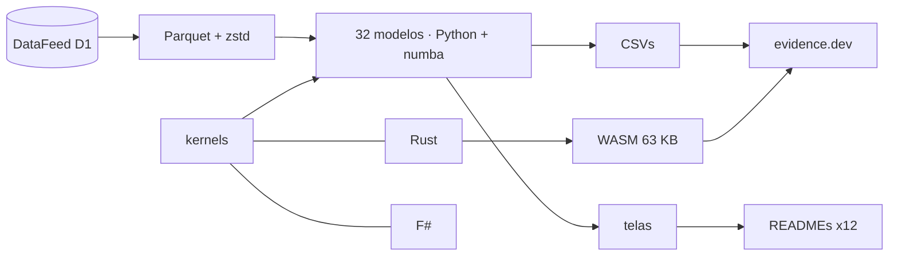

<!--
quant_models_2026
Autor: ProfBru - Bruno Penedo © 2026 - TODOS OS DIREITOS RESERVADOS
E-mail: profbruanbima@gmail.com

README GERADO — não editar à mão. Estrutura: montar_i18n.py · prosa: translation/blocos/<idioma>.json
Gerar: python3 public/foundations/pipeline/montar_i18n.py && python3 public/foundations/pipeline/gerar_readmes.py
-->

<div align="center">

# 📈 quant_models_2026 — 40 kvantitativa modeller för beslut under osäkerhet


**ProfBru © 2026**

### Sluta välja med kalkylblad. Börja besluta med modeller.

**32 modeller som körs på 16 år av verkliga data, tre motorer (Python, Rust och F#) som stämmer överens bit för bit och ett labb som körs i din webbläsare — var och en visar med data var intuitionen vilseleder.**

[](#modelos)
[](#arquitetura)
[](#desempenho)
[](#site)

[](https://www.python.org)
[](https://numba.pydata.org)
[](https://www.rust-lang.org)
[](https://fsharp.org)
[](https://evidence.dev)
[](#licenca)

[Português](README.md) · [English](README.en.md) · [Español](README.es.md) · [Français](README.fr.md) · [Deutsch](README.de.md) · [中文](README.zh.md) · [한국어](README.ko.md) · [हिन्दी](README.hi.md) · [עברית](README.he.md) · [Русский](README.ru.md) · **Svenska** · [Suomi](README.fi.md)

</div>

> [!WARNING]
> Använd endast detta förråd som källa. Resultaten beror på de validerade DataFeed-data; ingen skärm är en investeringsrekommendation.

---

## 💀 Smärtan: att besluta med kalkylblad

Du har gjort det här. Du byggde ett kalkylblad med alternativen — leverantörer, mobiler till teamet, elbilar till fordonsparken, tillgångar till portföljen, flygplan till en division —, gav poäng per kriterium, viktade, sorterade från högst till lägst och tog med vinnaren till mötet. Kalkylbladet hade rätt. Beslutet hade fel.

**Kalkylbladet räknar inte fel. Det ställer fel fråga.**

| Vad du gjorde | Vad verktyget dolde |
|---|---|
| 🔻 **Rangordnade efter historiskt medelvärde** | Medelvärdet för 2010–2019 valde den bästa portföljen; 2020–2026 förlorade den mot lika vikter. Det förflutna bar på brus som kolumnen inte visar. |
| 🏷️ **Filtrerade på etiketten** | Du ”diversifierade” mellan alternativ i samma kategori som rör sig tillsammans — och mellan olika kategorier som i data bildar samma grupp. |
| 🎯 **Litade på träffsäkerheten** | En modell som ”har rätt i 54 %” upprepade bara andelen uppgångsdagar. Hög träffsäkerhet utan särskiljande förmåga är en dyr slantsingling. |

> [!IMPORTANT]
> **Felet är inte ditt. Det är verktygets.**
> Kalkylblad, poängmatriser och rangordningsfilter behandlar varje tal som säkert. Inget av dem frågar hur mycket av det du ser som är brus, om det förflutna fortfarande representerar framtiden eller om ditt ”bästa alternativ” skulle klara en period det aldrig har sett.

Och det finns ett misstag du gör utan att veta det: ju fler alternativ och kombinationer du testar, desto bättre blir det historiska resultatet — av ren slump. Projektets genetiska algoritm testade 1 826 regler på ett aktieindex; den bästa glänste i träningen och förlorade under nästa period mot att bara behålla positionen.

### Där beslutet rasar

På mötet är frågan som fäller rekommendationen aldrig ”vad blev poängen?”. Det är en annan:

> *Och om läget förändras — hur mycket av detta står kvar?*

Kalkylbladet kan inte svara, eftersom det aldrig skilde signal från brus, aldrig testades utanför urvalet och aldrig mätte sin egen osäkerhet.

---

## 💊 Lösningen

Var och en av de 32 modellerna körs på 27 verkliga tillgångar 2010–2026, med träning och test åtskilda i tid, och avslutas med en mening skriven utifrån talet — även när talet motsäger intuitionen.

> ### Tre oberoende motorer — Python/numba, Rust och F# — räknar samma matematik och måste stämma bit för bit. Två motorer som stämmer bevisar att räkningen är rätt, inte bara koden.

<div align="center">

| ❌ Kalkylblad | ✅ Modell |
|---|---|
| Alternativet med högst medelpoäng | **Alternativet som klarar sig utanför urvalet, med kostnad och risk angivna** |
| *”Diversifierat” eftersom kategorierna skiljer sig* | **Diversifierat eftersom data visar låg korrelation mellan valen** |

</div>

**Modellerna förutsäger inte framtiden med säkerhet — och säger det: flera resultat här visar att en populär metod saknar signal. Det är värdet: att veta var man inte ska lita innan man spenderar.**

---

## 🎯 Vad det är till för — bortom marknaden

Exemplen använder marknadsserier eftersom de är långa, offentliga och obarmhärtiga. Teknikerna är desamma för varje beslut under osäkerhet — projektets egen kunskapsbas visar marknadsriktningsmodellen som förutsäger studieavbrott och avvikelsedetektorn som avslöjar bedrägeri.

| Beslut | Modeller som svarar | Frågan kalkylbladet inte kan besvara |
|---|---|---|
| 📊 **Investeringsportfölj** | regimer (HMM), GARCH, Markowitz, walk-forward-backtest | Håller den historiskt optimala allokeringen i nästa regim? |
| 📱 **Företagsinköp — utrustning och mobiler** | Benford, avvikare, K-means, drift | Är leverantörens pris en avvikelse, ett skrivfel eller bedrägeri? Levererar gårdagens leverantör fortfarande samma sak? |
| 🔋 **Fordonspark med elbilar** | Bayes, GARCH, O-U Monte Carlo, icke-linjära system | Med bara några månaders data om räckvidd och energipris, hur mycket kan man lita på den beräknade besparingen? |
| 🛡️ **Försvar — anskaffning av stridsvagnar och flygplan** | Markovkedjor, tjocka svansar, GA med bivillkor, PCA | Vilken tillgänglighet kan flottan förväntas ha mellan drift och underhåll, och vad kostar det värsta scenariot, inte genomsnittet? |
| 🚀 **Startups och ledningsbeslut** | Bayes, drift, SHAP, walk-forward-backtest | Håller hypotesen som validerades i piloten fortfarande på marknaden — och kan jag förklara beslutet för styrelsen med siffror? |

> [!NOTE]
> Skärmarna och siffrorna i detta förråd kommer från marknadsdata. Att tillämpa dem på ett annat område kräver det områdets data; metoderna, valideringstesterna och de tre motorerna är desamma.

---

## 🖼️ Se det fungera

<a id="site"></a>

### 🌐 Webbplatsen och labbet

Webbplatsen byggs med evidence.dev: SQL över resultaten, en interaktiv sida per modell och ett labb där Rust-motorn, kompilerad till WebAssembly, körs i din webbläsare — utan server och utan kostnad per användare.

| | |
|---|---|
| <br/>**Skyltfönster: en mening per modell**<br/>Varje rad är den tolkning som data själva gav — även de som motbevisar den populära tekniken. | <br/>**Labb i webbläsaren (WebAssembly)**<br/>216 000 Monte Carlo-banor på cirka 3 sekunder i webbläsaren, med samma motor som klarar överensstämmelsetesterna. |
| <br/>**Modellsida: profil, tolkning och diagram**<br/>Den optimala utgångsregeln kommer från den uppmätta dynamiken i Brent − WTI-spreaden, inte från en fast procentsats. | <br/>**Tre motorer, ett resultat**<br/>Uppmätta tider för samma kärna i numba, Rust och F#, med processtarten avdragen. |

<a id="modelos"></a>

### 🧪 De 32 modellerna, en i taget

Varje skärm nedan visar beslutsfrågan som modellen besvarar och den tolkning som data gav. Katalogens övriga 8 modeller (text, förstärkningsinlärning och multiagentsimulering) beskrivs i modelos_quant.md.

### Statistik — vad data är, innan vad de förutsäger

#### 01 · Robust deskriptiv statistik

<div align="center"></div>

**Varför välja den:** Välj den när du behöver veta om medelvärdet representerar det typiska fallet eller om några få extremer förvränger räkningen.

> **Vad data visade:** Silver har en standardavvikelse 1,6× större än sin robusta σ: några få extrema dagar blåser upp den ”genomsnittliga” volatiliteten — överskottskurtosis på 26,9.

#### 02 · Stöd och motstånd via typvärde + klustring

<div align="center"></div>

**Varför välja den:** Välj den när en pris- eller budgetgräns måste komma från ett reproducerbart kriterium, inte från en linje dragen på öga.

> **Vad data visade:** Guld: typvärdet för avrundade priser är 3 330,00; det mest besökta bandet (2 350,00–2 730,00) rymmer 24 % av handelsdagarna och fungerar i dag som stöd.

#### 03 · Stationaritet (Augmented Dickey-Fuller)

<div align="center"></div>

**Varför välja den:** Välj den före varje prognos: den visar om det förflutna fortfarande är ett giltigt urval av framtiden.

> **Vad data visade:** 1 av 8 prisserier är stationär på 5 %-nivån; i logavkastning 8 av 8. Att träna på priser är att träna på en fördelning som inte kommer tillbaka.

#### 04 · Linjär regression (MKV) mellan tillgångar

<div align="center"></div>

**Varför välja den:** Välj den för att mäta hur mycket en variabel verkligen förklarar en annan — och upptäcka att det ”uppenbara” sambandet ibland förklarar nästan ingenting.

> **Vad data visade:** Dow Jones ~ S&P 500: β = 0,91 med R² = 0,91. Amerikansk statsobligation ~ S&P 500 har däremot R² 0,04: det ”uppenbara” sambandet förklarar nästan ingenting från dag till dag.

#### 13 · Avvikare med flera metoder (IQR, robust z, LOF)

<div align="center"></div>

**Varför välja den:** Välj den när en konstig datapunkt kan vara ett insamlingsfel eller den viktigaste händelsen i serien: konsensus avgör.

> **Vad data visade:** För S&P 500 markerar lådagrammet 264 dagar som avvikare (6,7 % av urvalet); konsensus mellan tre metoder behåller 101. En enda avvikande punkt ändrar linjens lutning från 0,76 till 0,53.

#### 31 · Newcomb-Benfords lag — dataintegritet

<div align="center"></div>

**Varför välja den:** Välj den för att granska en uppsättning värden innan du litar på den, med vetskap om när testet gäller och när det vore falsklarm.

> **Vad data visade:** Endast 21 av de 29 volymserierna spänner över ett tillräckligt intervall för testet; att tillämpa Benford på de övriga vore falsklarm. Sammantaget spänner volymerna över 6,4 storleksordningar och ger MAD 0,0099 (godtagbar överensstämmelse).

#### 25 · Betingad volatilitet (EWMA och GARCH(1,1))

<div align="center"></div>

**Varför välja den:** Välj den för att dimensionera risk, säkerhetslager eller exponeringsgräns efter morgondagens risk, inte årets genomsnitt.

> **Vad data visade:** S&P 500: persistens α+β = 0,963 — en volatilitetschock behöver 18 handelsdagar för att förlora halva sin kraft. VaR 99 % för 1 dag: 1,75 %.

#### 24 · Icke-linjär dynamik och tjocka svansar

<div align="center"></div>

**Varför välja den:** Välj den när det värsta scenariot betyder mer än det genomsnittliga: den mäter hur mycket de verkliga svansarna överstiger normalkurvan.

> **Vad data visade:** Rörelser på 4 standardavvikelser inträffar, i median, 64× oftare än normalkurvan förutsäger; avkastningen har nästan inget minne (autokorrelation -0,02), men rörelsens storlek har det (0,15).

#### 27 · Grangerkausalitet och smitta

<div align="center"></div>

**Varför välja den:** Välj den för att skilja ”rör sig tillsammans” från ”det ena föregår det andra” innan du använder en indikator som utlösare.

> **Vad data visade:** Av 72 testade par klarar 7 Bonferronikorrigeringen. Det starkaste, euro/dollar → dollarindex, är en artefakt av olika stängningstider mellan källorna: statistisk föregångare är inte orsak — och testet visar exakt var intuitionen skulle luras.

### Maskininlärning — mätt mot basfrekvensen

#### 05 · Logistisk regression för riktning

<div align="center"></div>

**Varför välja den:** Välj den som ärlig baslinje för varje ja/nej-klassificering: om en komplex modell inte slår den, betalar den inte sin egen kostnad.

> **Vad data visade:** Utanför urvalet (2016–2026) träffar den logistiska modellen 54,2 % av S&P 500:s riktning — i praktiken andelen uppgångsdagar (54,2 %): den förutsade uppgång 98 % av dagarna och har AUC 0,492. Hög träffsäkerhet utan särskiljande förmåga är fällan som den här baslinjen desarmerar.

#### 06 · SVM och kärnmetoder

<div align="center"></div>

**Varför välja den:** Välj den när gränsen mellan ”bra” och ”dåligt” är krökt — och för att bevisa att det finns en signal innan du betalar för större modeller.

> **Vad data visade:** Med bara RSI och volatilitet som indata når ingen av de fyra kärnorna över 50,7 % balanserad träffsäkerhet utanför urvalet. RBF ”lär sig” mest i träningen (53,2 %) och förlorar mest i testet (48,4 %): en kärna skapar ingen signal där ingen finns.

#### 07 · Beslutsträd och Random Forest

<div align="center"></div>

**Varför välja den:** Välj den när beslutet måste kunna förklaras som regler och vara robust på tabelldata.

> **Vad data visade:** Ett träd med djup 20 träffar 83,7 % i träningen och 49,8 % i testet: det lärde sig det förflutna utantill. Den grunda skogen stannar på 53,5 % — blygsamt men ärligt; det mest använda attributet är ”ret_1”.

#### 08 · MLP-neuralnät — vändningsindikator

<div align="center"></div>

**Varför välja den:** Välj den för sällsynta vändningshändelser och mät träffarna mot händelsens naturliga frekvens, inte mot den totala träffsäkerheten.

> **Vad data visade:** För silver gav MLP:n 2023–2026 (aldrig sedda i träningen) 607 signaler om uppåtvändning med 17,3 % precision, mot en basfrekvens på 13,6 % (1,27× den naturliga frekvensen): det är den kvoten, inte den totala träffsäkerheten, som avgör om indikatorn tillför information.

#### 09 · PCA — riskfaktorer och index

<div align="center"></div>

**Varför välja den:** Välj den för att ta reda på hur många verkligt oberoende satsningar som finns i en lång lista med alternativ.

> **Vad data visade:** Den 1:a faktorn ensam förklarar 24,5 % av den dagliga variationen hos 27 tillgångar; det krävs 12 faktorer för att nå 80 %. De 27 tillgångarna är inte 27 oberoende satsningar.

#### 10 · Klustring av tillgångar (K-means)

<div align="center"></div>

**Varför välja den:** Välj den för att gruppera alternativ efter uppmätt beteende, inte efter katalogens etikett.

> **Vad data visade:** Siluetten väljer K = 4 grupper utan manuellt ingrepp; en grupp blandar 3 olika tillgångsklasser — etiketten ”råvara” eller ”valuta” säger inte hur tillgången beter sig.

#### 11 · Avkastningsinbäddningar (FastICA) + cosinus

<div align="center"></div>

**Varför välja den:** Välj den för att på en enda karta se vem som rör sig tillsammans just nu — uppdaterad i varje fönster.

> **Vad data visade:** Under de senaste 60 handelsdagarna är det mest lika paret Brentolja × WTI-olja (cosinus 0,96) och det mest motsatta dollarindex × euro/dollar (-0,89): en närhetskarta som uppdateras i varje fönster.

#### 12 · Isolation Forest — avvikande avkastning och volym

<div align="center"></div>

**Varför välja den:** Välj den för att hitta det avvikande utan märkta exempel: det första larmet om att dynamiken har förändrats.

> **Vad data visade:** Utan en enda etikett markerar isoleringsskogen 77 handelsdagar i S&P 500 som avvikande — 21 bara under 2020 — och 57 % av dem är nedgångar: avvikelsen är en signal om förändrad dynamik, inte brus att kasta bort.

#### 32 · Förklarbarhet med Shapleyvärden (SHAP)

<div align="center"></div>

**Varför välja den:** Välj den när någon frågar ”varför beslutade modellen så?” och svaret behöver siffror, inte tro.

> **Vad data visade:** I den senaste prognosen stiger sannolikheten för uppgång från 54,0 % (modellens genomsnitt) till 55,4 %; attributet som vägde tyngst var ”ret_1” (+1,0 procentenhet). Den svarta lådan börjar svara på ”varför”.

### Sannolikhet och signaler — regimer, osäkerhet och cykler

#### 14 · Markovkedja för regimer (upp, ner, sidled)

<div align="center"></div>

**Varför välja den:** Välj den för att svara på ”i den här fasen, hur stor är chansen att gå över till den andra?” med en granskningsbar matris.

> **Vad data visade:** För S&P 500 är sannolikheten, efter ett fallande block om 20 handelsdagar, 59,0 % att nästa block blir uppåt — högre än att fortsätta falla (30,8 %). I jämvikt tillbringar marknaden 41,3 % av tiden i en uppåtregim.

#### 15 · Dold Markovmodell (gaussisk HMM)

<div align="center"></div>

**Varför välja den:** Välj den när regimerna inte kan observeras och måste läras in från data, med en daglig sannolikhet.

> **Vad data visade:** Utan godtycklig gränsregel hittar HMM tre regimer i S&P 500: den turbulenta har 43 % årlig volatilitet mot 7 % i den lugna och varar i genomsnitt 18 handelsdagar. I dag är den mest sannolika regimen ”lugn”.

#### 16 · Bayesiansk uppdatering av avkastning och volatilitet

<div align="center"></div>

**Varför välja den:** Välj den när data är få och beslutstrycket högt: den säger hur mycket man kan lita på medelvärdet, inte bara vad det är.

> **Vad data visade:** Guld sedan 2019: den genomsnittliga årsavkastningen a posteriori är 15,3 %, men 95 %-trovärdighetsintervallet går från 2,3 % till 28,4 %. Sannolikheten att medelvärdet är positivt är 98,9 % — stickprovsmedelvärdet (15,7 %) ensamt säger inte det.

#### 30 · Optimala handelsregler (Ornstein-Uhlenbeck)

<div align="center"></div>

**Varför välja den:** Välj den för att sätta mål och förlustgräns utifrån den uppmätta dynamiken, i stället för ärvda fasta procentsatser.

> **Vad data visade:** Brent − WTI-spreaden återgår till medelvärdet med en halveringstid på 22 handelsdagar. Med 4 000 simulerade banor per cell är bästa regeln ett mål på 1,5σ med stopp vid 10,0σ (Sharpe per affär 0,63) — ett fast procentuellt stopp ignorerar tillgångens dynamik.

#### 17 · Fouriertransform — dominerande cykler

<div align="center"></div>

**Varför välja den:** Välj den för att bevisa om en säsongscykel finns eller är slump — varje spektrum har toppar.

> **Vad data visade:** Av de 12 största cykeltopparna i de fyra tillgångarna överstiger bara 2 brusgränsen på 95 % som erhålls genom att blanda själva avkastningarna. Varje periodogram har toppar; testet visar vilka som är cykler och vilka som är slump.

#### 18 · Wavelets — tid-frekvensuppdelning

<div align="center"></div>

**Varför välja den:** Välj den för att placera i tiden när turbulensen börjar, vilket årsgenomsnittet döljer.

> **Vad data visade:** Nivå 1 (svängningar över 2 handelsdagar) rymmer 55,0 % av S&P 500:s energi. När högfrekvensenergin exploderar (z > 2) är spridningen i avkastningen för de följande 20 handelsdagarna 1,3× den normala: waveleten placerar i tiden det Fourier bara ser i genomsnitt.

#### 23 · Hurstexponent och rullande Hurstindikator

<div align="center"></div>

**Varför välja den:** Välj den för att avgöra mellan trend- och återgångsstrategi — i jämförelse med den minneslösa referensen.

> **Vad data visade:** Det råa R/S-H ligger mellan 0,54 och 0,59 och skulle se ”ihållande” ut; mot blandade serier visar ingen av de 6 tillgångarna verkligt minne. Korsningen MH100 − MH150 slår glidande medelvärden i 3 av 6 tillgångar enligt Sharpekvot.

### Optimering och styrning — optimum, slump och tid

#### 19 · Markowitz effektiva front

<div align="center"></div>

**Varför välja den:** Välj den för att se bästa möjliga avkastning för varje risknivå — och hur mycket det optimumet beror på bräckliga skattningar.

> **Vad data visade:** Portföljen med högst Sharpekvot hade 1,19 under 2010–2019 och levererade 0,76 under 2020–2026; lika vikter gick från 0,35 till 0,94. Fronten är exakt om det förflutna — felet ligger i att skatta medelvärden som framtiden inte upprepar.

#### 20 · Genetisk algoritm — portföljoptimering

<div align="center"></div>

**Varför välja den:** Välj den när målet har verkliga bivillkor (kostnader, gränser, maximala förluster) som ingen sluten formel accepterar.

> **Vad data visade:** Fyra parallella GA-körningar med olika frön konvergerar till samma portfölj (genomsnittlig viktavvikelse 0,1 procentenhet) med Sharpekvot 1,19 under 2010–2019. Under 2020–2026 levererar den 0,86, under lika vikter (0,94): konvergens bevisar att optimumet är stabilt, inte att framtiden upprepar det.

#### 21 · Genetisk algoritm — val av indikatorer och parametrar

<div align="center"></div>

**Varför välja den:** Välj den för att söka den bästa regelkombinationen — och registrera hur många som testades så att slumpen inte lurar dig.

> **Vad data visade:** GA:n testade 1826 olika regler på S&P 500 och den bästa i varje körning hade en träningssharpekvot på upp till 0,78; under 2019–2026 låg de mellan 0,41 och 0,54, mot 0,77 för att bara ligga kvar köpt. Ju fler regler man testar, desto högre träningssharpekvot av ren slump.

#### 22 · Genetisk programmering — symbolisk regression

<div align="center"></div>

**Varför välja den:** Välj den för att uppfinna läsbara, granskningsbara formler och utsätta dem för en period de aldrig sett.

> **Vad data visade:** Genetisk programmering upptäckte läsbara formler som ((sen(cos(r3)) + r1) + sen(sen(cos(r2)))) (10 noder), med en rangkorrelation mot nästa avkastning på -0,080 i träningen och -0,028 i testet. Evolutionen hittar alltid ”något” i det förflutna; bara den osedda perioden skiljer indikator från tillfällighet.

#### 26 · Korrelationsnätverk och centralitet

<div align="center"></div>

**Varför välja den:** Välj den för att se vem som står i centrum och vem som är i periferin av ett system av beroenden.

> **Vad data visade:** Valda av nätverket 2010–2019 förblev de 8 perifera tillgångarna nästan oberoende 2020–2026 (genomsnittlig korrelation 0,00 mot 0,15 för de centrala) och gav mer (11,0 % mot 7,4 % per år), men med högre volatilitet. Den som slog båda korgarna var portföljen med alla 27 (Sharpe 0,95): antalet oberoende satsningar väger tyngre än positionen i nätverket.

#### 28 · Upptäckt av modell- och konceptdrift

<div align="center"></div>

**Varför välja den:** Välj den för att veta att en modell har åldrats innan förlusten syns.

> **Vad data visade:** Modellen som tränats på 2010–2016 kräver omträning i 8 av de följande 10 åren: den periodens indataregim kom inte tillbaka. 2022 hade sämst träffsäkerhet (43,8 %) och 2017 störst förskjutning (KS 0,77) — att övervaka indata visar problemet utan att vänta på förlusten.

#### 29 · Walk-forward-backtest med kostnader

<div align="center"></div>

**Varför välja den:** Välj den för att testa vilken beslutsregel som helst mot tiden, med kostnader och avvisningsgränser angivna i förväg.

> **Vad data visade:** Med kostnader på 5 baspunkter per omsättning klarar 2 av 4 strategier de tre STOP-gränserna (lika vikter, riskparitet). Momentumfönstret, valt varje månad enbart utifrån det förflutna, ändrades 45 gånger — den ”optimala parametern” är inte konstant.


---

## ⚡ Installation

Förutsättningar: Python 3.13, Rust 1.96 (med målet wasm32-unknown-unknown), .NET 9 för F#-motorn och Node 20+ för webbplatsen. Data kommer från DataFeed Service Provider (variabeln QUANT_MODELS_DATAFEED).

**1 · Data och modeller**

```bash
git clone <url-do-repositorio-privado> quant_models_2026
cd quant_models_2026/public/foundations/pipeline
pip install -r requisitos.txt
export QUANT_MODELS_DATAFEED=/mnt/d/DataFeedServiceProvider
python3 dados_feed.py consolidar --tf D1
python3 executar_modelos.py
```

**2 · De tre motorerna och överensstämmelsen**

```bash
(cd ../rust/quant_models_2026_core && cargo build --release && cargo build --release --lib --target wasm32-unknown-unknown)
(cd ../fsharp/QuantModels2026.Core && dotnet build -c Release)
python3 testes_nucleo.py        # 38 verificações: numba × Rust × F#
```

**3 · Skärmar och webbplats**

```bash
python3 gerar_telas.py && python3 gerar_site.py
cd ../evidence && npm ci && bash subir_servidor.sh     # http://localhost:3020
```

**4 · Lång körning i bakgrunden (screen + vakthund var 20:e minut)**

```bash
./run_all.sh --background
screen -r quant_models_2026
```

---

<a id="arquitetura"></a>

## 🧠 Arkitektur och beslut



Arkitekturbeslut, vart och ett med sitt skäl:

| | |
|---|---|
| **Tre motorer med samma pseudoslumpgenerator (xorshift64*)** | även Monte Carlo stämmer bit för bit; ett matematiskt fel kan inte smita igenom i tre språk samtidigt. |
| **WebAssembly utan beroenden (63 KB)** | den tunga beräkningen körs i användarens webbläsare: noll serverkostnad och inga data lämnar datorn. |
| **Träning och test alltid åtskilda i tid** | att blanda tidsserier läcker framtiden in i träningen och tillverkar träffsäkerhet. |
| **Skattningar jämförs med sin egen nollnivå** | Hurst och Fourier har kända snedvridningar; bara jämförelsen med blandade data skiljer signal från artefakt. |
| **Tolkningen skrivs utifrån talet** | meningen på varje skärm genereras från resultatet; när resultatet ändras, ändras meningen med. |
| **Parallellism med ProcessPoolExecutor och fast uppdelning** | resultatet beror inte på hur många kärnor datorn har. |

---

<a id="desempenho"></a>

## 🚀 Uppmätt prestanda

Siffror uppmätta med bench_motores.py och registrerade i projektets historik. För Rust och F# är processtarten avdragen.

| Belastning | numba | Rust | F# | Ren Python |
|---|---:|---:|---:|---:|
| O-U Monte Carlo (20×20-rutnät, 2 000 banor) | 2,859 s | 2,840 s | 3,490 s | — |
| Rullande R/S-Hurst (fönster 250, 3 917 handelsdagar) | 0,027 s | 0,016 s | 0,108 s | 7,86 s |
| Gaussisk HMM med EM (3 tillstånd, 200 iterationer) | 0,235 s | 0,308 s | 1,213 s | 64,19 s |
| Mått för 2 000 portföljer × 10 tillgångar | 1,366 s | 1,297 s | 1,908 s | — |

Den kritiska vägen (20×20 Monte Carlo-rutnät i numba) körs på 3,4 s, med en budget på 10 s och bevis på ett resultat identiskt med Rust-motorns.

---

## 📚 Fullständig katalog

Alla 40 modeller — nummer, typ, kategori och beskrivning — finns i modelos_quant.md, genererad från samma källa som matar webbplatsen. → [modelos_quant.md](modelos_quant.md)

---

## ❓ Svåra frågor

<details><summary><b>Jag använder redan ett kalkylblad med vikter och filter. Är det inte samma sak?</b></summary>

Nej. Kalkylbladet summerar poäng som det betraktar som säkra. Modellerna mäter hur mycket av poängen som är brus, testar valet under en period det aldrig sett och visar när det historiskt bästa alternativet slutar vara bäst.
</details>

<details><summary><b>Slår någon av modellerna ”marknaden”?</b></summary>

Flera resultat i detta förråd visar precis motsatsen för populära tekniker: indikatorer och kärnor utan daglig riktningssignal, långt minne som bara är skattningsfel. Att veta det innan man investerar tid och pengar är poängen.
</details>

<details><summary><b>Varför tre språk för samma beräkning?</b></summary>

Därför att en oberoende andra motor som stämmer med den första bevisar matematiken, och den tredje avgör. I 38 kontroller stämmer alla tre bit för bit.
</details>

<details><summary><b>Behöver jag en server eller molnet?</b></summary>

Nej. Modellerna körs på din dator och webbplatsen är statisk: labbet kör Rust-motorn som WebAssembly i webbläsaren.
</details>

<details><summary><b>Fungerar det för beslut utanför finansmarknaden?</b></summary>

Metoderna gör det; data måste komma från ditt område. Tabellen ”Vad det är till för” visar vilka modeller som besvarar varje typ av beslut.
</details>

---

<a id="licenca"></a>

## 📜 Licens och upphov

Kod, modeller, texter och skärmar: användning förbehållen upphovspersonen. Tredjepartsbibliotek behåller sina egna licenser (NumPy, numba, scikit-learn, SciPy, pandas, networkx, matplotlib, evidence.dev).

**Upphovsperson:** ProfBru - Bruno Penedo © 2026 — TODOS OS DIREITOS RESERVADOS · profbruanbima@gmail.com

<div align="center">


**ProfBru © 2026**

</div>
