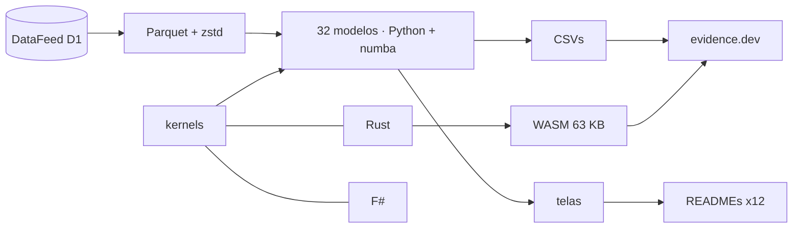

<!--
quant_models_2026
Autor: ProfBru - Bruno Penedo © 2026 - TODOS OS DIREITOS RESERVADOS
E-mail: profbruanbima@gmail.com

README GERADO — não editar à mão. Estrutura: montar_i18n.py · prosa: translation/blocos/<idioma>.json
Gerar: python3 public/foundations/pipeline/montar_i18n.py && python3 public/foundations/pipeline/gerar_readmes.py
-->

<div align="center">

# 📈 quant_models_2026 — 40 个用于不确定性决策的量化模型


**ProfBru © 2026**

### 别再用电子表格做选择。开始用模型做决策。

**32 个模型运行在 16 年真实数据之上，三个引擎（Python、Rust 和 F#）逐位一致，还有一个在浏览器中运行的实验室——每一个都用数据指出直觉在哪里出错。**

[](#modelos)
[](#arquitetura)
[](#desempenho)
[](#site)

[](https://www.python.org)
[](https://numba.pydata.org)
[](https://www.rust-lang.org)
[](https://fsharp.org)
[](https://evidence.dev)
[](#licenca)

[Português](README.md) · [English](README.en.md) · [Español](README.es.md) · [Français](README.fr.md) · [Deutsch](README.de.md) · **中文** · [한국어](README.ko.md) · [हिन्दी](README.hi.md) · [עברית](README.he.md) · [Русский](README.ru.md) · [Svenska](README.sv.md) · [Suomi](README.fi.md)

</div>

> [!WARNING]
> 请仅以本仓库为来源。结果依赖于经过验证的 DataFeed 数据；任何画面都不构成投资建议。

---

## 💀 痛点：用电子表格做决策

你一定这样做过。你把备选方案做成一张电子表格——供应商、团队用的手机、车队用的电动汽车、投资组合里的资产、一个中队的飞机——给每项标准打分、加权、从高到低排序，然后把第一名带进会议室。表格算得没错。决策却错了。

**电子表格不会算错账。它问错了问题。**

| 你做了什么 | 工具隐藏了什么 |
|---|---|
| 🔻 **按过去的平均值排序** | 2010–2019 年的平均值选出了最佳组合；到 2020–2026 年，它输给了等权重。过去的数据里有那一列看不出的噪声。 |
| 🏷️ **按标签筛选** | 你在同一类别、同涨同跌的选项之间“分散”——也在数据上其实属于同一组的不同类别之间“分散”。 |
| 🎯 **相信了命中率** | 一个“准确率 54%”的模型只是在重复上涨日的比例。没有区分能力的高准确率，是一次昂贵的抛硬币。 |

> [!IMPORTANT]
> **缺陷不在你，而在工具。**
> 电子表格、评分矩阵和排序筛选把每个数字都当作确定的。它们从不追问：你看到的有多少是噪声？过去是否仍能代表未来？你的“最佳选项”能否经受住一段它从未见过的时期？

还有一个你在不知不觉中犯下的错误：你测试的备选和组合越多，过去的结果就越好看——纯属偶然。本项目的遗传算法在一个股票指数上测试了 1,826 条规则；最好的那条在训练中闪闪发光，到下一个时期却输给了简单地持有不动。

### 决策在哪里崩塌

在会议上，推翻建议的问题从来不是“得分多少？”，而是另一个：

> *如果情况变了——这些还有多少站得住？*

电子表格无法回答，因为它从未把信号和噪声分开，从未做过样本外检验，也从未衡量过自己的不确定性。

---

## 💊 解决方案

32 个模型中的每一个都运行在 2010 至 2026 年的 27 种真实资产上，训练与测试按时间分开，并以一句根据数字写成的结论收尾——即使那个数字与直觉相悖。

> ### 三个独立引擎——Python/numba、Rust 和 F#——计算同一套数学，并且必须逐位一致。两个一致的引擎证明计算是对的，而不仅仅是代码。

<div align="center">

| ❌ 电子表格 | ✅ 模型 |
|---|---|
| 平均分最高的选项 | **在样本外依然成立、成本与风险都已标明的选项** |
| *因为类别不同而“分散”* | **因为数据显示选项之间相关性低而真正分散** |

</div>

**这些模型无法确定地预测未来——它们也会直说：这里的好几个结果表明某种流行方法根本没有信号。这正是价值所在：在花钱之前知道哪里不该相信。**

---

## 🎯 适用场景——不止于市场

示例使用市场序列，因为它们够长、公开且毫不留情。这些技术适用于任何不确定性下的决策——项目自己的知识库就展示了市场方向模型用于预测学生辍学、异常检测器用于发现欺诈。

| 决策 | 能回答的模型 | 电子表格回答不了的问题 |
|---|---|---|
| 📊 **投资组合** | 市场状态（HMM）、GARCH、Markowitz、滚动前推回测 | 过去的最优配置在下一个市场状态中还成立吗？ |
| 📱 **企业采购——设备与手机** | Benford、异常值、K-means、漂移 | 这家供应商的价格是异常、录入错误还是欺诈？昨天的供应商今天交付的还一样吗？ |
| 🔋 **电动汽车车队** | 贝叶斯、GARCH、O-U 蒙特卡洛、非线性系统 | 只有几个月的续航和能源价格数据时，预计节省的费用有多可信？ |
| 🛡️ **国防——坦克与飞机采购** | 马尔可夫链、厚尾、带约束的遗传算法、PCA | 在运行与维护之间，机队的预期可用率是多少？最坏情况而非平均情况下的成本是多少？ |
| 🚀 **初创企业与高管决策** | 贝叶斯、漂移、SHAP、滚动前推回测 | 试点中验证过的假设在市场上还成立吗？我能用数字向董事会解释这个决定吗？ |

> [!NOTE]
> 本仓库中的画面和数字来自市场数据。应用到其他领域需要该领域的数据；方法、验证测试和三个引擎都是一样的。

---

## 🖼️ 实际效果

<a id="site"></a>

### 🌐 网站与实验室

网站使用 evidence.dev 生成：对结果执行 SQL、每个模型一个交互页面，还有一个实验室，其中编译为 WebAssembly 的 Rust 引擎直接在你的浏览器中运行——无需服务器，也没有按用户计的成本。

| | |
|---|---|
| <br/>**展示页：每个模型一句话**<br/>每一行都是数据自己得出的结论——包括那些推翻流行技术的结论。 | <br/>**浏览器内实验室（WebAssembly）**<br/>在浏览器中约 3 秒完成 216,000 条蒙特卡洛路径，使用的正是通过一致性测试的同一个引擎。 |
| <br/>**模型页面：档案、结论与图表**<br/>最优离场规则来自 Brent − WTI 价差实测的动态，而不是固定百分比。 | <br/>**三个引擎，一个结果**<br/>同一内核在 numba、Rust 和 F# 中的实测时间，已扣除进程启动时间。 |

<a id="modelos"></a>

### 🧪 32 个模型，逐一呈现

下面每个画面都标明模型所回答的决策问题，以及数据得出的结论。目录中其余 8 个模型（文本、强化学习和多智能体仿真）在 modelos_quant.md 中说明。

### 统计——先看数据是什么，再看它预测什么

#### 01 · 稳健描述统计

<div align="center"></div>

**为何选择：** 当你需要知道平均值是否代表典型情况，还是被少数极端值扭曲时，选择它。

> **数据显示：** 白银的标准差是其稳健 σ 的 1.6 倍：少数极端交易日抬高了“平均”波动率——超额峰度为 26.9。

#### 02 · 基于众数与聚类的支撑与阻力

<div align="center"></div>

**为何选择：** 当价格或预算上限必须来自可复现的标准、而不是凭眼睛画的线时，选择它。

> **数据显示：** 黄金：取整后价格的众数为 3,330.00；访问最多的区间（2,350.00–2,730.00）集中了 24% 的交易日，目前起支撑作用。

#### 03 · 平稳性（Augmented Dickey-Fuller）

<div align="center"></div>

**为何选择：** 在任何预测之前选择它：它告诉你过去是否仍是未来的有效样本。

> **数据显示：** 8 个价格序列中只有 1 个在 5% 水平下平稳；对数收益率则是 8 个中有 8 个。用价格训练，就是用一个不会再回来的分布训练。

#### 04 · 资产间线性回归（OLS）

<div align="center"></div>

**为何选择：** 用它衡量一个变量究竟能解释另一个变量多少——并发现“显而易见”的关系有时几乎什么也解释不了。

> **数据显示：** 道琼斯 ~ 标普 500：β = 0.91，R² = 0.91。而美国国债 ~ 标普 500 的 R² 只有 0.04：“显而易见”的关系几乎解释不了日常波动。

#### 13 · 多方法异常值（IQR、稳健 z、LOF）

<div align="center"></div>

**为何选择：** 当一个奇怪的数据点可能是采集错误、也可能是序列中最重要的事件时选择它：由共识来决定。

> **数据显示：** 在标普 500 上，箱线图把 264 天标为异常值（样本的 6.7%）；三种方法的共识保留 101 天。仅一个离群点就能让回归线的斜率从 0.76 变为 0.53。

#### 31 · Newcomb-Benford 定律——数据完整性

<div align="center"></div>

**为何选择：** 用它在信任一个数据集之前先审计它，并清楚何时该检验适用、何时会是误报。

> **数据显示：** 29 个成交量序列中只有 21 个覆盖了足以检验的范围；对其余序列应用 Benford 会造成误报。汇总后，成交量覆盖 6.4 个数量级，MAD 为 0.0099（符合度可接受）。

#### 25 · 条件波动率（EWMA 与 GARCH(1,1)）

<div align="center"></div>

**为何选择：** 用它根据明天的风险而不是全年的平均值来确定风险、安全库存或敞口上限。

> **数据显示：** 标普 500：持续性 α+β = 0.963——一次波动冲击需要 18 个交易日才会衰减一半。1 日 99% VaR：1.75%。

#### 24 · 非线性动力学与厚尾

<div align="center"></div>

**为何选择：** 当最坏情况比平均情况更重要时选择它：它衡量真实尾部超出正态曲线多少。

> **数据显示：** 4 个标准差的波动，其中位数发生频率是正态曲线预测的 64 倍；收益几乎没有记忆（自相关 -0.02），但波动的幅度有（0.15）。

#### 27 · Granger 因果与传染

<div align="center"></div>

**为何选择：** 在把某个指标当作触发器之前，用它区分“一起变动”和“一个领先另一个”。

> **数据显示：** 在测试的 72 对中，有 7 对通过了 Bonferroni 校正。最强的一对“欧元/美元 → 美元指数”是不同数据源收盘时间差异造成的伪迹：统计上的先行不等于原因——检验恰恰指出了直觉会在哪里上当。

### 机器学习——以基准率为尺

#### 05 · 方向逻辑回归

<div align="center"></div>

**为何选择：** 把它作为所有是/否分类的诚实基准：如果复杂模型赢不了它，就付不起自身的成本。

> **数据显示：** 样本外（2016–2026），逻辑回归预测对了标普 500 方向的 54.2%——几乎就是上涨日的比例（54.2%）：它在 98% 的交易日预测上涨，AUC 为 0.492。没有区分能力的高准确率正是这个基准要拆穿的陷阱。

#### 06 · SVM 与核方法

<div align="center"></div>

**为何选择：** 当“好”与“坏”之间的边界是弯曲的时选择它——并在为更大的模型买单之前证明信号是否存在。

> **数据显示：** 仅以 RSI 和波动率为输入，四种核函数在样本外的平衡准确率都没有超过 50.7%。RBF 在训练中“学到”最多（53.2%），在测试中损失也最多（48.4%）：核函数无法在没有信号的地方创造信号。

#### 07 · 决策树与随机森林

<div align="center"></div>

**为何选择：** 当决策必须能用规则解释、并在表格数据上保持稳健时，选择它。

> **数据显示：** 深度为 20 的树在训练中准确率 83.7%，测试中 49.8%：它背下了过去。浅层森林停在 53.5%——不高，但诚实；最常用的特征是“ret_1”。

#### 08 · MLP 神经网络——反转指标

<div align="center"></div>

**为何选择：** 用于罕见的转折事件，以事件的自然频率而非总体准确率衡量命中率。

> **数据显示：** 在白银上，2023–2026 年（训练中从未见过），MLP 发出了 607 个向上反转信号，精确率 17.3%，而基准率为 13.6%（自然频率的 1.27 倍）：判断指标是否带来信息的是这个比率，而不是总体准确率。

#### 09 · PCA——风险因子与指数

<div align="center"></div>

**为何选择：** 用它找出一长串选项中究竟有多少个真正独立的押注。

> **数据显示：** 仅第 1 个因子就解释了 27 种资产日波动的 24.5%；要达到 80% 需要 12 个因子。27 种资产并不是 27 个独立的押注。

#### 10 · 资产聚类（K-means）

<div align="center"></div>

**为何选择：** 用它按实测行为而不是目录标签对备选进行分组。

> **数据显示：** 轮廓系数在无人干预下选出 K = 4 组；其中一组混合了 3 种不同的资产类别——“大宗商品”或“外汇”的标签并不能说明资产如何表现。

#### 11 · 收益嵌入（FastICA）+ 余弦

<div align="center"></div>

**为何选择：** 用一张地图看清此刻谁在一起波动——每个窗口都会更新。

> **数据显示：** 最近 60 个交易日中，最相似的一对是布伦特原油 × WTI 原油（余弦 0.96），最相反的是美元指数 × 欧元/美元（-0.89）：一张随每个窗口更新的接近度地图。

#### 12 · 孤立森林——异常收益与成交量

<div align="center"></div>

**为何选择：** 用它在没有标注样本的情况下找出异常：动态已经改变的第一声警报。

> **数据显示：** 不用任何标签，孤立森林把标普 500 的 77 个交易日标为异常——仅 2020 年就有 21 个——其中 57% 是下跌：异常是动态变化的信号，而不是该丢弃的噪声。

#### 32 · 基于 Shapley 值的可解释性（SHAP）

<div align="center"></div>

**为何选择：** 当有人问“模型为什么这样决定？”而回答需要数字而非信念时，选择它。

> **数据显示：** 在最新一次预测中，上涨概率从 54.0%（模型平均）升至 55.4%；影响最大的特征是“ret_1”（+1.0 个百分点）。黑箱开始回答“为什么”。

### 概率与信号——市场状态、不确定性与周期

#### 14 · 市场状态马尔可夫链（上涨、下跌、横盘）

<div align="center"></div>

**为何选择：** 用一个可审计的矩阵回答“处在这个阶段时，转入那个阶段的概率是多少？”

> **数据显示：** 在标普 500 上，处于下跌的 20 日区块之后，下一个区块上涨的概率为 59.0%——高于继续下跌的概率（30.8%）。在均衡状态下，市场有 41.3% 的时间处于上涨状态。

#### 15 · 隐马尔可夫模型（高斯 HMM）

<div align="center"></div>

**为何选择：** 当市场状态无法直接观测、必须从数据中学习并给出每日概率时，选择它。

> **数据显示：** 无需任意的分界规则，HMM 在标普 500 中找到三种状态：动荡状态的年化波动率为 43%，平静状态为 7%，动荡状态平均持续 18 个交易日。当前最可能的状态是“平静”。

#### 16 · 收益与波动率的贝叶斯更新

<div align="center"></div>

**为何选择：** 当数据很少而决策压力很大时选择它：它告诉你该多相信平均值，而不只是平均值是多少。

> **数据显示：** 2019 年以来的黄金：后验年化平均收益为 15.3%，但 95% 可信区间从 2.3% 到 28.4%。均值为正的概率为 98.9%——单看样本均值（15.7%）说明不了这一点。

#### 30 · 最优交易规则（Ornstein-Uhlenbeck）

<div align="center"></div>

**为何选择：** 用它根据实测的动态来设定目标和止损，而不是沿用固定百分比。

> **数据显示：** Brent − WTI 价差以 22 个交易日的半衰期均值回归。每个格子模拟 4,000 条路径，最佳规则是 1.5σ 目标配 10.0σ 止损（每笔交易夏普 0.63）——固定百分比止损忽略了资产的动态。

#### 17 · 傅里叶变换——主导周期

<div align="center"></div>

**为何选择：** 用它证明季节性周期是真实存在还是偶然——每个频谱都有峰值。

> **数据显示：** 四种资产的 12 个最大周期峰值中，只有 2 个超过了通过打乱收益本身得到的 95% 噪声阈值。每个周期图都有峰值；检验告诉你哪些是周期、哪些是偶然。

#### 18 · 小波——时频分解

<div align="center"></div>

**为何选择：** 用它在时间上定位动荡何时开始，这是年平均值所掩盖的。

> **数据显示：** 第 1 层（2 个交易日的振荡）集中了标普 500 55.0% 的能量。当高频能量爆发（z > 2）时，随后 20 个交易日收益的离散度是正常水平的 1.3 倍：小波在时间上定位了傅里叶只能在平均意义上看到的东西。

#### 23 · Hurst 指数与滚动 Hurst 指标

<div align="center"></div>

**为何选择：** 用它在趋势策略和均值回归策略之间做选择——与无记忆的参照进行比较。

> **数据显示：** 原始 R/S 的 H 值在 0.54 到 0.59 之间，看起来“持续”；但与打乱的序列相比，6 种资产中没有一种显示出真正的记忆。按夏普比率，MH100 − MH150 交叉在 6 种资产中的 3 种上优于均线交叉。

### 优化与治理——最优解、偶然与时间

#### 19 · Markowitz 有效前沿

<div align="center"></div>

**为何选择：** 用它查看每个风险水平下可能的最佳收益——以及这个最优解在多大程度上依赖脆弱的估计。

> **数据显示：** 最大夏普组合在 2010–2019 年的夏普比率为 1.19，在 2020–2026 年只交出 0.76；等权重则从 0.35 升到 0.94。前沿对过去是精确的——错误在于估计了未来不会重复的均值。

#### 20 · 遗传算法——投资组合优化

<div align="center"></div>

**为何选择：** 当目标带有任何封闭公式都无法容纳的现实约束（成本、上限、最大损失）时选择它。

> **数据显示：** 使用不同随机种子的四次并行遗传算法运行收敛到同一个组合（平均权重偏差 0.1 个百分点），2010–2019 年夏普比率为 1.19。在 2020–2026 年它交出 0.86，低于等权重（0.94）：收敛证明最优解是稳定的，而不是证明未来会重复它。

#### 21 · 遗传算法——指标与参数选择

<div align="center"></div>

**为何选择：** 用它搜索最佳规则组合——并记录测试了多少条，以免被偶然所骗。

> **数据显示：** 遗传算法在标普 500 上测试了 1826 条不同的规则，每次运行中最好的规则训练期夏普比率最高达 0.78；在 2019–2026 年它们落在 0.41 到 0.54 之间，而简单持有为 0.77。测试的规则越多，训练期夏普比率就越会纯粹因偶然而升高。

#### 22 · 遗传编程——符号回归

<div align="center"></div>

**为何选择：** 用它发明可读、可审计的公式，并让它们接受一个从未见过的时期的检验。

> **数据显示：** 遗传编程发现了可读的公式，例如 ((sen(cos(r3)) + r1) + sen(sen(cos(r2))))（10 个节点），它与下一期收益的秩相关在训练中为 -0.080，在测试中为 -0.028。进化总能在过去找到“某些东西”；只有从未见过的时期才能把指标与巧合分开。

#### 26 · 相关网络与中心性

<div align="center"></div>

**为何选择：** 用它看清在一个依赖系统中，谁处于中心、谁处于边缘。

> **数据显示：** 由 2010–2019 年网络选出的 8 种边缘资产在 2020–2026 年几乎保持独立（平均相关 0.00，中心资产为 0.15），收益更高（年化 11.0% 对 7.4%），但波动更大。击败这两个篮子的是包含全部 27 种资产的组合（夏普 0.95）：独立押注的数量比在网络中的位置更重要。

#### 28 · 模型漂移与概念漂移检测

<div align="center"></div>

**为何选择：** 用它在损失出现之前就知道模型已经老化。

> **数据显示：** 用 2010–2016 年训练的模型在之后 10 年中有 8 年需要重新训练：那段时期的输入状态再也没有回来。2022 年准确率最差（43.8%），2017 年偏移最大（KS 0.77）——监控输入能在不等损失出现的情况下暴露问题。

#### 29 · 含成本的滚动前推回测

<div align="center"></div>

**为何选择：** 用它让任何决策规则接受时间的检验，成本与否决门槛都事先声明。

> **数据显示：** 在每次换手 5 个基点的成本下，4 种策略中有 2 种通过了三道 STOP 门槛（等权重、风险平价）。每月仅凭过去数据选择的动量窗口变化了 45 次——“最优参数”并不恒定。


---

## ⚡ 安装

前置条件：Python 3.13、Rust 1.96（含 wasm32-unknown-unknown 目标）、用于 F# 引擎的 .NET 9，以及用于网站的 Node 20+。数据来自 DataFeed Service Provider（变量 QUANT_MODELS_DATAFEED）。

**1 · 数据与模型**

```bash
git clone <url-do-repositorio-privado> quant_models_2026
cd quant_models_2026/public/foundations/pipeline
pip install -r requisitos.txt
export QUANT_MODELS_DATAFEED=/mnt/d/DataFeedServiceProvider
python3 dados_feed.py consolidar --tf D1
python3 executar_modelos.py
```

**2 · 三个引擎与一致性检验**

```bash
(cd ../rust/quant_models_2026_core && cargo build --release && cargo build --release --lib --target wasm32-unknown-unknown)
(cd ../fsharp/QuantModels2026.Core && dotnet build -c Release)
python3 testes_nucleo.py        # 38 verificações: numba × Rust × F#
```

**3 · 画面与网站**

```bash
python3 gerar_telas.py && python3 gerar_site.py
cd ../evidence && npm ci && bash subir_servidor.sh     # http://localhost:3020
```

**4 · 后台长时间运行（screen + 每 20 分钟一次的看门狗）**

```bash
./run_all.sh --background
screen -r quant_models_2026
```

---

<a id="arquitetura"></a>

## 🧠 架构与决策



架构决策，各附其依据：

| | |
|---|---|
| **三个引擎使用同一个伪随机数生成器（xorshift64*）** | 连蒙特卡洛也逐位一致；数学错误不可能同时在三种语言中蒙混过关。 |
| **无依赖的 WebAssembly（63 KB）** | 繁重计算在用户浏览器中运行：服务器成本为零，数据不离开本机。 |
| **训练与测试始终按时间分开** | 打乱时间序列会把未来泄漏进训练，制造虚假的准确率。 |
| **估计量与其自身的零假设比较** | Hurst 和 Fourier 有已知偏差；只有与打乱数据对比，才能把信号和伪迹区分开。 |
| **结论由数字生成** | 每个画面的句子都由结果生成；结果变了，句子也随之改变。 |
| **用 ProcessPoolExecutor 并行，分区固定** | 结果不取决于机器有多少个核心。 |

---

<a id="desempenho"></a>

## 🚀 实测性能

数据由 bench_motores.py 实测并记录在项目历史中。Rust 和 F# 已扣除进程启动时间。

| 负载 | numba | Rust | F# | 纯 Python |
|---|---:|---:|---:|---:|
| O-U 蒙特卡洛（20×20 网格，2,000 条路径） | 2.859 s | 2.840 s | 3.490 s | — |
| 滚动 R/S Hurst（窗口 250，3,917 个交易日） | 0.027 s | 0.016 s | 0.108 s | 7.86 s |
| 高斯 HMM EM（3 个状态，200 次迭代） | 0.235 s | 0.308 s | 1.213 s | 64.19 s |
| 2,000 个组合 × 10 种资产的指标 | 1.366 s | 1.297 s | 1.908 s | — |

关键路径（numba 中的 20×20 蒙特卡洛网格）运行 3.4 s，预算 10 s，并证明结果与 Rust 引擎完全相同。

---

## 📚 完整目录

全部 40 个模型——编号、类型、类别和描述——见 modelos_quant.md，它与网站来自同一数据源。 → [modelos_quant.md](modelos_quant.md)

---

## ❓ 尖锐问题

<details><summary><b>我已经在用带权重和筛选的电子表格了。这不是一回事吗？</b></summary>

不是。电子表格把它视为确定的分数加总起来。模型则衡量分数中有多少是噪声，在选项从未见过的时期检验它，并指出过去的最佳选项何时不再是最佳。
</details>

<details><summary><b>这些模型中有哪个能“跑赢市场”？</b></summary>

本仓库的多个结果恰恰对流行技术给出了相反的结论：没有每日方向信号的指标和核函数、其实只是估计偏差的长记忆。在投入时间和金钱之前知道这些，正是目的所在。
</details>

<details><summary><b>为什么同一个计算要用三种语言？</b></summary>

因为一个与第一个一致的独立引擎能证明数学，第三个用来裁决。在 38 项检查中，三者逐位一致。
</details>

<details><summary><b>我需要服务器或云吗？</b></summary>

不需要。模型在你的机器上运行，网站是静态的：实验室在浏览器中以 WebAssembly 执行 Rust 引擎。
</details>

<details><summary><b>它适用于金融市场以外的决策吗？</b></summary>

方法适用；数据必须来自你的领域。“适用场景”表格展示了哪些模型能回答哪类决策。
</details>

---

<a id="licenca"></a>

## 📜 许可与作者

代码、模型、文本和画面：仅限作者使用。第三方库保留各自的许可（NumPy、numba、scikit-learn、SciPy、pandas、networkx、matplotlib、evidence.dev）。

**作者:** ProfBru - Bruno Penedo © 2026 — TODOS OS DIREITOS RESERVADOS · profbruanbima@gmail.com

<div align="center">


**ProfBru © 2026**

</div>
